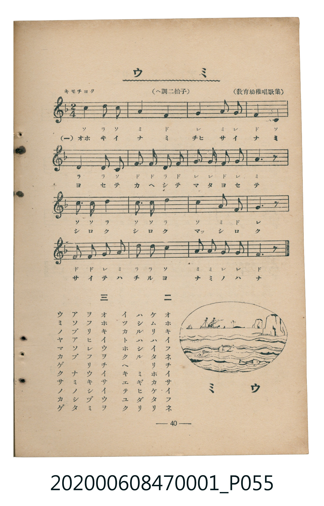

# ウミ（海）

> Re:Shōka 使用 AI 協助辨識與重建樂譜，可能會有錯誤。歡迎回報。

- **鋼琴伴奏版**：<br><audio controls src="umi.mp3"></audio>
- **NEUTRINO 歌聲合成版**：<br><audio controls src="umi_neutrino.mp3"></audio>

- 教育幼稚唱歌集
- 臺灣教育會公認《新定兒童唱歌》尋常科第一學年用（2020.006.0847.0001）

## 說明

曲目說明
中文解釋：描寫大海的遼闊、波浪與海上景色。


## 歌詞

```text
一
オホキイ　ナミ　チヒサイ　ナミ
ヨセテ　カヘシテ　マタヨセテ
シロク　シロク　マツシロク
サイテハ　チルヨ　ナミノハナ

二
オホキイフネ　チイサイフネ
ケムリハイタリ　ホカケタリ
ハシルハシル　ミギヒダリ
イツカトホクヘ　キエテユク

三
オホキイウヲ　チイサイウヲ
ヲフリヒレフリ　ウキシヅミ
アソブアソブ　ナミノシタ
ウミノヤマカゲ　クサノカゲ
```

## ABC

<div class="abc-score" data-abc-src="umi.abc" aria-label="五線譜載入中"></div>

[下載 ABC 原始檔](umi.abc)

## TMD 檔案連結

- [主旋律 TMD 檔案](umi.tmd) [[在 TMD Studio 編輯](https://tmdlang.github.io/Tmd-TS/#tmd=s7IKdvYPcrWy4qpTUCpJTLdSSM7PyUlNLsnMz7MqzsjMK0nNjM_KTMmPL87Iz05Ugisry88pzU21Si9KTEmNN4w3MjAyiDcwMIs3sDAxBzIMDBFKi_NLi5JTrYqTM_Lzc-JLUitKkvLzsxHyBUX5Zal5iXlANQVFIBtTwIoQClLLMlNSQdKpKZkl-UWZiTlI7kgtKga7FWxJfElRYl5xclFmAcgDCFUlGalAx-YllpQWpaKLlieWpBYhBIHmp2fmWeWmZmZlYnFsflFJRj7Q1wUZlVYZmcUg5yQn5sRnJ-YhBQ7UMQWJ6alWAQampkpcWloKj5uWPW6e_35Px7Ot29_v6VTQ0uJStFWwNOOyt1Vw47Ix0jexAxnwbOrMF02bnu7c83zFrKdTNj5b2_NydhvY6Bftu543LobIP5vT_LR1zYtVvY8bup5N2_B03aynrZOer14K0fG4ofvphu6nO3Y8Xz7x-Zo1T3Y0PF274-nOLc-nrADaD4orPWBc6YHiCsgwMAQ6R4lLX0vh2exNz2eve7Fq1bMZfVwKCgpPdqx9Nq39xfLFL9u73--Z9ay__-n61U-XLAf64PmslpeNe15O73rc0Phs86JnW1e96GgHij_Z0fVs5voXnZseNzRxaelzAY3lAtrP9bhp1ePm2Y-b1j5uWvK4oeFxcxcwMMCMxsfNkx43bUUW53rcvOJx0-7HzW0goabVj5tnPG7aDuU2z3vctB-uAGgwUAJo6nqwUiQ2UF1zC1wEqA5sBdCM5n6YvUCDVyAc09wHkmru4uJ6sqsH1cHNUx83A4MarAvIhRoFEgSq2_i4ecHjZqDqfrAc0G2rwEqBmleDZMEiQC8BpYGOAdoJY4AUzX_ctA4UAM1ANlARyFigo4GKOsAGrAd5HeQxoDNWgB2_DOQZYJB2oroQlLiAYY7qQrAg0OZNYLcCVQPtWQNlgwwFmgXUDHRLKzjQmxY9btr7uHkagoEcNkB1TfuBikCpGBxWQKcCowLoRbC9QKcCLQWpA4mAo943EZiRAjIT8_IdagxqqkEpSsHGQssOzKhRMFXQVTADkjUKxkCWIRDXKBgBSWMgWQPmm8aDBMHKfQxrgDkI5GGgENDZQLwEqAroPBC_eT5YNyQxgRVsxaYAYpIRDpOmghX2wk0CCqOahKQAYpIxdpOaloEVbsJpErICLmhomIH8CiSAfgZ53hDENgSHiBGQBoUIKJR0FQyQA6R5Bdjg3UBWG9jg1UDWDCC9HSbSPA_I2w9WCVIHEmlDNQccHBvBDloAxKvAavrBToXohIjMhpgOVAkSBYmsQjUHFBhgL4ECCqZrEhCvQRYBeh0SUiAXtoLVgKIGYg48YZgCEwYo8JBZoIQBCRCMYAAbBjJ0PSTI0fmgoqAZHFIQCZASkBRaKIB9DVKxGqoNnQ9yKTC_gv0F4oPyLGYgNC0C4r1A6WlQ16Dx4SkSmFsgrgWFKFoYgFKAEdDHwIQBziQgncbgrAHLHOhhAEldoOgFORyc8MBOhyQSiL0wW2EqQC5BTwogM1qgSakDHvXrwQkL4h9QyAKTE9imZdgCExwKwIiG2wbJP6CkCEpC0IwBMhPkapAKoDhIBCQDMaeWi0vXTgFUgigAaWUuAA)]
- [鋼琴伴奏 TMD 檔案](umi_piano.tmd) [[在 TMD Studio 編輯](https://tmdlang.github.io/Tmd-TS/#tmd=s7IKdvYPcrWy4qpTUCpJTLdSyC8qychPL0osyKi0ysgsLskvykxOzInPTsxLVIIrKs4vLUpOjS9ITE-1CjAwNVXi0tJSeNy07HHz_Pd7Oh43T3nctOhxc9-TPVueLu1_snvG-z2dClpaXIq2CpZmXPa2Cm5cNkb6JnYg855NnfmiadPTnXuer5j1dMrGZ2t7Xs5uA9v0on3X88bFEPlnc5qftq55sar3cUPXs2kbnq6b9bR10vPVSyE6Hjd0P93Q_XTHjufLJz5fs-bJjoana3c83bnl-ZQVQOcYGRgZ6BkYmOkZWJiYAxkGhkDnKHFx-SZm5lkFZCbm5Qd5ONQY1FRzKQCBjYWWHZhRo2CqoKtgBiRrFIyBLEMgrlEwApLGQLIGzDeNBwmClfsY1gBDYNXj5tlAocdNa4F4CVDV4-YuEL95Plj34-bGx82TwAq2YlMAMckIh0lTwQp74SYBhVFNQlIAMckYu0lNy8AKN-E0CVkBFzQ0zEB-BRJAP4M8bwhiG4JDxAhIg0IEFEq6CgbIAdK8AmzwbiCrDWzwaiBrBpDeDhNpngfk7QerBKkDibShmgMOjo1gBy0A4lVgNf1gp0J0QkRmQ0wHqgSJgkRWoZoDCgywl0ABBdM1CYjXIIsAvQ4JKZALW8FqQFEDMQeeMEyBCQMUeMgsUMKABAhGMIANAxm6HhLk6PzmeY-bm8EhBZEAKQFJoYUC2NcgFauh2tD5IJc-bloH9heI34A1EJoWAfFeoPQ0qGvQ-PAUCczCENeCQhQtDEApwAjoY2DCAGcSkE5jcNaAZQ70MICkLlD0ghwOTnhgp0MSCcRemK0wFSCXoCcFkBkt0KTUAY_69eCEBfEPKGSByQls0zJsgQkOBWBEw22D5B9QUgQlIWjGAJkJcjVIBVAcJAKSgZhTi1yA-GAvQKINY4Gqo01AJJwHJoE803gwF0KhycL0m0DUQCiEeTAuViMQ3sThAHzOwaIZbjpYH1w9miSS1cCQ0bVTAAVOtA9IGMY2QmIbg9nKXAA)]

## 分析

```text
================================================================================
📊 TMD Song Profile: [ ウミ（海） ]
================================================================================
⏱  Duration:       0:20 (20.0s), 16 measures total
🎼 Key & Tempo:    首調基準 F, != 96.0 BPM, <2/4>
   - 分析範圍：      由實際發聲的音符與和弦推測調性；播放脈絡另行呈現
🎤 人聲音域:    C4 (MIDI 60) – D5 (MIDI 74) [跨度: 14 個半音 / 1.2 個八度, 難度: moderate]
   - 最低音:  C4 in [Main #1 @ m.4, 0:04]
   - 最高音: D5 in [Main #1 @ m.1, 0:00]
   - 適合: soprano, mezzo-soprano, contralto, tenor, baritone, bass
🏛  結構:      Main (20.0s)
⚡ 編曲密度:        Peak 1 軌道同時演奏
🗝  調性診斷：       F 大調（純淨自然大調，未偵測到可信轉調）
   - 風格氣質:    純淨自然大調（陽光明朗、易唱易記，無明顯調外色彩）
   - 轉調歷程:    全曲維持單一推測調性（未偵測到可信轉調）
   - 核心骨幹音:  C, F, G, D, A
   - 調性數值:    F 大調 [相關度: 0.81, 穩定度: Moderate, 自然音純度: 100.0%]
   - 候選調性 (K-S): F 大調 (0.81), C 大調 (0.77), D 小調 (0.65)
   - 五度圈歷程:   -1
   - 各段落調性細節:
     • [Main #1]: F 大調 (r: 0.81, 自然音純度: 100.0%)

  [ 五度圈游移軌跡 ]
               C  
        [F ]*          G  
      Bb               D  
      Eb               A  
         Ab           E  
            Db       B  
               F# 
     (* = active key center)

  [ 十二半音累積音高分佈 ]
     C  : ████████████████████████  23.0%
     C# :                            0.0%
     D  : ███████████████████       18.0%
     D# :                            0.0%
     E  :                            0.0%
     F  : ████████████████████████  23.0%
     F# :                            0.0%
     G  : █████████████████████     19.7%
     G# :                            0.0%
     A  : █████████████████         16.4%
     A# :                            0.0%
     B  :                            0.0%
--------------------------------------------------------------------------------
Assignment 軌道音域：
  - Piano         : C4 – D5 (14 個半音 / 1.2 個八度, 44 個音符)
================================================================================
```


## 原書掃描頁




