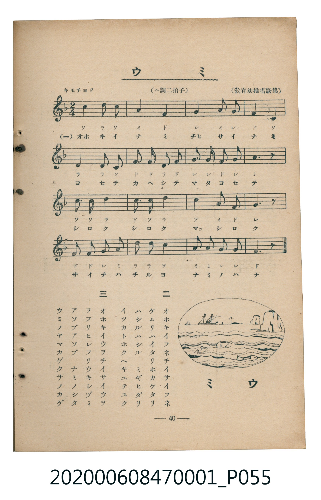

# ウミ（海）

> Re:Shōka 使用 AI 協助辨識與重建樂譜，可能會有錯誤。歡迎回報。

- **鋼琴伴奏版**：<br><audio controls src="umi.mp3"></audio>
- **NEUTRINO 歌聲合成版**：<br><audio controls src="umi_neutrino.mp3"></audio>

- 教育幼稚唱歌集
- 臺灣教育會公認《新定兒童唱歌》尋常科第一學年用（2020.006.0847.0001）

## 說明

曲目說明
中文解釋：描寫大海的遼闊、波浪與海上景色。


## 歌詞

```text
一
オホキイ　ナミ　チヒサイ　ナミ
ヨセテ　カヘシテ　マタヨセテ
シロク　シロク　マツシロク
サイテハ　チルヨ　ナミノハナ

二
オホキイフネ　チイサイフネ
ケムリハイタリ　ホカケタリ
ハシルハシル　ミギヒダリ
イツカトホクヘ　キエテユク

三
オホキイウヲ　チイサイウヲ
ヲフリヒレフリ　ウキシヅミ
アソブアソブ　ナミノシタ
ウミノヤマカゲ　クサノカゲ
```

## ABC

```abc
X:1
T:ウミ（海）
M:2/4
L:1/16
Q:1/4=96
K:F
V:V1 name="Piano" snm="Pia"
[V:V1]
c4 d2 c2 | A4 F4 | G4 A2 G2 | F4 C4 |
w: 1.~オホ キ イ | ナ ミ | チヒ サ イ | ナ ミ
w: 2.~オホ キ イ | フ ネ | チイ サ イ | フ ネ
w: 3.~オホ キ イ | ウ ヲ | チイ サ イ | ウ ヲ
D4 D2 C2 | F2 F2 D2 F2 | G2 G2 F2 G2 | A6 z2 |
w: 1.~ヨ セ テ | カ ヘ シ テ | マ タ ヨ セ | テ
w: 2.~ケ ム リ | ハ イ タ リ | ホ カ ケ タ | リ
w: 3.~ヲ フ リ | ヒ レ フ リ | ウ キ シ ヅ | ミ
c2 c2 d4 | c2 c2 d4 | c4 A2 F2 | G6 z2 |
w: 1.~シ ロ ク | シ ロ ク | マッ シ ロ | ク
w: 2.~ハ シ ル | ハ シ ル | ミ ギ ヒ | ダリ
w: 3.~ア ソ ブ | ア ソ ブ | ナ ミ ノ | シタ
F2 F2 G2 A2 | d2 d2 c4 | A2 A2 G2 G2 | F6 z2 |
w: 1.~サ イ テ ハ | チ ル ヨ | ナ ミ ノ ハ | ナ
w: 2.~イ ツ カ ト | ホ ク ヘ | キ エ テ ユ | ク
w: 3.~ウ ミ ノ ヤ | マ カ ゲ | ク サ ノ カ | ゲ
```

## TMD 檔案連結

- [主旋律 TMD 檔案](umi.tmd) [[在 TMD Studio 編輯](https://tmdlang.github.io/Tmd-TS/#tmd=s7IKdvYPcrWy4qpTUCpJTLdSSM7PyUlNLsnMz7MqzsjMK0nNjM_KTMmPL87Iz05Ugisry88pzU21Si9KTEmNN4w3MjAyiDcwMIs3sDAxBzIMDBFKi_NLi5JTrYqTM_Lzc-JLUitKkvLzsxHyBUX5Zal5iXlANQVFIBtTwIoQClLLMlNSQdKpKZkl-UWZiTlI7kgtKga7FWxJfElRYl5xclFmAcgDCFUlGalAx-YllpQWpaKLlieWpBYhBIHmp2fmWeWmZmZlIjlWS0vhcdOyx83z3-_peLZ1-_s9nQpaWlyKtgqWZlz2tgpuXDZG-iZ2IFOeTZ35omnT0517nq-Y9XTKxmdre17ObgOb_6J91_PGxRD5Z3Oan7auebGq93FD17NpG56um_W0ddLz1UshOh43dD_d0P10x47nyyc-X7PmyY6Gp2t3PN255fmUFUD7QYGtBwxsPVBgAxkGhkDnKHHpayk8m73p-ex1L1atejajj0tBQeHJjrXPprW_WL74ZXv3-z2znvX3P12_-umS5UAfPJ_V8rJxz8vpXY8bGp9tXvRs66oXHe1A8Sc7up7NXP-ic9PjhiYuLX0uoLFcQPu5Hjetetw8-3HT2sdNSx43NDxu7gIGBpjR-Lh50uOmrcjiXI-bVzxu2v24uQ0k1LT6cfOMx03bodzmeY-b9sMVAA0GSgBNXQ9WisQGqmtugYsA1YGtAJrR3A-zF2jwCoRjmvtAUs1dXFxPdvWgOrh56uNmYFCDdQG5UKNAgkB1Gx83L3jcDFTdD5YDum0VWClQ82qQLFgE6CWgNNAxQDthDJCi-Y-b1oECoBnIBioCGQt0NFBRB9iA9SCvgzwGdMYKsOOXgTwDDNJOVBeCEhcwzFFdCBYE2rwJ7FagaqA9a6BskKFAs4CagW5pBQd606LHTXsfN09DMJDDBqiuaT9QESgVg8MK6FRgVAC9CLYX6FSgpSB1IBFw1PsmAnNCQGZiXr5DjUFNNShFKdgYmmnZgVk1CqYKumBoBsQgdo2CMVTEEErXKBhBWSAZELsGLmcaD1MENs7HsAaYxUAhAhUG-g1MLgHrAvoDJt48H246JPXBNWwlpAFikxEBm6bCNfai2ARWgM0mLBogNhnjt6lpGVzjJqJswqaBCxobZrDwBDPAoQsJbBAGi4EYkBgBYRAPEiOwWANBA4TjQRHSvALukN1ga9ugDlkN5s0Ay2xHlmmeBxbbDxYD6YboBMmAVGCxBxwdG-EeWwAmV0H19MO9DzMTJgMKU6g7wLoh8iAZkAos9oAiAx5skEhDmAZKRMDMhSkDDnJYvEF82grVA0tWCHuQMgYIgzIGJFKxi4AgKPAREYMjGqAWQxyxHm4GTnFQ2dkM8ymSIpAWmDIssQANbYh6UMjCjMMlDgsBYCEIlgOFIkgcVBhitwacIxaBtewFa5mG5Bsc4mg5GVhIwXwPiXOscQBL-aBQBYUxMIMASVhRBTEZJA4rmFALJ2xxgMiJkKQMCRZwhoUHDCLDwNyN7GaEDpiPsEQC1IYWsG0QMzuguiBJHhSBkKwHCzdI_IMzG9RloESLJ7LBsQBO2Ciug5VnkCwMyVpIBRPEZkg4QHSA1YBkYKoQ9tRycenaKYCqEAUgrcwFAA)]
- [鋼琴伴奏 TMD 檔案](umi_piano.tmd) [[在 TMD Studio 編輯](https://tmdlang.github.io/Tmd-TS/#tmd=s7IKdvYPcrWy4tLSUnjctOxx8_z3ezoeN0953LTocXPfkz1bni7tf7J7xvs9nQpaWlyKtgqWZlz2tgpuXDZG-iZ2XHUKSs-mznzRtOnpzj3PV8x6OmXjs7U9L2e3KYFkXrTvet64GCL_bE7z09Y1L1b1Pm7oejZtw9N1s562Tnq-eilEx-OG7qcbup_u2PF8-cTna9Y82dHwdO2Opzu3PJ-yAugcIwMjAz0DAzM9AwsTcyDDwBDoHCUuLt_EzDyrgMzEvPwgD4cag5pqLgUgsDE007IDs2oUTBV0wdAMiEHsGgVjqIghlK5RMIKyQDIgdg1czjQepghsnI9hDTCIVj1ung0Vfty0FkwuAet63NwFE2-eDzf9cXPj4-ZJcA1bCWmA2GREwKapcI29KDaBFWCzCYsGiE3G-G1qWgbXuIkom7Bp4ILGhhksPMEMcOhCAhuEwWIgBiRGQBjEg8QILNZA0ADheFCENK-AO2Q32No2qENWg3kzwDLbkWWa54HF9oPFQLohOkEyIBVY7AFHx0a4xxaAyVVQPf1w78PMhMmAwhTqDrBuiDxIBqQCiz2gyIAHGyTSEKaBEtHj5jWYMuAgh8UbxKetUD2wZIWwByljgDAoY0AiFbsICIICHxExOKIBajHEEevhZuAUb573uLkZ5lMkRSAtMGVYYgEa2hD1oJCFGYdLHBYCj5vWgeVAoQgSb8AbCU2LwFr2grVMQ_INDnG0nAwsOWG-h8Q51jiApXxQqILCGJhBgCSsqIKYDBKHFUyohRO2OEDkREhShgQLOMPCAwaRYWDuRnYzQgfMR1giAWpDC9g2iJkdUF2QJA-KQEjWg4UbJP7BmQ3qMlCixRPZ4FgAJ2wU18HKM0gWhmQtpIIJYjMkHCA6wGpAMjBVCHtqkWsQH-QaxAJegUQbxgLVRpuASDgPTAJ5pvFgLoRCk4XpN4GogVAI82BcrEaAHAg3AJsD8DkHi2a46WB9cPVokkhWA0NG104BFDjRPiBhGNsIiW0MZitzAQA)]

## 分析

```text
================================================================================
📊 TMD Song Profile: [ ウミ（海） ]
================================================================================
⏱  Duration:       0:20 (20.0s), 16 measures total
🎼 Key & Tempo:    首調基準 F, != 96.0 BPM, <2/4>
   - 分析範圍：      由實際發聲的音符與和弦推測調性；播放脈絡另行呈現
🎤 人聲音域:    C4 (MIDI 60) – D5 (MIDI 74) [跨度: 14 個半音 / 1.2 個八度, 難度: moderate]
   - 最低音:  C4 in [Main #1 @ m.4, 0:04]
   - 最高音: D5 in [Main #1 @ m.1, 0:00]
   - 適合: soprano, mezzo-soprano, contralto, tenor, baritone, bass
🏛  結構:      Main (20.0s)
⚡ 編曲密度:        Peak 1 軌道同時演奏
🗝  調性診斷：       F 大調（純淨自然大調，未偵測到可信轉調）
   - 風格氣質:    純淨自然大調（陽光明朗、易唱易記，無明顯調外色彩）
   - 轉調歷程:    全曲維持單一推測調性（未偵測到可信轉調）
   - 核心骨幹音:  C, F, G, D, A
   - 調性數值:    F 大調 [相關度: 0.81, 穩定度: Moderate, 自然音純度: 100.0%]
   - 候選調性 (K-S): F 大調 (0.81), C 大調 (0.77), D 小調 (0.65)
   - 五度圈歷程:   -1
   - 各段落調性細節:
     • [Main #1]: F 大調 (r: 0.81, 自然音純度: 100.0%)

  [ 五度圈游移軌跡 ]
               C  
        [F ]*          G  
      Bb               D  
      Eb               A  
         Ab           E  
            Db       B  
               F# 
     (* = active key center)

  [ 十二半音累積音高分佈 ]
     C  : ████████████████████████  23.0%
     C# :                            0.0%
     D  : ███████████████████       18.0%
     D# :                            0.0%
     E  :                            0.0%
     F  : ████████████████████████  23.0%
     F# :                            0.0%
     G  : █████████████████████     19.7%
     G# :                            0.0%
     A  : █████████████████         16.4%
     A# :                            0.0%
     B  :                            0.0%
--------------------------------------------------------------------------------
Assignment 軌道音域：
  - Piano         : C4 – D5 (14 個半音 / 1.2 個八度, 44 個音符)
================================================================================
```


## 原書掃描頁




