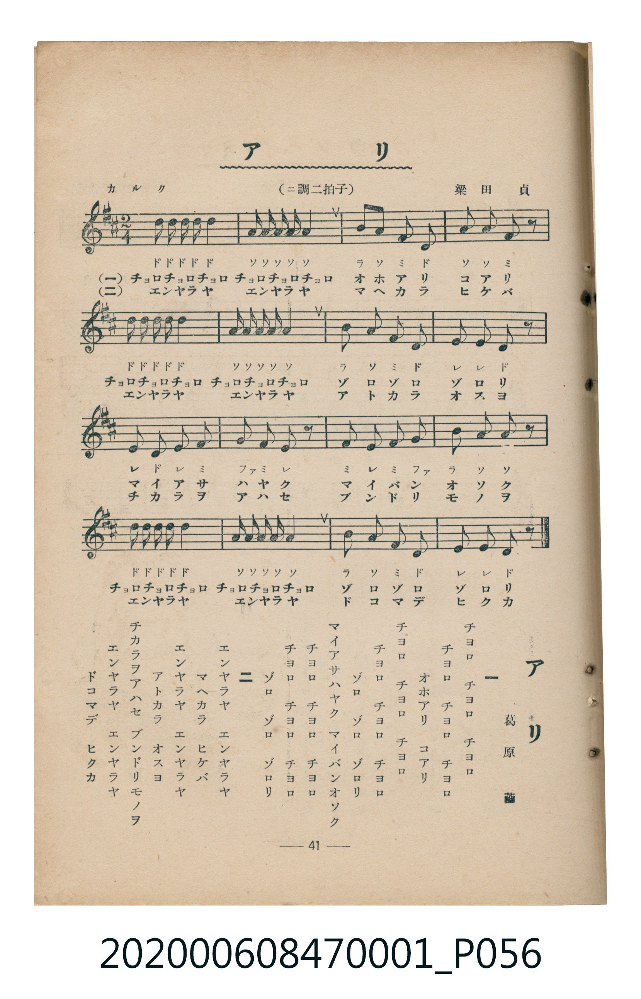

# アリ（螞蟻）

> Re:Shōka 使用 AI 協助辨識與重建樂譜，可能會有錯誤。歡迎回報。

- **鋼琴伴奏版**：<br><audio controls src="ari.mp3"></audio>
- **NEUTRINO 歌聲合成版**：<br><audio controls src="ari_neutrino.mp3"></audio>

- 詞：葛原𦱳
- 曲：梁田貞
- 臺灣教育會公認《新定兒童唱歌》尋常科第一學年用（2020.006.0847.0001）

## 說明

曲目說明
中文解釋：描寫螞蟻成群工作、搬運食物的勤勞模樣。


## 歌詞

```text
一
チヨロ　チヨロ　チヨロ
チヨロ　チヨロ　チヨロ
オホアリ　コアリ
チヨロ　チヨロ　チヨロ
チヨロ　チヨロ　チヨロ
ゾロ　ゾロ　ゾロリ
マイアサハヤク　マイバンオソク
チヨロ　チヨロ　チヨロ
チヨロ　チヨロ　チヨロ
ゾロ　ゾロ　ゾロリ

二
エンヤラヤ　エンヤラヤ
マヘカラ　ヒケバ
エンヤラヤ　エンヤラヤ
アトカラ　オスヨ
チカラヲアハセ　ブンドリモノヲ
エンヤラヤ　エンヤラヤ
ドコマデ　ヒクカ
```

## ABC

<div class="abc-score" data-abc-src="ari.abc" aria-label="五線譜載入中"></div>

[下載 ABC 原始檔](ari.abc)

## TMD 檔案連結

- [主旋律 TMD 檔案](ari.tmd) [[在 TMD Studio 編輯](https://tmdlang.github.io/Tmd-TS/#tmd=s7IKdvYPcrWy4qpTUCpJTLdSSM7PyUlNLsnMz7MqzsjMK0nNjM_KTMmPL87Iz05Ugisry88pzU21Si9KTEmNN4w3MjAyiDcwMIs3sDAxBzIMDBFKi_NLi5JTrYqTM_Lzc-JLUitKkvLzsxHyBUX5Zal5iXlANQVFIBtTwIoQClLLMlNSQdKpKZkl-UWZiTlI7kgtKga7FWxJfElRYl5xclFmAcgDCFUlGalAxybmZeYi6wUalZ6ZZ1WSmAn0HMiD5YnxuYmZeTmJeSnIqkoy8oH-LMiotMrILAY5IDkxJz47MQ8pOKDWFySmp1oFGJiaKXFpaSk8blr0uHnV-z0dL-bNezF_9_s9nQpaWlyKtgqGBhZc9rYKLlw2RvomdiBDXqyc937PrBcTZz_tm_9h2cbNYJOfzd4EFHy2qPH5lA0vNs0Di71o3_W8cfGzqTNfNG16Nqf5aeuaF6t6Hzd0PZu24em6WU9bJz1fvfTplI3P1vY8buh-uqH76Y4dz5dPfL5mzZMdDU_X7ni6c8vzKSuATgJFmB4wwvRAEQZkGBgCnafEpa-lALT1-ex1L1atejajj0tBQeHJjrXPprW_WL74ZXs3yDn9_U_Xr4b46FnHhOf7ljzdvvTJ3jmPGxqfTVjzsrH75eL5zztXPp_V8rR7ydPuec9WLHy2YvHjhiYuLX0uoPlcQIdwPW5ufNy84nHz2scNDVjZxKhoWvW4eTYkjEESTZshbCoZvg8qhMYAmz_vcdMSkGVNWx839z9uBrLXg3WDxZsnPG4GOmXV46a9QHGau4brya4eoAKgus0glzSvBJEgBSgiYEc3z3jctBrEB5k96XHTRqBbidEKCtYOhFaQ13YCXQZ2OES0eRNYUf_jpt1gw6eBDegExUwzULwPqIAoN3aCYhHk0naYG9cDbQCnHF9gxrQKyEzMy3eoMaipBqVMBRtDMy07MKtGwTAOBemCYY2CKRzCRMyAJIhnDMSGUDUIEQOQCNhIH8MaBXAULAdSazGZIBbMTKLVNa0C0sBkCyKbFoHZIBGQzGY0MSSXGIHkVwDFNwPxEiBeCaYRpuKRa54HNnEG2PTVYPZKqMwksNhGsNgEuI2Uh6cRkARhEI_W4bkP7HqQCDIbTYaa4QmNoQ7M8ITEbdNOsNgK9PCEBQiIBgVVjYIJlAUSASuF80A0SBYRuCCMHpTgiG0COQ3qqKat0MDrBzsBIrMebjqKDnCEgzyJ7PS9qDoQgdXciOZdYIZGCQ6wjU27keyaBjcfmK3hkQCSgejog5symuyIycbgMIQUEtAs3Q6VgWRjUKxBYghiYy0Xl66dAqjUVADSylwA)]
- [鋼琴伴奏 TMD 檔案](ari_piano.tmd) [[在 TMD Studio 編輯](https://tmdlang.github.io/Tmd-TS/#tmd=s7IKdvYPcrWy4qpTUCpJTLdSyC8qychPL0osyKi0ysgsLskvykxOzInPTsxLVIIrKs4vLUpOjS9ITE-1CjAwNVPi0tJSeNy06HHzqvd7Oh43TwGz-57s2fJ0af-T3TPe7-lU0NLiUrRVMDSw4LK3VXDhsjHSN7EDGfhi5bz3e2a9mDj7ad_8D8s2bgbb8mz2JqDgs0WNz6dseLFpHljsRfuu542Ln02d-aJp07M5zU9b17xY1fu4oevZtA1P18162jrp-eqlT6dsfLa253FD99MN3U937Hi-fOLzNWue7Gh4unbH051bnk9ZAXSekYGRgZ6BgZmegYWJOZBhYAh0nhIXl29iZp5VQGZiXn6Qh0ONQU01lwIQ2BiaadmBWTUKhnEoSBcMaxRM4RAmYgYkQTxjIDaEqkGIGIBEwEb6GNYoPG5ufNy8HEitxWSCWDAziVbXtApIP26eDSKbFoHZIBGQzGY0MSSXGIHkVwDFNwPxEiBeCaYRpuKRa54HNnEG2PTVYPZKqMwksNhGsNgEuI2Uh6cRkARhEI_W4bkP7HqQCDIbTYaa4QmNoQ7M8ITEbdNOsNgK9PCEBQiIBgVVjYIJlAUSASuF80A0SBYRuCCMHpTgiG0COQ3qqKat0MDrBzsBIrMebjqKDnCEgzyJ7PS9qDoQgdXciObdx82bUIIDbGPTbiS7psHNf9zcCY8EkAxERx_clNFkR0w2BochpJCAZul2qAwkG4NiDRJDEBtrkQtNH-RC0wJeZkYbxgLVQkgMngkKzzQexjWAeody7QhBJB0gQaAamHFgQWTjqGA9MGh07RRAoRPtA1IBYxuB2cpcAA)]

## 分析

```text
================================================================================
📊 TMD Song Profile: [ アリ（螞蟻） ]
================================================================================
⏱  Duration:       0:17 (17.8s), 16 measures total
🎼 Key & Tempo:    首調基準 D, != 108.0 BPM, <2/4>
   - 分析範圍：      由實際發聲的音符與和弦推測調性；播放脈絡另行呈現
🎤 人聲音域:    D4 (MIDI 62) – D5 (MIDI 74) [跨度: 12 個半音 / 1.0 個八度, 難度: easy]
   - 最低音:  D4 in [Main #1 @ m.3, 0:03]
   - 最高音: D5 in [Main #1 @ m.1, 0:00]
   - 適合: soprano, mezzo-soprano, contralto, tenor, baritone, bass
🏛  結構:      Main (17.8s)
⚡ 編曲密度:        Peak 1 軌道同時演奏
🗝  調性診斷：       D 大調（純淨自然大調，未偵測到可信轉調）
   - 風格氣質:    純淨自然大調（陽光明朗、易唱易記，無明顯調外色彩）
   - 轉調歷程:    全曲維持單一推測調性（未偵測到可信轉調）
   - 核心骨幹音:  A, D, E, F#, B
   - 調性數值:    D 大調 [相關度: 0.91, 穩定度: High, 自然音純度: 100.0%]
   - 候選調性 (K-S): D 大調 (0.91), A 大調 (0.77), D 小調 (0.56)
   - 五度圈歷程:   +2
   - 各段落調性細節:
     • [Main #1]: D 大調 (r: 0.91, 自然音純度: 100.0%)

  [ 五度圈游移軌跡 ]
               C  
         F            G  
      Bb              [D ]*
      Eb               A  
         Ab           E  
            Db       B  
               F# 
     (* = active key center)

  [ 十二半音累積音高分佈 ]
     C  :                            0.0%
     C# :                            0.0%
     D  : ███████████████████████   30.5%
     D# :                            0.0%
     E  : ██████████                13.6%
     F  :                            0.0%
     F# : ██████████                13.6%
     G  : ███                        3.4%
     G# :                            0.0%
     A  : ████████████████████████  32.2%
     A# :                            0.0%
     B  : █████                      6.8%
--------------------------------------------------------------------------------
Assignment 軌道音域：
  - Piano         : D4 – D5 (12 個半音 / 1.0 個八度, 65 個音符)
================================================================================
```


## 原書掃描頁




