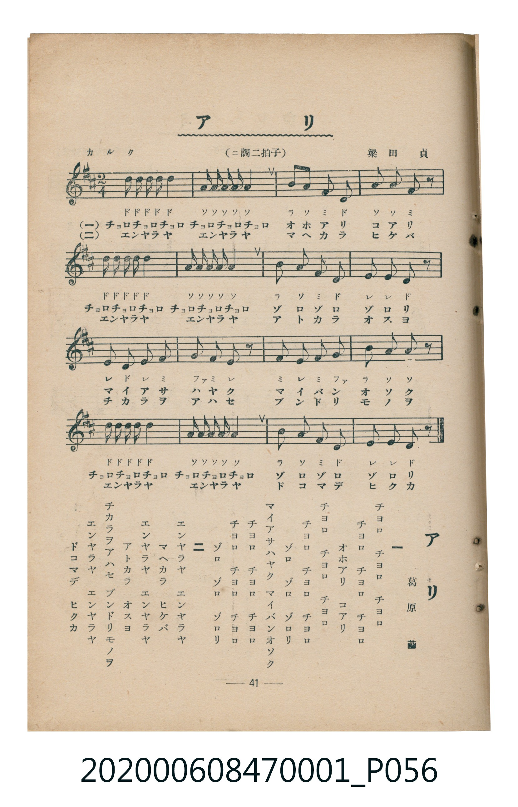

# アリ（螞蟻）

> Re:Shoka 使用 AI 協助辨識與重建樂譜，可能會有錯誤。歡迎回報。

<audio controls src="ari.mp3"></audio>

- 詞：葛原𦱳
- 曲：梁田貞
- 臺灣教育會公認《新定兒童唱歌》尋常科第一學年用（2020.006.0847.0001）

## 說明

曲目說明
中文解釋：描寫螞蟻成群工作、搬運食物的勤勞模樣。

## 歌詞

```text
一
チヨロ　チヨロ　チヨロ
チヨロ　チヨロ　チヨロ
オホアリ　コアリ
チヨロ　チヨロ　チヨロ
チヨロ　チヨロ　チヨロ
ゾロ　ゾロ　ゾロリ
マイアサハヤク　マイバンオソク
チヨロ　チヨロ　チヨロ
チヨロ　チヨロ　チヨロ
ゾロ　ゾロ　ゾロリ

二
エンヤラヤ　エンヤラヤ
マヘカラ　ヒケバ
エンヤラヤ　エンヤラヤ
アトカラ　オスヨ
チカラヲアハセ　ブンドリモノヲ
エンヤラヤ　エンヤラヤ
ドコマデ　ヒクカ
```

## ABC

```abc
X:1
T:アリ（螞蟻）
C:曲：梁田貞
M:2/4
L:1/16
Q:1/4=108
K:D
V:V1 name="Piano" snm="Pia"
[V:V1]
d d d d d4 | A A A A A4 | B2 A2 F2 D2 | A2 A2 F2 z2 |
d d d d d4 | A A A A A4 | B2 A2 F2 D2 | E2 E2 D2 z2 |
E2 D2 E2 F2 | G2 F2 E2 z2 | F2 E2 F2 G2 | B2 A2 A2 z2 |
d d d d d4 | A A A A A4 | B2 A2 F2 D2 | E2 E2 D2 z2 |
```

## TMD 檔案連結

- [主旋律 TMD 檔案](ari.tmd) [[在 TMD Studio 編輯](https://tmdlang.github.io/Tmd-TS/#tmd=s7IKdvYPcrWy4qpTUCpJTLdSSM7PyUlNLsnMz7MqzsjMK0nNjM_KTMmPL87Iz05Ugisry88pzU21Si9KTEmNN4w3MjAyiDcwMIs3sDAxBzIMDBFKi_NLi5JTrYqTM_Lzc-JLUitKkvLzsxHyBUX5Zal5iXlANQVFIBtTwIoQClLLMlNSQdKpKZkl-UWZiTlI7kgtKga7FWxJfElRYl5xclFmAcgDCFUlGalAxybmZeaC9GppKTxuWvS4edX7PR0v5s17MX_3-z2dClpaXIq2CoYGFlz2tgouXDZG-iZ2IANerJz3fs-sFxNnP-2b_2HZxs1gU5_N3gQUfLao8fmUDS82zQOLvWjf9bxx8bOpM180bXo2p_lp65oXq3ofN3Q9m7bh6bpZT1snPV-99OmUjc_W9jxu6H66ofvpjh3Pl098vmbNkx0NT9fueLpzy_MpK4BOAoWlHjAs9UBhCWQYGAKdp8Slr6UAtPX57HUvVq16NqOPS0FB4cmOtc-mtb9YvvhlezfIOf39T9evhvjoWceE5_uWPN2-9MneOY8bGp9NWPOysfvl4vnPO1c-n9XytHvJ0-55z1YsfLZi8eOGJi4tfS6g-VxAh3A9bm583LzicfPaxw0NWNnEqGha9bh5NiSMQRJNmyFsKhm-DyqExgCbP-9x0xKQZU1bHzf3P24GsteDdYPFmyc8bgY6ZdXjpr1AcZq7huvJrh6gAqC6zSCXNK8EkSAFKCJgRzfPeNy0GsQHmT3pcdNGoFuJ0QoK1g6EVpDXdgJdBnY4RLR5E1hR_-Om3WDDp4EN6ATFTDNQvA-ogCg3doJiEeTSdpgb1wNtAKcc38TMPKuAzMS8fIcagxqFalDSVLAxNNOyA7NqFAzjUJAuGNYomMIhTMQMSIJ4xkBsCFWDEDEAiVBupBGQBGEQD9lImBiIBqmuUTCBskAiYJVwHogGySLMB2GaObCWi0vXTgEUzgpAWpmLCwA)]
- [鋼琴伴奏 TMD 檔案](ari_piano.tmd) [[在 TMD Studio 編輯](https://tmdlang.github.io/Tmd-TS/#tmd=s7IKdvYPcrWy4tLSUnjctOhx86r3ezoeN08Bs_ue7NnydGn_k90z3u_pVNDS4lK0VTA0sOCyt1Vw4bIx0jex46pTUHqxct77PbNeTJz9tG_-h2UbNyuBBJ_N3gQUfLao8fmUDS82zQOLvWjf9bxx8bOpM180bXo2p_lp65oXq3ofN3Q9m7bh6bpZT1snPV-99OmUjc_W9jxu6H66ofvpjh3Pl098vmbNkx0NT9fueLpzy_MpK4DOMzIwMtAzMDDTM7AwMQcyDAyBzlPi4vJNzMyzCshMzMsP8nCoMahRqOZSAAIbQzMtOzCrRsEwDgXpgmGNgikcwkTMgCSIZwzEhlA1CBEDkAjlRhoBSRAG8ZCNhImBaJDqGgUTKAskAlYJ54FokCzCfBCmmQNrkYPZByWYLeChHG0YC1QMITF4Jig803gY1wDuYEq1IwSRdIAEgWpgxoEFkY2jgvXAsNG1UwAFjwISrczFBQA)]

## 分析

```text
================================================================================
📊 TMD Song Profile: [ アリ（螞蟻） ]
================================================================================
⏱  Duration:       0:17 (17.8s), 16 measures total
🎼 Key & Tempo:    首調基準 D, != 108.0 BPM, <2/4>
   - 分析範圍：      由實際發聲的音符與和弦推測調性；播放脈絡另行呈現
🎤 人聲音域:    D4 (MIDI 62) – D5 (MIDI 74) [跨度: 12 個半音 / 1.0 個八度, 難度: easy]
   - 最低音:  D4 in [Main #1 @ m.3, 0:03]
   - 最高音: D5 in [Main #1 @ m.1, 0:00]
   - 適合: soprano, mezzo-soprano, contralto, tenor, baritone, bass
🏛  結構:      Main (17.8s)
⚡ 編曲密度:        Peak 1 軌道同時演奏
🗝  調性診斷：       D 大調（純淨自然大調，未偵測到可信轉調）
   - 風格氣質:    純淨自然大調（陽光明朗、易唱易記，無明顯調外色彩）
   - 轉調歷程:    全曲維持單一推測調性（未偵測到可信轉調）
   - 核心骨幹音:  A, D, E, F#, B
   - 調性數值:    D 大調 [相關度: 0.91, 穩定度: High, 自然音純度: 100.0%]
   - 候選調性 (K-S): D 大調 (0.91), A 大調 (0.77), D 小調 (0.56)
   - 五度圈歷程:   +2
   - 各段落調性細節:
     • [Main #1]: D 大調 (r: 0.91, 自然音純度: 100.0%)

  [ 五度圈游移軌跡 ]
               C  
         F            G  
      Bb              [D ]*
      Eb               A  
         Ab           E  
            Db       B  
               F# 
     (* = active key center)

  [ 十二半音累積音高分佈 ]
     C  :                            0.0%
     C# :                            0.0%
     D  : ███████████████████████   30.5%
     D# :                            0.0%
     E  : ██████████                13.6%
     F  :                            0.0%
     F# : ██████████                13.6%
     G  : ███                        3.4%
     G# :                            0.0%
     A  : ████████████████████████  32.2%
     A# :                            0.0%
     B  : █████                      6.8%
--------------------------------------------------------------------------------
Assignment 軌道音域：
  - Piano         : D4 – D5 (12 個半音 / 1.0 個八度, 65 個音符)
================================================================================
```


## 原書掃描頁




