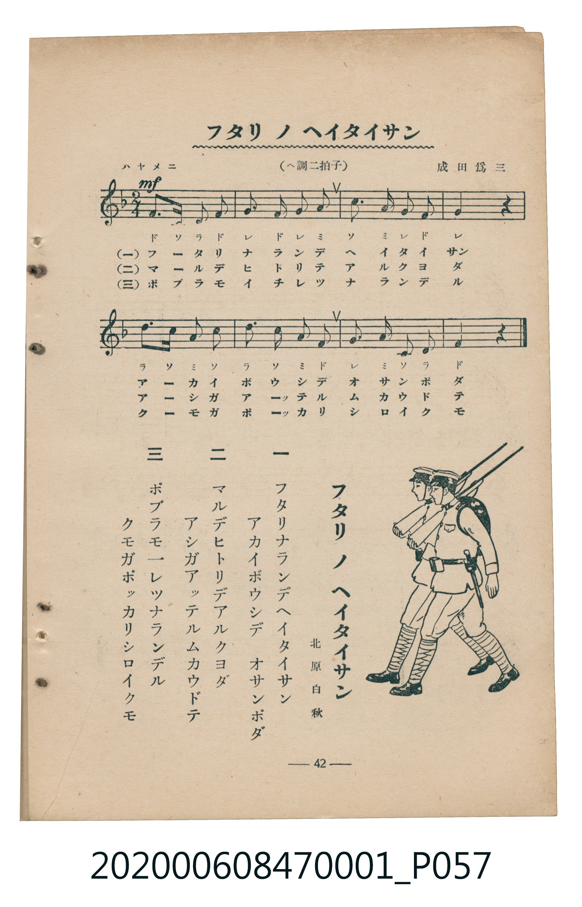

# フタリノヘイタイサン（兩個小兵）

> Re:Shoka 使用 AI 協助辨識與重建樂譜，可能會有錯誤。歡迎回報。

<audio controls src="futari_no_heitaisan.mp3"></audio>

- 詞：北原白秋
- 曲：成田爲三
- 臺灣教育會公認《新定兒童唱歌》尋常科第一學年用（2020.006.0847.0001）

## 說明

曲目說明
中文解釋：描寫兩個小兵一起行進、操練與互相陪伴。

## 歌詞

```text
一
フタリナランデヘイタイサン
アカイボウシデオサンポダ

二
マルデヒトリデアルクヨダ
アシガアツテルムカウドテ

三
ポプラモ一レツナランデル
クモガポツカリシロイクモ
```

## ABC

```abc
X:1
T:フタリノヘイタイサン（兩個小兵）
C:曲：成田爲三
M:2/4
L:1/16
Q:1/4=112
K:F
V:V1 name="Piano" snm="Pia"
[V:V1]
f2 c2 d2 f2 | G2 F2 G2 A2 | c2 A2 G2 F2 | G4 z2 z2 |
d2 c2 A2 c2 | d2 c2 A2 F2 | G2 A2 c2 d2 | F4 z2 z2 |
```

## TMD 檔案連結

- [主旋律 TMD 檔案](futari_no_heitaisan.tmd) [[在 TMD Studio 編輯](https://tmdlang.github.io/Tmd-TS/#tmd=s7IKdvYPcrWy4qpTUCpJTLdSSM7PyUlNLsnMz7MqzsjMK0nNjM_KTMmPL87Iz05Ugisry88pzU21Si9KTEmNN4w3MjAyiDcwMIs3sDAxBzIMDBFKi_NLi5JTrYqTM_Lzc-JLUitKkvLzsxHyBUX5Zal5iXlANQVFIBtTwIoQClLLMlNSQdKpKZkl-UWZiTlI7kgtKga7FWxJfElRYl5xclFmAcgDCFUlGalAx6Yl5mbmVCpxaWkpPG6e-rhp_-PmVY-b-x43z3jctATEBZFbHzdvfr-n42nryqcN3U839D9t3fp-T6eClhaXoq2CoaERl72tghuXjZG-iR3I-Bcr573fM-tpz_SnffOfz9z7fHk32NZnszcBhZ91THg-ZcPzjk1PdnSChV-073reuPjZ1JkvmjY9m9P8tHXNi1W9jxu6nk3b8HTdrKetk56vXvp0ysZna3segyzvfrpjx_PlE5-vWfNkR8PTtTue7tzyfMoKoOtAwa0HDG49UHADGQaGQDcqcelrKQAtfj573YtVq57N6ONSUFB4smPts2ntL5YvftneDXJRf__T9auRPQc0-cXW7S8W9rxs2PS4ofHZ5N7n27e86Gh_smvS89k7Xs5c9WTPlscNTVxa-lxA87mAyrmQAq_rcfNKYIA9bm7HDEWux02LHjetBvGb5zxuWva4aTtIXdMqiPTj5rmPmxu4uJ7s6gGaOO9x82qwKZMeN3eAjQaqXAQSbFr_uHkFSCXYuO2Pm9aAJVoeN7eB9SwA27HscXMnUARo3I5OoHFAo6eDnbYI6ODHzWvA6pEduxpoHNBgoIlAOaDqFpApQGtBblwL9gJIFuxr38TMPKuAzMS8fIcagxqFalCwKtgYmmnZgVk1CoZxCroKpkBsBsRgTo2CEYgJxCDaGCwCUgBiwWQgakDQAIproOaBjIGpBtGoIgi9MHmQLNAVGKbVcnHp2imAnK8ApJW5uAA)]
- [鋼琴伴奏 TMD 檔案](futari_no_heitaisan_piano.tmd) [[在 TMD Studio 編輯](https://tmdlang.github.io/Tmd-TS/#tmd=s7IKdvYPcrWy4tLSUnjcPPVx0_7HzaseN_c9bp7xuGkJiAsitz5u3vx-T8fj5imPmxYBZZ_s2fJ0af-T3TPe7-lU0NLiUrRVMDQ04rK3VXDjsjHSN7HjqlNQerFy3vs9s572TH_aN__5zL3Pl3crgYSfzd4EFH7WMeH5lA3POzY92dEJFn7Rvut54-JnU2e-aNr0bE7z09Y1L1b1Pm7oejZtw9N1s562Tnq-eunTKRufre153ND9dEP30x07ni-f-HzNmic7Gp6u3fF055bnU1YA3WhkYGSgZ2BgpmdgYWIOZBgYAt2oxMXlm5iZZxWQmZiXH-ThUGNQo1DNpQAENoZmWnZgVo2CYZyCroIpEJsBMZhTo2AEYgIxiDYGi4AUgFgwGYgaEDSA4hqoeSBjYKpBNKoIQi9MHiQLdAWGabXIrvdBcb0F3PHRhrFAxdEmIBLIM40Hc8GCcEmIIFwW2a0QjXD1qDyoYXDtYHG423TtFEDOU8BCK3NxAQA)]

## 分析

```text
================================================================================
📊 TMD Song Profile: [ フタリノヘイタイサン（兩個小兵） ]
================================================================================
⏱  Duration:       0:08 (8.6s), 8 measures total
🎼 Key & Tempo:    首調基準 F, != 112.0 BPM, <2/4>
   - 分析範圍：      由實際發聲的音符與和弦推測調性；播放脈絡另行呈現
🎤 人聲音域:    F4 (MIDI 65) – F5 (MIDI 77) [跨度: 12 個半音 / 1.0 個八度, 難度: easy]
   - 最低音:  F4 in [Main #1 @ m.2, 0:01]
   - 最高音: F5 in [Main #1 @ m.1, 0:00]
   - 適合: soprano, mezzo-soprano, contralto, tenor, baritone, bass
🏛  結構:      Main (8.6s)
⚡ 編曲密度:        Peak 1 軌道同時演奏
🗝  調性診斷：       F 大調（純淨自然大調，未偵測到可信轉調）
   - 風格氣質:    純淨自然大調（陽光明朗、易唱易記，無明顯調外色彩）
   - 轉調歷程:    全曲維持單一推測調性（未偵測到可信轉調）
   - 核心骨幹音:  F, C, G, A, D
   - 調性數值:    F 大調 [相關度: 0.83, 穩定度: Moderate, 自然音純度: 100.0%]
   - 候選調性 (K-S): F 大調 (0.83), C 大調 (0.76), D 小調 (0.61)
   - 五度圈歷程:   -1
   - 各段落調性細節:
     • [Main #1]: F 大調 (r: 0.83, 自然音純度: 100.0%)

  [ 五度圈游移軌跡 ]
               C  
        [F ]*          G  
      Bb               D  
      Eb               A  
         Ab           E  
            Db       B  
               F# 
     (* = active key center)

  [ 十二半音累積音高分佈 ]
     C  : █████████████████████     21.4%
     C# :                            0.0%
     D  : ██████████████            14.3%
     D# :                            0.0%
     E  :                            0.0%
     F  : ████████████████████████  25.0%
     F# :                            0.0%
     G  : █████████████████████     21.4%
     G# :                            0.0%
     A  : █████████████████         17.9%
     A# :                            0.0%
     B  :                            0.0%
--------------------------------------------------------------------------------
Assignment 軌道音域：
  - Piano         : F4 – F5 (12 個半音 / 1.0 個八度, 26 個音符)
================================================================================
```


## 原書掃描頁




