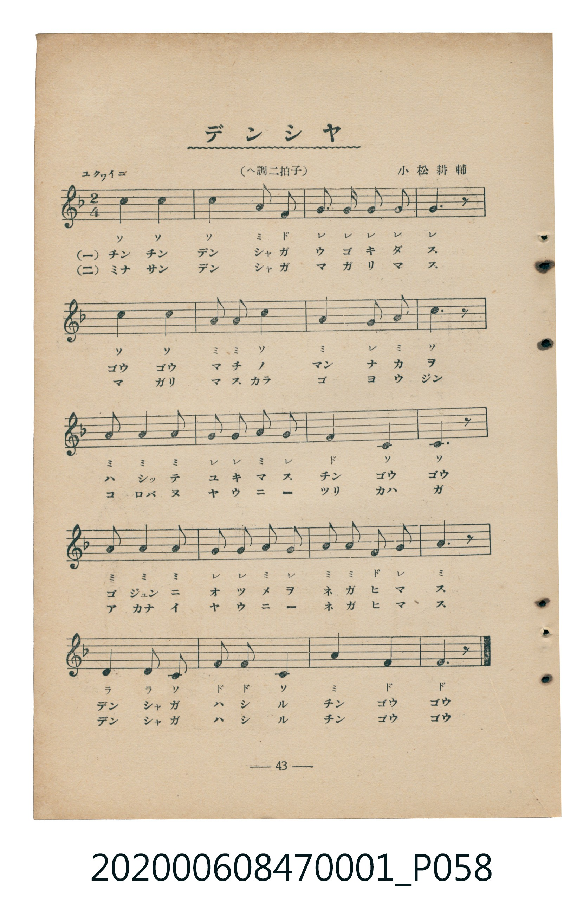
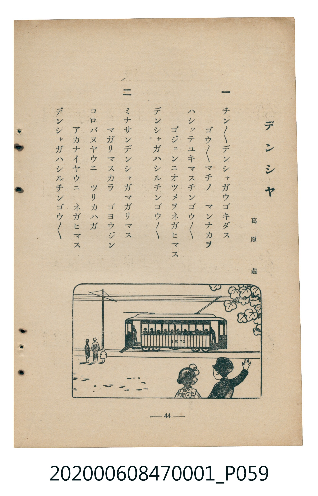

# デンシヤ（電車）

> Re:Shōka 使用 AI 協助辨識與重建樂譜，可能會有錯誤。歡迎回報。

- **鋼琴伴奏版**：<br><audio controls src="densha.mp3"></audio>
- **NEUTRINO 歌聲合成版**：<br><audio controls src="densha_neutrino.mp3"></audio>

- 詞：葛原𦱳
- 曲：小松耕輔
- 臺灣教育會公認《新定兒童唱歌》尋常科第一學年用（2020.006.0847.0001）

## 說明

曲目說明
中文解釋：描寫電車行駛、沿途景色與乘車的興奮。


## 歌詞

```text
一
チンチンデンシヤガウゴキダス
ゴウゴウマチノ　マンナカヲ
ハシツテユキマスチンゴウゴウ
ゴジユンニオツメヲネガヒマス
デンシヤガハシルチンゴウゴウ

二
ミナサンデンシヤガマガリマス
マガリマスカラ　ゴヨウジン
コロバヌヤウニ　ツリカハガ
アカナイヤウニ　ネガヒマス
デンシヤガハシルチンゴウゴウ
```

## ABC

<div class="abc-score" data-abc-src="densha.abc" aria-label="五線譜載入中"></div>

[下載 ABC 原始檔](densha.abc)

## TMD 檔案連結

- [主旋律 TMD 檔案](densha.tmd) [[在 TMD Studio 編輯](https://tmdlang.github.io/Tmd-TS/#tmd=s7IKdvYPcrWy4qpTUCpJTLdSSM7PyUlNLsnMz7MqzsjMK0nNjM_KTMmPL87Iz05Ugisry88pzU21Si9KTEmNN4w3MjAyiDcwMIs3sDAxBzIMDBFKi_NLi5JTrYqTM_Lzc-JLUitKkvLzsxHyBUX5Zal5iXlANQVFIBtTwIoQClLLMlNSQdKpKZkl-UWZiTlI7kgtKga7FWxJfElRYl5xclFmAcgDCFUlGalAx4IlC_KLkIwGmpaemWdVkpgJ9B_Ij-WJ8bmJmXk5iXkpSlxaWgqPm9sfN29-3LT9cfOS93s6Xs7e_WJ31_s9nQpaWlyKtgqGBiZc9rYKblw2RvomdiBjX6yc937PrBcTZz_tm_9h2cbNYLuezd4EFHy6of_Z3H0vGqa-2DMFLPyifdfzxsXPps580bTp2Zzmp61rXqzqfdzQ9WzahqfrZj1tnfR89dKnUzY-W9vzuKH76Ybupzt2PF8-8fmaNU92NDxdu-Ppzi3Pp6wAugoU-nrA0NcDhT6QYWAIdKESl76WAtDi57PXvVi16tmMPi4FBYUnO9Y-m9b-Yvnil-3dQBc96-9_un41xFMvFva8XD77cUPjs037XzZMeTZz_YvOTS862p_snAGUfT6r5UVHx9Ol6x43NHFp6XMBDecCuoLrcXMjKHygJCKsHjetedy07HHTlsdNax83Nzxu2skF5kCElj1ungfW0_e4oQHMBmruety0-nHzJqCR_WAzWh43tz1uBmoAGjAPaADUEiRTIEbuACkCGdD9uGkVWNtCoDGPm3tBbmieBNEMNBXVcVBLgDZimMr1ZFcPUP18sJO2YvEYyEQgCbQMajQKH-yNlSCPAY1rXgE2F-jGzUDXAk0CembC4-YesElAZ3eDAwDo5lVgbUBHrQGqWwTmAG1fgqqObC-BYswXmK6tAjIT8_IdagxqqkHJQcHG0EzLDsyqUTBV0AVDGI0QMQZiQ7CIEZBExhARGDQAiYBN8zGsAWYdkDOgUigckBzI6TA5kKsXgxlrILJNy8C8LWByLVh7A1RmJ3b7jEBmgmIMbiYo4oi1r3kenAeMCTAJEsFuH87gAgUTCKOKgCAokEBshC4swQWOKbgTkThwBzY3gsk-ZHHkIAZ5HphyoFKbsFsFDimQcRB7QOkW3R6wpyHJGCEFjg2IPSvA0iDngcRBaRvDKmggQQLAGB40iBQE4kFSEChlgQMyHm4ZnIklmJr7oS7fDmQ3g93TBnU8JNVA0gvCI-gpES1okblYgqoJog-YcYF4ApjVAzV0CTwYgPkTYSA4N8MtA2VqJMtASYzskILJgUIMIYIzOUFdAIyfpUBXgfwBcSdIEpLIW8DkQjAJSi4g1_eCNUGywiR4UBLIek2LYN6FJ0NQ6OALJVLsgYaRGSxZgBngRAJJPiCMlHxgoQJLWYg0hi094S8ZQJEHSmsgB4JyFsz55KcoellYy8Wla6cAKvUVgLQyFwA)]
- [鋼琴伴奏 TMD 檔案](densha_piano.tmd) [[在 TMD Studio 編輯](https://tmdlang.github.io/Tmd-TS/#tmd=s7IKdvYPcrWy4tLSUnjc3P64efPjpu2Pm5e839PxuHnK46ZFj5v7nuzZ8nRp_5PdM97v6VTQ0uJStFUwNDDhsrdVcOOyMdI3seOqU1B6sXLe-z2zXkyc_bRv_odlGzcrgQSfzd4EFHy6of_Z3H0vGqa-2DMFLPyifdfzxsXPps580bTp2Zzmp61rXqzqfdzQ9WzahqfrZj1tnfR89dKnUzY-W9vzuKH76Ybupzt2PF8-8fmaNU92NDxdu-Ppzi3Pp6wAutDIwMhAz8DATM_AwsQcyDAwBLpQiYvLNzEzzyogMzEvP8jDocagpppLAQhsDM207MCsGgVTBV0whNEIEWMgNgSLGAFJZAwRgUEDkAjYNB_DGmDQNQKDDiqFwgHJgYIVJgcK3cVgxhqIbNMyMG8LmFwL1t4AldmJ3T4jkJnzHzd3wc3cSoJ9zfPgvMfNq8AkSAS7fTiDCxRMIIwqAoKgQAKxEbqwBFfTFoi_IU5E4sAd2NwIJvuQxZGDGOT5x02roVKbsFsFDimQcRB71kA8jGIP2NNAgx43r0RIgWMDYs8KsDTIeSDxHQgnYAQSJACM4UGDSEEgHiQFgVIWOCDj4ZbBmViCqbkf6vLtQHYz2D1tUMdDUg0kvSA8gp4S0YIWmYslqJog-h43rwXiCWBWD9TQJfBgeNzcjTCwuQURpOBAhDgYYhkoiZEdUjA5UIghRHAmJ6gLgPGzFOgqkD8g7gRJQhJ5C5hcCCZByQXk-l6wJkhWmAQPSgJZr2kRzLvwZAgKHXyhRIo90DAygyULMAOcSCDJB4SRkg8sVGApC5HGsKUn_CUDKPJAaQ3kQFDOgjmf_BRFLwtrkQt9H-RC3wJe5kcbxgLVQkgMnmk8mAuh4HyQ8RDfENAO4cF1g7l4NKPbhsUwknXjsdwErABMEuMPiF5gkOraKYBCNdoHJAxjG4HZylwA)]

## 分析

```text
================================================================================
📊 TMD Song Profile: [ デンシヤ（電車） ]
================================================================================
⏱  Duration:       0:23 (23.1s), 20 measures total
🎼 Key & Tempo:    首調基準 F, != 104.0 BPM, <2/4>
   - 分析範圍：      由實際發聲的音符與和弦推測調性；播放脈絡另行呈現
🎤 人聲音域:    C4 (MIDI 60) – C5 (MIDI 72) [跨度: 12 個半音 / 1.0 個八度, 難度: easy]
   - 最低音:  C4 in [Main #1 @ m.11, 0:12]
   - 最高音: C5 in [Main #1 @ m.1, 0:00]
   - 適合: soprano, mezzo-soprano, contralto, tenor, baritone, bass
🏛  結構:      Main (23.1s)
⚡ 編曲密度:        Peak 1 軌道同時演奏
🗝  調性診斷：       A 調性不明確（純淨自然大調，未偵測到可信轉調）
   - 風格氣質:    純淨自然大調（陽光明朗、易唱易記，無明顯調外色彩）
   - 轉調歷程:    全曲維持單一推測調性（未偵測到可信轉調）
   - 核心骨幹音:  C, A, G, F, D
   - 調性數值:    A 調性不明確 [相關度: 0.78, 穩定度: Ambiguous, 自然音純度: 100.0%]
   - 候選調性 (K-S): A 小調 (0.78), C 大調 (0.76), F 大調 (0.68)
   - 五度圈歷程:   +3
   - 各段落調性細節:
     • [Main #1]: A 調性不明確 (r: 0.78, 自然音純度: 100.0%)

  [ 五度圈游移軌跡 ]
               C  
         F            G  
      Bb               D  
      Eb              [A ]*
         Ab           E  
            Db       B  
               F# 
     (* = active key center)

  [ 十二半音累積音高分佈 ]
     C  : ████████████████████████  30.7%
     C# :                            0.0%
     D  : ███                        4.0%
     D# :                            0.0%
     E  :                            0.0%
     F  : ███████████               14.7%
     F# :                            0.0%
     G  : ████████████████          20.0%
     G# :                            0.0%
     A  : ████████████████████████  30.7%
     A# :                            0.0%
     B  :                            0.0%
--------------------------------------------------------------------------------
Assignment 軌道音域：
  - Piano         : C4 – C5 (12 個半音 / 1.0 個八度, 52 個音符)
================================================================================
```


## 原書掃描頁






