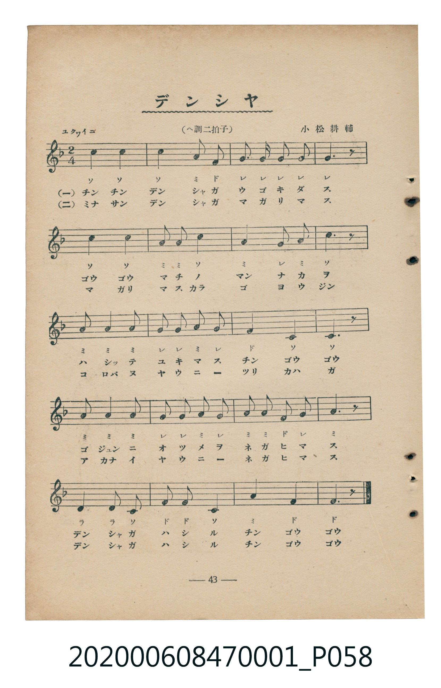
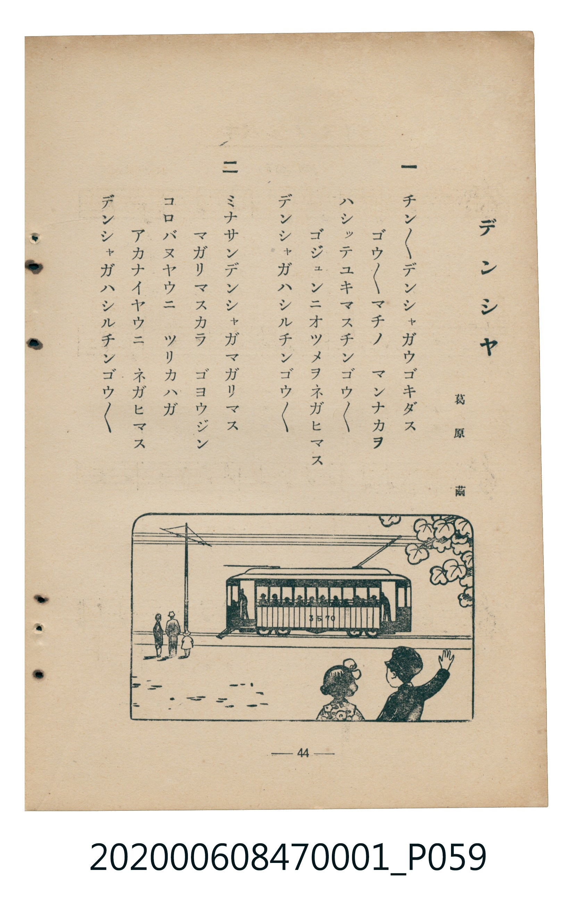

# デンシヤ

> Re:Shoka 使用 AI 協助辨識與重建樂譜，可能會有錯誤。歡迎回報。

<audio controls src="densha.mp3"></audio>

- 詞：葛原𦱳
- 曲：小松耕輔
- 臺灣教育會公認《新定兒童唱歌》尋常科第一學年用（2020.006.0847.0001）

## 說明

・出處：臺灣教育會公認《新定兒童唱歌》尋常科第一學年用（2020.006.0847.0001）
・調性與拍號：調號 ?= F，拍號 <2/4>，速度 != 104

## 歌詞

```text
一
チンチンデンシヤガウゴキダス
ゴウゴウマチノ　マンナカヲ
ハシツテユキマスチンゴウゴウ
ゴジユンニオツメヲネガヒマス
デンシヤガハシルチンゴウゴウ

二
ミナサンデンシヤガマガリマス
マガリマスカラ　ゴヨウジン
コロバヌヤウニ　ツリカハガ
アカナイヤウニ　ネガヒマス
デンシヤガハシルチンゴウゴウ
```

## ABC

```abc
X:1
T:デンシヤ
C:曲：小松耕輔
M:2/4
L:1/16
Q:1/4=104
K:F
V:V1 name="Piano" snm="Pia"
[V:V1]
c4 c4 | c4 A2 F2 | G2 G2 G2 G2 | G6 z2 |
c4 c4 | A2 A2 c4 | A4 G2 A2 | c6 z2 |
A3 A A2 A2 | G2 G2 A2 G2 | F4 C4 | C6 z2 |
A3 A A2 A2 | G2 G2 A2 G2 | A2 A2 F2 G2 | A6 z2 |
d4 d2 c2 | f2 f2 c4 | A4 F4 | F6 z2 |
c4 c4 | c4 A2 F2 | G2 G2 G2 G2 | G6 z2 |
c4 c4 | A2 A2 c4 | A4 G2 A2 | c6 z2 |
A3 A A2 A2 | G2 G2 A2 G2 | F4 C4 | C6 z2 |
A3 A A2 A2 | G2 G2 A2 G2 | A2 A2 F2 G2 | A6 z2 |
d4 d2 c2 | f2 f2 c4 | A4 F4 | F6 z2 |
```

## TMD 檔案連結

- [主旋律 TMD 檔案](densha.tmd) [[在 TMD Studio 編輯](https://tmdlang.github.io/Tmd-TS/#tmd=s7IKdvYPcrWy4qpTUCpJTLdSSM7PyUlNLsnMz7MqzsjMK0nNjM_KTMmPL87Iz05Ugisry88pzU21Si9KTEmNN4w3MjAyiDcwMIs3sDAxBzIMDBFKi_NLi5JTrYqTM_Lzc-JLUitKkvLzsxHyBUX5Zal5iXlANQVFIBtTwIoQClLLMlNSQdKpKZkl-UWZiTlI7kgtKga7FWxJfElRYl5xclFmAcgDCFUlGalAx4IlC_KLgEZraSk8bm5_3Lz5cdP2x81LFLS0uBRtFQwNTLjsbRXcuGyM9E3sQLpfrJz3fs-sFxNnP-2b_2HZxs1gI5_N3gQUfLqh_9ncfS8apr7YMwUs_KJ91_PGxc-mznzRtOnZnOanrWterOp93ND1bNqGp-tmPW2d9Hz10qdTNj5b2_O4ofvphu6nO3Y8Xz7x-Zo1T3Y0PF274-nOLc-nrHi_pwMUlnrAsNQDhSWQYWD4fk-nEheXvhYXUCXX4-ZGkLuhJMIPj5vWPG5a9rhpy-OmtY-bGx437eQCcyBCyx43zwPr6Xvc0ABmAzV3PW5a_bh5E9DIfrAZLY-b2x43AzUADZgHNABqCZIpECN3gBSBDOh-3LQKrG0h0JjHzb0gNzRPgmgGmorqOKglQBsxTOV6sqsHqH4-2ElbsXgMZCKQBFoGNRqFD_bGSpDHgMY1rwCbC3TjZqBrgSYBPTPhcXMP2CSgs7vBAQB08yqwNqCj1gDVLQJzgLYvQVVHtpe09Lm4fBMz86wCMhPz8h1qDGoUqrkUgMDG0EzLDsyqUTBV0AVDGI0QMQZiQ7CIEZBExhARGDQAieA0DWQKCKOKgCDIDBAboQvdNIhKY7gZCJeAeBCXgFwItjEe4QEYkxzzYHIgcxEi2Ewzg4qBaJAPgG6JA2kEEZi-hbkT4WKEebVcXLp2CqCoUkCilbm4AA)]
- [鋼琴伴奏 TMD 檔案](densha_piano.tmd) [[在 TMD Studio 編輯](https://tmdlang.github.io/Tmd-TS/#tmd=s7IKdvYPcrWy4tLSUnjc3P64efPjpu2Pm5e839PxuHnK46ZFj5v7nuzZ8nRp_5PdM97v6VTQ0uJStFUwNDDhsrdVcOOyMdI3seOqU1B6sXLe-z2zXkyc_bRv_odlGzcrgQSfzd4EFHy6of_Z3H0vGqa-2DMFLPyifdfzxsXPps580bTp2Zzmp61rXqzqfdzQ9WzahqfrZj1tnfR89dKnUzY-W9vzuKH76Ybupzt2PF8-8fmaNU92NDxdu-Ppzi3Pp6wAutDIwMhAz8DATM_AwsQcyDAwBLpQiYvLNzEzzyogMzEvP8jDocagRqGaSwEIbAzNtOzArBoFUwVdMITRCBFjIDYEixgBSWQMEYFBA5AITtNApoAwqggIgswAsRG60E2DqDSGm4FwCYgHcQnIhWAb4xEegDHJMQ8mBzIXIYLNNDOoGIgG-QDoljiQRhCB6VuYOxEuRphXixxTPigxZQGPqGjDWKBiCInBM40HcyEUnA8yH-ZavNohPLhuMBePZnTbsBhGsm48lpuAFYBJYvwB0QsMU107BVCwKiDRylxcAA)]

## 分析

```text
================================================================================
📊 TMD Song Profile: [ デンシヤ ]
================================================================================
⏱  Duration:       0:46 (46.2s), 40 measures total
🎼 Key & Tempo:    首調基準 F, != 104.0 BPM, <2/4>
   - 分析範圍：      由實際發聲的音符與和弦推測調性；播放脈絡另行呈現
🎤 人聲音域:    C4 (MIDI 60) – F5 (MIDI 77) [跨度: 17 個半音 / 1.4 個八度, 難度: challenging]
   - 最低音:  C4 in [Main #1 @ m.11, 0:12]
   - 最高音: F5 in [Main #1 @ m.18, 0:19]
   - 適合: soprano, mezzo-soprano, contralto, tenor, baritone, bass
🏛  結構:      Main (23.1s) -> Main (23.1s)
⚡ 編曲密度:        Peak 1 軌道同時演奏
🗝  調性診斷：       A 調性不明確（純淨自然大調，未偵測到可信轉調）
   - 風格氣質:    純淨自然大調（陽光明朗、易唱易記，無明顯調外色彩）
   - 轉調歷程:    全曲維持單一推測調性（未偵測到可信轉調）
   - 核心骨幹音:  C, A, G, F, D
   - 調性數值:    A 調性不明確 [相關度: 0.78, 穩定度: Ambiguous, 自然音純度: 100.0%]
   - 候選調性 (K-S): A 小調 (0.78), C 大調 (0.76), F 大調 (0.68)
   - 五度圈歷程:   +3 -> +3
   - 各段落調性細節:
     • [Main #1]: A 調性不明確 (r: 0.78, 自然音純度: 100.0%)
     • [Main #2]: A 調性不明確 (r: 0.78, 自然音純度: 100.0%)

  [ 五度圈游移軌跡 ]
               C  
         F            G  
      Bb               D  
      Eb              [A ]*
         Ab           E  
            Db       B  
               F# 
     (* = active key center)

  [ 十二半音累積音高分佈 ]
     C  : ████████████████████████  30.7%
     C# :                            0.0%
     D  : ███                        4.0%
     D# :                            0.0%
     E  :                            0.0%
     F  : ███████████               14.7%
     F# :                            0.0%
     G  : ████████████████          20.0%
     G# :                            0.0%
     A  : ████████████████████████  30.7%
     A# :                            0.0%
     B  :                            0.0%
--------------------------------------------------------------------------------
Assignment 軌道音域：
  - Piano         : C4 – F5 (17 個半音 / 1.4 個八度, 104 個音符)
================================================================================
```


## 原書掃描頁






