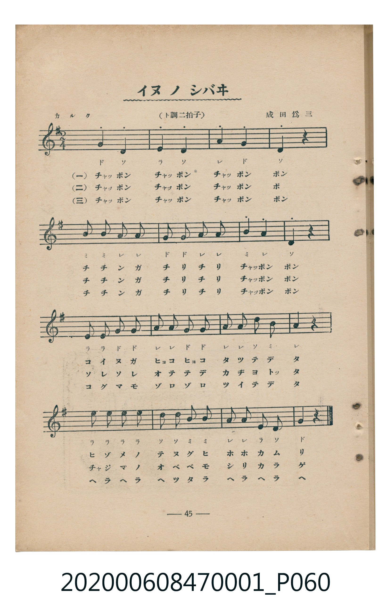
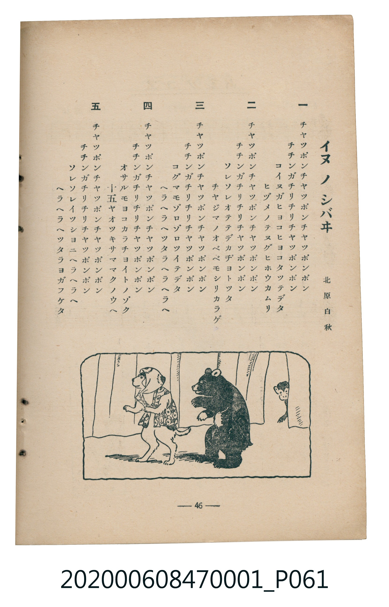

# イヌノシバヰ（狗的戲劇）

> Re:Shoka 使用 AI 協助辨識與重建樂譜，可能會有錯誤。歡迎回報。

<audio controls src="inu_no_shibai.mp3"></audio>

- 詞：北原白秋
- 曲：成田爲三
- 臺灣教育會公認《新定兒童唱歌》尋常科第一學年用（2020.006.0847.0001）

## 說明

曲目說明
中文解釋：把狗擬人化，描寫牠們演戲般的滑稽動作。

## 歌詞

```text
一
チヤツポンチヤツポンチヤツポンポン
チチンガチリチリチヤツポンポン
コイヌガヒヨコヒヨコタツテデタ
ヒヅメノテヌグヒホウカムリ

二
チヤツポンチヤツポンチヤツポンポン
チチンガチリチリチヤツポンポン
ソレソレオテテデカヂヨトツタ
チヤジマノオベベモシリカラゲ

三
チヤツポンチヤツポンチヤツポンポン
チチンガチリチリチヤツポンポン
コグマモゾロゾロツイテデタ
ヘラヘラヘツタラヘラヘラヘ

四
チヤツポンチヤツポンチヤツポンポン
チチンガチリチリチヤツポンポン
オサルモヨコカラチヨイトノゾク
十五ヤオツキサママクノウヘ

五
チヤツポンチヤツポンチヤツポンポン
チチンガチリチリチヤツポンポン
ソレソレイツシヨニヘラヘラヘ
ヘラヘラヘツタラヨガフケタ
```

## ABC

```abc
X:1
T:イヌノシバヰ（狗的戲劇）
C:曲：成田爲三
M:2/4
L:1/16
Q:1/4=108
K:G
V:V1 name="Piano" snm="Pia"
[V:V1]
G4 D4 | E4 D4 | A4 G4 | D4 z2 z2 |
B2 B2 A2 A2 | G2 G2 A2 A2 | B4 A4 | D4 z2 z2 |
E2 E2 G2 G2 | A2 A2 G2 G2 | A2 A2 d2 B2 | A4 z2 z2 |
e2 e2 e2 e2 | d2 d2 B2 B2 | A2 A2 E2 D2 | G4 z2 z2 |
G4 D4 | E4 D4 | A4 G4 | D4 z2 z2 |
B2 B2 A2 A2 | G2 G2 A2 A2 | B4 A4 | D4 z2 z2 |
E2 E2 G2 G2 | A2 A2 G2 G2 | A2 A2 d2 B2 | A4 z2 z2 |
e2 e2 e2 e2 | d2 d2 B2 B2 | A2 A2 E2 D2 | G4 z2 z2 |
G4 D4 | E4 D4 | A4 G4 | D4 z2 z2 |
B2 B2 A2 A2 | G2 G2 A2 A2 | B4 A4 | D4 z2 z2 |
E2 E2 G2 G2 | A2 A2 G2 G2 | A2 A2 d2 B2 | A4 z2 z2 |
e2 e2 e2 e2 | d2 d2 B2 B2 | A2 A2 E2 D2 | G4 z2 z2 |
G4 D4 | E4 D4 | A4 G4 | D4 z2 z2 |
B2 B2 A2 A2 | G2 G2 A2 A2 | B4 A4 | D4 z2 z2 |
E2 E2 G2 G2 | A2 A2 G2 G2 | A2 A2 d2 B2 | A4 z2 z2 |
e2 e2 e2 e2 | d2 d2 B2 B2 | A2 A2 E2 D2 | G4 z2 z2 |
G4 D4 | E4 D4 | A4 G4 | D4 z2 z2 |
B2 B2 A2 A2 | G2 G2 A2 A2 | B4 A4 | D4 z2 z2 |
E2 E2 G2 G2 | A2 A2 G2 G2 | A2 A2 d2 B2 | A4 z2 z2 |
e2 e2 e2 e2 | d2 d2 B2 B2 | A2 A2 E2 D2 | G4 z2 z2 |
```

## TMD 檔案連結

- [主旋律 TMD 檔案](inu_no_shibai.tmd) [[在 TMD Studio 編輯](https://tmdlang.github.io/Tmd-TS/#tmd=s7IKdvYPcrWy4qpTUCpJTLdSSM7PyUlNLsnMz7MqzsjMK0nNjM_KTMmPL87Iz05Ugisry88pzU21Si9KTEmNN4w3MjAyiDcwMIs3sDAxBzIMDBFKi_NLi5JTrYqTM_Lzc-JLUitKkvLzsxHyBUX5Zal5iXlANQVFIBtTwIoQClLLMlNSQdKpKZkl-UWZiTlI7kgtKga7FWxJfElRYl5xclFmAcgDCFUlGalAxybmZeaC9GppKTxuWvK4uedxc9_jpu2Pmyc8bt7wfk_H8-7pz2e1POvY9LSr_f2eTgUtLS5FWwVDAwsue1sFdy4bI30TO5CRL1bOe79n1tOe6U_75j-fuff58m6wTc9mbwIKP-uY8HzKhucdm57s6AQLv2jf9bxx8bOpM180bXo2p_lp65oXq3ofN3Q9m7bh6bpZT1snPV-99OmUjc_W9jxu6H66ofvpjh3Pl098vmbNkx0NT9fueLpzy_MpK4CuAwWxHjCI9UBBDGQYGALdqMSlr6UAtPj57HUvVq16NqOPS0FB4cmOtc-mtb9YvvhlezfIRV1dQJ89m7zmya5dT3umvd_T86y__-n61c87FzxtmPhszxSgj190rAF5fffE5yv2Pu2e-mTvnMcNTVxa-lxA87mADuF63Nz4uBkYZi2Pm-c-bt5MiAsiIXqAaPPjpjVgxiokElN1E1AdOFZAqic9bl4BEoEzmvaDNbQ9bm4HsoFmAyVaHzcvBMUhSBSobQNYcPbjpmWPm1Y_bl4AtIqL68muHro4fu_j5jUwEqgI6CKIU4EOaQJ5obkDpAfscrABTTseN88DJ0Cg6plgtAicGFeB9ax83LQJ6PgdnfQKeWDgAZ0DdMK-x81roSTIwUDViDCfAXIYggT5B1UERHJxPZ09my7OBgbV1sfNwNBaBEsk4JADqQZygRqAYQ4M4H2Pm9ZzPe1tfLJrCjjkgeYBXQ70JFAz0M_zgNJgdcvAjgeqonuCAUuDIh-YTrrRgxN3sAM9CbRq6uOmjaDoAeVW38TMPKuAzMS8fIcagxqFalBxoGBjaKZlB2bVKBgq6IKhaTyUUaNgBmMiiRlBWTDlNQhJAyiugZpoDGSDMEgLCEPsAGGECEgeBGHG4jEO7BowATMG4hoQxhQxhVqOcDGGeSDjkDDQaiR9CL0gDLYW7DJEQCHMq-Xi0rVTAIWwAhG0MhcXAA)]
- [鋼琴伴奏 TMD 檔案](inu_no_shibai_piano.tmd) [[在 TMD Studio 編輯](https://tmdlang.github.io/Tmd-TS/#tmd=s7IKdvYPcrWy4tLSUnjctORxc8_j5r7HTdsfN0943Lzh_Z6Ox81THjctAgo-2bPl6dL-J7tnvN_TqaClxaVoq2BoYMFlb6vgzmVjpG9ix1WnoPRi5bz3e2Y97Zn-tG_-85l7ny_vVgIJP5u9CSj8rGPC8ykbnndserKjEyz8on3X88bFz6bOfNG06dmc5qeta16s6n3c0PVs2oan62Y9bZ30fPXSp1M2Plvb87ih--mG7qc7djxfPvH5mjVPdjQ8Xbvj6c4tz6esALrRyMDIQM_AwEzPwMLEHMgwMAS6UYmLyzcxM88qIDMxLz_Iw6HGoEahmksBCGwMzbTswKwaBUMFXTA0jYcyahTMYEwkMSMoC6a8BiFpAMU1UBONgWwQBmkBYYgdIIwQAcmDIMxYPMaBXQMmYMZAXAPCmCKmUMsRLsYwD2QcEgZajaQPoReEwdaCXYYIKIR5tcgB7IMSwBbw8I02jAUqhpBAnkk8CtcUGxfZtVDtEAmCXCz6ibEQn_0mYAVgEsMzUN2oroGHja6dAih4FIiglbm4AA)]

## 分析

```text
================================================================================
📊 TMD Song Profile: [ イヌノシバヰ（狗的戲劇） ]
================================================================================
⏱  Duration:       1:28 (88.9s), 80 measures total
🎼 Key & Tempo:    首調基準 G, != 108.0 BPM, <2/4>
   - 分析範圍：      由實際發聲的音符與和弦推測調性；播放脈絡另行呈現
🎤 人聲音域:    D4 (MIDI 62) – E5 (MIDI 76) [跨度: 14 個半音 / 1.2 個八度, 難度: moderate]
   - 最低音:  D4 in [Main #1 @ m.1, 0:00]
   - 最高音: E5 in [Main #1 @ m.13, 0:13]
   - 適合: soprano, mezzo-soprano, contralto, tenor, baritone, bass
🏛  結構:      Main (17.8s) -> Main (17.8s) -> Main (17.8s) -> Main (17.8s) -> Main (17.8s)
⚡ 編曲密度:        Peak 1 軌道同時演奏
🗝  調性診斷：       D 大調（純淨自然大調，未偵測到可信轉調）
   - 風格氣質:    純淨自然大調（陽光明朗、易唱易記，無明顯調外色彩）
   - 轉調歷程:    全曲維持單一推測調性（未偵測到可信轉調）
   - 核心骨幹音:  A, D, G, E, B
   - 調性數值:    D 大調 [相關度: 0.79, 穩定度: Moderate, 自然音純度: 100.0%]
   - 候選調性 (K-S): D 大調 (0.79), G 大調 (0.71), A 大調 (0.61)
   - 五度圈歷程:   +2 -> +2 -> +2 -> +2 -> +2
   - 各段落調性細節:
     • [Main #1]: D 大調 (r: 0.79, 自然音純度: 100.0%)
     • [Main #2]: D 大調 (r: 0.79, 自然音純度: 100.0%)
     • [Main #3]: D 大調 (r: 0.79, 自然音純度: 100.0%)
     • [Main #4]: D 大調 (r: 0.79, 自然音純度: 100.0%)
     • [Main #5]: D 大調 (r: 0.79, 自然音純度: 100.0%)

  [ 五度圈游移軌跡 ]
               C  
         F            G  
      Bb              [D ]*
      Eb               A  
         Ab           E  
            Db       B  
               F# 
     (* = active key center)

  [ 十二半音累積音高分佈 ]
     C  :                            0.0%
     C# :                            0.0%
     D  : ██████████████████        21.4%
     D# :                            0.0%
     E  : ██████████████            16.1%
     F  :                            0.0%
     F# :                            0.0%
     G  : ██████████████████        21.4%
     G# :                            0.0%
     A  : ████████████████████████  28.6%
     A# :                            0.0%
     B  : ███████████               12.5%
--------------------------------------------------------------------------------
Assignment 軌道音域：
  - Piano         : D4 – E5 (14 個半音 / 1.2 個八度, 220 個音符)
================================================================================
```


## 原書掃描頁






