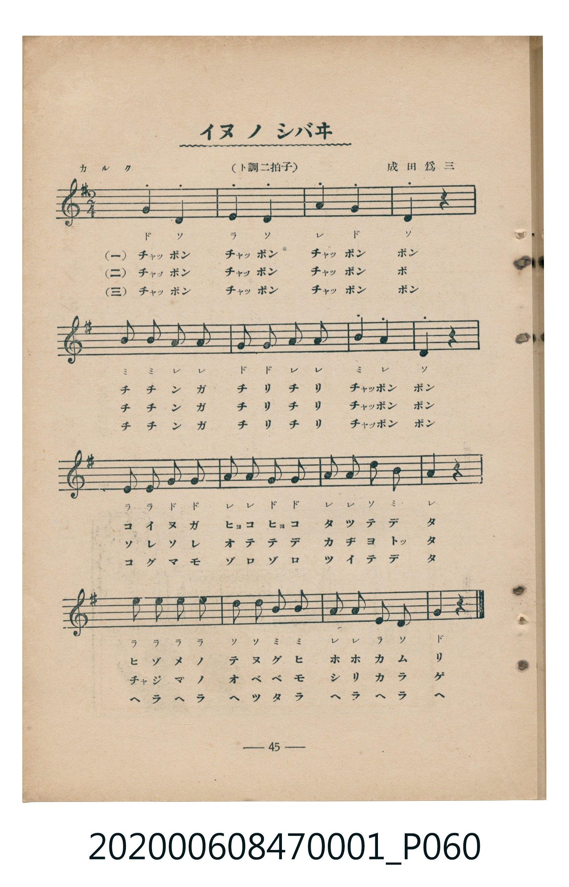
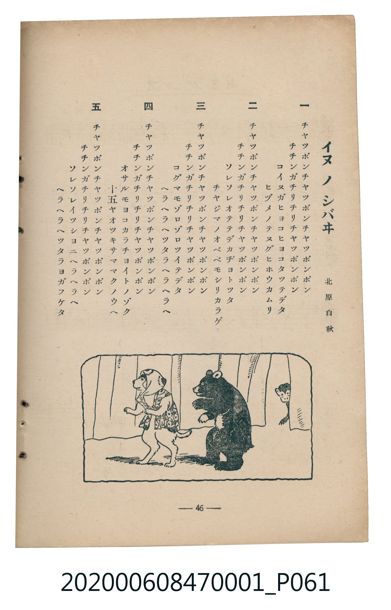

# イヌノシバヰ（狗的戲劇）

> Re:Shōka 使用 AI 協助辨識與重建樂譜，可能會有錯誤。歡迎回報。

- **鋼琴伴奏版**：<br><audio controls src="inu_no_shibai.mp3"></audio>
- **NEUTRINO 歌聲合成版**：<br><audio controls src="inu_no_shibai_neutrino.mp3"></audio>

- 詞：北原白秋
- 曲：成田爲三
- 臺灣教育會公認《新定兒童唱歌》尋常科第一學年用（2020.006.0847.0001）

## 說明

曲目說明
中文解釋：把狗擬人化，描寫牠們演戲般的滑稽動作。


## 歌詞

```text
一
チヤツポンチヤツポンチヤツポンポン
チチンガチリチリチヤツポンポン
コイヌガヒヨコヒヨコタツテデタ
ヒヅメノテヌグヒホウカムリ

二
チヤツポンチヤツポンチヤツポンポン
チチンガチリチリチヤツポンポン
ソレソレオテテデカヂヨトツタ
チヤジマノオベベモシリカラゲ

三
チヤツポンチヤツポンチヤツポンポン
チチンガチリチリチヤツポンポン
コグマモゾロゾロツイテデタ
ヘラヘラヘツタラヘラヘラヘ

四
チヤツポンチヤツポンチヤツポンポン
チチンガチリチリチヤツポンポン
オサルモヨコカラチヨイトノゾク
十五ヤオツキサママクノウヘ

五
チヤツポンチヤツポンチヤツポンポン
チチンガチリチリチヤツポンポン
ソレソレイツシヨニヘラヘラヘ
ヘラヘラヘツタラヨガフケタ
```

## ABC

<div class="abc-score" data-abc-src="inu_no_shibai.abc" aria-label="五線譜載入中"></div>

[下載 ABC 原始檔](inu_no_shibai.abc)

## TMD 檔案連結

- [主旋律 TMD 檔案](inu_no_shibai.tmd) [[在 TMD Studio 編輯](https://tmdlang.github.io/Tmd-TS/#tmd=s7IKdvYPcrWy4qpTUCpJTLdSSM7PyUlNLsnMz7MqzsjMK0nNjM_KTMmPL87Iz05Ugisry88pzU21Si9KTEmNN4w3MjAyiDcwMIs3sDAxBzIMDBFKi_NLi5JTrYqTM_Lzc-JLUitKkvLzsxHyBUX5Zal5iXlANQVFIBtTwIoQClLLMlNSQdKpKZkl-UWZiTlI7kgtKga7FWxJfElRYl5xclFmAcgDCFUlGalAxybmZeYi6wUalZ6ZZ1WSmAn0HMiD5YnxuYmZeTmJeSnIqkoy8oH-LMiotMrILAY5IDkxJz47MQ8pOKDWFySmp1oFGJgZ6AIJYBBoaSk8blryuLnncXPf46btj5snPG7e8H5Px_Pu6c9ntTzr2PS0q_39nk4FLS0uRVsFQwMLLntbBXcuGyN9EzuQ2S9Wznu_Z9bTnulP--Y_n7n3-fJusJXPZm8CCj_rmPB8yobnHZue7OgEC79o3_W8cfGzqTNfNG16Nqf5aeuaF6t6Hzd0PZu24em6WU9bJz1fvfTplI3P1vY8buh-uqH76Y4dz5dPfL5mzZMdDU_X7ni6c8vzKSuArgNFph4wMvVAkQlkGBgC3ajEpa-lALT4-ex1L1atejajj0tBQeHJjrXPprW_WL74ZXs3yEVdXUCfPZu85smuXU97pr3f0_Osv__p-tXPOxc8bZj4bM8UoI9fdKwBeX33xOcr9j7tnvpk75zHDU1cWvpcQPO5gA7hetzc-LgZGGYtj5vnPm7eTIgLIiF6gGjz46Y1YMYqJBJTdRNQHThWQKonPW5eARKBM5r2gzW0PW5uB7KBZgMlWh83LwTFIUgUqG0DWHD246Zlj5tWP25eALSKi-vJrh66OH7v4-Y1MBKoCOgiiFOBDmkCeaG5A6QH7HKwAU07HjfPAydAoOqZYLQInBhXgfWsfNy0Cej4HZ30Cnlg4AGdA3TCvsfNa6EkyMFA1YgwnwFyGIIE-QdVBERycT2dPZsuzgYG1dbHzcDQWgRLJOCQA6kGcoEagGEODOB9j5vWcz3tbXyyawo45IHmAV0O9CRQM9DP84DSYHXLwI4HqqJ7ggFLgyIfmE660YMTd7ADPQm0aurjpo2g6AHlVl9gQWkVkJmYl-9QY1BTDSoNFGwstOzAjBoFQwVdBdN4IFGjYAaioGwjIAmSqoEIGABhDViHj2GNAtj9ix83NwNlII4HqyRVGMpEMtuIhmYb09BsExqabUobs6HRbwyERkAISgiGUJYxUBEo_nHFPRRvBlaZayD2AfEqOE1GjFPTREg8U9NESOxS00RInFLJRGhMAnMvEIFiEZR7jZBYpsAYheRotKhsAlm9BGheD9wJwNpyOUQCwQSp3A8UaAHiNiBuh4pgRGTTXqDsGjgNEgF5B6QHoW81kNUExCuAGFgYN2MzDBSHYMdtACqaB8SLwKr2AVlr4TTIuUAngT2A01mguAM5omkrUAXIarBJIMvB5oNEVsJCGuRbkGEdQNwHsRBYD2DGHBZvgrSB3AIsr4GmNHeDjZwBNhxGQ0TQIw0KgVkNHE2QiDICxSQw70FKZ_T8NwmIW4F4IcyZYN-DohAUWpPAIrOBvGVQ_y0Ai6zCUdICFe2ABjLEz6AYmwnFkGDfDtaOFFhNm7BkOWy-hQQKKO0gRHCFCCK6gM2gpVD3bwEqWQJ3FsgwUPxvBWsFOhkYOyBng9RiMQycy4hxFig1AOOzeSqQ3oiWimq5uHTtFECVqAKQVuYCAA)]
- [鋼琴伴奏 TMD 檔案](inu_no_shibai_piano.tmd) [[在 TMD Studio 編輯](https://tmdlang.github.io/Tmd-TS/#tmd=s7IKdvYPcrWy4qpTUCpJTLdSyC8qychPL0osyKi0ysgsLskvykxOzInPTsxLVIIrKs4vLUpOjS9ITE-1CjAwM9AFEoZKXFpaCo-bljxu7nnc3Pe4afvj5gmPmze839PxuHnK46ZFQMEne7Y8Xdr_ZPeM93s6FbS0uBRtFQwNLLjsbRXcuWyM9E3sQDa8WDnv_Z5ZT3umP-2b_3zm3ufLu8EWP5u9CSj8rGPC8ykbnndserKjEyz8on3X88bFz6bOfNG06dmc5qeta16s6n3c0PVs2oan62Y9bZ30fPXSp1M2Plvb87ih--mG7qc7djxfPvH5mjVPdjQ8Xbvj6c4tz6esALrRyMDIQM_AwEzPwMLEHMgwMAS6UYmLyzcxM88qIDMxLz_Iw6HGoKaaSwEIbCy07MCMGgVDBV0F03ggUaNgBqKgbCMgCZKqgQgYAGENWIePYY3C4-bGx82LHzc3A2UeN8993LwZrJJUYSgTyWwjGpptTEOzTWhotiltzIZGvzEQGgEhKCEYQlnGQEWg-McV91C8GZhb1kDsA-JVcJqMGKemiZB4pqaJkNilpomQOKWSidCYBOZeIALFIij3GiGxTIExCsnRaFHZBLJ6CdC8HrgTJj1uXg6RQDBBKvcDBVqAuA2I26EiGBHZtBcouwZOg0RA3gHpQehbDcQ7gLwVQAwsWpuxGQaKQ7DjNgAVzQPiRWBV-4CstXAa5Fygk8AewOksUNyBHNG0FagCaDXEJJDlYPNBIithIQ3yLciwDiDug1j4uGk9Zsxh8SZIG8gtwEoDaEpzN9jIGWDDYTREBD3SoBCY1cDRBIkoI1BMAvMepHRGz3-TgPbsAtILYc4E-x4UhaDQmgQWmQ3kLYP6bwFYZBWOkhYaG6BAhvgZFGMzoRgS7NvB2pECq2kTliyHzbeQQAGlHYQIrhBBRNeOx81Loe7fAlSyBO4skGGg-N8K1gp0MjB2QM4GqcViGDiXEeMsUGoAxmfzVCC9ES0V1SLXoT7IdagJvA6NNowFYyDLJB7ONEVlwpwFVQ4SwslEU4_bUOzmmwAlgBjFYWDVCJugXtO1UwD5LtoHKARnGyGxjZHYQCPhbFMwW5kLAA)]

## 分析

```text
================================================================================
📊 TMD Song Profile: [ イヌノシバヰ（狗的戲劇） ]
================================================================================
⏱  Duration:       0:17 (17.8s), 16 measures total
🎼 Key & Tempo:    首調基準 G, != 108.0 BPM, <2/4>
   - 分析範圍：      由實際發聲的音符與和弦推測調性；播放脈絡另行呈現
🎤 人聲音域:    D4 (MIDI 62) – E5 (MIDI 76) [跨度: 14 個半音 / 1.2 個八度, 難度: moderate]
   - 最低音:  D4 in [Main #1 @ m.1, 0:00]
   - 最高音: E5 in [Main #1 @ m.13, 0:13]
   - 適合: soprano, mezzo-soprano, contralto, tenor, baritone, bass
🏛  結構:      Main (17.8s)
⚡ 編曲密度:        Peak 1 軌道同時演奏
🗝  調性診斷：       D 大調（純淨自然大調，未偵測到可信轉調）
   - 風格氣質:    純淨自然大調（陽光明朗、易唱易記，無明顯調外色彩）
   - 轉調歷程:    全曲維持單一推測調性（未偵測到可信轉調）
   - 核心骨幹音:  A, D, G, E, B
   - 調性數值:    D 大調 [相關度: 0.79, 穩定度: Moderate, 自然音純度: 100.0%]
   - 候選調性 (K-S): D 大調 (0.79), G 大調 (0.71), A 大調 (0.61)
   - 五度圈歷程:   +2
   - 各段落調性細節:
     • [Main #1]: D 大調 (r: 0.79, 自然音純度: 100.0%)

  [ 五度圈游移軌跡 ]
               C  
         F            G  
      Bb              [D ]*
      Eb               A  
         Ab           E  
            Db       B  
               F# 
     (* = active key center)

  [ 十二半音累積音高分佈 ]
     C  :                            0.0%
     C# :                            0.0%
     D  : ██████████████████        21.4%
     D# :                            0.0%
     E  : ██████████████            16.1%
     F  :                            0.0%
     F# :                            0.0%
     G  : ██████████████████        21.4%
     G# :                            0.0%
     A  : ████████████████████████  28.6%
     A# :                            0.0%
     B  : ███████████               12.5%
--------------------------------------------------------------------------------
Assignment 軌道音域：
  - Piano         : D4 – E5 (14 個半音 / 1.2 個八度, 44 個音符)
================================================================================
```


## 原書掃描頁






