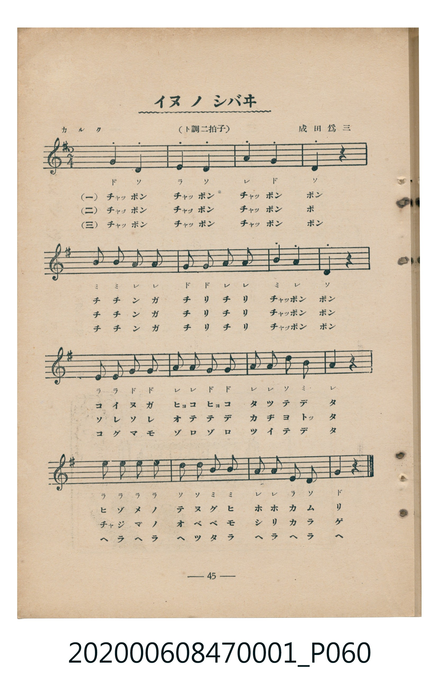
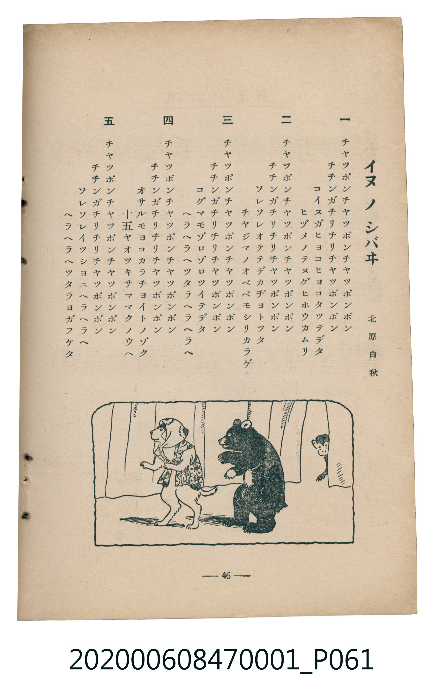

# イヌノシバヰ（狗的戲劇）

> Re:Shōka 使用 AI 協助辨識與重建樂譜，可能會有錯誤。歡迎回報。

- **NEUTRINO 歌聲合成版**：<br><audio controls src="inu_no_shibai_neutrino.mp3"></audio>
- **鋼琴伴奏版**：<br><audio controls src="inu_no_shibai.mp3"></audio>


- 詞：北原白秋
- 曲：成田爲三
- 臺灣教育會公認《新定兒童唱歌》尋常科第一學年用（2020.006.0847.0001）

## 說明

曲目說明
中文解釋：把狗擬人化，描寫牠們演戲般的滑稽動作。


## 歌詞

```text
一
チヤツポンチヤツポンチヤツポンポン
チチンガチリチリチヤツポンポン
コイヌガヒヨコヒヨコタツテデタ
ヒヅメノテヌグヒホウカムリ

二
チヤツポンチヤツポンチヤツポンポン
チチンガチリチリチヤツポンポン
ソレソレオテテデカヂヨトツタ
チヤジマノオベベモシリカラゲ

三
チヤツポンチヤツポンチヤツポンポン
チチンガチリチリチヤツポンポン
コグマモゾロゾロツイテデタ
ヘラヘラヘツタラヘラヘラヘ

四
チヤツポンチヤツポンチヤツポンポン
チチンガチリチリチヤツポンポン
オサルモヨコカラチヨイトノゾク
十五ヤオツキサママクノウヘ

五
チヤツポンチヤツポンチヤツポンポン
チチンガチリチリチヤツポンポン
ソレソレイツシヨニヘラヘラヘ
ヘラヘラヘツタラヨガフケタ
```

## ABC

```abc
X:1
T:イヌノシバヰ（狗的戲劇）
C:曲：成田爲三
M:2/4
L:1/16
Q:1/4=108
K:G
V:V1 name="Piano" snm="Pia"
[V:V1]
G4 D4 | E4 D4 | A4 G4 | D4 z2 z2 |
w: 1.~チャッ ポン | チャッ ポン | チャッ ポン | ポン
w: 2.~チャッ ポン | チャッ ポン | チャッ ポン | ポン
w: 3.~チャッ ポン | チャッ ポン | チャッ ポン | ポン
w: 4.~チャッ ポン | チャッ ポン | チャッ ポン | ポン
w: 5.~チャッ ポン | チャッ ポン | チャッ ポン | ポン
B2 B2 A2 A2 | G2 G2 A2 A2 | B4 A4 | D4 z2 z2 |
w: 1.~チ チ ン ガ | チ リ チ リ | チャッ ポン | ポン
w: 2.~チ チ ン ガ | チ リ チ リ | チャッ ポン | ポン
w: 3.~チ チ ン ガ | チ リ チ リ | チャッ ポン | ポン
w: 4.~チ チ ン ガ | チ リ チ リ | チャッ ポン | ポン
w: 5.~チ チ ン ガ | チ リ チ リ | チャッ ポン | ポン
E2 E2 G2 G2 | A2 A2 G2 G2 | A2 A2 d2 B2 | A4 z2 z2 |
w: 1.~コ イ ヌ ガ | ヒョ コ ヒョ コ | タ ツ テ デ | タ
w: 2.~ソ レ ソ レ | オ テ テ デ | カ ヂ ヨ トッ | タ
w: 3.~コ グ マ モ | ゾ ロ ゾ ロ | ツ イ テ デ | タ
w: 4.~オ サ ル モ | ヨ コ カ ラ | チョ イ ト ノ | ゾク
w: 5.~ソ レ ソ レ | イ ツ ショ ニ | ヘ ラ ヘ ラ | ヘ
e2 e2 e2 e2 | d2 d2 B2 B2 | A2 A2 E2 D2 | G4 z2 z2 |
w: 1.~ヒ ヅ メ ノ | テ ヌ グ ヒ | ホ ウ カ ム | リ
w: 2.~チャ ジ マ ノ | オ ベ ベ モ | シ リ カ ラ | ゲ
w: 3.~ヘ ラ ヘ ラ | ヘ ツ タ ラ | ヘ ラ ヘ ラ | ヘ
w: 4.~ジュ ウ ゴ ヤ | オ ツ キ サ | マ ク ノ ウ | ヘ
w: 5.~ヘ ラ ヘ ラ | ヘ ツ タ ラ | ヨ ガ フ ケ | タ
```

## TMD 檔案連結

- [主旋律 TMD 檔案](inu_no_shibai.tmd) [[在 TMD Studio 編輯](https://tmdlang.github.io/Tmd-TS/#tmd=s7IKdvYPcrWy4qpTUCpJTLdSSM7PyUlNLsnMz7MqzsjMK0nNjM_KTMmPL87Iz05Ugisry88pzU21Si9KTEmNN4w3MjAyiDcwMIs3sDAxBzIMDBFKi_NLi5JTrYqTM_Lzc-JLUitKkvLzsxHyBUX5Zal5iXlANQVFIBtTwIoQClLLMlNSQdKpKZkl-UWZiTlI7kgtKga7FWxJfElRYl5xclFmAcgDCFUlGalAxybmZeYi6wUalZ6ZZ1WSmAn0HMiD5YnxuYmZeTmJeSlKXFpaCo-bljxu7nnc3Pe4afvj5gmPmze839PxvHv681ktzzo2Pe1qf7-nU0FLi0vRVsHQwILL3lbBncvGSN_EDmTFi5Xz3u-Z9bRn-tO--c9n7n2-vBts87PZm4DCzzomPJ-y4XnHpic7OsHCL9p3PW9c_GzqzBdNm57NaX7auubFqt7HDV3Ppm14um7W09ZJz1cvfTpl47O1PY8bup9u6H66Y8fz5ROfr1nzZEfD07U7nu7c8nzKCqDrQBGhB4wIPVBEABkGhkA3KnHpaykALX4-e92LVauezejjUlBQeLJj7bNp7S-WL37Z3g1yUVcX0GfPJq95smvX055p7_f0POvvf7p-9fPOBU8bJj7bMwXo4xcda0Be3z3x-Yq9T7unPtk753FDE5eWPhfQfC6gQ7geNzc-bgaGWcvj5rmPmzcT4oJIiB4g2vy4aQ2YsQqJxFTdBFQHjhWQ6kmPm1eAROCMpv1gDW2Pm9uBbKDZQInWx80LQXEIEgVq2wAWnP24adnjptWPmxcAreLierKrhy6O3_u4eQ2MBCoCugjiVKBDmkBeaO4A6QG7HGxA047HzfPACRCoeiYYLQInxlVgPSsfN20COn5HJ71CHhh4QOcAnbDvcfNaKAlyMFA1IsxngByGIEH-QRUBkVxcT2fPpouzgUG19XEzMLQWwRIJOORAqoFcoAZgmAMDeN_jpvVcT3sbn-yaAg55oHlAlwM9CdQM9PM8oDRY3TKw44Gq6J5gwNKgyAemk2704MQd7EBPAq2a-rhpIyh6QLnVF1jIWQVkJublO9QY1FSDSgMFG0MzLTswq0bBUEEXDE3joYwaBTMYE0nMCMqCKa9BSBpAcQ3YRB_DGgWwBxc_bm6GqoD4EK6TUmkkLprdRgNot_EA2m0ygHabDozd0ORrDOSAMCh9gjAkQYMwQgQkD4KwNEwo7YLdACFB9gKzFMydYLFVSPIgNhVSLD1thKRTetoISZ30tBGSJulkIzQlgktNMAFLgZBSE4QxRUyBGJQuESUrlqTYBHH2ErBTelC8AGzWLAcLgJWgckE694OFW8BkG5hsR5LBkRCb9oJVguxAZoNkIIEFMQnVvNVgXhOYXAEmgXUsKATxWAZKg1DPbQBrmQcmF0F17QPz1oLlEWyQt8EeggYIUd4CpT2I45u2gtVDnAu1CeJgqEsgMiuhMsCUAAlRiGUdYLIP5kBgAwG7faCUhycYIYZBfAGs3ME2NHdDrZwBdwAyGyaDPdEBOcgYWLQBSVjiQiQwEAanTXDJh6j1sZV_k8BWt4LJhcjehoY4JCFC4g2kFiQzGyy2DCkcF0BlQGGPs9wD5jawlh1gLZBEAAtjSIqbiUTCksd2MA8SqSiR1rQJu2XgIg9_6MIiBZJvUGWIixFEcgO245cihccWsEZQzCO8BbEMksJB6RJkJNj74HQFCQSIfjyWgUs5crwFSfXg9Nk8FczeCHUdZi6q5eLStVMAtSIVgLQyFwA)]
- [鋼琴伴奏 TMD 檔案](inu_no_shibai_piano.tmd) [[在 TMD Studio 編輯](https://tmdlang.github.io/Tmd-TS/#tmd=s7IKdvYPcrWy4tLSUnjctORxc8_j5r7HTdsfN0943Lzh_Z6Ox81THjctAgo-2bPl6dL-J7tnvN_TqaClxaVoq2BoYMFlb6vgzmVjpG9ix1WnoPRi5bz3e2Y97Zn-tG_-85l7ny_vVgIJP5u9CSj8rGPC8ykbnndserKjEyz8on3X88bFz6bOfNG06dmc5qeta16s6n3c0PVs2oan62Y9bZ30fPXSp1M2Plvb87ih--mG7qc7djxfPvH5mjVPdjQ8Xbvj6c4tz6esALrRyMDIQM_AwEzPwMLEHMgwMAS6UYmLyzcxM88qIDMxLz_Iw6HGoKaaSwEIbAzNtOzArBoFQwVdMDSNhzJqFMxgTCQxIygLprwGIWkAxTVgE30MaxQeNzc-bl78uLkZquJx89zHzZvhOimVRuKi2W00gHYbD6DdJgNot-nA2A1NvsZADgiD0icIQxI0CCNEQPIgCEvDhNIu2A0QEmTv46Y1MHeCxVYhyYPYVEix9LQRkk7paSMkddLTRkiapJON0JQILjXBBCwFQkpNEMYUMQViULpElKxYkmITxNlLwE7pQfHCpMfNy8ECYCWoXJDO_WDhFjDZBibbkWRwJMSmvWCVIDuQ2SAZSGBBTEI1bzWY1wQmV4BJYI0JCkE8loHSINRzG8Ba5oHJRVBd-8C8tWB5BBvkbbCHoAFClLdAaQ_i-KatYPUQ50JtgjgY6hKIzEqoDDAlQEIUYlkHmOyDOfBx03rs9oFSHp5ghBgG8QWwhQG2obkbauUMuAOQ2TAZ7IkOyEHGwKINSMISFyKBgTA4bYJLPkStj638mwS2uhVMLkT2NjTEIQkREm8gtSCZ2WCxZUjhuAAqAwp7nOUeMLeBtewAa4EkAlgYQ1LcTCQSljy2g3mQSEWJtKZN2C0DF3n4QxcWKZB8gypDXIwgktuOx81LkcJjC1gjKOYR3oJYBknhoHQJMhLsfXC6ggQCRD8ey8ClHDnegqR6cPpsngpmb4S6DjMX1SI3In2QG5EW8DZktGEsUC2EBPJM4lG4pti4CG_AtUMkCHKx6CfGQnz2m4AVgEkMz0B1o7oGHjS6dgqg0In2AQnD2EZIbGMkNsgCGNsUzFbmAgA)]

## 分析

```text
================================================================================
📊 TMD Song Profile: [ イヌノシバヰ（狗的戲劇） ]
================================================================================
⏱  Duration:       0:17 (17.8s), 16 measures total
🎼 Key & Tempo:    首調基準 G, != 108.0 BPM, <2/4>
   - 分析範圍：      由實際發聲的音符與和弦推測調性；播放脈絡另行呈現
🎤 人聲音域:    D4 (MIDI 62) – E5 (MIDI 76) [跨度: 14 個半音 / 1.2 個八度, 難度: moderate]
   - 最低音:  D4 in [Main #1 @ m.1, 0:00]
   - 最高音: E5 in [Main #1 @ m.13, 0:13]
   - 適合: soprano, mezzo-soprano, contralto, tenor, baritone, bass
🏛  結構:      Main (17.8s)
⚡ 編曲密度:        Peak 1 軌道同時演奏
🗝  調性診斷：       D 大調（純淨自然大調，未偵測到可信轉調）
   - 風格氣質:    純淨自然大調（陽光明朗、易唱易記，無明顯調外色彩）
   - 轉調歷程:    全曲維持單一推測調性（未偵測到可信轉調）
   - 核心骨幹音:  A, D, G, E, B
   - 調性數值:    D 大調 [相關度: 0.79, 穩定度: Moderate, 自然音純度: 100.0%]
   - 候選調性 (K-S): D 大調 (0.79), G 大調 (0.71), A 大調 (0.61)
   - 五度圈歷程:   +2
   - 各段落調性細節:
     • [Main #1]: D 大調 (r: 0.79, 自然音純度: 100.0%)

  [ 五度圈游移軌跡 ]
               C  
         F            G  
      Bb              [D ]*
      Eb               A  
         Ab           E  
            Db       B  
               F# 
     (* = active key center)

  [ 十二半音累積音高分佈 ]
     C  :                            0.0%
     C# :                            0.0%
     D  : ██████████████████        21.4%
     D# :                            0.0%
     E  : ██████████████            16.1%
     F  :                            0.0%
     F# :                            0.0%
     G  : ██████████████████        21.4%
     G# :                            0.0%
     A  : ████████████████████████  28.6%
     A# :                            0.0%
     B  : ███████████               12.5%
--------------------------------------------------------------------------------
Assignment 軌道音域：
  - Piano         : D4 – E5 (14 個半音 / 1.2 個八度, 44 個音符)
================================================================================
```


## 原書掃描頁






