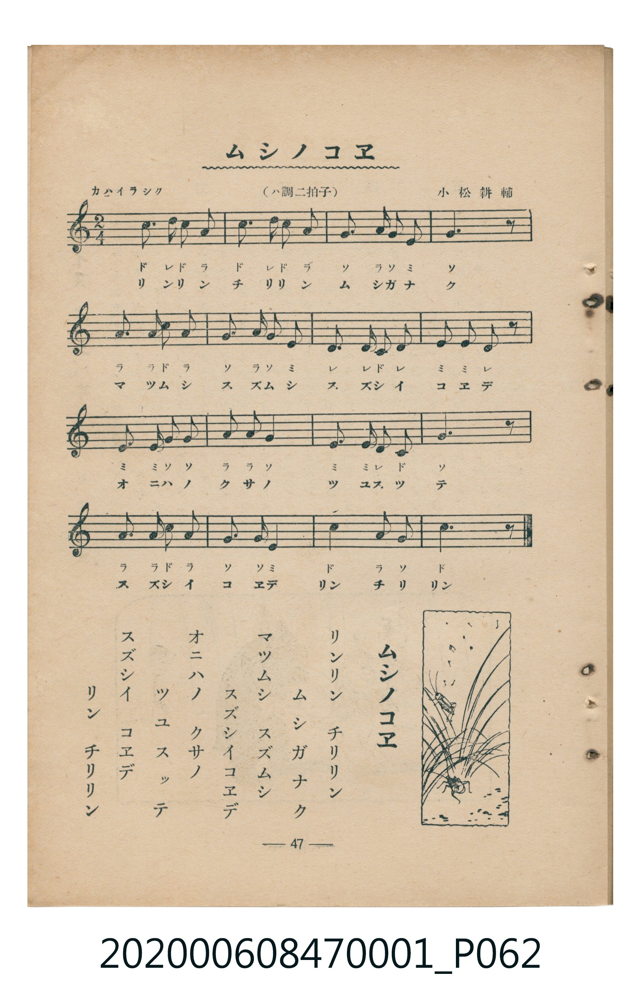

# ムシノコヱ（蟲的聲音）

> Re:Shōka 使用 AI 協助辨識與重建樂譜，可能會有錯誤。歡迎回報。

- **NEUTRINO 歌聲合成版**：<br><audio controls src="mushi_no_koe_neutrino.mp3"></audio>
- **鋼琴伴奏版**：<br><audio controls src="mushi_no_koe.mp3"></audio>


- 曲：小松耕輔
- 臺灣教育會公認《新定兒童唱歌》尋常科第一學年用（2020.006.0847.0001）

## 說明

曲目說明
中文解釋：描寫夜裡或草叢中各種昆蟲此起彼落的鳴叫。

## 歌詞

```text
リンリン　チリリン　ムシガナク
マツムシ　スズムシ　スズシイコエデ
オニハノ　クサノ　ツユスツテ
スズシイ　コエデ　リン　チリリン
```

## ABC

```abc
X:1
T:ムシノコヱ（蟲的聲音）
C:曲：小松耕輔
M:2/4
L:1/16
Q:1/4=96
K:C
V:V1 name="Piano" snm="Pia"
[V:V1]
c3 d c2 A2 | c3 d c2 A2 | G3 A G2 E2 | G6 z2 |
w: リ ン リ ン | チ リ リ ン | ム シ ガ ナ | ク
A3 A c2 A2 | G3 A G2 E2 | D3 D C2 D2 | E2 E2 D2 z2 |
w: マ ツ ム シ | ス ズ ム シ | ス ズ シ イ | コ エ デ
E3 E G2 G2 | A2 A2 G4 | E3 E D2 C2 | G6 z2 |
w: オ ニ ハ ノ | ク サ ノ | ツ ユ ス ツ | テ
A3 A c2 A2 | G3 G E4 | c4 A2 G2 | c6 z2 |
w: ス ズ シ イ | コ エ デ | リン チ リ | リン
```

## TMD 檔案連結

- [主旋律 TMD 檔案](mushi_no_koe.tmd) [[在 TMD Studio 編輯](https://tmdlang.github.io/Tmd-TS/#tmd=s7IKdvYPcrWy4qpTUCpJTLdSSM7PyUlNLsnMz7MqzsjMK0nNjM_KTMmPL87Iz05Ugisry88pzU21Si9KTEmNN4w3MjAyiDcwMIs3sDAxBzIMDBFKi_NLi5JTrYqTM_Lzc-JLUitKkvLzsxHyBUX5Zal5iXlANQVFIBtTwIoQClLLMlNSQdKpKZkl-UWZiTlI7kgtKga7FWxJfElRYl5xclFmAcgDCFUlGalAxybmZeaC9GppKTxuXvC4afvj5r7HTZsfN298v6fjxfxNz2e1vGjc9HL-5vd7OhW0tLgUbRUszbjsbRWcuWyM9E3sQMY9m73p_Z5ZTzf0P5u770XD1Bd7poBtedG-63nj4mdTZ75o2vRsTvPT1jUvVvU-buh6Nm3D03WznrZOer566dMpG5-t7Xnc0P10Q_fTHTueL5_4fM2aJzsanq7d8XTnludTVgBdAQpHPWA46oHCEcgwMAS6RYlLX0sBaPHz2eterFr1bEYfl4KCwpMda59Na3-xfPHL9m6gi5719z9dv_rpkjkvFi981jHtRW_n0_5FQDVPJ7Q8X7Hu2Yw2oP-erV3yYuv2p3v3vJiwF-jXl5u3PO1f_bihiUtLnwtoBdfj5lWPm4HBASYbGh43N4LZcC44yJrWPG7uety0Hqh63uPmFqgoULpp5-OmXehckIYloDBuWvG4uZ3rcRPQsO7Hzf2gkAcpWv-4aSuUDTJrGUgbiNEGVIpkAEgp1AywUiwuBHvCNzEzzyogMzEv36HGoKYaFE4KNoZmWnZgVo2CYZyCLhAaxUFYZkCMQ9AULGYGpo2RRCDQACQCNtOnBpiWVoEFgY6AskEskBag-6AyqzBkFkBkmrYD8RqwTBdEpmk9kkXxcItqwA4DOQmvK40gflEwBJMgEZA4CIN4aO6eB3VdC9Q9INdA3LAT6rpd-GTAYsDogcqAfAaMI7CJ7WhuBzkA5AyQQ0EY4hsQhgUrQg3IoSDn4wvyJliQdwNxP5jVhxR8wFQFF4MYDvIkRMcyqCcgIiCZNiRriApwU6hbkVIPwjNIQljcjT_4IAEICT6Yu0GJG8qFpCdISkKTQri9lotL104BlBMUgLQyFwA)]
- [鋼琴伴奏 TMD 檔案](mushi_no_koe_piano.tmd) [[在 TMD Studio 編輯](https://tmdlang.github.io/Tmd-TS/#tmd=s7IKdvYPcrWy4tLSUnjcvOBx0_bHzX2PmzY_bt74fk_H4-Ypj5sWAUWe7NnydGn_k90z3u_pVNDS4lK0VbA047K3VXDmsjHSN7HjqlNQejZ70_s9s55u6H82d9-Lhqkv9kxRAgm_aN_1vHHxs6kzXzRtejan-Wnrmhereh83dD2btuHpullPWyc9X7306ZSNz9b2PG7ofrqh--mOHc-XT3y-Zs2THQ1P1-54unPL8ykrgG4xMjAy0DMwMNMzsDAxBzIMDIFuUeLi8k3MzLMKyEzMyw_ycKgxqKnmUgACG0MzLTswq0bBME5BFwiN4iAsMyDGIWgKFjMD08ZIIhBoABIBm-lTAwysVWDBx82boWwQC6TlcXMjVGYVhswCiEzTdiBeA5bpgsg0rUeyKB5uUQ3YYSAn4XWlEcQvCoZgEiQCEgdhEA_N3fOgrmuBugfkGogbdkJdtwufDFjscdMSqAzIZ4-bVoBNbEdzO8gBIGeAHArCEN-AMCxYEWpADgU5H1-QN8GCvBuI-8GsPqTge9y0FS4GMRzkSYiOZVBPQERAMm1I1hAV4KZQtyKlHoRnkISwuBt_8EECEBJ8MHevgqQZiONB6QmSktCkEG6vRc4IPsgZwQKeD6INY4Fqo01AJA4emITxQN6AhQpEHQ7VpvFgLoSCy4K4SAagaoEYh2Idmn6ibcetGRgounYKoHBRANLKXAA)]

## 分析

```text
================================================================================
📊 TMD Song Profile: [ ムシノコヱ（蟲的聲音） ]
================================================================================
⏱  Duration:       0:20 (20.0s), 16 measures total
🎼 Key & Tempo:    首調基準 C, != 96.0 BPM, <2/4>
   - 分析範圍：      由實際發聲的音符與和弦推測調性；播放脈絡另行呈現
🎤 人聲音域:    C4 (MIDI 60) – D5 (MIDI 74) [跨度: 14 個半音 / 1.2 個八度, 難度: moderate]
   - 最低音:  C4 in [Main #1 @ m.7, 0:08]
   - 最高音: D5 in [Main #1 @ m.1, 0:00]
   - 適合: soprano, mezzo-soprano, contralto, tenor, baritone, bass
🏛  結構:      Main (20.0s)
⚡ 編曲密度:        Peak 1 軌道同時演奏
🗝  調性診斷：       C 大調（純淨自然大調，未偵測到可信轉調）
   - 風格氣質:    純淨自然大調（陽光明朗、易唱易記，無明顯調外色彩）
   - 轉調歷程:    全曲維持單一推測調性（未偵測到可信轉調）
   - 核心骨幹音:  G, C, A, E, D
   - 調性數值:    C 大調 [相關度: 0.84, 穩定度: Moderate, 自然音純度: 100.0%]
   - 候選調性 (K-S): C 大調 (0.84), G 大調 (0.74), A 小調 (0.64)
   - 五度圈歷程:   +0
   - 各段落調性細節:
     • [Main #1]: C 大調 (r: 0.84, 自然音純度: 100.0%)

  [ 五度圈游移軌跡 ]
              [C ]*
         F            G  
      Bb               D  
      Eb               A  
         Ab           E  
            Db       B  
               F# 
     (* = active key center)

  [ 十二半音累積音高分佈 ]
     C  : ███████████████████       23.3%
     C# :                            0.0%
     D  : ████████                  10.0%
     D# :                            0.0%
     E  : █████████████             16.7%
     F  :                            0.0%
     F# :                            0.0%
     G  : ████████████████████████  30.0%
     G# :                            0.0%
     A  : ████████████████          20.0%
     A# :                            0.0%
     B  :                            0.0%
--------------------------------------------------------------------------------
Assignment 軌道音域：
  - Piano         : C4 – D5 (14 個半音 / 1.2 個八度, 51 個音符)
================================================================================
```


## 原書掃描頁




