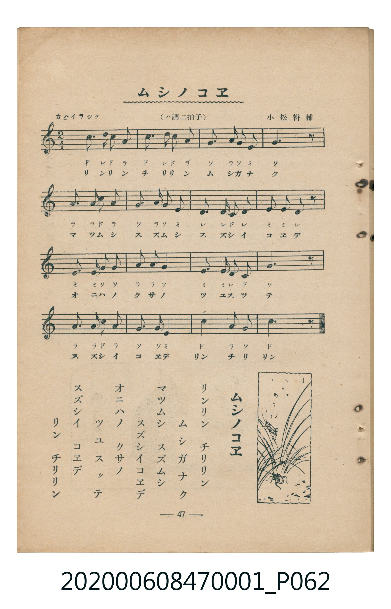

# ムシノコヱ（蟲的聲音）

> Re:Shōka 使用 AI 協助辨識與重建樂譜，可能會有錯誤。歡迎回報。

- **鋼琴伴奏版**：<br><audio controls src="mushi_no_koe.mp3"></audio>
- **NEUTRINO 歌聲合成版**：<br><audio controls src="mushi_no_koe_neutrino.mp3"></audio>

- 曲：小松耕輔
- 臺灣教育會公認《新定兒童唱歌》尋常科第一學年用（2020.006.0847.0001）

## 說明

曲目說明
中文解釋：描寫夜裡或草叢中各種昆蟲此起彼落的鳴叫。


## 歌詞

```text
リンリン　チリリン　ムシガナク
マツムシ　スズムシ　スズシイコエデ
オニハノ　クサノ　ツユスツテ
スズシイ　コエデ　リン　チリリン
```

## ABC

<div class="abc-score" data-abc-src="mushi_no_koe.abc" aria-label="五線譜載入中"></div>

[下載 ABC 原始檔](mushi_no_koe.abc)

## TMD 檔案連結

- [主旋律 TMD 檔案](mushi_no_koe.tmd) [[在 TMD Studio 編輯](https://tmdlang.github.io/Tmd-TS/#tmd=s7IKdvYPcrWy4qpTUCpJTLdSSM7PyUlNLsnMz7MqzsjMK0nNjM_KTMmPL87Iz05Ugisry88pzU21Si9KTEmNN4w3MjAyiDcwMIs3sDAxBzIMDBFKi_NLi5JTrYqTM_Lzc-JLUitKkvLzsxHyBUX5Zal5iXlANQVFIBtTwIoQClLLMlNSQdKpKZkl-UWZiTlI7kgtKga7FWxJfElRYl5xclFmAcgDCFUlGalAxybmZeYi6wUalZ6ZZ1WSmAn0HMiD5YnxuYmZeTmJeSnIqkoy8oH-LMiotMrILAY5IDkxJz47MQ8pOKDWFySmp1oFGJgZKXFpaSk8bl7wuGn74-a-x02bHzdvfL-n48X8Tc9ntbxo3PRy_ub3ezoVtLS4FG0VLM247G0VnLlsjPRN7EBGPpu96f2eWU839D-bu-9Fw9QXe6aAbXrRvut54-JnU2e-aNr0bE7z09Y1L1b1Pm7oejZtw9N1s562Tnq-eunTKRufre153ND9dEP30x07ni-f-HzNmic7Gp6u3fF055bnU1YAXQGKLD1gZOmBIgvIMDAEukWJS19LAWjx89nrXqxa9WxGH5eCgsKTHWufTWt_sXzxy_ZuoIue9fc_Xb_66ZI5LxYvfNYx7UVv59P-RUA1Tye0PF-x7tmMNqD_nq1d8mLr9qd797yYsBfo15ebtzztX_24oYlLS58LaAXX4-ZVj5uBwQEmGxoeNzeC2XAuOMia1jxu7nrctB6oet7j5haoKFC6aefjpl3oXJCGJaAwblrxuLmd63ET0LDux839oJAHKVr_uGkrlA0yaxlIG4jRBlSKZABIKdQMsFIsLgR7wheYRKwCMhPz8h1qDGqqQeGkYGNopmUHZtUoGMYp6AKhURyEZQbEOARNwWJmYNoYSQQCDUAiYDN9aoBpaRVYEOgIKBvEAmkBug8qswpDZgFEpmk7EK8By3RBZJrWI1kUD7eoBuwwkJPwutII4hcFQzAJEgGJgzCIh-bueVDXtUDdA3INxA07oa7bhU8GLAaMHqgMyGfAOAKb2I7mdpADQM4AORSEIb4BYViwItSAHApyPr4gb4IFeTcQ94NZfUjBB0xVcDGI4SBPQnQsg3oCIgKSaUOyhqgAN4W6FSn1IDyDJITF3fiDDxKAkOCDuRuUuKFcSHqCpCQ0KYTba7m4dO0UQDlBAUgrcwEA)]
- [鋼琴伴奏 TMD 檔案](mushi_no_koe_piano.tmd) [[在 TMD Studio 編輯](https://tmdlang.github.io/Tmd-TS/#tmd=s7IKdvYPcrWy4qpTUCpJTLdSyC8qychPL0osyKi0ysgsLskvykxOzInPTsxLVIIrKs4vLUpOjS9ITE-1CjAwM1Li0tJSeNy84HHT9sfNfY-bNj9u3vh-T8fj5imPmxYBRZ7s2fJ0af-T3TPe7-lU0NLiUrRVsDTjsrdVcOayMdI3sQMZ_Gz2pvd7Zj3d0P9s7r4XDVNf7JkCtu9F-67njYufTZ35omnTsznNT1vXvFjV-7ih69m0DU_XzXraOun56qVPp2x8trbncUP30w3dT3fseL584vM1a57saHi6dsfTnVueT1kBdIuRgZGBnoGBmZ6BhYk5kGFgCHSLEheXb2JmnlVAZmJefpCHQ41BTTWXAhDYGJpp2YFZNQqGcQq6QGgUB2GZATEOQVOwmBmYNkYSgUADkAjYTJ8aYGCtAgs-bt4MZYNYIC2PmxuhMqswZBZAZJq2A_EasEwXRKZpPZJF8XCLasAOAzkJryuNIH5RMASTIBGQOAiDeGjungd1XQvUPSDXQNywE-q6XfhkwGKPm5ZAZUA-e9y0AmxiO5rbQQ4AOQPkUBCG-AaEYcGKUANyKMj5-IK8CRbk3UDcD2b1IQXf46atcDGI4SBPQnQsg3oCIgKSaUOyhqgAN4W6FSn1IDyDJITF3fiDDxKAkOCDuXsVJM1AHA9KT5CUhCaFcHstckbwQc4IFvB8EG0YC1QbbQIicfDAJIwH8gYsVCDqcKg2jQdzIRRcFsRFMgBVC8Q4FOvQ9BNtO27NwEDRtVMAhYsCkFbmAgA)]

## 分析

```text
================================================================================
📊 TMD Song Profile: [ ムシノコヱ（蟲的聲音） ]
================================================================================
⏱  Duration:       0:20 (20.0s), 16 measures total
🎼 Key & Tempo:    首調基準 C, != 96.0 BPM, <2/4>
   - 分析範圍：      由實際發聲的音符與和弦推測調性；播放脈絡另行呈現
🎤 人聲音域:    C4 (MIDI 60) – D5 (MIDI 74) [跨度: 14 個半音 / 1.2 個八度, 難度: moderate]
   - 最低音:  C4 in [Main #1 @ m.7, 0:08]
   - 最高音: D5 in [Main #1 @ m.1, 0:00]
   - 適合: soprano, mezzo-soprano, contralto, tenor, baritone, bass
🏛  結構:      Main (20.0s)
⚡ 編曲密度:        Peak 1 軌道同時演奏
🗝  調性診斷：       C 大調（純淨自然大調，未偵測到可信轉調）
   - 風格氣質:    純淨自然大調（陽光明朗、易唱易記，無明顯調外色彩）
   - 轉調歷程:    全曲維持單一推測調性（未偵測到可信轉調）
   - 核心骨幹音:  G, C, A, E, D
   - 調性數值:    C 大調 [相關度: 0.84, 穩定度: Moderate, 自然音純度: 100.0%]
   - 候選調性 (K-S): C 大調 (0.84), G 大調 (0.74), A 小調 (0.64)
   - 五度圈歷程:   +0
   - 各段落調性細節:
     • [Main #1]: C 大調 (r: 0.84, 自然音純度: 100.0%)

  [ 五度圈游移軌跡 ]
              [C ]*
         F            G  
      Bb               D  
      Eb               A  
         Ab           E  
            Db       B  
               F# 
     (* = active key center)

  [ 十二半音累積音高分佈 ]
     C  : ███████████████████       23.3%
     C# :                            0.0%
     D  : ████████                  10.0%
     D# :                            0.0%
     E  : █████████████             16.7%
     F  :                            0.0%
     F# :                            0.0%
     G  : ████████████████████████  30.0%
     G# :                            0.0%
     A  : ████████████████          20.0%
     A# :                            0.0%
     B  :                            0.0%
--------------------------------------------------------------------------------
Assignment 軌道音域：
  - Piano         : C4 – D5 (14 個半音 / 1.2 個八度, 51 個音符)
================================================================================
```


## 原書掃描頁




