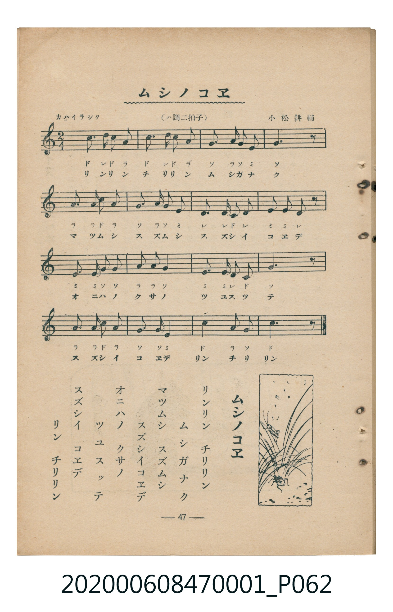

# ムシノコヱ

<audio controls src="mushi_no_koe.mp3"></audio>

- 曲：小松耕輔
- 臺灣教育會公認《新定兒童唱歌》尋常科第一學年用（2020.006.0847.0001）

## 說明

・出處：臺灣教育會公認《新定兒童唱歌》尋常科第一學年用（2020.006.0847.0001）
・調性與拍號：調號 ?= C，拍號 <2/4>，速度 != 96

## 歌詞

```text
リンリン　チリリン　ムシガナク
マツムシ　スズムシ　スズシイコエデ
オニハノ　クサノ　ツユスツテ
スズシイ　コエデ　リン　チリリン
```

## 原書掃描頁



## 分析

```text
================================================================================
📊 TMD Song Profile: [ ムシノコヱ ]
================================================================================
⏱  Duration:       0:20 (20.0s), 16 measures total
🎼 Key & Tempo:    首調基準 C, != 96.0 BPM, <2/4>
   - 分析範圍：      由實際發聲的音符與和弦推測調性；播放脈絡另行呈現
🎤 人聲音域:    G3 (MIDI 55) – D5 (MIDI 74) [跨度: 19 個半音 / 1.6 個八度, 難度: challenging]
   - 最低音:  G3 in [Main #1 @ m.12, 0:13]
   - 最高音: D5 in [Main #1 @ m.1, 0:00]
   - 適合: mezzo-soprano, contralto, tenor, baritone, bass
🏛  結構:      Main (20.0s)
⚡ 編曲密度:        Peak 1 軌道同時演奏
🗝  調性診斷：       C 大調（純淨自然大調，未偵測到可信轉調）
   - 風格氣質:    純淨自然大調（陽光明朗、易唱易記，無明顯調外色彩）
   - 轉調歷程:    全曲維持單一推測調性（未偵測到可信轉調）
   - 核心骨幹音:  G, C, A, E, D
   - 調性數值:    C 大調 [相關度: 0.84, 穩定度: Moderate, 自然音純度: 100.0%]
   - 候選調性 (K-S): C 大調 (0.84), G 大調 (0.74), A 小調 (0.64)
   - 五度圈歷程:   +0
   - 各段落調性細節:
     • [Main #1]: C 大調 (r: 0.84, 自然音純度: 100.0%)

  [ 五度圈游移軌跡 ]
              [C ]*
         F            G  
      Bb               D  
      Eb               A  
         Ab           E  
            Db       B  
               F# 
     (* = active key center)

  [ 十二半音累積音高分佈 ]
     C  : ███████████████████       23.3%
     C# :                            0.0%
     D  : ████████                  10.0%
     D# :                            0.0%
     E  : █████████████             16.7%
     F  :                            0.0%
     F# :                            0.0%
     G  : ████████████████████████  30.0%
     G# :                            0.0%
     A  : ████████████████          20.0%
     A# :                            0.0%
     B  :                            0.0%
--------------------------------------------------------------------------------
Assignment 軌道音域：
  - Piano         : G3 – D5 (19 個半音 / 1.6 個八度, 51 個音符)
================================================================================
```

## ABC

```abc
X:1
T:ムシノコヱ
C:曲：小松耕輔
M:2/4
L:1/16
Q:1/4=96
K:C
V:V1 name="Piano" snm="Pia"
[V:V1]
c3 d c2 a2 | c3 d c2 a2 | g3 a g2 e2 | g6 z2 |
a3 a c2 a2 | g3 a g2 e2 | d3 d c2 d2 | e2 e2 d2 z2 |
e3 e g2 g2 | a2 a2 g4 | e3 e d2 c2 | G6 z2 |
a3 a c2 a2 | g3 g e4 | c4 a2 g2 | c6 z2 |
```

- [主旋律 TMD 檔案](mushi_no_koe.tmd)
- [鋼琴伴奏 TMD 檔案](mushi_no_koe_piano.tmd)
