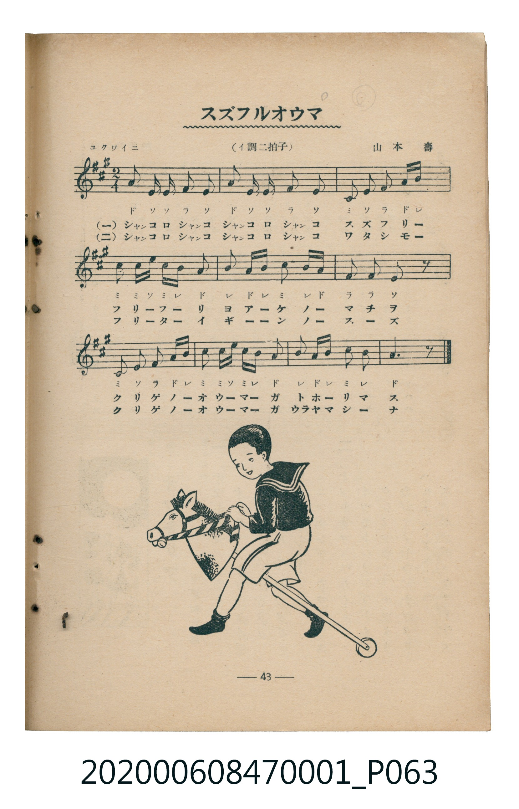

# スズフルオウマ（鈴鐺響的小馬）

> Re:Shōka 使用 AI 協助辨識與重建樂譜，可能會有錯誤。歡迎回報。

- **鋼琴伴奏版**：<br><audio controls src="suzu_furu_ouma.mp3"></audio>
- **NEUTRINO 歌聲合成版**：<br><audio controls src="suzu_furu_ouma_neutrino.mp3"></audio>

- 曲：山本壽
- 臺灣教育會公認《新定兒童唱歌》尋常科第一學年用（2020.006.0847.0001）

## 說明

曲目說明
中文解釋：描寫馬兒掛著鈴鐺奔跑，鈴聲清脆悅耳。


## 歌詞

```text
一
シヤンコロシヤンコ　シヤンコロシヤンコ
スズフリー　フリーフーリ
ヨアーケノー　マチヲ
クリゲノーオウーマーガ　トホーリマス

二
シヤンコロシヤンコ　シヤンコロシヤンコ
ワタシモー　フリーターイ
ギーンノー　スーズ
クリゲノーオウーマーガ　ウラヤマシーナ
```

## ABC

<div class="abc-score" data-abc-src="suzu_furu_ouma.abc" aria-label="五線譜載入中"></div>

[下載 ABC 原始檔](suzu_furu_ouma.abc)

## TMD 檔案連結

- [主旋律 TMD 檔案](suzu_furu_ouma.tmd) [[在 TMD Studio 編輯](https://tmdlang.github.io/Tmd-TS/#tmd=s7IKdvYPcrWy4qpTUCpJTLdSSM7PyUlNLsnMz7MqzsjMK0nNjM_KTMmPL87Iz05Ugisry88pzU21Si9KTEmNN4w3MjAyiDcwMIs3sDAxBzIMDBFKi_NLi5JTrYqTM_Lzc-JLUitKkvLzsxHyBUX5Zal5iXlANQVFIBtTwIoQClLLMlNSQdKpKZkl-UWZiTlI7kgtKga7FWxJfElRYl5xclFmAcgDCFUlGalAxybmZeYi6wUalZ6ZZ1WSmAn0HMiD5YnxuYmZeTmJeSlKXFpaCo-bdj5u2vW4eerj5tWPm1Y9blr2uHne-z0dLzu2vJyw6-X8_c9ntTzd0P9y2Zr3ezoVtLS4FG0VDA0suOxtFRy5bIz0TexAdj2bven9nllPN258NmfN08V7wfa_aN_1vHHxs6kzXzRtejan-Wnrmhereh83dD2btuHpullPWyc9X7306ZSNz9b2PG7ofrqh--mOHc-XT3y-Zs2THQ1P1-54unPL8ykrgC4BhbseMNz1QOEOZBgYAl2ixKWvpQC09fnsdS9WrXo2o49LQUHhyY61z6a1v1i--GV7N9A5z_r7n65fDXQ50K5nfbNfTJwO8dTTpVNebJ_4fk8PkPuicdOzHa0vWtqeNbW-aNj8uKGJS0ufC2g4F9AVXI-btj9uXvK4efPjps2Pm9eicBsa8MgCdcKDddXj5j0g1XA2iAEkV3E9bl7xuGkRiNO08XFzH0zdvMfNjY-bNwHNWA_S0bQJKgeNHaBWoAogdw1Ydcfj5tkQ80DiTTu5uJ7s6qHE5c3rHzftBwuBnYbscqA4iFwCNH4d2E6gbpizgR4Gye0iztkgkZVgS4FuBloFlO0Ch7wvMHFaBWQm5uU71BjUVIOiVcHG0EzLDsyqUTBU0FUwjQchs3gIUxenqDGcDRY1VDACCQJZxgqmQGwE1lYDNtjHsAaYFYAOWQz0FFAUGBIKwJDBEAMZS7y6nWDeLhDZPBVMroLIIPFQZCBuMaKBW5rXg3n7weR2sI2LMN0ClV8Cd0sNMJQgIQcKN1CI1UACExHOBmSFdfMKsE0gNwBTP9gFfVD3zAPzGsHkJiAJiUxgskJyJ0gcrqMJIrYMLAbW3bQGLTTXAfkgCA0VuE5QDIHFwbFEmU3oYQVLmDAIDiikEOgAmzIbYRfYRGRXgSDYTUg-AWUcsOIlYA2QyARBkJFdGBprubh07RRAuUoBSCtzAQA)]
- [鋼琴伴奏 TMD 檔案](suzu_furu_ouma_piano.tmd) [[在 TMD Studio 編輯](https://tmdlang.github.io/Tmd-TS/#tmd=s7IKdvYPcrWy4tLSUnjctPNx067HzVMfN69-3LTqcdOyx83z3u_peNw85XHTosfNfU_2bHm6tP_J7hnv93QqaGlxKdoqGBpYcNnbKjhy2Rjpm9hx1SkoPZu96f2eWU83bnw2Z83TxXuVQGIv2nc9b1z8bOrMF02bns1pftq65sWq3scNXc-mbXi6btbT1knPVy99OmXjs7U9jxu6n27ofrpjx_PlE5-vWfNkR8PTtTue7tzyfMoKoEuMDIwM9AwMzPQMLEzMgQwDQ6BLlLi4fBMz86wCMhPz8oM8HGoMaqq5FIDAxtBMyw7MqlEwVNBVMI0HIbN4CFMXp6gxnA0WNVQwAgkCWcYKpkBsBNZWAzbYx7AGGGzbHzcvfty8GSj6uGmzwuPmtRhiIGOJV7cTzNsFIpungslVEBkkHooMxC1GNHBL83owbz-Y3A62cRGmW6DyS-BuqQGGEiTkQOEGCrEaSGAiwtmArLBuXgG2CeSGx00bwS7og7pnHpjXCCY3AUlIZD5uAvsA6k6QOFxHE0RsGVgMrLtpDVporgPyQRAaKnCdoBgCi4NjiTKb0MMKljBhEBxQSCHQATZlNsIusInIrgJBsJuQfALMyyvBipeANUAiEwRBRnZhaKxFzlQ-yJnKAp6nog1jgWohJA6eSTwWSZh2U7AkXAdELYhrQJoBEAqmBhRgYPfr2imAvBDtAxKGsY3AbGUuAA)]

## 分析

```text
================================================================================
📊 TMD Song Profile: [ スズフルオウマ（鈴鐺響的小馬） ]
================================================================================
⏱  Duration:       0:11 (11.1s), 10 measures total
🎼 Key & Tempo:    首調基準 A, != 108.0 BPM, <2/4>
   - 分析範圍：      由實際發聲的音符與和弦推測調性；播放脈絡另行呈現
🎤 人聲音域:    C#4 (MIDI 61) – E5 (MIDI 76) [跨度: 15 個半音 / 1.2 個八度, 難度: moderate]
   - 最低音:  C#4 in [Main #1 @ m.3, 0:02]
   - 最高音: E5 in [Main #1 @ m.4, 0:03]
   - 適合: soprano, mezzo-soprano, contralto, tenor, baritone, bass
🏛  結構:      Main (11.1s)
⚡ 編曲密度:        Peak 1 軌道同時演奏
🗝  調性診斷：       A 大調（純淨自然大調，未偵測到可信轉調）
   - 風格氣質:    純淨自然大調（陽光明朗、易唱易記，無明顯調外色彩）
   - 轉調歷程:    全曲維持單一推測調性（未偵測到可信轉調）
   - 核心骨幹音:  A, C#, E, B, F#
   - 調性數值:    A 大調 [相關度: 0.85, 穩定度: High, 自然音純度: 100.0%]
   - 候選調性 (K-S): A 大調 (0.85), E 大調 (0.71), F# 小調 (0.67)
   - 五度圈歷程:   +3
   - 各段落調性細節:
     • [Main #1]: A 大調 (r: 0.85, 自然音純度: 100.0%)

  [ 五度圈游移軌跡 ]
               C  
         F            G  
      Bb               D  
      Eb              [A ]*
         Ab           E  
            Db       B  
               F# 
     (* = active key center)

  [ 十二半音累積音高分佈 ]
     C  :                            0.0%
     C# : ████████████████████      21.1%
     D  :                            0.0%
     D# :                            0.0%
     E  : ████████████████████      21.1%
     F  :                            0.0%
     F# : ███████████████           15.8%
     G  :                            0.0%
     G# :                            0.0%
     A  : ████████████████████████  25.0%
     A# :                            0.0%
     B  : ████████████████          17.1%
--------------------------------------------------------------------------------
Assignment 軌道音域：
  - Piano         : C#4 – E5 (15 個半音 / 1.2 個八度, 47 個音符)
================================================================================
```


## 原書掃描頁




