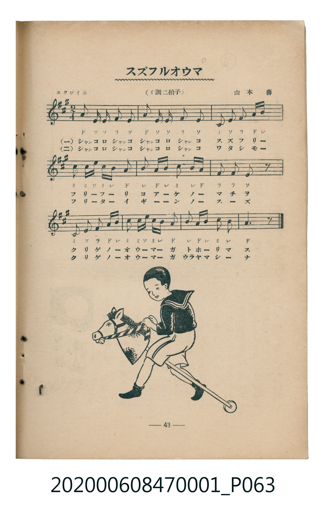

# スズフルオウマ（鈴鐺響的小馬）

> Re:Shōka 使用 AI 協助辨識與重建樂譜，可能會有錯誤。歡迎[回報](https://github.com/TMDLang/reshoka/issues)。

- **鋼琴伴奏版**：<br><audio controls src="suzu_furu_ouma.mp3"></audio>
- **NEUTRINO 歌聲合成版**：<br><audio controls src="suzu_furu_ouma_neutrino.mp3"></audio>

- 曲：山本壽
- 臺灣教育會公認《新定兒童唱歌》尋常科第一學年用（2020.006.0847.0001）

## 說明

曲目說明
中文解釋：描寫馬兒掛著鈴鐺奔跑，鈴聲清脆悅耳。


## 歌詞

```text
一
シヤンコロシヤンコ　シヤンコロシヤンコ
スズフリー　フリーフーリ
ヨアーケノー　マチヲ
クリゲノーオウーマーガ　トホーリマス

二
シヤンコロシヤンコ　シヤンコロシヤンコ
ワタシモー　フリーターイ
ギーンノー　スーズ
クリゲノーオウーマーガ　ウラヤマシーナ
```

## ABC

<div class="abc-score" data-abc-src="suzu_furu_ouma.abc" aria-label="五線譜載入中"></div>

[下載 ABC 原始檔](suzu_furu_ouma.abc)

## TMD 檔案連結

- [主旋律 TMD 檔案](suzu_furu_ouma.tmd) [[在 TMD Studio 編輯](https://tmdlang.github.io/Tmd-TS/#tmd=s7IKdvYPcrWy4qpTUCpJTLdSSM7PyUlNLsnMz7MqzsjMK0nNjM_KTMmPL87Iz05Ugisry88pzU21Si9KTEmNN4w3MjAyiDcwMIs3sDAxBzIMDBFKi_NLi5JTrYqTM_Lzc-JLUitKkvLzsxHyBUX5Zal5iXlANQVFIBtTwIoQClLLMlNSQdKpKZkl-UWZiTlI7kgtKga7FWxJfElRYl5xclFmAcgDCFUlGalAxybmZeYi6wUalZ6ZZ1WSmAn0HMiD5YnxuYmZeTmJeSnIqkoy8oH-LMiotMrILAY5IDkxJz47MQ8pOKDWFySmp1oFGJgZK3FpaSk8btr5uGnX4-apj5tXP25a9bhp2ePmee_3dLzs2PJywq6X8_c_n9XydEP_y2Vr3u_pVNDS4lK0VTA0sOCyt1Vw5LIx0jexA5n_bPam93tmPd248dmcNU8X7wXb-aJ91_PGxc-mznzRtOnZnOanrWterOp93ND1bNqGp-tmPW2d9Hz10qdTNj5b2_O4ofvphu6nO3Y8Xz7x-Zo1T3Y0PF274-nOLc-nrAC6BBRtesBo0wNFG5BhYAh0iRKXvpYC0Nbns9e9WLXq2Yw-LgUFhSc71j6b1v5i-eKX7d1A5zzr73-6fjXQ5UC7nvXNfjFxOsRTT5dOebF94vs9PUDui8ZNz3a0vmhpe9bU-qJh8-OGJi4tfS6g4VxAV3A9btr-uHnJ4-bNj5s2P25ei8JtaMAjC9QJD9ZVj5v3gFTD2SAGkFzF9bh5xeOmRSBO08bHzX0wdfMeNzc-bt4ENGM9SEfTJqgcNHaAWoEqgNw1YNUdj5tnQ8wDiTft5OJ6squHEpc3r3_ctB8sBHYassuB4iByCdD4dWA7gbphzgZ6GCS3izhng0RWgi0FuhloFVC2CxzyvsC0bRWQmZiX71BjUFMNilYFG0MzLTswq0bBUEFXwTQehMziIUxdnKLGcDZY1FDBCCQIZBkrmAKxEVhbDdhgH8MaYFYAOmQx0FNAUWBIKABDBkMMZCzx6naCebtAZPNUMLkKIoPEQ5GBuMWIBm5pXg_m7QeT28E2LsJ0C1R-CdwtNcBQgoQcKNxAIVYDCUxEOBuQFdbNK8A2gdwATP1gF_RB3TMPzGsEk5uAJCQygckKyZ0gcbiOJojYMrAYWHfTGrTQXAfkgyA0VOA6QTEEFgfHEmU2oYcVLGHCIDigkEKgA2zKbIRdYBORXQWCYDch-QSUccCKl4A1QCITBEFGdmForOXi0rVTAOUqBSCtzAUA)]
- [鋼琴伴奏 TMD 檔案](suzu_furu_ouma_piano.tmd) [[在 TMD Studio 編輯](https://tmdlang.github.io/Tmd-TS/#tmd=s7IKdvYPcrWy4qpTUCpJTLdSyC8qychPL0osyKi0ysgsLskvykxOzInPTsxLVIIrKs4vLUpOjS9ITE-1CjAwM1bi0tJSeNy083HTrsfNUx83r37ctOpx07LHzfPe7-l43DzlcdOix819T_Zsebq0_8nuGe_3dCpoaXEp2ioYGlhw2dsqOHLZGOmb2IHMfzZ70_s9s55u3Phszpqni_eC7XzRvut54-JnU2e-aNr0bE7z09Y1L1b1Pm7oejZtw9N1s562Tnq-eunTKRufre153ND9dEP30x07ni-f-HzNmic7Gp6u3fF055bnU1YAXWJkYGSgZ2BgpmdgYWIOZBgYAl2ixMXlm5iZZxWQmZiXH-ThUGNQU82lAAQ2hmZadmBWjYKhgq6CaTwImcVDmLo4RY3hbLCooYIRSBDIMlYwBWIjsLYasME-hjXAYNv-uHnx4-bNQNHHTZsVHjevxRADGUu8up1g3i4Q2TwVTK6CyCDxUGQgbjGigVua14N5-8HkdrCNizDdApVfAndLDTCUICEHCjdQiNVAAhMRzgZkhXXzCrBNIDc8btoIdkEf1D3zwLxGMLkJSEIi83ET2AdQd4LE4TqaIGLLwGJg3U1r0EJzHZAPgtBQgesExRBYHBxLlNmEHlawhAmD4IBCCoEOsCmzEXaBTUR2FQiC3YTkE2BeXglWvASsARKZIAgysgtDYy1ypvJBzlQW8DwVbRgLVAshcfBM4rFIwrSbgiXhOiBqQVwD0gyAUDA1oAADu1_XTgHkhWgfkDCMbQRmK3MBAA)]

## 分析

```text
================================================================================
📊 TMD Song Profile: [ スズフルオウマ（鈴鐺響的小馬） ]
================================================================================
⏱  Duration:       0:11 (11.1s), 10 measures total
🎼 Key & Tempo:    首調基準 A, != 108.0 BPM, <2/4>
   - 分析範圍：      由實際發聲的音符與和弦推測調性；播放脈絡另行呈現
🎤 人聲音域:    C#4 (MIDI 61) – E5 (MIDI 76) [跨度: 15 個半音 / 1.2 個八度, 難度: moderate]
   - 最低音:  C#4 in [Main #1 @ m.3, 0:02]
   - 最高音: E5 in [Main #1 @ m.4, 0:03]
   - 適合: soprano, mezzo-soprano, contralto, tenor, baritone, bass
🏛  結構:      Main (11.1s)
⚡ 編曲密度:        Peak 1 軌道同時演奏
🗝  調性診斷：       A 大調（純淨自然大調，未偵測到可信轉調）
   - 風格氣質:    純淨自然大調（陽光明朗、易唱易記，無明顯調外色彩）
   - 轉調歷程:    全曲維持單一推測調性（未偵測到可信轉調）
   - 核心骨幹音:  A, C#, E, B, F#
   - 調性數值:    A 大調 [相關度: 0.85, 穩定度: High, 自然音純度: 100.0%]
   - 候選調性 (K-S): A 大調 (0.85), E 大調 (0.71), F# 小調 (0.67)
   - 五度圈歷程:   +3
   - 各段落調性細節:
     • [Main #1]: A 大調 (r: 0.85, 自然音純度: 100.0%)

  [ 五度圈游移軌跡 ]
               C  
         F            G  
      Bb               D  
      Eb              [A ]*
         Ab           E  
            Db       B  
               F# 
     (* = active key center)

  [ 十二半音累積音高分佈 ]
     C  :                            0.0%
     C# : ████████████████████      21.1%
     D  :                            0.0%
     D# :                            0.0%
     E  : ████████████████████      21.1%
     F  :                            0.0%
     F# : ███████████████           15.8%
     G  :                            0.0%
     G# :                            0.0%
     A  : ████████████████████████  25.0%
     A# :                            0.0%
     B  : ████████████████          17.1%
--------------------------------------------------------------------------------
Assignment 軌道音域：
  - Piano         : C#4 – E5 (15 個半音 / 1.2 個八度, 47 個音符)
================================================================================
```


## 原書掃描頁




