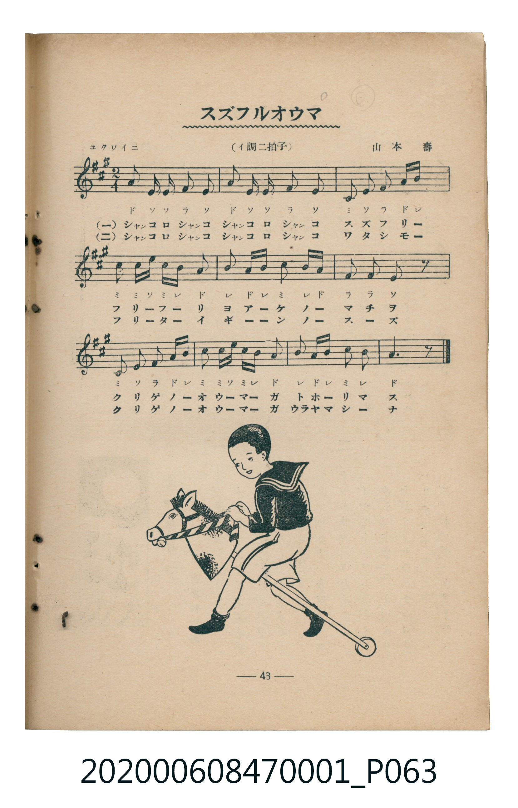

# スズフルオウマ

<audio controls src="suzu_furu_ouma.mp3"></audio>

- 曲：山本壽
- 臺灣教育會公認《新定兒童唱歌》尋常科第一學年用（2020.006.0847.0001）

## 說明

・出處：臺灣教育會公認《新定兒童唱歌》尋常科第一學年用（2020.006.0847.0001）
・調性與拍號：調號 ?= A，拍號 <2/4>，速度 != 108

## 歌詞

```text
一
シヤンコロシヤンコ　シヤンコロシヤンコ
スズフリー　フリーフーリ
ヨアーケノー　マチヲ
クリゲノーオウーマーガ　トホーリマス

二
シヤンコロシヤンコ　シヤンコロシヤンコ
ワタシモー　フリーターイ
ギーンノー　スーズ
クリゲノーオウーマーガ　ウラヤマシーナ
```

## ABC

```abc
X:1
T:スズフルオウマ
C:曲：山本壽
M:2/4
L:1/16
Q:1/4=108
K:A
V:V1 name="Piano" snm="Pia"
[V:V1]
A2 E E F2 E2 | A2 E E F2 E2 | C2 E2 F2 A B | c2 c e c B A2 |
B2 A B c2 B A | F2 F2 E2 z2 | C2 E2 F2 A B | c2 c e c B A2 |
B2 A B c2 B2 | A6 z2 | A2 E E F2 E2 | A2 E E F2 E2 |
C2 E2 F2 A B | c2 c e c B A2 | B2 A B c2 B A | F2 F2 E2 z2 |
C2 E2 F2 A B | c2 c e c B A2 | B2 A B c2 B2 | A6 z2 |
```

## TMD 檔案連結

- [主旋律 TMD 檔案](suzu_furu_ouma.tmd) [[在 TMD Studio 編輯](https://tmdlang.github.io/Tmd-TS/#tmd=s7IKdvYPcrWy4tLSUnjctPNx067HzVMfN69-3LTqcdOyx83zFLS0uBRtFQwNLLjsbRUcuWyM9E3suOoUlJ7N3vR-z6ynGzc-m7Pm6eK9SiCxF-27njcufjZ15oumTc_mND9tXfNiVe_jhq5n0zY8XTfraeuk56uXPp2y8dnanscN3U83dD_dseP58onP16x5sqPh6dodT3dueT5lxfs9HUYGRgZ6BgZmegYWJuZAhoHh-z2dSlxc-lpcQJVcj5u2P25e8rh58-OmzY-b16JwGxrwyAJ1wr246nHzHpBqOBvEAJKruB43r3jctAjEadr4uLkPpm7e4-bGx82bgGasB-lo2gSVg4YUUCtQBZC7Bqy643HzbIh5IPGmnVxcT3b1UOLy5vWPm_aDhcBOQ3Y5UBxELgEavw5sJ1A3zNlAD4PkdhHnbJDISrClQDcDrQLKdnFp6XNx-SZm5lkFZCbm5TvUGNQoVHMpAIGNoZmWHZhVo2CooKtgGg9CZvEQpi5OUWM4GyxqqGAEEgSyjBVMgdgIrK0GarARVAVIHiRTA9GEMM-AUjNhDoVBsIFctVxcunYKIH8rINHKXFwA)]
- [鋼琴伴奏 TMD 檔案](suzu_furu_ouma_piano.tmd) [[在 TMD Studio 編輯](https://tmdlang.github.io/Tmd-TS/#tmd=s7IKdvYPcrWy4tLSUnjctPNx067HzVMfN69-3LTqcdOyx83z3u_peNw85XHTosfNfU_2bHm6tP_J7hnv93QqaGlxKdoqGBpYcNnbKjhy2Rjpm9hx1SkoPZu96f2eWU83bnw2Z83TxXuVQGIv2nc9b1z8bOrMF02bns1pftq65sWq3scNXc-mbXi6btbT1knPVy99OmXjs7U9jxu6n27ofrpjx_PlE5-vWfNkR8PTtTue7tzyfMoKoEuMDIwM9AwMzPQMLEzMgQwDQ6BLlLi4fBMz86wCMhPz8oM8HGoMahSquRSAwMbQTMsOzKpRMFTQVTCNByGzeAhTF6eoMZwNFjVUMAIJAlnGCqZAbATWVgM12AiqAiQPkqmBaEKYZ0CpmTCHwiDYQK5aZG_7oHjbAu7raMNYoGIIiYNnEo9FEqbdFCwJ1wFRC-IakGYAhIKpAXkB7AFdOwWQHxSQaGUuLgA)]

## 分析

```text
================================================================================
📊 TMD Song Profile: [ スズフルオウマ ]
================================================================================
⏱  Duration:       0:22 (22.2s), 20 measures total
🎼 Key & Tempo:    首調基準 A, != 108.0 BPM, <2/4>
   - 分析範圍：      由實際發聲的音符與和弦推測調性；播放脈絡另行呈現
🎤 人聲音域:    C#4 (MIDI 61) – E5 (MIDI 76) [跨度: 15 個半音 / 1.2 個八度, 難度: moderate]
   - 最低音:  C#4 in [Main #1 @ m.3, 0:02]
   - 最高音: E5 in [Main #1 @ m.4, 0:03]
   - 適合: soprano, mezzo-soprano, contralto, tenor, baritone, bass
🏛  結構:      Main (11.1s) -> Main (11.1s)
⚡ 編曲密度:        Peak 1 軌道同時演奏
🗝  調性診斷：       A 大調（純淨自然大調，未偵測到可信轉調）
   - 風格氣質:    純淨自然大調（陽光明朗、易唱易記，無明顯調外色彩）
   - 轉調歷程:    全曲維持單一推測調性（未偵測到可信轉調）
   - 核心骨幹音:  A, C#, E, B, F#
   - 調性數值:    A 大調 [相關度: 0.85, 穩定度: High, 自然音純度: 100.0%]
   - 候選調性 (K-S): A 大調 (0.85), E 大調 (0.71), F# 小調 (0.67)
   - 五度圈歷程:   +3 -> +3
   - 各段落調性細節:
     • [Main #1]: A 大調 (r: 0.85, 自然音純度: 100.0%)
     • [Main #2]: A 大調 (r: 0.85, 自然音純度: 100.0%)

  [ 五度圈游移軌跡 ]
               C  
         F            G  
      Bb               D  
      Eb              [A ]*
         Ab           E  
            Db       B  
               F# 
     (* = active key center)

  [ 十二半音累積音高分佈 ]
     C  :                            0.0%
     C# : ████████████████████      21.1%
     D  :                            0.0%
     D# :                            0.0%
     E  : ████████████████████      21.1%
     F  :                            0.0%
     F# : ███████████████           15.8%
     G  :                            0.0%
     G# :                            0.0%
     A  : ████████████████████████  25.0%
     A# :                            0.0%
     B  : ████████████████          17.1%
--------------------------------------------------------------------------------
Assignment 軌道音域：
  - Piano         : C#4 – E5 (15 個半音 / 1.2 個八度, 94 個音符)
================================================================================
```


## 原書掃描頁




