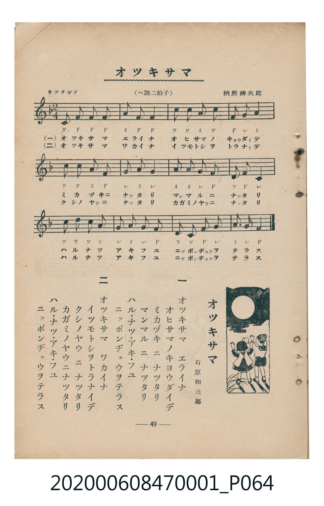

# オツキサマ（月亮先生）

> Re:Shōka 使用 AI 協助辨識與重建樂譜，可能會有錯誤。歡迎回報。

- **鋼琴伴奏版**：<br><audio controls src="otsukisama.mp3"></audio>
- **NEUTRINO 歌聲合成版**：<br><audio controls src="otsukisama_neutrino.mp3"></audio>

- 詞：石原和三郎
- 曲：納所辨次郎
- 臺灣教育會公認《新定兒童唱歌》尋常科第一學年用（2020.006.0847.0001）

## 說明

曲目說明
中文解釋：以親切的稱呼歌唱夜空中的月亮與月光。


## 歌詞

```text
一
オツキサマ　エライナ
オヒサマノキヨウダイデ
ミカヅキニ　ナツタリ
マンマルニ　ナツタリ
ハル・ナツ・アキ・フユ
ニツポンヂユウヲテラス

二
オツキサマ　ワカイナ
イツモトシヲトラナイデ
クシノヤウニ　ナツタリ
カガミノヤウニナツタリ
ハル・ナツ・アキ・フユ
ニツポンヂユウヲテラス
```

## ABC

<div class="abc-score" data-abc-src="otsukisama.abc" aria-label="五線譜載入中"></div>

[下載 ABC 原始檔](otsukisama.abc)

## TMD 檔案連結

- [主旋律 TMD 檔案](otsukisama.tmd) [[在 TMD Studio 編輯](https://tmdlang.github.io/Tmd-TS/#tmd=s7IKdvYPcrWy4qpTUCpJTLdSSM7PyUlNLsnMz7MqzsjMK0nNjM_KTMmPL87Iz05Ugisry88pzU21Si9KTEmNN4w3MjAyiDcwMIs3sDAxBzIMDBFKi_NLi5JTrYqTM_Lzc-JLUitKkvLzsxHyBUX5Zal5iXlANQVFIBtTwIoQClLLMlNSQdKpKZkl-UWZiTlI7kgtKga7FWxJfElRYl5xclFmAcgDCFUlGalAx-YllpQWpSJEgUalZ-ZZ5aZmZmUiuUtLS-Fx06rHzS2Pm9Y-btr6uHne-z0dz-Z0PNm17mlrx_Mp89_v6VTQ0uJStFWwNOKyt1Vw47Ix0jexA5n7YiVQ8azn8zc_7Zv_dFLPkx2dL5v7wDY-m70JJLOl91lnw4t9K56tWQiTedG-63nj4mdTZ75o2vRsTvPT1jUvVvU-buh6Nm3D03WznrZOer566dMpG5-t7Xnc0P10Q_fTHTueL5_4fM2aJzsanq7d8XTnludTVgCdCIoDPWAc6IHiAMgwMAQ6VIlLX0sBaPfz2eterFr1bEYfl4KCwpMda59Na3-xfPHL9m6go57sXvpi2aqnHe3PZ7U8X7Hx6cQ9QLuANj5dMuf5yl1AxUBxiP9fdLQDGU9bOx83NHFp6XMBDecCuoILLbweNzQ8blrxuHnl46Ylj5u7INKToHLNfSB1zSseNy173AxUB1TRzvW4ef7jptWPm1vBct0gA5q7wEbuf9y8CigN1LcZTAIVYZHuB0vshooCGU2LwCYBRaY-bl4GVNENlpgLNqYJKAS2ftPj5jawM3dycT3Z1YPNH83rQQ6D-QNIAU1Z9Li543HTdrD-DpB-oLVQfzQBlQMl-h43LwHbgOlWkGlrQP5FVkRt34DixjcRmLgDMhPz8h1qDGqqQRGvYGOhZQdm1CiYxisYgmGNgjGY1gUJAqExENcoGMYpGMUpGMeBhME6fAxrQPlCARJAQOZWIHMeUCUwqoEsUFwDqS6wMRB1k0CKQGqAXgULAr2wHOhSIB8U70CqHWG6ES7Tm9cDeaAYQDIdxAbFA5ACRQSQ2gRWCooMkDJ002EeA3nWCEgbgc0xBrNAYmagsAALIrzaPB9kL5Buhbi8G2wDMEaagfz9QOYqiGPASRPsWGCsATF2dUieBPkHlESAUqDox6kF4u01IJcQoRruTzOwT2H-hPoOHNlGYD-DxFA92g91eRcoVMH2AgMWFAnNU4F4Gdg6YIIDWgdOcUAKmOSWQhwDCfc2UAIA6tmJ6lWqm1zLxaVrpwBK2ApAWpkLAA)]
- [鋼琴伴奏 TMD 檔案](otsukisama_piano.tmd) [[在 TMD Studio 編輯](https://tmdlang.github.io/Tmd-TS/#tmd=s7IKdvYPcrWy4tLSUnjctOpxc8vjprWPm7Y-bp73fk_H4-Ypj5sWPW7ue7Jny9Ol_U92z3i_p1NBS4tL0VbB0ojL3lbBjcvGSN_EjqtOQenFSqCWWc_nb37aN__ppJ4nOzpfNvcpgWSezd4EktnS-6yz4cW-Fc_WLITJvGjf9bxx8bOpM180bXo2p_lp65oXq3ofN3Q9m7bh6bpZT1snPV-99OmUjc_W9jxu6H66ofvpjh3Pl098vmbNkx0NT9fueLpzy_MpK4AONTIwMtAzMDDTM7AwMQcyDAyBDlXi4vJNzMyzCshMzMsP8nCoMaip5lIAAhsLLTswo0bBNF7BEAxrFIzBtC5IEAiNgbhGwTBOwShOwTgOJAzW4WNYAwonBUhAAZlbgcx5QJWPm1YAWSsfNy0BUl1gYyDqJoEUgdQAgxEsuPZx8_LHTcuA_AaI6naE6Ua4TG9eD-StRjUdxG553LwISHU8btoOpDaBlQKjbSVIGbrpMI-BPGsEpI3A5hiDWSAxM1BYgAURXm2eD7IXSLdCXN4NtqHrcXMzkL8fyFwFcUzzvMfNm8GOfdwMUo5dHZInQf7ZDgqSx81LIKGBy2iQt9eAXEKEarg_zcA-hfkT6jtwZBuB_QwSQ_VoP9TlXaBQBdsLDFhQJDRPBeJlYOu6wdY1z4X4telx81KIYyDh3gZKAEA9O1G9SnWTa5HTtQ9yujaBp-tow1gwJsDCVG0aD2SCCBRRE7goDh1IytBEQc7VtVMAuTjaBygAZxuB2cpcAA)]

## 分析

```text
================================================================================
📊 TMD Song Profile: [ オツキサマ（月亮先生） ]
================================================================================
⏱  Duration:       0:15 (15.7s), 12 measures total
🎼 Key & Tempo:    首調基準 F, != 92.0 BPM, <2/4>
   - 分析範圍：      由實際發聲的音符與和弦推測調性；播放脈絡另行呈現
🎤 人聲音域:    C4 (MIDI 60) – A5 (MIDI 81) [跨度: 21 個半音 / 1.8 個八度, 難度: difficult]
   - 最低音:  C4 in [Main #1 @ m.1, 0:00]
   - 最高音: A5 in [Main #1 @ m.4, 0:04]
   - 適合: soprano, mezzo-soprano, tenor, baritone
🏛  結構:      Main (15.7s)
⚡ 編曲密度:        Peak 1 軌道同時演奏
🗝  調性診斷：       F 大調（純淨自然大調，未偵測到可信轉調）
   - 風格氣質:    純淨自然大調（陽光明朗、易唱易記，無明顯調外色彩）
   - 轉調歷程:    全曲維持單一推測調性（未偵測到可信轉調）
   - 核心骨幹音:  F, G, A, C, D
   - 調性數值:    F 大調 [相關度: 0.82, 穩定度: High, 自然音純度: 100.0%]
   - 候選調性 (K-S): F 大調 (0.82), C 大調 (0.69), A 小調 (0.59)
   - 五度圈歷程:   -1
   - 各段落調性細節:
     • [Main #1]: F 大調 (r: 0.82, 自然音純度: 100.0%)

  [ 五度圈游移軌跡 ]
               C  
        [F ]*          G  
      Bb               D  
      Eb               A  
         Ab           E  
            Db       B  
               F# 
     (* = active key center)

  [ 十二半音累積音高分佈 ]
     C  : ███████████████           18.7%
     C# :                            0.0%
     D  : █████                      6.2%
     D# :                            0.0%
     E  :                            0.0%
     F  : ████████████████████████  29.2%
     F# :                            0.0%
     G  : ███████████████████       22.9%
     G# :                            0.0%
     A  : ███████████████████       22.9%
     A# :                            0.0%
     B  :                            0.0%
--------------------------------------------------------------------------------
Assignment 軌道音域：
  - Piano         : C4 – A5 (21 個半音 / 1.8 個八度, 43 個音符)
================================================================================
```


## 原書掃描頁




