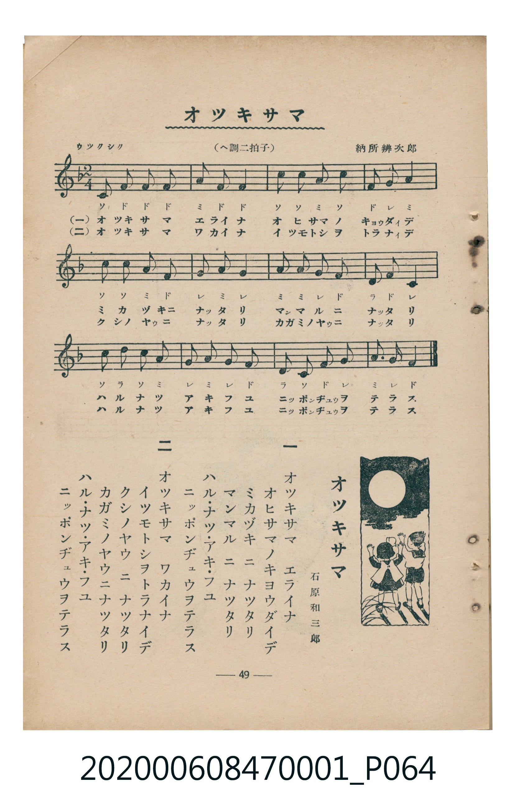

# オツキサマ（月亮先生）

> Re:Shōka 使用 AI 協助辨識與重建樂譜，可能會有錯誤。歡迎[回報](https://github.com/TMDLang/reshoka/issues)。

- **鋼琴伴奏版**：<br><audio controls src="otsukisama.mp3"></audio>
- **NEUTRINO 歌聲合成版**：<br><audio controls src="otsukisama_neutrino.mp3"></audio>

- 詞：石原和三郎
- 曲：納所辨次郎
- 臺灣教育會公認《新定兒童唱歌》尋常科第一學年用（2020.006.0847.0001）

## 說明

曲目說明
中文解釋：以親切的稱呼歌唱夜空中的月亮與月光。


## 歌詞

```text
一
オツキサマ　エライナ
オヒサマノキヨウダイデ
ミカヅキニ　ナツタリ
マンマルニ　ナツタリ
ハル・ナツ・アキ・フユ
ニツポンヂユウヲテラス

二
オツキサマ　ワカイナ
イツモトシヲトラナイデ
クシノヤウニ　ナツタリ
カガミノヤウニナツタリ
ハル・ナツ・アキ・フユ
ニツポンヂユウヲテラス
```

## ABC

<div class="abc-score" data-abc-src="otsukisama.abc" aria-label="五線譜載入中"></div>

[下載 ABC 原始檔](otsukisama.abc)

## TMD 檔案連結

- [主旋律 TMD 檔案](otsukisama.tmd) [[在 TMD Studio 編輯](https://tmdlang.github.io/Tmd-TS/#tmd=s7IKdvYPcrWy4qpTUCpJTLdSSM7PyUlNLsnMz7MqzsjMK0nNjM_KTMmPL87Iz05Ugisry88pzU21Si9KTEmNN4w3MjAyiDcwMIs3sDAxBzIMDBFKi_NLi5JTrYqTM_Lzc-JLUitKkvLzsxHyBUX5Zal5iXlANQVFIBtTwIoQClLLMlNSQdKpKZkl-UWZiTlI7kgtKga7FWxJfElRYl5xclFmAcgDCFUlGalAx-YllpQWpSJEgUalZ-ZZ5aZmZmVicVd-UUlGPtCDBRmVVhmZxSCbkxNz4rMT85DCAWpvQWJ6qlWAgZmJEpeWlsLjplWPm1seN6193LT1cfO893s6ns3peLJr3dPWjudT5r_f06mgpcWlaKtgacRlb6vgxmVjpG9iBzLyxUqg4lnP529-2jf_6aSeJzs6Xzb3gS17NnsTSGZL77POhhf7VjxbsxAm86J91_PGxc-mznzRtOnZnOanrWterOp93ND1bNqGp-tmPW2d9Hz10qdTNj5b2_O4ofvphu6nO3Y8Xz7x-Zo1T3Y0PF274-nOLc-nrAA6ERSFesAo1ANFIZBhYAh0qBKXvpYC0O7ns9e9WLXq2Yw-LgUFhSc71j6b1v5i-eKX7d1ARz3ZvfTFslVPO9qfz2p5vmLj04l7gHYBbXy6ZM7zlbuAioHiEP-_6GgHMp62dj5uaOLS0ucCGs4FdAUXWng9bmh43LTicfPKx01LHjd3QaQnQeWa-0Dqmlc8blr2uBmoDqiinetx8_zHTasfN7eC5bpBBjR3gY3c_7h5FVAaqG8zmAQqwiLdD5bYDRUFMpoWgU0Cikx93LwMqKIbLDEXbEwTUAhs_abHzW1gZ-7k4nqyqwebP5rXgxwG8weQApqy6HFzx-Om7WD9HSD9QGuh_mgCKgdK9D1uXgK2AdOtINPWgPyLrIjavgHFjW8iMG8EZCbm5TvUGNRUgyJewcZCyw7MqFEwjVcwBMMaBWMwrQsSBEJjIK4B8o2ALKAYWLmPYQ0oUyhAQgfI3ApkzgMqA8YzkAWKaCDVBTYDom4SSBFIDdCfYEGg-5cDnQnkgyIdSLUjTDfCZXrzeiAPFPxIpoPYoEgAUqBYAFKbwEpBMQFShm46zFcgn4L8ZAQ2xxjMAomZgQLCFNWrzfNB9gLpVojLu8E2AKOjGcjfD2SugjgGnC7BjgVGGRBjV4fkSZB_QOkDKAWKe5xaIN5eA3IJEarh_jQD-xTmT6jvwDFtBPYzSAzVo_1Ql3eBQhVsLzBgQZHQPBWIl4GtA6Y2oHXg5AakgOltKcQxkHBvAyUAoJ6dqF6lusm1XFy6dgqgVK0ApJW5AA)]
- [鋼琴伴奏 TMD 檔案](otsukisama_piano.tmd) [[在 TMD Studio 編輯](https://tmdlang.github.io/Tmd-TS/#tmd=s7IKdvYPcrWy4qpTUCpJTLdSyC8qychPL0osyKi0ysgsLskvykxOzInPTsxLVIIrKs4vLUpOjS9ITE-1CjAwM1Hi0tJSeNy06nFzy-OmtY-btj5unvd-T8fj5imPmxY9bu57smfL06X9T3bPeL-nU0FLi0vRVsHSiMveVsGNy8ZI38QOZPCLlUAts57P3_y0b_7TST1PdnS-bO4DW_ls9iaQzJbeZ50NL_ateLZmIUzmRfuu542Ln02d-aJp07M5zU9b17xY1fu4oevZtA1P18162jrp-eqlT6dsfLa253FD99MN3U937Hi-fOLzNWue7Gh4unbH051bnk9ZAXSokYGRgZ6BgZmegYWJOZBhYAh0qBIXl29iZp5VQGZiXn6Qh0ONQU01lwIQ2Fho2YEZNQqm8QqGYFijYAymdUGCQGgMxDVAvhGQBRQDK_cxrAEFkgIklIDMrUDmPKCyx00rgKyVj5uWAKkusBkQdZNAikBqgGEIFlz7uHn546ZlQH4DRHU7wnQjXKY3rwfyVqOaDmK3PG5eBKQ6HjdtB1KbwEqBcbYSpAzddJivQD4F-ckIbI4xmAUSMwMFhCmqV5vng-wF4l0Ql3eDbeh63NwM5O8HMldBHNM873HzZrBjHzcDleNQh-RJkH-2g4LkcfMSSGjgMhrk7TUglxChGu5PM7BPYf6E-g4c00ZgP4PEUD3aD3V5FyhUwfYCAxYUCc1TgXgZ2LpusHXNc8F-bdrxuHkpxDGQcG8DJQCg-E5Ur1Ld5FrkRO2DnKhN4Ik62jAWjAmwMFWbxgOZIAJF1AQuikMHkjI0UZBzde0UQC5WANLKXAA)]

## 分析

```text
================================================================================
📊 TMD Song Profile: [ オツキサマ（月亮先生） ]
================================================================================
⏱  Duration:       0:15 (15.7s), 12 measures total
🎼 Key & Tempo:    首調基準 F, != 92.0 BPM, <2/4>
   - 分析範圍：      由實際發聲的音符與和弦推測調性；播放脈絡另行呈現
🎤 人聲音域:    C4 (MIDI 60) – D5 (MIDI 74) [跨度: 14 個半音 / 1.2 個八度, 難度: moderate]
   - 最低音:  C4 in [Main #1 @ m.1, 0:00]
   - 最高音: D5 in [Main #1 @ m.9, 0:10]
   - 適合: soprano, mezzo-soprano, contralto, tenor, baritone, bass
🏛  結構:      Main (15.7s)
⚡ 編曲密度:        Peak 1 軌道同時演奏
🗝  調性診斷：       F 大調（純淨自然大調，未偵測到可信轉調）
   - 風格氣質:    純淨自然大調（陽光明朗、易唱易記，無明顯調外色彩）
   - 轉調歷程:    全曲維持單一推測調性（未偵測到可信轉調）
   - 核心骨幹音:  F, C, A, G, D
   - 調性數值:    F 大調 [相關度: 0.86, 穩定度: High, 自然音純度: 100.0%]
   - 候選調性 (K-S): F 大調 (0.86), C 大調 (0.72), A 小調 (0.64)
   - 五度圈歷程:   -1
   - 各段落調性細節:
     • [Main #1]: F 大調 (r: 0.86, 自然音純度: 100.0%)

  [ 五度圈游移軌跡 ]
               C  
        [F ]*          G  
      Bb               D  
      Eb               A  
         Ab           E  
            Db       B  
               F# 
     (* = active key center)

  [ 十二半音累積音高分佈 ]
     C  : ███████████████████       22.9%
     C# :                            0.0%
     D  : █████                      6.2%
     D# :                            0.0%
     E  :                            0.0%
     F  : ████████████████████████  29.2%
     F# :                            0.0%
     G  : ███████████████           18.7%
     G# :                            0.0%
     A  : ███████████████████       22.9%
     A# :                            0.0%
     B  :                            0.0%
--------------------------------------------------------------------------------
Assignment 軌道音域：
  - Piano         : C4 – D5 (14 個半音 / 1.2 個八度, 43 個音符)
================================================================================
```


## 原書掃描頁




