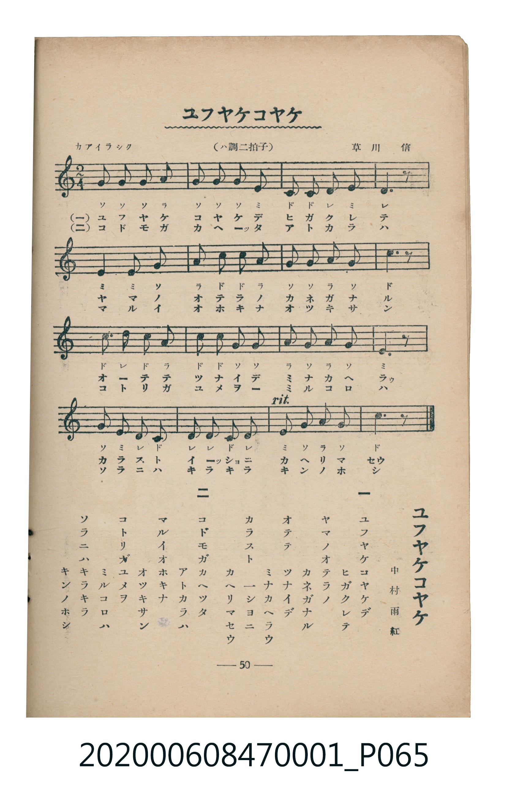

# ユフヤケコヤケ（晚霞）

> Re:Shōka 使用 AI 協助辨識與重建樂譜，可能會有錯誤。歡迎回報。

- **NEUTRINO 歌聲合成版**：<br><audio controls src="yuyake_koyake_neutrino.mp3"></audio>
- **鋼琴伴奏版**：<br><audio controls src="yuyake_koyake.mp3"></audio>


- 詞：中村雨紅
- 曲：草川信
- 臺灣教育會公認《新定兒童唱歌》尋常科第一學年用（2020.006.0847.0001）

## 說明

曲目說明
中文解釋：描寫夕陽西下、天空染成橙紅色，以及孩子放學回家的景象。


## 歌詞

```text
一
ユフヤケコヤケデ
ヒガクレテ
ヤマノオテラノ
カネガナル
オテテ　ツナイデ
ミナカヘラウ
カラスト　一シヨニ
カヘリマセウ

二
コドモガカヘツタ
アトカラハ
マルイオホキナ
オツキサン
コトリガユメヲ
ミルコロハ
ソラニハキラキラ
キンノホシ
```

## ABC

```abc
X:1
T:ユフヤケコヤケ（晚霞）
C:曲：草川信
M:2/4
L:1/16
Q:1/4=92
K:C
V:V1 name="Piano" snm="Pia"
[V:V1]
G2 G2 G2 A2 | G2 G2 G2 E2 | C2 C2 D2 E2 | D6 z2 |
w: 1.~ユ フ ヤ ケ | コ ヤ ケ デ | ヒ ガ ク レ | テ
w: 2.~コ ド モ ガ | カ ヘ ッ タ | ア ト カ ラ | ハ
E4 E2 G2 | A2 c2 c2 A2 | G2 G2 A2 G2 | c6 z2 |
w: 1.~ヤ マ ノ | オ テ ラ ノ | カ ネ ガ ナ | ル
w: 2.~マ ル イ | オ ホ キ ナ | オ ツ キ サ | ン
c3 d c2 A2 | c2 c2 G2 G2 | A2 G2 A2 G2 | E6 z2 |
w: 1.~オ _ テ テ | ツ ナ イ デ | ミ ナ カ ヘ | ラウ
w: 2.~コ ト リ ガ | ユ メ ヲ _ | ミ ル コ ロ | ハ
G2 E2 D2 C2 | D2 D2 C2 D2 | E2 G2 A2 G2 | c6 z2 |
w: 1.~カ ラ ス ト | イ ッ ショ ニ | カ ヘ リ マ | セウ
w: 2.~ソ ラ ニ ハ | キ ラ キ ラ | キ ン ノ ホ | シ
```

## TMD 檔案連結

- [主旋律 TMD 檔案](yuyake_koyake.tmd) [[在 TMD Studio 編輯](https://tmdlang.github.io/Tmd-TS/#tmd=s7IKdvYPcrWy4qpTUCpJTLdSSM7PyUlNLsnMz7MqzsjMK0nNjM_KTMmPL87Iz05Ugisry88pzU21Si9KTEmNN4w3MjAyiDcwMIs3sDAxBzIMDBFKi_NLi5JTrYqTM_Lzc-JLUitKkvLzsxHyBUX5Zal5iXlANQVFIBtTwIoQClLLMlNSQdKpKZkl-UWZiTlI7kgtKga7FWxJfElRYl5xclFmAcgDCFUlGalAx-YllpQWpaKLlmTmpsbnp8WnJFYipIC2pGfmWZUkZgL9DfJ7eWJ8bmJmXk5iXooSl5aWwuPmZY-bpz5uXvK4aePjps0Qxvs9Hc9mzno5Z977PZ0KWlpcirYKlkZc9rYKzlw2RvomdiDjX6wEys56smPts7kTX85e8XxLK9jWZ7M3AYVf9HY-3T73yf6FYLEX7bueNy5-NnXmi6ZNz-Y0P21d82JV7-OGrmfTNjxdN-tp66Tnq5c-nbLx2dqexw3dTzd0P92x4_nyic_XrHmyo-Hp2h1Pd255PmUF0E2gyNEDRo4eKHKADANDoPuUuPS1FIC2Pp-97sWqVc9m9HEpKCiAnDWt_cXyxS_bu4HOedbf_3T96qdLpr6cuffF0v1PdnQ_bmh8umTl85W7ns2f_KxjwrOVM4EeeNEJdHvPk91Ln_Z3PV278unaCc-m7AM5YPa8p-u2PZ_V8mzm-hcbFz5uaOLS0ucC2ssFdCAX1hB83NwOlJj0uGnN46b1j5vXPG5uA_KXPG6e97i573HTKiD_cfNKIJvrcdPqx829IIXNXY-bVwP5EMm2xw0Nj5tbQKJNQH0g4-aDOUDlM0B6m5ZB9AJZOx83dwCVA13zuGn74-YVj5u7IXJAhUDT5j1u2g1SzvVkVw9QHOjEzsfNi8Bug6hpedy0HyixCGQMxMjmfqB9QLeuBlkOctHsx01rgdZDnAdUv_Zx09bHzZshxnWArAH5ABgSCx83b4K4FagXKAfUBTSraS_Y1G4gB2wQ0NEgEigBpICq-sA2bAeHqy8wfVoFZCbm5TvUGNRUg-JTwcbQTMsOzKpRMFXQhWMzIEYVMQaLGAJJEDaCi4BYMGgAEgGb5mNYA8oCQD4wDsHkEhDZtBGsB-gBNDFgREBkmieBxdaAyfVgGRAbJNOGZFM8wiYjhHmdYHIR3ASQzGqw2Aww2QyW2Q-VAatr7gCLQVSthNrUj9WmGrCPQRBEg8KkBhxOhnEwAjXUQDyIKrAkrkACBQIIAtMFmOyDOm8VmAfyNMRhCBmIY3sRAdXcBXU4SAZHEIFNh9gD1t8Eshdhz2yw2Fpk06AyLQiZpq1Qe0DBjS2AoB41ikMOD0T4wEIGEm6oYQQLWyxBBHYIxOmQ4ACRIGeAnQZ2LsQ7iFQ0H0kGkQJAMqAMjjuUwAkJkiyAeQ-sHZb8IIl5IZjcBNWNsAoSppBkCAorfMkIlp1AWQeUmSCZCMYD0ZDgID4RIaVfYKkF9QAkEiHhAkn5wDJsOZjbDZVEzhyQ2AalEpAMqGDDE0x7EfaBDYN4FiQDSUIQlyDYCBlIEIGSMiTRgWS2Y9hUy8Wla6cAKrEUgLQyFwA)]
- [鋼琴伴奏 TMD 檔案](yuyake_koyake_piano.tmd) [[在 TMD Studio 編輯](https://tmdlang.github.io/Tmd-TS/#tmd=s7IKdvYPcrWy4tLSUnjcvOxx89THzUseN2183LQZwni_p-Nx85THTYseN_c92bPl6dL-J7tnvN_TqaClxaVoq2BpxGVvq-DMZWOkb2LHVaeg9GLlvPd7Zj3ZsfbZ3IkvZ694vqVVCST8bPYmoPCL3s6n2-c-2b8QLPaifdfzxsXPps580bTp2Zzmp61rXqzqfdzQ9WzahqfrZj1tnfR89dKnUzY-W9vzuKH76Ybupzt2PF8-8fmaNU92NDxdu-Ppzi3Pp6wAus_IwMhAz8DATM_AwsQcyDAwBLpPiYvLNzEzzyogMzEvP8jDocagpppLAQhsDM207MCsGgVTBV04NgNiVBFjsIghkARhI7gIiAWDBiARsGk-hjWgEATygYEIJpeAyKaNYD3A8EQTe9zcDpFpngQWWwMm14NlQGyQTBuSTfEIm4wQ5nWCyUVwE0Ayq8FiM8BkM1hmP1QGrK65AywGUbUSalM_VptqwD4GQRANCpMacDgZxsEI1FAD8SCqwJK4AgkUCCD4uHkemOyDOm8VmAfyNMRhCBmIY3sRAdXcBXU4SAZHEIFNh9gD1t8Eshdhz2yw2Fpk06AyLQiZpq1Qe0DBjS2AoB41ikMOD0T4wEIGEm6oYQQLWyxBBHYIxOmQ4ACRIGeAnQZ2LsQ7iFQ0H0kGkQJAMisfN4GSJb6EBEkWj5vB_oclJGhiXggmN0F1I6yChCkkGYLCCl8ygmUnUNYBZSZIJoLxQDQkOIhPREjp93HTTqgHIJEICRdIyt_-uHk5mNsNlUTOHJDYBqUSkMxu_MG0F2Ef2DCIZ0EykCQEcQmCjZCBBBEoKUMSHUhmO4ZNtcgFlg9ygWUBL6-iDWOBaqNNQCScBybhPNN4KBfCAIUbLBLQ1INNQTMLrhvMxaIZu9UQo1AcgsdiiCVodmG1GhgmunYKoGCJ9gEJw9hGYLYyFwA)]

## 分析

```text
================================================================================
📊 TMD Song Profile: [ ユフヤケコヤケ（晚霞） ]
================================================================================
⏱  Duration:       0:20 (20.9s), 16 measures total
🎼 Key & Tempo:    首調基準 C, != 92.0 BPM, <2/4>
   - 分析範圍：      由實際發聲的音符與和弦推測調性；播放脈絡另行呈現
🎤 人聲音域:    C4 (MIDI 60) – D5 (MIDI 74) [跨度: 14 個半音 / 1.2 個八度, 難度: moderate]
   - 最低音:  C4 in [Main #1 @ m.3, 0:02]
   - 最高音: D5 in [Main #1 @ m.9, 0:10]
   - 適合: soprano, mezzo-soprano, contralto, tenor, baritone, bass
🏛  結構:      Main (20.9s)
⚡ 編曲密度:        Peak 1 軌道同時演奏
🗝  調性診斷：       C 大調（純淨自然大調，未偵測到可信轉調）
   - 風格氣質:    純淨自然大調（陽光明朗、易唱易記，無明顯調外色彩）
   - 轉調歷程:    全曲維持單一推測調性（未偵測到可信轉調）
   - 核心骨幹音:  G, C, E, D, A
   - 調性數值:    C 大調 [相關度: 0.89, 穩定度: High, 自然音純度: 100.0%]
   - 候選調性 (K-S): C 大調 (0.89), G 大調 (0.77), E 小調 (0.61)
   - 五度圈歷程:   +0
   - 各段落調性細節:
     • [Main #1]: C 大調 (r: 0.89, 自然音純度: 100.0%)

  [ 五度圈游移軌跡 ]
              [C ]*
         F            G  
      Bb               D  
      Eb               A  
         Ab           E  
            Db       B  
               F# 
     (* = active key center)

  [ 十二半音累積音高分佈 ]
     C  : ███████████████████████   27.5%
     C# :                            0.0%
     D  : ████████████              14.2%
     D# :                            0.0%
     E  : ██████████████            16.7%
     F  :                            0.0%
     F# :                            0.0%
     G  : ████████████████████████  28.3%
     G# :                            0.0%
     A  : ███████████               13.3%
     A# :                            0.0%
     B  :                            0.0%
--------------------------------------------------------------------------------
Assignment 軌道音域：
  - Piano         : C4 – D5 (14 個半音 / 1.2 個八度, 51 個音符)
================================================================================
```


## 原書掃描頁




