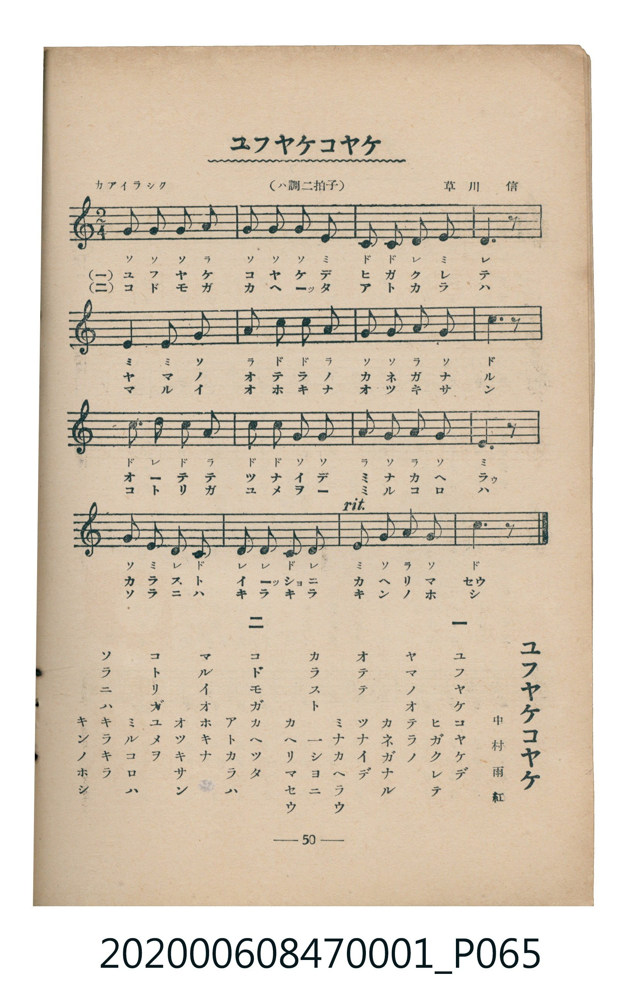

# ユフヤケコヤケ

<audio controls src="yuyake_koyake.mp3"></audio>

- 詞：中村雨紅
- 曲：草川信
- 臺灣教育會公認《新定兒童唱歌》尋常科第一學年用（2020.006.0847.0001）

## 說明

・出處：臺灣教育會公認《新定兒童唱歌》尋常科第一學年用（2020.006.0847.0001）
・調性與拍號：調號 ?= C，拍號 <2/4>，速度 != 92

## 歌詞

```text
一
ユフヤケコヤケデ
ヒガクレテ
ヤマノオテラノ
カネガナル
オテテ　ツナイデ
ミナカヘラウ
カラスト　一シヨニ
カヘリマセウ

二
コドモガカヘツタ
アトカラハ
マルイオホキナ
オツキサン
コトリガユメヲ
ミルコロハ
ソラニハキラキラ
キンノホシ
```

## ABC

```abc
X:1
T:ユフヤケコヤケ
C:曲：草川信
M:2/4
L:1/16
Q:1/4=92
K:C
V:V1 name="Piano" snm="Pia"
[V:V1]
g2 g2 g2 a2 | g2 g2 g2 e2 | c2 c2 d2 e2 | d6 z2 |
e4 e2 g2 | a2 c2 c2 a2 | g2 g2 a2 g2 | c6 z2 |
c3 d c2 a2 | c2 c2 g2 g2 | a2 g2 a2 g2 | e6 z2 |
g2 e2 d2 c2 | d2 d2 c2 d2 | e2 g2 a2 g2 | c6 z2 |
g2 g2 g2 a2 | g2 g2 g2 e2 | c2 c2 d2 e2 | d6 z2 |
e4 e2 g2 | a2 c2 c2 a2 | g2 g2 a2 g2 | c6 z2 |
c3 d c2 a2 | c2 c2 g2 g2 | a2 g2 a2 g2 | e6 z2 |
g2 e2 d2 c2 | d2 d2 c2 d2 | e2 g2 a2 g2 | c6 z2 |
```

## TMD 檔案連結

- [主旋律 TMD 檔案](yuyake_koyake.tmd)
- [鋼琴伴奏 TMD 檔案](yuyake_koyake_piano.tmd)

## 分析

```text
================================================================================
📊 TMD Song Profile: [ ユフヤケコヤケ ]
================================================================================
⏱  Duration:       0:41 (41.7s), 32 measures total
🎼 Key & Tempo:    首調基準 C, != 92.0 BPM, <2/4>
   - 分析範圍：      由實際發聲的音符與和弦推測調性；播放脈絡另行呈現
🎤 人聲音域:    C4 (MIDI 60) – D5 (MIDI 74) [跨度: 14 個半音 / 1.2 個八度, 難度: moderate]
   - 最低音:  C4 in [Main #1 @ m.3, 0:02]
   - 最高音: D5 in [Main #1 @ m.9, 0:10]
   - 適合: soprano, mezzo-soprano, contralto, tenor, baritone, bass
🏛  結構:      Main (20.9s) -> Main (20.9s)
⚡ 編曲密度:        Peak 1 軌道同時演奏
🗝  調性診斷：       C 大調（純淨自然大調，未偵測到可信轉調）
   - 風格氣質:    純淨自然大調（陽光明朗、易唱易記，無明顯調外色彩）
   - 轉調歷程:    全曲維持單一推測調性（未偵測到可信轉調）
   - 核心骨幹音:  G, C, E, D, A
   - 調性數值:    C 大調 [相關度: 0.89, 穩定度: High, 自然音純度: 100.0%]
   - 候選調性 (K-S): C 大調 (0.89), G 大調 (0.77), E 小調 (0.61)
   - 五度圈歷程:   +0 -> +0
   - 各段落調性細節:
     • [Main #1]: C 大調 (r: 0.89, 自然音純度: 100.0%)
     • [Main #2]: C 大調 (r: 0.89, 自然音純度: 100.0%)

  [ 五度圈游移軌跡 ]
              [C ]*
         F            G  
      Bb               D  
      Eb               A  
         Ab           E  
            Db       B  
               F# 
     (* = active key center)

  [ 十二半音累積音高分佈 ]
     C  : ███████████████████████   27.5%
     C# :                            0.0%
     D  : ████████████              14.2%
     D# :                            0.0%
     E  : ██████████████            16.7%
     F  :                            0.0%
     F# :                            0.0%
     G  : ████████████████████████  28.3%
     G# :                            0.0%
     A  : ███████████               13.3%
     A# :                            0.0%
     B  :                            0.0%
--------------------------------------------------------------------------------
Assignment 軌道音域：
  - Piano         : C4 – D5 (14 個半音 / 1.2 個八度, 102 個音符)
================================================================================
```


## 原書掃描頁




