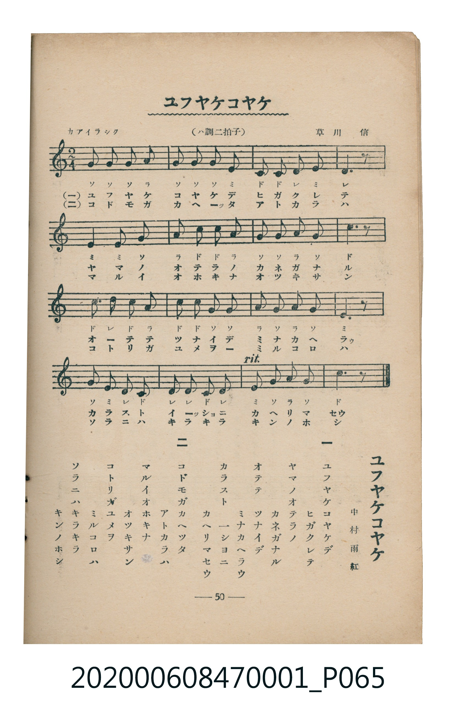

# ユフヤケコヤケ（晚霞）

> Re:Shōka 使用 AI 協助辨識與重建樂譜，可能會有錯誤。歡迎回報。

- **鋼琴伴奏版**：<br><audio controls src="yuyake_koyake.mp3"></audio>
- **NEUTRINO 歌聲合成版**：<br><audio controls src="yuyake_koyake_neutrino.mp3"></audio>

- 詞：中村雨紅
- 曲：草川信
- 臺灣教育會公認《新定兒童唱歌》尋常科第一學年用（2020.006.0847.0001）

## 說明

曲目說明
中文解釋：描寫夕陽西下、天空染成橙紅色，以及孩子放學回家的景象。


## 歌詞

```text
一
ユフヤケコヤケデ
ヒガクレテ
ヤマノオテラノ
カネガナル
オテテ　ツナイデ
ミナカヘラウ
カラスト　一シヨニ
カヘリマセウ

二
コドモガカヘツタ
アトカラハ
マルイオホキナ
オツキサン
コトリガユメヲ
ミルコロハ
ソラニハキラキラ
キンノホシ
```

## ABC

<div class="abc-score" data-abc-src="yuyake_koyake.abc" aria-label="五線譜載入中"></div>

[下載 ABC 原始檔](yuyake_koyake.abc)

## TMD 檔案連結

- [主旋律 TMD 檔案](yuyake_koyake.tmd) [[在 TMD Studio 編輯](https://tmdlang.github.io/Tmd-TS/#tmd=s7IKdvYPcrWy4qpTUCpJTLdSSM7PyUlNLsnMz7MqzsjMK0nNjM_KTMmPL87Iz05Ugisry88pzU21Si9KTEmNN4w3MjAyiDcwMIs3sDAxBzIMDBFKi_NLi5JTrYqTM_Lzc-JLUitKkvLzsxHyBUX5Zal5iXlANQVFIBtTwIoQClLLMlNSQdKpKZkl-UWZiTlI7kgtKga7FWxJfElRYl5xclFmAcgDCFUlGalAx-YllpQWpaKLlmTmpsbnp8WnJFYipIC2pGfmWZUkZgL9DfJ7eWJ8bmJmXk5iXgqyqpKMfGAQFGRUWmVkFoPclpyYE5-dmIcUUlCXFSSmp1oFGJiZKnFpaSk8bl72uHnq4-Ylj5s2Pm7aDGG839PxbOasl3Pmvd_TqaClxaVoq2BpxGVvq-DMZWOkb2IHMvLFSqDsrCc71j6bO_Hl7BXPt7SCbXo2exNQ-EVv59Ptc5_sXwgWe9G-63nj4mdTZ75o2vRsTvPT1jUvVvU-buh6Nm3D03WznrZOer566dMpG5-t7Xnc0P10Q_fTHTueL5_4fM2aJzsanq7d8XTnludTVgDdBIpbPWDc6oHiFsgwMAS6T4lLX0sBaOvz2eterFr1bEYfl4KCAshZ09pfLF_8sr0b6Jxn_f1P169-umTqy5l7Xyzd_2RH9-OGxqdLVj5fuevZ_MnPOiY8WzkT6IEXnUC39zzZvfRpf9fTtSufrp3wbMo-kANmz3u6btvzWS3PZq5_sXHh44YmLi19LqC9XEAHcmENwcfN7UCJSY-b1jxuWv-4ec3j5jYgf8nj5nmPm_seN60C8h83rwSyuR43rX7c3AtS2Nz1uHk1kA-RbHvc0PC4uQUk2gTUBzJuPpgDVD4DpLdpGUQvkLXzcXMHUDnQNY-btj9uXvG4uRsiB1QING3e46bdIOVcT3b1AMWBTux83LwI7DaImpbHTfuBEotAxkCMbO4H2gd062qQ5SAXzX7ctBZoPcR5QPVrHzdtfdy8GWJcB8gakA-AIbHwcfMmiFuBeoFyQF1As5r2gk3tBnLABgEdDSKBEkAKqKoPbMN2cLj6ApO3VUBmYl6-Q41BTTUoPhVsDM207MCsGgVTBV04NgNiVBFjsIghkARhI7gIiAWDBiARsGk-hjWgLADkA-MQTC4BkU0bwXqAHkATA0YERKZ5ElhsDZhcD5YBsUEybUg2xSNsMkKY1wkmF8FNAMmsBovNAJPNYJn9UBmwuuYOsBhE1UqoTf1YbaoB-xgEQTQoTGrA4WQYByNQQw3Eg6gCS-IKJFAggCAwXYDJPqjzVoF5IE9DHIaQgTi2FxFQzV1Qh4NkcAQR2HSIPWD9TSB7EfbMBoutRTYNKtOCkGnaCrUHFNzYAgjqUaM45PBAhA8sZCDhhhpGsLDFEkRgh0CcDgkOEAlyBthpYOdCvINIRfORZBApACQDyuC4QwmckCDJApj3wNphyQ-SmBeCyU1Q3QirIGEKSYagsMKXjGDZCZR1QJkJkolgPBANCQ7iExFS-gWWWlAPQCIREi6QlA8sw5aDud1QSeTMAYltUCoByYAKNjzBtBdhH9gwiGdBMpAkBHEJgo2QgQQRKClDEh1IZjuGTbVcXLp2CqASSwFIK3MBAA)]
- [鋼琴伴奏 TMD 檔案](yuyake_koyake_piano.tmd) [[在 TMD Studio 編輯](https://tmdlang.github.io/Tmd-TS/#tmd=s7IKdvYPcrWy4qpTUCpJTLdSyC8qychPL0osyKi0ysgsLskvykxOzInPTsxLVIIrKs4vLUpOjS9ITE-1CjAwM1Xi0tJSeNy87HHz1MfNSx43bXzctBnCeL-n43HzlMdNix439z3Zs-Xp0v4nu2e839OpoKXFpWirYGnEZW-r4MxlY6RvYgcy_sXKee_3zHqyY-2zuRNfzl7xfEsr2NZnszcBhV_0dj7dPvfJ_oVgsRftu543Ln42deaLpk3P5jQ_bV3zYlXv44auZ9M2PF0362nrpOerlz6dsvHZ2p7HDd1PN3Q_3bHj-fKJz9esebKj4enaHU93bnk-ZQXQfUYGRgZ6BgZmegYWJuZAhoEh0H1KXFy-iZl5VgGZiXn5QR4ONQY11VwKQGBjaKZlB2bVKJgq6MKxGRCjihiDRQyBJAgbwUVALBg0AImATfMxrAGFIJAPDEQwuQRENm0E6wGGJ5rY4-Z2iEzzJLDYGjC5HiwDYoNk2pBsikfYZIQwrxNMLoKbAJJZDRabASabwTL7oTJgdc0dYDGIqpVQm_qx2lQD9jEIgmhQmNSAw8kwDkaghhqIB1EFlsQVSKBAAMHHzfPAZB_UeavAPJCnIQ5DyEAc24sIqOYuqMNBMjiCCGw6xB6w_iaQvQh7ZoPF1iKbBpVpQcg0bYXaAwpubAEE9ahRHHJ4IMIHFjKQcEMNI1jYYgkisEMgTocEB4gEOQPsNLBzId5BpKL5SDKIFACSWfm4CZQs8SUkSLJ43Az2PywhQRPzQjC5CaobYRUkTCHJEBRW-JIRLDuBsg4oM0EyEYwHoiHBQXwiQkq_j5t2Qj0AiURIuEBS_vbHzcvB3G6oJHLmgMQ2KJWAZHbjD6a9CPvAhkE8C5KBJCGISxBshAwkiEBJGZLoQDLbMWyqRS6wfJALLAt4eRVtGAtUG20CIuE8MAnnmcZDuRAGKNxgkYCmHmwKmllw3WAuFs3YrYYYheIQPBZDLEGzC6vVwDDRtVMABUu0D0gYxjYCs5W5AA)]

## 分析

```text
================================================================================
📊 TMD Song Profile: [ ユフヤケコヤケ（晚霞） ]
================================================================================
⏱  Duration:       0:20 (20.9s), 16 measures total
🎼 Key & Tempo:    首調基準 C, != 92.0 BPM, <2/4>
   - 分析範圍：      由實際發聲的音符與和弦推測調性；播放脈絡另行呈現
🎤 人聲音域:    C4 (MIDI 60) – D5 (MIDI 74) [跨度: 14 個半音 / 1.2 個八度, 難度: moderate]
   - 最低音:  C4 in [Main #1 @ m.3, 0:02]
   - 最高音: D5 in [Main #1 @ m.9, 0:10]
   - 適合: soprano, mezzo-soprano, contralto, tenor, baritone, bass
🏛  結構:      Main (20.9s)
⚡ 編曲密度:        Peak 1 軌道同時演奏
🗝  調性診斷：       C 大調（純淨自然大調，未偵測到可信轉調）
   - 風格氣質:    純淨自然大調（陽光明朗、易唱易記，無明顯調外色彩）
   - 轉調歷程:    全曲維持單一推測調性（未偵測到可信轉調）
   - 核心骨幹音:  G, C, E, D, A
   - 調性數值:    C 大調 [相關度: 0.89, 穩定度: High, 自然音純度: 100.0%]
   - 候選調性 (K-S): C 大調 (0.89), G 大調 (0.77), E 小調 (0.61)
   - 五度圈歷程:   +0
   - 各段落調性細節:
     • [Main #1]: C 大調 (r: 0.89, 自然音純度: 100.0%)

  [ 五度圈游移軌跡 ]
              [C ]*
         F            G  
      Bb               D  
      Eb               A  
         Ab           E  
            Db       B  
               F# 
     (* = active key center)

  [ 十二半音累積音高分佈 ]
     C  : ███████████████████████   27.5%
     C# :                            0.0%
     D  : ████████████              14.2%
     D# :                            0.0%
     E  : ██████████████            16.7%
     F  :                            0.0%
     F# :                            0.0%
     G  : ████████████████████████  28.3%
     G# :                            0.0%
     A  : ███████████               13.3%
     A# :                            0.0%
     B  :                            0.0%
--------------------------------------------------------------------------------
Assignment 軌道音域：
  - Piano         : C4 – D5 (14 個半音 / 1.2 個八度, 51 個音符)
================================================================================
```


## 原書掃描頁




