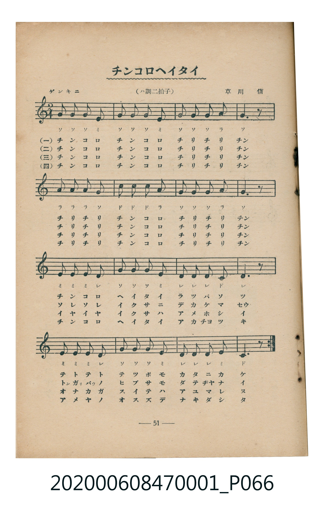
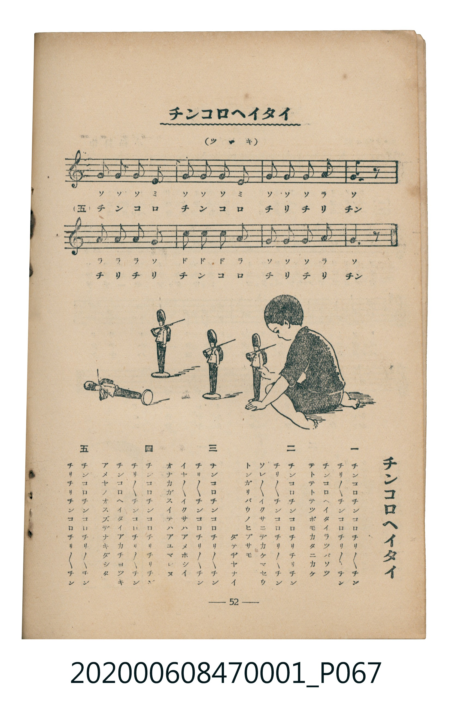

# チンコロヘイタイ（小小兵）

> Re:Shoka 使用 AI 協助辨識與重建樂譜，可能會有錯誤。歡迎回報。

<audio controls src="chinkoro_heitai.mp3"></audio>

- 曲：草川信
- 臺灣教育會公認《新定兒童唱歌》尋常科第一學年用（2020.006.0847.0001）

## 說明

曲目說明
中文解釋：描寫身材小巧、精神抖擻的士兵遊行與操練。

## 歌詞

```text
一
チンコロチンコロチリチリチン
チリチリチンコロチリチリチン
チンコロヘイタイラツパソツ
テトテトテツポモカタニカケ

二
チンコロチンコロチリチリチン
チリチリチンコロチリチリチン
ソレソレイクサニデカケマセウ
トンガリバウノヒブサモダテヂヤナイ

三
チンコロチンコロチリチリチン
チリチリチンコロチリチリチン
イヤイヤイクサハアメホシイ
オナカガスイテハアユマレヌ

四
チンコロチンコロチリチリチン
チリチリチンコロチリチリチン
チンコロヘイタイアカチヨツキ
アメヤノオスズデナキダシタ

五
チンコロチンコロチリチリチン
チリチリチンコロチリチリチン
```

## ABC

```abc
X:1
T:チンコロヘイタイ（小小兵）
C:曲：草川信
M:2/4
L:1/16
Q:1/4=108
K:C
V:V1 name="Piano" snm="Pia"
[V:V1]
G2 G2 G2 E2 | G2 G2 G2 E2 | G2 G2 G2 A2 | G6 z2 |
A2 A2 A2 G2 | c2 c2 c2 A2 | G2 G2 G2 A2 | G6 z2 |
E2 E2 E2 D2 | G2 G2 G2 E2 | D2 D2 D2 C2 | D6 z2 |
E2 E2 E2 D2 | G2 G2 G2 E2 | D2 D2 D2 E2 | C6 z2 |
G2 G2 G2 E2 | G2 G2 G2 E2 | G2 G2 G2 A2 | G6 z2 |
A2 A2 A2 G2 | c2 c2 c2 A2 | G2 G2 G2 A2 | G6 z2 |
E2 E2 E2 D2 | G2 G2 G2 E2 | D2 D2 D2 C2 | D6 z2 |
E2 E2 E2 D2 | G2 G2 G2 E2 | D2 D2 D2 E2 | C6 z2 |
G2 G2 G2 E2 | G2 G2 G2 E2 | G2 G2 G2 A2 | G6 z2 |
A2 A2 A2 G2 | c2 c2 c2 A2 | G2 G2 G2 A2 | G6 z2 |
E2 E2 E2 D2 | G2 G2 G2 E2 | D2 D2 D2 C2 | D6 z2 |
E2 E2 E2 D2 | G2 G2 G2 E2 | D2 D2 D2 E2 | C6 z2 |
G2 G2 G2 E2 | G2 G2 G2 E2 | G2 G2 G2 A2 | G6 z2 |
A2 A2 A2 G2 | c2 c2 c2 A2 | G2 G2 G2 A2 | G6 z2 |
E2 E2 E2 D2 | G2 G2 G2 E2 | D2 D2 D2 C2 | D6 z2 |
E2 E2 E2 D2 | G2 G2 G2 E2 | D2 D2 D2 E2 | C6 z2 |
G2 G2 G2 E2 | G2 G2 G2 E2 | G2 G2 G2 A2 | G6 z2 |
A2 A2 A2 G2 | c2 c2 c2 A2 | G2 G2 G2 A2 | G6 z2 |
```

## TMD 檔案連結

- [主旋律 TMD 檔案](chinkoro_heitai.tmd) [[在 TMD Studio 編輯](https://tmdlang.github.io/Tmd-TS/#tmd=s7IKdvYPcrWy4qpTUCpJTLdSSM7PyUlNLsnMz7MqzsjMK0nNjM_KTMmPL87Iz05Ugisry88pzU21Si9KTEmNN4w3MjAyiDcwMIs3sDAxBzIMDBFKi_NLi5JTrYqTM_Lzc-JLUitKkvLzsxHyBUX5Zal5iXlANQVFIBtTwIoQClLLMlNSQdKpKZkl-UWZiTlI7kgtKga7FWxJfElRYl5xclFmAcgDCFUlGalAx-Zm5mSWJBZVKnFpaSk8bm583Lz5cdPmx81rHzfPeNy05HHTfiD5fk_H0w39INS69f2eTgUtLS5FWwVDAwsue1sFZy4bI30TO5C5z2Zver9n1ovezqfb5z7ZvxBs14v2Xc8bFz-bOvNF06Znc5qftq55sar3cUPXs2kbnq6b9bR10vPVS59O2fhsbc_jhu6nG7qf7tjxfPnE52vWPNnR8HTtjqc7tzyfsgLoAFBo6gFDUw8UmkCGgSHQJUpc-loKQFufz173YtWqZzP6uBQUFJ7sWPtsWvuL5YtftncDnfOsv__p-tUvdq1-NncCyAvblz9uaHy-ad_zpfOedU17Nnn381ktTxevBnrtZWPXi4U9Lzran03ufb59y-OGJi4tfS6gFVxAt3ChBg4aexUSuRmiFEUIv1IsQf64eeXj5pbHzRMfN-0FMoDq2h43dyCRQLm5j5sXPW5aDdLQ3A1mbOTierKrh1ZOBblkDYwEunP946atIJub2yGWP26e97hp9-OmZUBTgY4EmrQGrHsCUOhxc9_j5kmPm6eB9Sx63NwA9kXT42agV7uAxgFdvqOTZi4HWgJ0MIyEurz_cRPQIQsfN89-3LQd5ITHTUAdQMcAPQP04U6wBqAjIeqAXpgH8nlzDxfX09mz6Z0egE4AugskuwIU-U1rga6FuB7oyD6Qy0EO3gWKDJAXgJobwL7aD0oSU2jkWlD2cLQKyEzMy3eoMahRqAblPwUbQzMtOzCrRsFUQReOjYGYkIgZXAQGDUAiUNNAsjAMUlOjYBgHpBAEQjshA2u5uJzwuhzkNhg2wuFykDgMG8JFsLmcVNMgIiAzMZyta6fgqAAknEAEESxlLi4A)]
- [鋼琴伴奏 TMD 檔案](chinkoro_heitai_piano.tmd) [[在 TMD Studio 編輯](https://tmdlang.github.io/Tmd-TS/#tmd=s7IKdvYPcrWy4tLSUnjc3Pi4efPjps2Pm9c-bp7xuGnJ46b9QPL9no7HzVMeNy163Nz3ZM-Wp0v7n-ye8X5Pp4KWFpeirYKhgQWXva2CM5eNkb6JHVedgtKz2Zve75n1orfz6fa5T_YvVAKJvWjf9bxx8bOpM180bXo2p_lp65oXq3ofN3Q9m7bh6bpZT1snPV-99OmUjc_W9jxu6H66ofvpjh3Pl098vmbNkx0NT9fueLpzy_MpK4AuMTIwMtAzMDDTM7AwMQcyDAyBLlHi4nK0CshMzMsP8nCoMahRqOZSAAIbQzMtOzCrRsFUQReOjYGYkIgZXAQGDUAiUNNAsjAMUlOjYBgHpBAEQjshA2vhbvdBcbsF3OnRhrFAlRASB88EmQcyGeZQiAw-1dj0At3kRCA8QSEGw0Y4whMkDsOGcBFs4UmqaRARkJkYgQl1OIHANI3HGpoQYTQuSngSox1VFh6kunYKjgpAwglEEMFS5uICAA)]

## 分析

```text
================================================================================
📊 TMD Song Profile: [ チンコロヘイタイ（小小兵） ]
================================================================================
⏱  Duration:       1:19 (80.0s), 72 measures total
🎼 Key & Tempo:    首調基準 C, != 108.0 BPM, <2/4>
   - 分析範圍：      由實際發聲的音符與和弦推測調性；播放脈絡另行呈現
🎤 人聲音域:    C4 (MIDI 60) – C5 (MIDI 72) [跨度: 12 個半音 / 1.0 個八度, 難度: easy]
   - 最低音:  C4 in [B #1 @ m.11, 0:11]
   - 最高音: C5 in [A #1 @ m.6, 0:05]
   - 適合: soprano, mezzo-soprano, contralto, tenor, baritone, bass
🏛  結構:      A (8.9s) -> B (8.9s) -> A (8.9s) -> B (8.9s) -> A (8.9s) -> B (8.9s) -> A (8.9s) -> B (8.9s) -> A (8.9s)
⚡ 編曲密度:        Peak 1 軌道同時演奏
🗝  調性診斷：       G 大調（純淨自然大調，未偵測到可信轉調）
   - 風格氣質:    純淨自然大調（陽光明朗、易唱易記，無明顯調外色彩）
   - 轉調歷程:    全曲維持單一推測調性（未偵測到可信轉調）
   - 核心骨幹音:  G, E, D, C, A
   - 調性數值:    G 大調 [相關度: 0.86, 穩定度: High, 自然音純度: 100.0%]
   - 候選調性 (K-S): G 大調 (0.86), C 大調 (0.65), E 小調 (0.65)
   - 五度圈歷程:   +1 -> +1 -> +1 -> +1 -> +1 -> +1 -> +1 -> +1 -> +1
   - 各段落調性細節:
     • [A #1]: G 大調 (r: 0.71, 自然音純度: 100.0%)
     • [B #1]: G 大調 (r: 0.68, 自然音純度: 100.0%)
     • [A #2]: G 大調 (r: 0.71, 自然音純度: 100.0%)
     • [B #2]: G 大調 (r: 0.68, 自然音純度: 100.0%)
     • [A #3]: G 大調 (r: 0.71, 自然音純度: 100.0%)
     • [B #3]: G 大調 (r: 0.68, 自然音純度: 100.0%)
     • [A #4]: G 大調 (r: 0.71, 自然音純度: 100.0%)
     • [B #4]: G 大調 (r: 0.68, 自然音純度: 100.0%)
     • [A #5]: G 大調 (r: 0.71, 自然音純度: 100.0%)

  [ 五度圈游移軌跡 ]
               C  
         F           [G ]*
      Bb               D  
      Eb               A  
         Ab           E  
            Db       B  
               F# 
     (* = active key center)

  [ 十二半音累積音高分佈 ]
     C  : ██████                    11.5%
     C# :                            0.0%
     D  : █████████                 16.3%
     D# :                            0.0%
     E  : █████████                 17.0%
     F  :                            0.0%
     F# :                            0.0%
     G  : ████████████████████████  44.1%
     G# :                            0.0%
     A  : ██████                    11.1%
     A# :                            0.0%
     B  :                            0.0%
--------------------------------------------------------------------------------
Assignment 軌道音域：
  - Piano         : C4 – C5 (12 個半音 / 1.0 個八度, 234 個音符)
================================================================================
```


## 原書掃描頁






