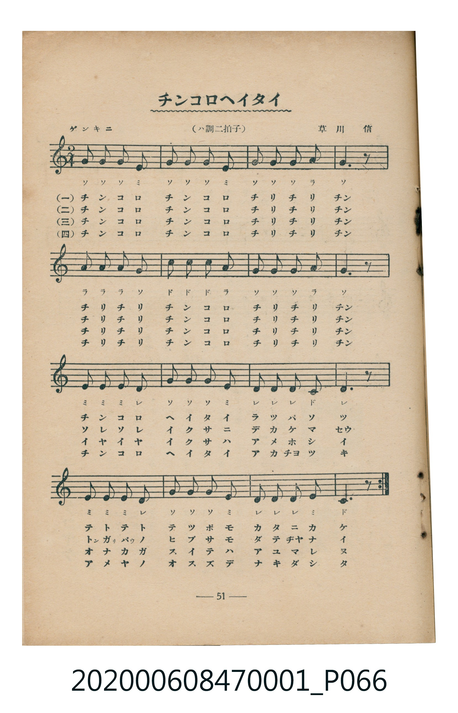
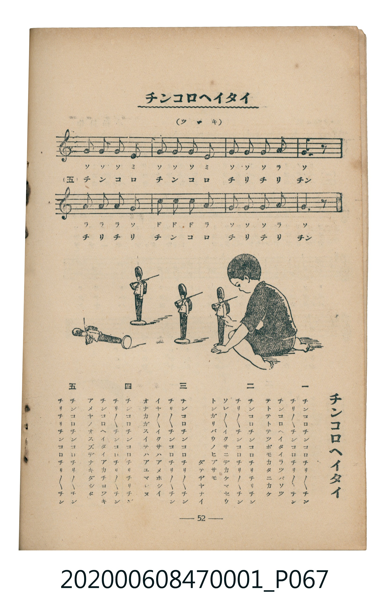

# チンコロヘイタイ（小小兵）

> Re:Shōka 使用 AI 協助辨識與重建樂譜，可能會有錯誤。歡迎回報。

- **鋼琴伴奏版**：<br><audio controls src="chinkoro_heitai.mp3"></audio>
- **NEUTRINO 歌聲合成版**：<br><audio controls src="chinkoro_heitai_neutrino.mp3"></audio>

- 曲：草川信
- 臺灣教育會公認《新定兒童唱歌》尋常科第一學年用（2020.006.0847.0001）

## 說明

曲目說明
中文解釋：描寫身材小巧、精神抖擻的士兵遊行與操練。


## 歌詞

```text
一
チンコロチンコロチリチリチン
チリチリチンコロチリチリチン
チンコロヘイタイラツパソツ
テトテトテツポモカタニカケ

二
チンコロチンコロチリチリチン
チリチリチンコロチリチリチン
ソレソレイクサニデカケマセウ
トンガリバウノヒブサモダテヂヤナイ

三
チンコロチンコロチリチリチン
チリチリチンコロチリチリチン
イヤイヤイクサハアメホシイ
オナカガスイテハアユマレヌ

四
チンコロチンコロチリチリチン
チリチリチンコロチリチリチン
チンコロヘイタイアカチヨツキ
アメヤノオスズデナキダシタ

五
チンコロチンコロチリチリチン
チリチリチンコロチリチリチン
```

## ABC

<div class="abc-score" data-abc-src="chinkoro_heitai.abc" aria-label="五線譜載入中"></div>

[下載 ABC 原始檔](chinkoro_heitai.abc)

## TMD 檔案連結

- [主旋律 TMD 檔案](chinkoro_heitai.tmd) [[在 TMD Studio 編輯](https://tmdlang.github.io/Tmd-TS/#tmd=s7IKdvYPcrWy4qpTUCpJTLdSSM7PyUlNLsnMz7MqzsjMK0nNjM_KTMmPL87Iz05Ugisry88pzU21Si9KTEmNN4w3MjAyiDcwMIs3sDAxBzIMDBFKi_NLi5JTrYqTM_Lzc-JLUitKkvLzsxHyBUX5Zal5iXlANQVFIBtTwIoQClLLMlNSQdKpKZkl-UWZiTlI7kgtKga7FWxJfElRYl5xclFmAcgDCFUlGalAx-Zm5mSWJBZVIsSBhqVn5lmVJGYCvQfyYnlifG5iZl5OYl6KEpeWlsLj5sbHzZsfN21-3Lz2cfOMx01LHjftB5Lv93Q83dAPQq1b3-_pVNDS4lK0VTA0sOCyt1Vw5rIx0jexA9nybPam93tmvejtfLp97pP9C8E2v2jf9bxx8bOpM180bXo2p_lp65oXq3ofN3Q9m7bh6bpZT1snPV-99OmUjc_W9jxu6H66ofvpjh3Pl098vmbNkx0NT9fueLpzy_MpK4AOAIW5HjDM9UBhDmQYGAJdosSlr6UAtPX57HUvVq16NqOPS0FB4cmOtc-mtb9YvvhlezfQOc_6-5-uX_1i1-pncyeAvLB9-eOGxueb9j1fOu9Z17Rnk3c_n9XydPFqoNdeNna9WNjzoqP92eTe59u3PG5o4tLS5wJawQV0Cxdq4KCxVyGRmyFKUYTwK8US5I-bVz5ubnncPPFx014gA6iu7XFzBxIJlJv7uHnR46bVIA3N3WDGRi6uJ7t6aOVUkEvWwEigO9c_btoKsrm5HWL54-Z5j5t2P25aBjQV6EigSWvAuicAhR439z1unvS4eRpYz6LHzQ1gXzQ9bgZ6tQtoHNDlOzpp5nKgJUAHw0ioy_sfNwEdsvBx8-zHTdtBTnjcBNQBdAzQM0Af7gRrADoSog7ohXkgnzf3cHE9nT2b3ukB6ASgu0CyK0CR37QW6FqI64GO7AO5HOTgXaDIAHkBqLkB7Kv9oCQxhUauBWUPR6uAzMS8fIcag5pqUPZTsDE007IDs2oUTBV04dgYiAmJmMFFYNAAJAI2zcewBlRCAflAq0FkE5hsXgvWQ1hmFZhEsMEyEA0wGI-wzIielhnT0zITelpmSkfLasDJB4ZBiahGwTAOSCEIRPoiNcVhdQlVgwopxdHeMqQUR3vLkFIc7S1DSnE0tayWi8sJX9EHKtxg2AhsEGbRBxKHYUO4COlF3wyw2BIwuR_OBsmsBKtrAZMTwTJ7oTIgMRypEKwGWNfB1UPYIBmIHevB5FawTDfUvHaw2GowuREsMw-qB9QkwG4ZKBVCjGyGGIxgY7esHyqzCMxbCCZng-W3I-khvdDDGYAQmyDeAle-8PAESYK0YyuHSI17iAgoBeCK-zawvR1gEsFGyEBieC6YBDkZ5DpIXIC9A44liAhIBhQ_uEogUMsNrBjUeAPrBbXfwIw-qJWTwLxpYFWQeIFa2dyA5EBQ2w7M6ILaiiNqwIkAYhNIJczdsBS3E8yDmAQxGDURQJwGSmvwVNrcg90mUCJASToQU6HegrgBat8usAwoTYPMg7gLFNtQL8KTGyh0McoFXTsFRwUg4QQilLkA)]
- [鋼琴伴奏 TMD 檔案](chinkoro_heitai_piano.tmd) [[在 TMD Studio 編輯](https://tmdlang.github.io/Tmd-TS/#tmd=s7IKdvYPcrWy4tLSUnjc3Pi4efPjps2Pm9c-bp7xuGnJ46b9QPL9no7HzVMeNy163Nz3ZM-Wp0v7n-ye8X5Pp4KWFpeirYKhgQWXva2CM5eNkb6JHVedgtKz2Zve75n1orfz6fa5T_YvVAKJvWjf9bxx8bOpM180bXo2p_lp65oXq3ofN3Q9m7bh6bpZT1snPV-99OmUjc_W9jxu6H66ofvpjh3Pl098vmbNkx0NT9fueLpzy_MpK4AuMTIwMtAzMDDTM7AwMQcyDAyBLlHi4nK0CshMzMsP8nCoMaip5lIAAhtDMy07MKtGwVRBF46NgZiQiBlcBAYNQCJg03wMa0BhBeQDgwtENoHJ5rVgPYRlVoFJBBssA9EAg_EIy4zoaZkxPS0zoadlpnS0rAacfGAYlIhqFAzjgBSCQKQvUlMcVpdQNaiQUhztLUNKcbS3DCnF0d4ypBRHU8tq4YWfD3LhZwEv-6INY4EKISQOngkyD5TyYAkZIoNPNTa9QCc54S-PQSUuDBuB9WOWxyBxGDaEi-DPHdjCcwZYbAmY3A9ng2RWgtW1gMmJYJm9UBmQGI6sAVbzuHkNXD2EDZKB2LEeTG4Fy3RDzWsHi60GkxvBMvOgenY_blqG3TJQ1oAY2QwxGMHGblk_VGYRmLcQTM4Gy29H0kN6SYwzACE2QbwFSpwr4OEJkgRpx1Y4khr3EBFQCsAV921gezvAJIKNkIHE8FwwCXIyyHWQuAB7BxxLEBGQDCh-cBWLwJYQJITWwHLoBEj8AdtGUCsngXnTwKog8QK1srkByYFN0Eht7oLaiiNqwIkAYhNIJczdsBS3E8yDmAQxGDURQJwGSmvwVNrcg90mUCJASToQU6HegrgBat8usAwoTYPMg7gLFNtQL8KTGyh0MQoraMmAv7AyjcdaWkGE0bgo5RUx2lFl4UWWrp2CY7QPSMxOwQnGAIoYwUQgDKCIMUwEwgCKgApBsAiEARQxBTOUuQA)]

## 分析

```text
================================================================================
📊 TMD Song Profile: [ チンコロヘイタイ（小小兵） ]
================================================================================
⏱  Duration:       0:17 (17.8s), 16 measures total
🎼 Key & Tempo:    首調基準 C, != 108.0 BPM, <2/4>
   - 分析範圍：      由實際發聲的音符與和弦推測調性；播放脈絡另行呈現
🎤 人聲音域:    C4 (MIDI 60) – C5 (MIDI 72) [跨度: 12 個半音 / 1.0 個八度, 難度: easy]
   - 最低音:  C4 in [B #1 @ m.11, 0:11]
   - 最高音: C5 in [A #1 @ m.6, 0:05]
   - 適合: soprano, mezzo-soprano, contralto, tenor, baritone, bass
🏛  結構:      A (8.9s) -> B (8.9s)
⚡ 編曲密度:        Peak 1 軌道同時演奏
🗝  調性診斷：       G 大調（純淨自然大調，未偵測到可信轉調）
   - 風格氣質:    純淨自然大調（陽光明朗、易唱易記，無明顯調外色彩）
   - 轉調歷程:    全曲維持單一推測調性（未偵測到可信轉調）
   - 核心骨幹音:  G, D, E, C, A
   - 調性數值:    G 大調 [相關度: 0.87, 穩定度: High, 自然音純度: 100.0%]
   - 候選調性 (K-S): G 大調 (0.87), C 大調 (0.66), E 小調 (0.66)
   - 五度圈歷程:   +1 -> +1
   - 各段落調性細節:
     • [A #1]: G 大調 (r: 0.71, 自然音純度: 100.0%)
     • [B #1]: G 大調 (r: 0.68, 自然音純度: 100.0%)

  [ 五度圈游移軌跡 ]
               C  
         F           [G ]*
      Bb               D  
      Eb               A  
         Ab           E  
            Db       B  
               F# 
     (* = active key center)

  [ 十二半音累積音高分佈 ]
     C  : ███████                   11.7%
     C# :                            0.0%
     D  : ███████████               18.3%
     D# :                            0.0%
     E  : ███████████               18.3%
     F  :                            0.0%
     F# :                            0.0%
     G  : ████████████████████████  41.7%
     G# :                            0.0%
     A  : ██████                    10.0%
     A# :                            0.0%
     B  :                            0.0%
--------------------------------------------------------------------------------
Assignment 軌道音域：
  - Piano         : C4 – C5 (12 個半音 / 1.0 個八度, 52 個音符)
================================================================================
```


## 原書掃描頁






