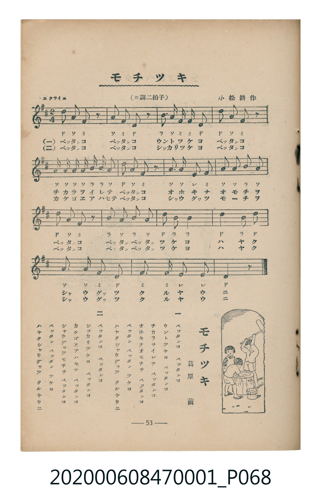

# モチツキ

<audio controls src="mochitsuki.mp3"></audio>

- 詞：葛原𦱳
- 曲：小松耕輔
- 臺灣教育會公認《新定兒童唱歌》尋常科第一學年用（2020.006.0847.0001）

## 說明

・出處：臺灣教育會公認《新定兒童唱歌》尋常科第一學年用（2020.006.0847.0001）
・調性與拍號：調號 ?= D，拍號 <2/4>，速度 != 108

## 歌詞

```text
一
ペツタンコ　ペツタンコ
ウントツケヨ　ペツタンコ
チカラヲイレテ　ペツタンコ
オホキナオモチヲ　ペツタンコ
ペツタン　ペツタン　ツケヨ
ハヤクシヤウグワツ　クルヤウニ

二
ペツタンコ　ペツタンコ
シツカリツケヨ　ペツタンコ
カケゴエアハセテ　ペツタンコ
シヤウグワツモチヲ　ペツタンコ
ペツタン　ペツタン　ツケヨ
ハヤクシヤウグワツ　クルヤウニ
```

## ABC

```abc
X:1
T:モチツキ
C:曲：小松耕輔
M:2/4
L:1/16
Q:1/4=108
K:D
V:V1 name="Piano" snm="Pia"
[V:V1]
d2 A2 F2 z2 | A2 F2 D2 z2 | B2 A2 F F D2 | d2 A2 F2 z2 |
A A A2 B B A2 | d2 A2 F2 z2 | A3 A E2 F2 | A2 A2 B2 A2 |
d2 A2 F2 z2 | B2 A2 B2 A2 | d2 B2 B4 | d4 B2 d2 |
A4 A2 F2 | D4 F4 | F2 E2 E4 | D6 z2 |
d2 A2 F2 z2 | A2 F2 D2 z2 | B2 A2 F F D2 | d2 A2 F2 z2 |
A A A2 B B A2 | d2 A2 F2 z2 | A3 A E2 F2 | A2 A2 B2 A2 |
d2 A2 F2 z2 | B2 A2 B2 A2 | d2 B2 B4 | d4 B2 d2 |
A4 A2 F2 | D4 F4 | F2 E2 E4 | D6 z2 |
```

## TMD 檔案連結

- [主旋律 TMD 檔案](mochitsuki.tmd) [[在 TMD Studio 編輯](https://tmdlang.github.io/Tmd-TS/#tmd=s7IKdvYPcrWy4tLSUnjcvOhxc-Pj5pbHTWsVtLS4FG0VDA0suOxtFVy4bIz0Tey46hSUXqyc937PrBcTZz_tm_9h2cbNSiDBZ7M3AQWfbuh_Nnffi4apL_ZMAQu_aN_1vHHxs6kzXzRtejan-Wnrmhereh83dD2btuHpullPWyc9X7306ZSNz9b2PG7ofrqh--mOHc-XT3y-Zs2THQ1P1-54unPL8ykr3u_pMDIwMtAzMDDTM7AwMQcyDAzf7-lU4uLS1-ICquR63DwL7Oj9j5s3P27a_LihAU2E63HTMhCruQMsuvFx8wpsioB-b1r9uHnl4-ZNj5uWPG5e87i5Dathqx43zwaG0ePmLjAbEmqbsBqJxEeTBnGhjgGq63_cvORx0_rHTdvBjGWPmzY8bl4PUgFUBxRvBjoMLN7czcX1ZFcPUZ4GmgXkA3UCHYnH30AVQLmmLY-bVjxuAnqm_3HTblxex3Ae3X2vpc_F5ZuYmWcVkJmYl-9QY1CjUM2lAAQ2hmZadmBWjYJhnIKugikQGwOxARDXwHmGcBEzuBpjsCg2bVDzTMFQF6jFDEzjtAEkZgQVhYhAtEFomHFYNMOUwJVCFIG4IAyCUCEQBAmBOQgHQiRghgLVQkVAPIhuEAvkNhCGmgdlgSDEu7VcXLp2CqDwVUCilbm4AA)]
- [鋼琴伴奏 TMD 檔案](mochitsuki_piano.tmd) [[在 TMD Studio 編輯](https://tmdlang.github.io/Tmd-TS/#tmd=s7IKdvYPcrWy4tLSUnjcvOhxc-Pj5pbHTWvf7-l43DzlcRNQpO_Jni1Pl_Y_2T3j_Z5OBS0tLkVbBUMDCy57WwUXLhsjfRM7rjoFpRcr573fM-vFxNlP--Z_WLZxsxJI8NnsTUDBpxv6n83d96Jh6os9U8DCL9p3PW9c_GzqzBdNm57NaX7auubFqt7HDV3Ppm14um7W09ZJz1cvfTpl47O1PY8bup9u6H66Y8fz5ROfr1nzZEfD07U7nu7c8nzKCqALjQyMDPQMDMz0DCxMzIEMA0OgC5W4uHwTM_OsAjIT8_KDPBxqDGoUqrkUgMDG0EzLDsyqUTCMU9BVMAViYyA2AOIaOM8QLmIGV2MMFsWmDWqeKRjqArWYgWmcNoDEjKCiEBGINggNMw6LZpgSuFKIIhAXhEEQKgSCICEwB-FAiATMUKBaqAiIB9ENYoHcBsJQ86AsEIR4txY5eH1QgtcCHrrRhrFAxSDSAJNnAuOBLECRQ9UNVofDLNN4FEmIUuyWQ6xDNQwbD0M3quVgHsRaNNtBIQMOF107BVDQKCDRylxcAA)]

## 分析

```text
================================================================================
📊 TMD Song Profile: [ モチツキ ]
================================================================================
⏱  Duration:       0:35 (35.6s), 32 measures total
🎼 Key & Tempo:    首調基準 D, != 108.0 BPM, <2/4>
   - 分析範圍：      由實際發聲的音符與和弦推測調性；播放脈絡另行呈現
🎤 人聲音域:    D4 (MIDI 62) – D5 (MIDI 74) [跨度: 12 個半音 / 1.0 個八度, 難度: easy]
   - 最低音:  D4 in [Main #1 @ m.2, 0:01]
   - 最高音: D5 in [Main #1 @ m.1, 0:00]
   - 適合: soprano, mezzo-soprano, contralto, tenor, baritone, bass
🏛  結構:      Main (17.8s) -> Main (17.8s)
⚡ 編曲密度:        Peak 1 軌道同時演奏
🗝  調性診斷：       D 大調（純淨自然大調，未偵測到可信轉調）
   - 風格氣質:    純淨自然大調（陽光明朗、易唱易記，無明顯調外色彩）
   - 轉調歷程:    全曲維持單一推測調性（未偵測到可信轉調）
   - 核心骨幹音:  A, D, F#, B, E
   - 調性數值:    D 大調 [相關度: 0.87, 穩定度: High, 自然音純度: 100.0%]
   - 候選調性 (K-S): D 大調 (0.87), A 大調 (0.72), F# 小調 (0.67)
   - 五度圈歷程:   +2 -> +2
   - 各段落調性細節:
     • [Main #1]: D 大調 (r: 0.87, 自然音純度: 100.0%)
     • [Main #2]: D 大調 (r: 0.87, 自然音純度: 100.0%)

  [ 五度圈游移軌跡 ]
               C  
         F            G  
      Bb              [D ]*
      Eb               A  
         Ab           E  
            Db       B  
               F# 
     (* = active key center)

  [ 十二半音累積音高分佈 ]
     C  :                            0.0%
     C# :                            0.0%
     D  : ███████████████████       25.9%
     D# :                            0.0%
     E  : █████                      6.9%
     F  :                            0.0%
     F# : ██████████████            19.0%
     G  :                            0.0%
     G# :                            0.0%
     A  : ████████████████████████  32.8%
     A# :                            0.0%
     B  : ███████████               15.5%
--------------------------------------------------------------------------------
Assignment 軌道音域：
  - Piano         : D4 – D5 (12 個半音 / 1.0 個八度, 106 個音符)
================================================================================
```


## 原書掃描頁




