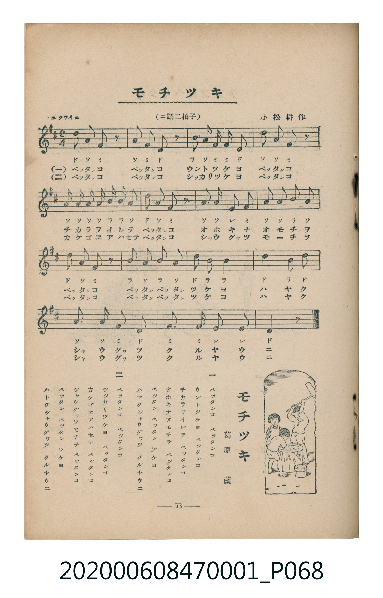

# モチツキ（搗麻糬）

> Re:Shōka 使用 AI 協助辨識與重建樂譜，可能會有錯誤。歡迎回報。

- **鋼琴伴奏版**：<br><audio controls src="mochitsuki.mp3"></audio>
- **NEUTRINO 歌聲合成版**：<br><audio controls src="mochitsuki_neutrino.mp3"></audio>

- 詞：葛原𦱳
- 曲：小松耕輔
- 臺灣教育會公認《新定兒童唱歌》尋常科第一學年用（2020.006.0847.0001）

## 說明

曲目說明
中文解釋：描寫過年或節慶時大家一起搗麻糬的熱鬧情景。


## 歌詞

```text
一
ペツタンコ　ペツタンコ
ウントツケヨ　ペツタンコ
チカラヲイレテ　ペツタンコ
オホキナオモチヲ　ペツタンコ
ペツタン　ペツタン　ツケヨ
ハヤクシヤウグワツ　クルヤウニ

二
ペツタンコ　ペツタンコ
シツカリツケヨ　ペツタンコ
カケゴエアハセテ　ペツタンコ
シヤウグワツモチヲ　ペツタンコ
ペツタン　ペツタン　ツケヨ
ハヤクシヤウグワツ　クルヤウニ
```

## ABC

<div class="abc-score" data-abc-src="mochitsuki.abc" aria-label="五線譜載入中"></div>

[下載 ABC 原始檔](mochitsuki.abc)

## TMD 檔案連結

- [主旋律 TMD 檔案](mochitsuki.tmd) [[在 TMD Studio 編輯](https://tmdlang.github.io/Tmd-TS/#tmd=s7IKdvYPcrWy4qpTUCpJTLdSSM7PyUlNLsnMz7MqzsjMK0nNjM_KTMmPL87Iz05Ugisry88pzU21Si9KTEmNN4w3MjAyiDcwMIs3sDAxBzIMDBFKi_NLi5JTrYqTM_Lzc-JLUitKkvLzsxHyBUX5Zal5iXlANQVFIBtTwIoQClLLMlNSQdKpKZkl-UWZiTlI7kgtKga7FWxJfElRYl5xclFmAcgDCFUlGalAx6alFpdkliHrhorn56cgxIAWpGfmWZUkZgK9DPJ2eWJ8bmJmXk5iHoqqkox8oO8LMiqtMjKLQc5KTsyJz07MQwokqKMKEtNTrQIMzCyUuLS0FB43L3rc3Pi4ueVx09r3ezqeTZj-ctfu55vXvN_TqaClxaVoq2BoYMFlb6vgwmVjpG9iBzLtxcp57_fMejFx9tO--R-WbdwMtuLZ7E1Awacb-p_N3feiYeqLPVPAwi_adz1vXPxs6swXTZuezWl-2rrmxarexw1dz6ZteLpu1tPWSc9XL306ZeOztT2PG7qfbuh-umPH8-UTn69Z82RHw9O1O57u3PJ8ygqgw0BRqgeMUj1QlAIZBoZAFypx6WspAC1-Pnvdi1Wrns3o41JQUHiyY-2zae0vli9-2d4NdNGz_v6n61e_bOwDGvWsY9rz9Q3PWrc9m9n0dMnyp-u2AW15sXU73NfPZ7U8b9v4cs3yZ82tz2auf9zQxKWlzwW0hQuokOtx8yxwQO1_3Lz5cdPmxw0NaCJcj5uWgVjNHWDRjY-bV2BTBAzvptWPm1c-bt70uGnJ4-Y1j5vbsBq26nHzbGC8PG7uArMhMbUJq5FIfDRpEBfqGKC6_sfNSx43rX_ctB3MWPa4acPj5vUgFUB1QPFmoMPA4s3dXFxPdvUQ5WmgWUA-UCfQkXj8DVQBlGva8rhpxeMmoGf6HzftxuV1DOfR3fegiPcF5jSrgMzEvHyHGoOaalDyUrAxNNOyA7NqFAzjFHQVTIHYGIgNgLgGzjOEi5jB1RiDRbFpA5vnY1gDzI9AxzcDhSDuBzNAZDxYIwFZcOoDCTZ3gMkWoNBGIL2CsGaIA4wodQAwXCGyoMRAlhtAIQiCusBwMwPTOIMZJGYEFYWIQLRBaOQwbQS5CEivBDtpE5C3BEiD8h1RvgL5BKRxNpC9FszqQpIBJk0w2Qg1HCU0QdaC_N-0BWzqCiBeBFQFTfrEhuliiAOalgExMMWug4YsRDfIdoj70F2ANeRg4QMPJ4giEBeEQRAqBIIgITCHgiSKIQJSBXI9KGRA8qC0AbEXGDJw3ywBq1iPGp4DZDcswSECExhGUBEQD2ICiAVKkCAMDUcoCwTRMjoiXiExCyKhcQtzI0QK5AqYC1cjuQ6kBSbejWQPWn6msT21XFy6dgqgglIBSCtzAQA)]
- [鋼琴伴奏 TMD 檔案](mochitsuki_piano.tmd) [[在 TMD Studio 編輯](https://tmdlang.github.io/Tmd-TS/#tmd=s7IKdvYPcrWy4qpTUCpJTLdSyC8qychPL0osyKi0ysgsLskvykxOzInPTsxLVIIrKs4vLUpOjS9ITE-1CjAws1Di0tJSeNy86HFz4-PmlsdNa9_v6XjcPOVxE1Ck78meLU-X9j_ZPeP9nk4FLS0uRVsFQwMLLntbBRcuGyN9EzuQsS9Wznu_Z9aLibOf9s3_sGzjZrBdz2ZvAgo-3dD_bO6-Fw1TX-yZAhZ-0b7reePiZ1Nnvmja9GxO89PWNS9W9T5u6Ho2bcPTdbOetk56vnrp0ykbn63tedzQ_XRD99MdO54vn_h8zZonOxqert3xdOeW51NWAF1oZGBkoGdgYKZnYGFiDmQYGAJdqMTF5ZuYmWcVkJmYlx_k4VBjUFPNpQAENoZmWnZgVo2CYZyCroIpEBsDsQEQ18B5hnARM7gaY7AoNm1g83wMa4CBN-txczNQ6HHT_sfNm8EMEBkP1khAtmkZVLC5A0y2AIU2AukVhDVDHGBEqQO2w2RXP25eRZYbQCEIgrrAcDMD0ziDGSRmBBWFiEC0QWjkMG0EuQhIrwQ7aROQtwRIr3nc3EaUr0A-AWmcDWSvBbO6kGSA6R1MNkINRwlNkLUg_zdtAZu6AogXAVX1P27aTaztwDBdDHFA0zIg3vC4eR00ZCG6QbZD3IfuAqwhBwsfeDhBFIG4IAyCUCEQBAmBORQkUQwRkCqQ60EhA5IHpQ2IvcCQgftmCVjFetTwHCC7YQkOEZjAMIKKgHgQE0AsUIIEYWg4QlkgiJbREfEKiVkQCY1bmBshUiBXwFy4Gsl1IC0w8W4ke9DyM43tqUUuJ32Qy0kLeDEZbRgLVAsiDTB5JjAeyAYUOVTdYHU4zDKNR5GEKMVuOcQ6VMOw8TB0o1oO5kGsRbMdFNHgYNG1UwCFTLQPSBjGNgKzlbkA)]

## 分析

```text
================================================================================
📊 TMD Song Profile: [ モチツキ（搗麻糬） ]
================================================================================
⏱  Duration:       0:17 (17.8s), 16 measures total
🎼 Key & Tempo:    首調基準 D, != 108.0 BPM, <2/4>
   - 分析範圍：      由實際發聲的音符與和弦推測調性；播放脈絡另行呈現
🎤 人聲音域:    D4 (MIDI 62) – D5 (MIDI 74) [跨度: 12 個半音 / 1.0 個八度, 難度: easy]
   - 最低音:  D4 in [Main #1 @ m.2, 0:01]
   - 最高音: D5 in [Main #1 @ m.1, 0:00]
   - 適合: soprano, mezzo-soprano, contralto, tenor, baritone, bass
🏛  結構:      Main (17.8s)
⚡ 編曲密度:        Peak 1 軌道同時演奏
🗝  調性診斷：       D 大調（純淨自然大調，未偵測到可信轉調）
   - 風格氣質:    純淨自然大調（陽光明朗、易唱易記，無明顯調外色彩）
   - 轉調歷程:    全曲維持單一推測調性（未偵測到可信轉調）
   - 核心骨幹音:  A, D, F#, B, E
   - 調性數值:    D 大調 [相關度: 0.87, 穩定度: High, 自然音純度: 100.0%]
   - 候選調性 (K-S): D 大調 (0.87), A 大調 (0.72), F# 小調 (0.67)
   - 五度圈歷程:   +2
   - 各段落調性細節:
     • [Main #1]: D 大調 (r: 0.87, 自然音純度: 100.0%)

  [ 五度圈游移軌跡 ]
               C  
         F            G  
      Bb              [D ]*
      Eb               A  
         Ab           E  
            Db       B  
               F# 
     (* = active key center)

  [ 十二半音累積音高分佈 ]
     C  :                            0.0%
     C# :                            0.0%
     D  : ███████████████████       25.9%
     D# :                            0.0%
     E  : █████                      6.9%
     F  :                            0.0%
     F# : ██████████████            19.0%
     G  :                            0.0%
     G# :                            0.0%
     A  : ████████████████████████  32.8%
     A# :                            0.0%
     B  : ███████████               15.5%
--------------------------------------------------------------------------------
Assignment 軌道音域：
  - Piano         : D4 – D5 (12 個半音 / 1.0 個八度, 53 個音符)
================================================================================
```


## 原書掃描頁




