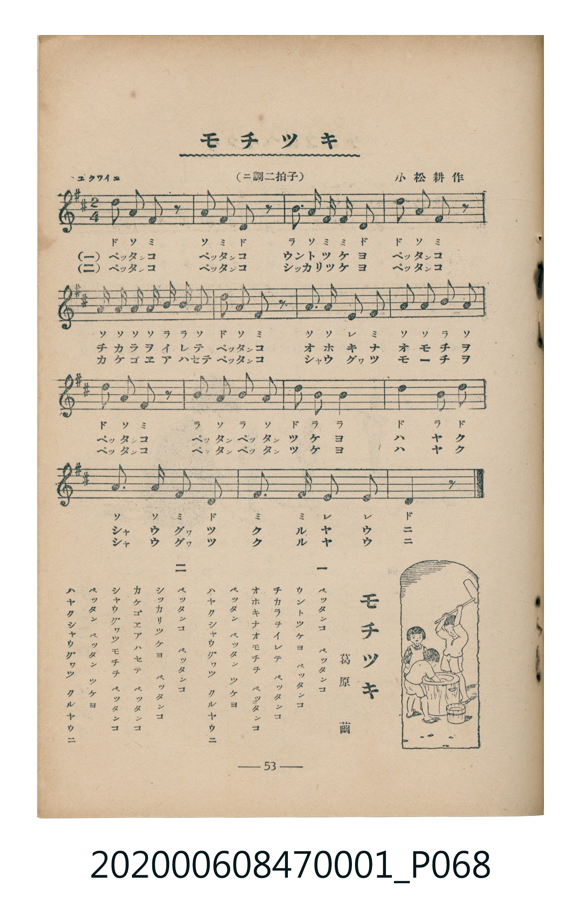

# モチツキ（搗麻糬）

> Re:Shōka 使用 AI 協助辨識與重建樂譜，可能會有錯誤。歡迎回報。

<audio controls src="mochitsuki.mp3"></audio>

- 詞：葛原𦱳
- 曲：小松耕輔
- 臺灣教育會公認《新定兒童唱歌》尋常科第一學年用（2020.006.0847.0001）

## 說明

曲目說明
中文解釋：描寫過年或節慶時大家一起搗麻糬的熱鬧情景。

## 歌詞

```text
一
ペツタンコ　ペツタンコ
ウントツケヨ　ペツタンコ
チカラヲイレテ　ペツタンコ
オホキナオモチヲ　ペツタンコ
ペツタン　ペツタン　ツケヨ
ハヤクシヤウグワツ　クルヤウニ

二
ペツタンコ　ペツタンコ
シツカリツケヨ　ペツタンコ
カケゴエアハセテ　ペツタンコ
シヤウグワツモチヲ　ペツタンコ
ペツタン　ペツタン　ツケヨ
ハヤクシヤウグワツ　クルヤウニ
```

## ABC

```abc
X:1
T:モチツキ（搗麻糬）
C:曲：小松耕輔
M:2/4
L:1/16
Q:1/4=108
K:D
V:V1 name="Piano" snm="Pia"
[V:V1]
d2 A2 F2 z2 | A2 F2 D2 z2 | B2 A2 F F D2 | d2 A2 F2 z2 |
w: 1.~ペッ タン コ | ペッ タン コ | ウン ト ツ ケ ヨ | ペッ タン コ
w: 2.~ペッ タン コ | ペッ タン コ | シッ カリ ツ ケ ヨ | ペッ タン コ
A A A2 B B A2 | d2 A2 F2 z2 | A3 A E2 F2 | A2 A2 B2 A2 |
w: 1.~チ カ ラ ヲ イ レテ | ペッ タン コ | オ ホ キ ナ | オ モ チ ヲ
w: 2.~カ ケ ゴ エ ア ハセテ | ペッ タン コ | シャ ウ グヮ ツ | モ _ チ ヲ
d2 A2 F2 z2 | B2 A2 B2 A2 | d2 B2 B4 | d4 B2 d2 |
w: 1.~ペッ タン コ | ペッ タン ペッ タン | ツ ケ ヨ | ハ ヤ ク
w: 2.~ペッ タン コ | ペッ タン ペッ タン | ツ ケ ヨ | ハ ヤ ク
A4 A2 F2 | D4 F4 | F2 E2 E4 | D6 z2 |
w: 1.~シャ ウ グヮ | ツ ク | ル ヤ ウ | ニ
w: 2.~シャ ウ グヮ | ツ ク | ル ヤ ウ | ニ
```

## TMD 檔案連結

- [主旋律 TMD 檔案](mochitsuki.tmd) [[在 TMD Studio 編輯](https://tmdlang.github.io/Tmd-TS/#tmd=s7IKdvYPcrWy4qpTUCpJTLdSSM7PyUlNLsnMz7MqzsjMK0nNjM_KTMmPL87Iz05Ugisry88pzU21Si9KTEmNN4w3MjAyiDcwMIs3sDAxBzIMDBFKi_NLi5JTrYqTM_Lzc-JLUitKkvLzsxHyBUX5Zal5iXlANQVFIBtTwIoQClLLMlNSQdKpKZkl-UWZiTlI7kgtKga7FWxJfElRYl5xclFmAcgDCFUlGalAx6alFpdkliHrhorn56cocWlpKTxuXvS4ufFxc8vjprXv93Q8mzD95a7dzzeveb-nU0FLi0vRVsHQwILL3lbBhcvGSN_EDmTOi5Xz3u-Z9WLi7Kd98z8s27gZbPiz2ZuAgk839D-bu-9Fw9QXe6aAhV-073reuPjZ1JkvmjY9m9P8tHXNi1W9jxu6nk3b8HTdrKetk56vXvp0ysZna3seN3Q_3dD9dMeO58snPl-z5smOhqdrdzzdueX5lBVAh4FCWw8Y2nqg0AYyDAyBLlTi0tdSAFr8fPa6F6tWPZvRx6WgoPBkx9pn09pfLF_8sr0b6KJn_f1P169-2dgHNOpZx7Tn6xuetW57NrPp6ZLlT9dtA9ryYut2uK-fz2p53rbx5Zrlz5pbn81c_7ihiUtLnwtoCxdQIdfj5lnggNr_uHnz46bNjxsa0ES4HjctA7GaO8CiGx83r8CmCBjeTasfN6983LzpcdOSx81rHje3YTVs1ePm2cB4edzcBWZDYmoTViOR-GjSIC7UMUB1_Y-blzxuWv-4aTuYsexx04bHzetBKoDqgOLNQIeBxZu7ubie7OohytNAs4B8oE6gI_H4G6gCKNe05XHTisdNQM_0P27ajcvrGM6ju-9BEe-bmJlnFZCZmJfvUGNQUw1KXgo2hmZadmBWjYJhnIKugikQGwOxARDXwHmGcBEzuBpjsCg2bWDzfAxrgPkR6PhmoBDE_WAGiIwHayQgC059IMHmDjDZAhTaCKRXENYMcYARpQ4AhitEFpQYyHIDKARBUBcYbmZgGmcwg8SMoKIQEYg2CI0cpo0gFwHplWAnbQLylgBpUL4jylcgn4A0zgay14JZXUgywKQJJhuhhqOEJshakP-btoBNXQHEi4CqoEmf2DBdDHFA0zIgBqbYddCQhegG2Q5xH7oLsIYcLHzg4QRRBOKCMAhChUAQJATmUJBEMURAqkCuB4UMSB6UNiD2AkMG7pslYBXrUcNzgOyGJThEYALDCCoC4kFMALFACRKEoeEIZYEgWkZHxCskZkEkNG5hboRIgVwBc-FqJNeBtMDEu5HsQcvPNLanlotL104BVFAqAGllLgA)]
- [鋼琴伴奏 TMD 檔案](mochitsuki_piano.tmd) [[在 TMD Studio 編輯](https://tmdlang.github.io/Tmd-TS/#tmd=s7IKdvYPcrWy4tLSUnjcvOhxc-Pj5pbHTWvf7-l43DzlcRNQpO_Jni1Pl_Y_2T3j_Z5OBS0tLkVbBUMDCy57WwUXLhsjfRM7rjoFpRcr573fM-vFxNlP--Z_WLZxsxJI8NnsTUDBpxv6n83d96Jh6os9U8DCL9p3PW9c_GzqzBdNm57NaX7auubFqt7HDV3Ppm14um7W09ZJz1cvfTpl47O1PY8bup9u6H66Y8fz5ROfr1nzZEfD07U7nu7c8nzKCqALjQyMDPQMDMz0DCxMzIEMA0OgC5W4uHwTM_OsAjIT8_KDPBxqDGqquRSAwMbQTMsOzKpRMIxT0FUwBWJjIDYA4ho4zxAuYgZXYwwWxaYNbJ6PYQ0w8GY9bm4GCj1u2v-4eTOYASLjwRoJyDYtgwo2d4DJFqDQRiC9grBmiAOMKHXAdpjs6sfNq8hyAygEQVAXGG5mYBpnMIPEjKCiEBGINgiNHKaNIBcB6ZVgJ20C8pYA6TWPm9uI8hXIJyCNs4HstWBWF5IMML2DyUao4SihCbIW5P-mLWBTVwDxIqCq_sdNu4m1HRimiyEOaFoGxBseN6-DhixEN8h2iPvQXYA15GDhAw8niCIQF4RBECoEgiAhMIeCJIohAlIFcj0oZEDyoLQBsRcYMnDfLAGrWI8angNkNyzBIQITGEZQERAPYgKIBUqQIAwNRygLBNEyOiJeITELIqFxC3MjRArkCpgLVyO5DqQFJt6NZA9afqaxPbXI5aQPcjlpAS8mow1jgWpBpAEmzwTGA9mAIoeqG6wOh1mm8SiSEKXYLYdYh2oYNh6GblTLwTyItWi2gyIaHCy6dgqgkIn2AQnD2EZgtjIXAA)]

## 分析

```text
================================================================================
📊 TMD Song Profile: [ モチツキ（搗麻糬） ]
================================================================================
⏱  Duration:       0:17 (17.8s), 16 measures total
🎼 Key & Tempo:    首調基準 D, != 108.0 BPM, <2/4>
   - 分析範圍：      由實際發聲的音符與和弦推測調性；播放脈絡另行呈現
🎤 人聲音域:    D4 (MIDI 62) – D5 (MIDI 74) [跨度: 12 個半音 / 1.0 個八度, 難度: easy]
   - 最低音:  D4 in [Main #1 @ m.2, 0:01]
   - 最高音: D5 in [Main #1 @ m.1, 0:00]
   - 適合: soprano, mezzo-soprano, contralto, tenor, baritone, bass
🏛  結構:      Main (17.8s)
⚡ 編曲密度:        Peak 1 軌道同時演奏
🗝  調性診斷：       D 大調（純淨自然大調，未偵測到可信轉調）
   - 風格氣質:    純淨自然大調（陽光明朗、易唱易記，無明顯調外色彩）
   - 轉調歷程:    全曲維持單一推測調性（未偵測到可信轉調）
   - 核心骨幹音:  A, D, F#, B, E
   - 調性數值:    D 大調 [相關度: 0.87, 穩定度: High, 自然音純度: 100.0%]
   - 候選調性 (K-S): D 大調 (0.87), A 大調 (0.72), F# 小調 (0.67)
   - 五度圈歷程:   +2
   - 各段落調性細節:
     • [Main #1]: D 大調 (r: 0.87, 自然音純度: 100.0%)

  [ 五度圈游移軌跡 ]
               C  
         F            G  
      Bb              [D ]*
      Eb               A  
         Ab           E  
            Db       B  
               F# 
     (* = active key center)

  [ 十二半音累積音高分佈 ]
     C  :                            0.0%
     C# :                            0.0%
     D  : ███████████████████       25.9%
     D# :                            0.0%
     E  : █████                      6.9%
     F  :                            0.0%
     F# : ██████████████            19.0%
     G  :                            0.0%
     G# :                            0.0%
     A  : ████████████████████████  32.8%
     A# :                            0.0%
     B  : ███████████               15.5%
--------------------------------------------------------------------------------
Assignment 軌道音域：
  - Piano         : D4 – D5 (12 個半音 / 1.0 個八度, 53 個音符)
================================================================================
```


## 原書掃描頁




