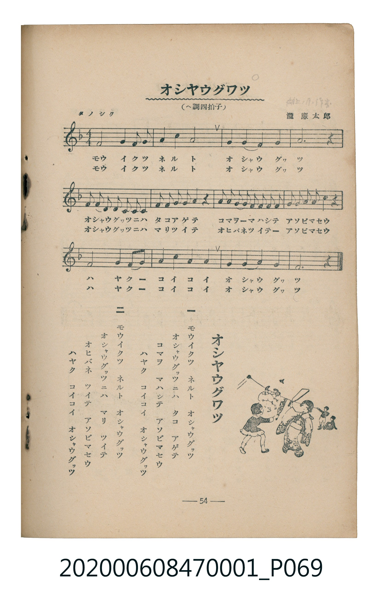

# オシヤウグワツ（新年）

> Re:Shōka 使用 AI 協助辨識與重建樂譜，可能會有錯誤。歡迎[回報](https://github.com/TMDLang/reshoka/issues)。

- **鋼琴伴奏版**：<br><audio controls src="oshogatsu.mp3"></audio>
- **NEUTRINO 歌聲合成版**：<br><audio controls src="oshogatsu_neutrino.mp3"></audio>

- 詞：東くめ
- 曲：瀧廉太郎
- 臺灣教育會公認《新定兒童唱歌》尋常科第一學年用（2020.006.0847.0001）

## 說明

曲目說明
中文解釋：描寫日本正月的新年氣氛、節慶習俗與迎春喜悅。


## 歌詞

```text
一
モウイクツ　ネルト　オシヤウグワツ
オシヤウグワツニハ　タコ　アゲテ
コマヲ　マハシテ　アソビマセウ
ハヤク　コイコイ　オシヤウグワツ

二
モウイクツ　ネルト　オシヤウグワツ
オシヤウグワツニハ　マリ　ツイテ
オヒバネ　ツイテ　アソビマセウ
ハヤク　コイコイ　オシヤウグワツ
```

## ABC

<div class="abc-score" data-abc-src="oshogatsu.abc" aria-label="五線譜載入中"></div>

[下載 ABC 原始檔](oshogatsu.abc)

## TMD 檔案連結

- [主旋律 TMD 檔案](oshogatsu.tmd) [[在 TMD Studio 編輯](https://tmdlang.github.io/Tmd-TS/#tmd=s7IKdvYPcrWy4qpTUCpJTLdSSM7PyUlNLsnMz7MqzsjMK0nNjM_KTMmPL87Iz05Ugisry88pzU21Si9KTEmNN4w3MjAyiDcwMIs3sDAxBzIMDBFKi_NLi5JTrYqTM_Lzc-JLUitKkvLzsxHyBUX5Zal5iXlANQVFIBtTwIoQClLLMlNSQdKpKZkl-UWZiTlI7kgtKga7FWxJfElRYl5xclFmAcgDCFUlGalAxxanJhbn5xWjC6elFpdkliEbCrQjPTPPKjc1MysTi4Oh0iWJmcBAAQVMeWJ8bmJmXk5iXgqyqpKMfGD4FGRUWmVkFoMcnpyYE5-dmIcUjFBnFySmp1oFGJhZKnFpaSk8blr1uGn74-Ylj5uWPW7a8Lh5_ePmlvd7Op5N2_B055b3ezoVtLS4FG0VDA0MuOxtFdy4bEz0TexAZr5YOe_9nlnP5m583Nj_uKkRbM-z2ZuAYs8blj_d3fl0yaqXzX1g4Rftu543Ln42deaLpk3P5jQ_bV3zYlXv44YukCXrZj1tnfR89dKnUzY-W9vzuKH76Ybupzt2PF8-8fmaNU92NDxduwPokOdTVgAdBYp5PWDM64FiHsgwMAQ6UIlLX0sBaPHz2eterFr1bEYfl4KCwpMda59Na3-xfPHL9m6QK_v7n65f_Wz60mdz1jxbu_jZnI7ns1ogXny2YfGzDbMfNzQ-X9_wrHXb8_2Tnuyf_qKj_cX-vmczlj6dNudZU-vjhiYuLX0uoEVcQBdxPW5eBA4tYJiBQutxQ8Pj5t7HzasfN3eA2NhClAur6OPm7sfN_WA9-x83bQYzgEZvetzcBtSw-XHzvMfNm8DGAxnAQAbqb4Mp2vu4eTJIvGk30ESgk_rBZq8HS28Guw1M4nIP15NdPbTwCMilq8CMFpC5YI-setw86XHzBJDZSBJU8ggoXnyBGcIqIDMxL9-hxqCmGpQAFGwstOzAjBoFQwVdMDQCYkMgWaNgDGSZAjGIBsEasBxEHkJD1MCgAUgEbJqPYY0CJNigUkC3gcn1QOEWoDagL0H85tVgsgNuAdD1YHVADywGM0AGgL2xDiIP1I2wMB5hoRGdLQSFl6GCWTwImcKQIVTYCAhBAQMOECDLGCwCkgFBUDCC5I3BgYsWaEDnQB0DcgrUISBHABMPEPdDHb0fiDcD8SIg3gQUb4M5DiLePA-IN4G9CmL1g8wEqwLJg_TsBfImQ2TBKQozMIlzCNh4oEqQODDEUR0CEp8ExBPAoY-qhiiHEEqUIIxIlCAeJFHCdGFLlCCHgxNIMyyBwEINkWgQbEpTJD1sq-Xi0rVTAOVuBSCtzAUA)]
- [鋼琴伴奏 TMD 檔案](oshogatsu_piano.tmd) [[在 TMD Studio 編輯](https://tmdlang.github.io/Tmd-TS/#tmd=s7IKdvYPcrWy4qpTUCpJTLdSyC8qychPL0osyKi0ysgsLskvykxOzInPTsxLVIIrKs4vLUpOjS9ITE-1CjAws1Ti0tJSeNy06nHT9sfNSx43LXvctOFx8_rHzS3v93Q8bp7yuGnR4-a-J3u2PF3a_2T3jPd7OhW0tLgUbRUMDQy47G0V3LhsTPRN7EDmv1g57_2eWc_mbnzc2P-4qRFs57PZm4BizxuWP93d-XTJqpfNfWDhF-27njcufjZ15oumTc_mND9tXfNiVe_jhq5n0zY8XTfraeuk56uXPp2y8dnanscN3U83dD_dseP58onP16x5sqPh6dodT3dueT5lBdCBRgZGBnoGBmZ6BhYm5kCGgSHQgUpcXL6JmXlWAZmJeflBHg41BjXVXApAYGOhZQdm1CgYKuiCoREQGwLJGgVjIMsUiEE0CNaA5SDyEBqiBgYNQCJg03wMaxQeNy8Chh1U6nHTEjC5HijcAtT2uLkXxG9eDSY74BYAgx2sDhjyi8EMkAHg8F8HkQfqRlgYj7DQiM4WgsLLUMEsHoRMYcgQKmwEhKCAAQcIkGUMFgHJgCAoGEHyxuDARQs0oHOgjgE5BeoQkCMeN3cDcT_U0fuBeDMQLwLiTUDxNpjjIOLN84B4E9irIFY_yEywKpA8SM9eIG8yRLZpN8TTaIFJnEPAxgNVgsSBIY7qEJD4JCCeAA59VDVEOYRQogRhRKIE8SCJEqYLW6IEORycQJphCQQWaohEg2BTmiLpYVstcub2Qc7cJvDMHW0YC1QLIYE8k1gwG843jQdLQyiYalDYweIBTT9UPZALVILMxZTFbgCEB3UGhA_WhtUJQA_q2imA_BjtAxKGsY3AbGUuAA)]

## 分析

```text
================================================================================
📊 TMD Song Profile: [ オシヤウグワツ（新年） ]
================================================================================
⏱  Duration:       0:28 (28.8s), 12 measures total
🎼 Key & Tempo:    首調基準 F, != 100.0 BPM, <4/4>
   - 分析範圍：      由實際發聲的音符與和弦推測調性；播放脈絡另行呈現
🎤 人聲音域:    C4 (MIDI 60) – C5 (MIDI 72) [跨度: 12 個半音 / 1.0 個八度, 難度: easy]
   - 最低音:  C4 in [Main #1 @ m.5, 0:10]
   - 最高音: C5 in [Main #1 @ m.2, 0:03]
   - 適合: soprano, mezzo-soprano, contralto, tenor, baritone, bass
🏛  結構:      Main (28.8s)
⚡ 編曲密度:        Peak 1 軌道同時演奏
🗝  調性診斷：       F 大調（純淨自然大調，未偵測到可信轉調）
   - 風格氣質:    純淨自然大調（陽光明朗、易唱易記，無明顯調外色彩）
   - 轉調歷程:    全曲維持單一推測調性（未偵測到可信轉調）
   - 核心骨幹音:  F, A, G, C, D
   - 調性數值:    F 大調 [相關度: 0.71, 穩定度: High, 自然音純度: 100.0%]
   - 候選調性 (K-S): F 大調 (0.71), A 小調 (0.54), C 大調 (0.53)
   - 五度圈歷程:   -1
   - 各段落調性細節:
     • [Main #1]: F 大調 (r: 0.71, 自然音純度: 100.0%)

  [ 五度圈游移軌跡 ]
               C  
        [F ]*          G  
      Bb               D  
      Eb               A  
         Ab           E  
            Db       B  
               F# 
     (* = active key center)

  [ 十二半音累積音高分佈 ]
     C  : ████████                  10.2%
     C# :                            0.0%
     D  : ██                         2.3%
     D# :                            0.0%
     E  :                            0.0%
     F  : ████████████████████████  30.7%
     F# :                            0.0%
     G  : █████████████████████     27.3%
     G# :                            0.0%
     A  : ███████████████████████   29.5%
     A# :                            0.0%
     B  :                            0.0%
--------------------------------------------------------------------------------
Assignment 軌道音域：
  - Piano         : C4 – C5 (12 個半音 / 1.0 個八度, 51 個音符)
================================================================================
```


## 原書掃描頁




