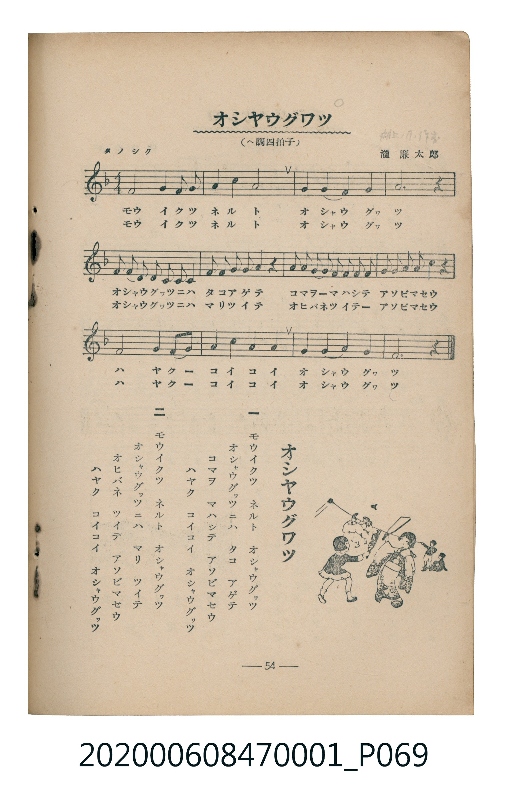

# オシヤウグワツ（新年）

> Re:Shōka 使用 AI 協助辨識與重建樂譜，可能會有錯誤。歡迎回報。

- **NEUTRINO 歌聲合成版**：<br><audio controls src="oshogatsu_neutrino.mp3"></audio>
- **鋼琴伴奏版**：<br><audio controls src="oshogatsu.mp3"></audio>


- 詞：東くめ
- 曲：瀧廉太郎
- 臺灣教育會公認《新定兒童唱歌》尋常科第一學年用（2020.006.0847.0001）

## 說明

曲目說明
中文解釋：描寫日本正月的新年氣氛、節慶習俗與迎春喜悅。


## 歌詞

```text
一
モウイクツ　ネルト　オシヤウグワツ
オシヤウグワツニハ　タコ　アゲテ
コマヲ　マハシテ　アソビマセウ
ハヤク　コイコイ　オシヤウグワツ

二
モウイクツ　ネルト　オシヤウグワツ
オシヤウグワツニハ　マリ　ツイテ
オヒバネ　ツイテ　アソビマセウ
ハヤク　コイコイ　オシヤウグワツ
```

## ABC

```abc
X:1
T:オシヤウグワツ（新年）
C:曲：瀧廉太郎
M:4/4
L:1/16
Q:1/4=100
K:F
V:V1 name="Piano" snm="Pia"
[V:V1]
F8 G4 F2 G2 | A4 c4 A8 | G4 G4 F4 G4 | A12 z4 |
w: 1.~モウ イ ク ツ | ネ ル ト | オ シャ ウ グヮ | ツ
w: 2.~モウ イ ク ツ | ネ ル ト | オ シャ ウ グヮ | ツ
F2 F2 D2 D2 C2 C2 C2 F2 | F2 F2 G2 G2 A4 z4 | A2 A2 G2 G2 F2 F2 F2 F2 | G2 G2 A2 A2 c4 z4 |
w: 1.~オ シャ ウ グヮ ツ ニ ハ _ | タ コ ア ゲ テ | コ マ ヲ _ マ ハ シ テ | ア ソ ビ マ セウ
w: 2.~オ シャ ウ グヮ ツ ニ ハ _ | マ リ ツ イ テ | オ ヒ バ ネ ツ イ テ _ | ア ソ ビ マ セウ
F8 G4 F2 G2 | A4 c4 A4 A4 | G4 G4 A4 G4 | F12 z4 |
w: 1.~ハ ヤ ク _ | コ イ コ イ | オ シャ ウ グヮ | ツ
w: 2.~ハ ヤ ク _ | コ イ コ イ | オ シャ ウ グヮ | ツ
```

## TMD 檔案連結

- [主旋律 TMD 檔案](oshogatsu.tmd) [[在 TMD Studio 編輯](https://tmdlang.github.io/Tmd-TS/#tmd=s7IKdvYPcrWy4qpTUCpJTLdSSM7PyUlNLsnMz7MqzsjMK0nNjM_KTMmPL87Iz05Ugisry88pzU21Si9KTEmNN4w3MjAyiDcwMIs3sDAxBzIMDBFKi_NLi5JTrYqTM_Lzc-JLUitKkvLzsxHyBUX5Zal5iXlANQVFIBtTwIoQClLLMlNSQdKpKZkl-UWZiTlI7kgtKga7FWxJfElRYl5xclFmAcgDCFUlGalAxxanJhbn5xWjC6elFpdkliEbCrQjPTPPKjc1MysTi4Oh0iWJmcBAAQVMeWJ8bmJmXk5iXooSl5aWwuOmVY-btj9uXvK4adnjpg2Pm9c_bm55v6fj2bQNT3dueb-nU0FLi0vRVsHQwIDL3lbBjcvGRN_EDmT-i5Xz3u-Z9WzuxseN_Y-bGsF2Ppu9CSj2vGH5092dT5esetncBxZ-0b7reePiZ1Nnvmja9GxO89PWNS9W9T5u6AJZsm7W09ZJz1cvfTpl47O1PY8bup9u6H66Y8fz5ROfr1nzZEfD07U7gA55PmUF0FGgqNMDRp0eKOqADANDoAOVuPS1FIAWP5-97sWqVc9m9HEpKCg82bH22bT2F8sXv2zvBrmyv__p-tXPpi99NmfNs7WLn83peD6rBeLFZxsWP9sw-3FD4_P1Dc9atz3fP-nJ_ukvOtpf7O97NmPp02lznjW1Pm5o4tLS5wJaxAV0Edfj5kXg0AKGGSi0Hjc0PG7ufdy8-nFzB4iNLUS5sIo-bu5-3NwP1rP_cdNmMANo9KbHzW1ADZsfN8973LwJbDyQAQxkoP42mKK9j5sng8SbdgNNBDqpH2z2erD0ZrDbwCQu93A92dVDC4-AXLoKzGgBmQv2yKrHzZMeN08AmY0kQSWPgOLFF5iirQIyE_PyHWoMaqpBCUDBxkLLDsyoUTBU0AVDIyA2BJI1CsZAlikQg2gQrAHLQeQhNEQNDBqARMCm-RjWKECCDSoFdBuYXA8UbgFqA_oSxG9eDSY74BYAXQ9WB_TAYjADZADYG-sg8kDdCAvjERYa0dlCUHgZKpjFg5ApDBlChY2AEBQw4AABsozBIiAZEAQFI0jeGBy4aIEGdA7UMSCnQB0CcgQw8QBxP9TR-4F4MxAvAuJNQPE2mOMg4s3zgHgT2KsgVj_ITLAqkDxIz14gbzJEFpyiMAOTOIeAjQeqBIkDQxzVISDxSUA8ARz6qGqIcgihRAnCiEQJ4kESJUwXtkQJcjg4gTTDEggs1BCJBsGmNEXSw7ZaLi5dOwVQ7lYA0spcAA)]
- [鋼琴伴奏 TMD 檔案](oshogatsu_piano.tmd) [[在 TMD Studio 編輯](https://tmdlang.github.io/Tmd-TS/#tmd=s7IKdvYPcrWy4tLSUnjctOpx0_bHzUseNy173LThcfP6x80t7_d0PG6e8rhp0ePmvid7tjxd2v9k94z3ezoVtLS4FG0VDA0MuOxtFdy4bEz0Tey46hSUXqyc937PrGdzNz5u7H_c1KgEEns2exNQ7HnD8qe7O58uWfWyuQ8s_KJ91_PGxc-mznzRtOnZnOanrWterOp93ND1bNqGp-tmPW2d9Hz10qdTNj5b2_O4ofvphu6nO3Y8Xz7x-Zo1T3Y0PF274-nOLc-nrAA60MjAyEDPwMBMz8DCxBzIMDAEOlCJi8s3MTPPKiAzMS8_yMOhxqCmmksBCGwstOzAjBoFQwVdMDQCYkMgWaNgDGSZAjGIBsEasBxEHkJD1MCgAUgEbJqPYY3C4-ZFwLCDSj1uWgIm1wOFW4DaHjf3gvjNq8FkB9wCYLCD1QFDfjGYATIAHP7rIPJA3QgL4xEWGtHZQlB4GSqYxYOQKQwZQoWNgBAUMOAAAbKMwSIgGRAEBSNI3hgcuGiBBnQO1DEgp0AdAnLE4-ZuIO6HOno_EG8G4kVAvAko3gZzHES8eR4QbwJ7FcTqB5kJVgWSB-nZC-RNhsg27YZ4Gi0wiXMI2HigSpA4MMRRHQISnwTEE8Chj6qGKIcQSpQgjEiUIB4kUcJ0YUuUIIeDE0gzLIHAQg2RaBBsSlMkPWyrRc7cPsiZ2wSeuaMNY4FqISSQZxILZsP5pvFgaQgFUw0KO1g8oOmHqgdygUqQuZiy2A2A8KDOgPDB2rA6AehBXTsFkB-jfUDCMLYRmK3MBQA)]

## 分析

```text
================================================================================
📊 TMD Song Profile: [ オシヤウグワツ（新年） ]
================================================================================
⏱  Duration:       0:28 (28.8s), 12 measures total
🎼 Key & Tempo:    首調基準 F, != 100.0 BPM, <4/4>
   - 分析範圍：      由實際發聲的音符與和弦推測調性；播放脈絡另行呈現
🎤 人聲音域:    C4 (MIDI 60) – C5 (MIDI 72) [跨度: 12 個半音 / 1.0 個八度, 難度: easy]
   - 最低音:  C4 in [Main #1 @ m.5, 0:10]
   - 最高音: C5 in [Main #1 @ m.2, 0:03]
   - 適合: soprano, mezzo-soprano, contralto, tenor, baritone, bass
🏛  結構:      Main (28.8s)
⚡ 編曲密度:        Peak 1 軌道同時演奏
🗝  調性診斷：       F 大調（純淨自然大調，未偵測到可信轉調）
   - 風格氣質:    純淨自然大調（陽光明朗、易唱易記，無明顯調外色彩）
   - 轉調歷程:    全曲維持單一推測調性（未偵測到可信轉調）
   - 核心骨幹音:  F, A, G, C, D
   - 調性數值:    F 大調 [相關度: 0.71, 穩定度: High, 自然音純度: 100.0%]
   - 候選調性 (K-S): F 大調 (0.71), A 小調 (0.54), C 大調 (0.53)
   - 五度圈歷程:   -1
   - 各段落調性細節:
     • [Main #1]: F 大調 (r: 0.71, 自然音純度: 100.0%)

  [ 五度圈游移軌跡 ]
               C  
        [F ]*          G  
      Bb               D  
      Eb               A  
         Ab           E  
            Db       B  
               F# 
     (* = active key center)

  [ 十二半音累積音高分佈 ]
     C  : ████████                  10.2%
     C# :                            0.0%
     D  : ██                         2.3%
     D# :                            0.0%
     E  :                            0.0%
     F  : ████████████████████████  30.7%
     F# :                            0.0%
     G  : █████████████████████     27.3%
     G# :                            0.0%
     A  : ███████████████████████   29.5%
     A# :                            0.0%
     B  :                            0.0%
--------------------------------------------------------------------------------
Assignment 軌道音域：
  - Piano         : C4 – C5 (12 個半音 / 1.0 個八度, 51 個音符)
================================================================================
```


## 原書掃描頁




