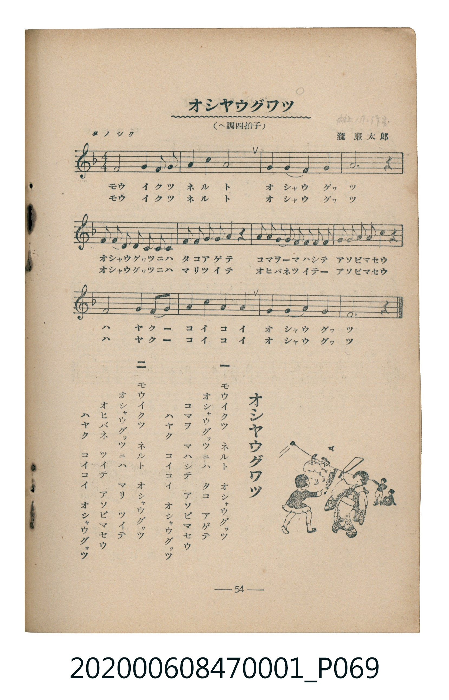

# オシヤウグワツ

<audio controls src="oshogatsu.mp3"></audio>

- 詞：東くめ
- 曲：瀧廉太郎
- 臺灣教育會公認《新定兒童唱歌》尋常科第一學年用（2020.006.0847.0001）

## 說明

・出處：臺灣教育會公認《新定兒童唱歌》尋常科第一學年用（2020.006.0847.0001）
・調性與拍號：調號 ?= F，拍號 <4/4>，速度 != 100

## 歌詞

```text
一
モウイクツ　ネルト　オシヤウグワツ
オシヤウグワツニハ　タコ　アゲテ
コマヲ　マハシテ　アソビマセウ
ハヤク　コイコイ　オシヤウグワツ

二
モウイクツ　ネルト　オシヤウグワツ
オシヤウグワツニハ　マリ　ツイテ
オヒバネ　ツイテ　アソビマセウ
ハヤク　コイコイ　オシヤウグワツ
```

## ABC

```abc
X:1
T:オシヤウグワツ
C:曲：瀧廉太郎
M:4/4
L:1/16
Q:1/4=100
K:F
V:V1 name="Piano" snm="Pia"
[V:V1]
A8 A4 c2 c2 | d4 c4 A8 | G4 G4 F4 G4 | A12 z4 |
A2 G2 A2 c2 A4 G2 F2 | G2 G2 F2 G2 A4 z4 | G2 G2 F2 G2 A2 A2 G2 F2 | G2 G2 A2 G2 F4 z4 |
A8 A4 c2 d2 | c4 f4 d4 c4 | A4 G4 A4 G4 | F12 z4 |
A8 A4 c2 c2 | d4 c4 A8 | G4 G4 F4 G4 | A12 z4 |
A2 G2 A2 c2 A4 G2 F2 | G2 G2 F2 G2 A4 z4 | G2 G2 F2 G2 A2 A2 G2 F2 | G2 G2 A2 G2 F4 z4 |
A8 A4 c2 d2 | c4 f4 d4 c4 | A4 G4 A4 G4 | F12 z4 |
```

## TMD 檔案連結

- [主旋律 TMD 檔案](oshogatsu.tmd) [[在 TMD Studio 編輯](https://tmdlang.github.io/Tmd-TS/#tmd=s7IKdvYPcrWy4qpTUCpJTLdSSM7PyUlNLsnMz7MqzsjMK0nNjM_KTMmPL87Iz05Ugisry88pzU21Si9KTEmNN4w3MjAyiDcwMIs3sDAxBzIMDBFKi_NLi5JTrYqTM_Lzc-JLUitKkvLzsxHyBUX5Zal5iXlANQVFIBtTwIoQClLLMlNSQdKpKZkl-UWZiTlI7kgtKga7FWxJfElRYl5xclFmAcgDCFUlGalAxxanJhbn5xWjC6elFpdkloEM1dJSeNy06nHT9sfNSx43LXvctOFx8_rHzS0KWlpcirYKhgYGXPa2Cm5cNib6JnYgU16snPd-z6xnczc-bux_3NQINvnZ7E1AsecNy5_u7ny6ZNXL5j6w8Iv2Xc8bFz-bOvNF06Znc5qftq55sar3cUPXs2kbnq6b9bR10vPVS59O2fhsbc_jhu6nG7qf7tjxfPnE52vWPNnR8HTtjqc7tzyfsuL9ng5QSOsBQ1oPFNJAhoHh-z2dSlxc-lpcQJVcj5sXgV0OdD_I5Y8bGh439z5uXv24uQPExuY7Lqyij5u7Hzf3g_Xsf9y0GcwAGr3pcXMbUMPmx83zHjdvAhsPZAA9D9TfBlO093HzZJB4026giUAn9YPNXg-W3gx2G5jE5R6uJ7t6aOERkEtXgRktIHPBHln1uHnS4-YJILORJKjkES19Li7fxMw8q4DMxLx8hxqDGoVqLgUgsLHQsgMzahSMFXTBEESbAmGNghmYBREBwRoFIyAJwoZQGqELBA1AInDTjIDYFCxvBFQP0guiQaJQlUgiINUwNRA2umnIbjMDioDcZRgHJGCOhCgCOQpG14CNQXVcLReXrp0CKCgUkGhlLi4A)]
- [鋼琴伴奏 TMD 檔案](oshogatsu_piano.tmd) [[在 TMD Studio 編輯](https://tmdlang.github.io/Tmd-TS/#tmd=s7IKdvYPcrWy4tLSUnjctOpx0_bHzUseNy173LThcfP6x80t7_d0PG6e8rhp0ePmvid7tjxd2v9k94z3ezoVtLS4FG0VDA0MuOxtFdy4bEz0Tey46hSUXqyc937PrGdzNz5u7H_c1KgEEns2exNQ7HnD8qe7O58uWfWyuQ8s_KJ91_PGxc-mznzRtOnZnOanrWterOp93ND1bNqGp-tmPW2d9Hz10qdTNj5b2_O4ofvphu6nO3Y8Xz7x-Zo1T3Y0PF274-nOLc-nrAA60MjAyEDPwMBMz8DCxBzIMDAEOlCJi8s3MTPPKiAzMS8_yMOhxqBGoZpLAQhsLLTswIwaBWMFXTAE0aZAWKNgBmZBRECwRsEISIKwIZRG6AJBA5AI3DQjIDYFyxsB1YP0gmiQKFQlkghINUwNhI1uGrLbzIAiIHcZxgEJmCMhikCOgtE1YGNQHVeLHBI-KCFhAg-JaMNYoGIICeSZxILZcL5pPFgaQsFUgyyAuRZNP1Q9kAtUgszFlMVuAIQHdQaED9aG1QlAH-raKYA8qYBEK3NxAQA)]

## 分析

```text
================================================================================
📊 TMD Song Profile: [ オシヤウグワツ ]
================================================================================
⏱  Duration:       0:57 (57.6s), 24 measures total
🎼 Key & Tempo:    首調基準 F, != 100.0 BPM, <4/4>
   - 分析範圍：      由實際發聲的音符與和弦推測調性；播放脈絡另行呈現
🎤 人聲音域:    F4 (MIDI 65) – F5 (MIDI 77) [跨度: 12 個半音 / 1.0 個八度, 難度: easy]
   - 最低音:  F4 in [Main #1 @ m.3, 0:06]
   - 最高音: F5 in [Main #1 @ m.10, 0:22]
   - 適合: soprano, mezzo-soprano, contralto, tenor, baritone, bass
🏛  結構:      Main (28.8s) -> Main (28.8s)
⚡ 編曲密度:        Peak 1 軌道同時演奏
🗝  調性診斷：       A 小調（純淨自然小調，未偵測到可信轉調）
   - 風格氣質:    純淨自然小調（陰鬱抒情、旋律集中，無明顯調外色彩）
   - 轉調歷程:    全曲維持單一推測調性（未偵測到可信轉調）
   - 核心骨幹音:  A, G, F, C, D
   - 調性數值:    A 小調 [相關度: 0.68, 穩定度: Moderate, 自然音純度: 100.0%]
   - 候選調性 (K-S): A 小調 (0.68), F 大調 (0.57), C 大調 (0.49)
   - 五度圈歷程:   +3 -> +3
   - 各段落調性細節:
     • [Main #1]: A 小調 (r: 0.68, 自然音純度: 100.0%)
     • [Main #2]: A 小調 (r: 0.68, 自然音純度: 100.0%)

  [ 五度圈游移軌跡 ]
               C  
         F            G  
      Bb               D  
      Eb              [A ]*
         Ab           E  
            Db       B  
               F# 
     (* = active key center)

  [ 十二半音累積音高分佈 ]
     C  : ███████                   11.4%
     C# :                            0.0%
     D  : ███                        5.7%
     D# :                            0.0%
     E  :                            0.0%
     F  : ███████████               18.2%
     F# :                            0.0%
     G  : ███████████████           25.0%
     G# :                            0.0%
     A  : ████████████████████████  39.8%
     A# :                            0.0%
     B  :                            0.0%
--------------------------------------------------------------------------------
Assignment 軌道音域：
  - Piano         : F4 – F5 (12 個半音 / 1.0 個八度, 100 個音符)
================================================================================
```


## 原書掃描頁




