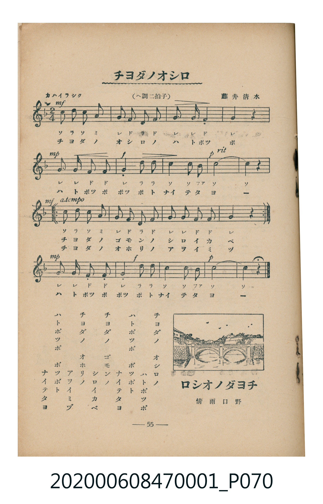

# チヨダノオシロ（千代田城）

> Re:Shōka 使用 AI 協助辨識與重建樂譜，可能會有錯誤。歡迎回報。

- **鋼琴伴奏版**：<br><audio controls src="chiyoda_no_oshiro.mp3"></audio>
- **NEUTRINO 歌聲合成版**：<br><audio controls src="chiyoda_no_oshiro_neutrino.mp3"></audio>

- 詞：野口雨情
- 曲：藤井清水
- 臺灣教育會公認《新定兒童唱歌》尋常科第一學年用（2020.006.0847.0001）

## 說明

曲目說明
中文解釋：描寫東京皇居一帶的城郭與莊嚴景色。


## 歌詞

```text
チヨダノ　オシロノ
ハトポツポ
ハトポツポ　ポツポト
ナイテタヨ
チヨダノ　ゴモンノ
シロイカベ
チヨダノ　オホリノ
アヲイミヅ
ハトポツポ　ポツポト
ナイテタヨ
```

## ABC

```abc
X:1
T:チヨダノオシロ（千代田城）
C:曲：藤井清水
M:2/4
L:1/16
Q:1/4=92
K:F
V:V1 name="Piano" snm="Pia"
[V:V1]
!mf! c2 d2 c2 A2 | G2 F2 D2 F2 | G3 G F4 | G4 z4 |
w: チ ヨ ダ ノ | オ シ ロ ノ | ハ ト ポツ | ポ
!mp! G3 G F2 F2 | G4 d2 d2 | c4 c2 B2 | c8 |
w: ハ ト ポツ ポ | ポツ ポ ト | ナイ テ タ | ヨ
c4 z4 | !mf! c2 d2 c2 A2 | G2 F2 D2 F2 | G2 G2 F2 F2 |
w: _ | チ ヨ ダ ノ | ゴ モ ン ノ | シ ロ イ カ
G4 z2 z2 | !mf! c2 d2 c2 A2 | G2 F2 D2 F2 | G2 G2 F2 F2 |
w: ベ | チ ヨ ダ ノ | オ ホ リ ノ | ア ヲ イ ミ
G4 z2 z2 | !mp! G3 G F2 F2 | G4 d2 d2 | c4 c2 B2 |
w: ヅ | ハ ト ポツ ポ | ポツ ポ ト | ナイ テ タ
c8- | c4 z4 |
w: ヨ | _
```

## TMD 檔案連結

- [主旋律 TMD 檔案](chiyoda_no_oshiro.tmd) [[在 TMD Studio 編輯](https://tmdlang.github.io/Tmd-TS/#tmd=s7IKdvYPcrWy4qpTUCpJTLdSSM7PyUlNLsnMz7MqzsjMK0nNjM_KTMmPL87Iz05Ugisry88pzU21Si9KTEmNN4w3MjAyiDcwMIs3sDAxBzIMDBFKi_NLi5JTrYqTM_Lzc-JLUitKkvLzsxHyBUX5Zal5iXlANQVFIBtTwIoQClLLMlNSQdKpKZkl-UWZiTlI7kgtKga7FWxJfElRYl5xclFmAcgDCFUlGalAxxbkJCanIgSBJqVn5lmVJGYC_QbyX3lifG5iZl5OYl6KEpeWlsLj5sbHzSseNzc8bu573LTqcdP2x81r3-_peNrb_GT34udTNjyd3_d-T6eClhaXoq2CpRGXva2CG5eNkb6JHciSFyvnvd8z62V739P-xS9nr3jW3Aq2-9nsTUDhF9OXPNk19dmO1mcbtoCFX7Tvet64-NnUmS-aNj2b0_y0dc2LVb2PG7qeTdvwdN2sp62Tnq9e-nTKxmdrex43dD_d0P10x47nyyc-X7PmyY6Gp2t3PN255fmUFUDHgWJCDxgTeqCYADIMDIFOVOLS11IAWvx89roXq1Y9m9HHpaCg8GTH2mfT2l8sX_yyvRvoomf9_U_Xr342d-OTXWuez2p_urEVZPKObc9ntQD9-bJ57YuO9hd9XU9nbXk2c_2Lzk2PG5q4tPS5gCZzoQRUQwM8rIBcoFz_4-aOx81zHze3AEl0Pkg5nN3cAZTuety05HFz2-Om_UAzMY3e8rh50ePmzWCjIZYAlTetftw8E5szmmc_bgaSILVAXZvARs9_3NxKqjNAHnW0CshMzMt3qDGoqQaFn4KNoZmWHZhVo1Cdm1arYKqgq2AGxCDaGIhrFIyApCFINB7KgAjpAkkQDwRhIroKBjARsJk-NaAECOQC7QeTDWCyD6wF6DcQr2k7WGwtskxzP9gQoC-AGOQluD1ALpQNcg3CJpDrC2pRHIbsVIifQLgG7DMQBNEmKCIwiBDB4h0sToM4Cuw4hFshgiB1EClQZMCl2sA-3w-VAoUNqv0wFsKTtVxcTtSLPJgwahiBfAvCUN8a4o-9LWDeIjC5GUUGKUbBfgambahPZyL5C4ShNhkRkU6aZ4NJCBsmA7F9E8Km5vlQm1oxbAKGoDP-EKRiAoKxBlUC0rVTcFQAEk7RPoaxUIYRmOEMIpS5AA)]
- [鋼琴伴奏 TMD 檔案](chiyoda_no_oshiro_piano.tmd) [[在 TMD Studio 編輯](https://tmdlang.github.io/Tmd-TS/#tmd=s7IKdvYPcrWy4tLSUnjc3Pi4ecXj5obHzX2Pm1Y9btr-uHnt-z0dj5unPG5aBBR8smfL06X9T3bPeL-nU0FLi0vRVsHSiMveVsGNy8ZI38SOq05B6cXKee_3zHrZ3ve0f_HL2SueNbcqgYSfzd4EFH4xfcmTXVOf7Wh9tmELWPhF-67njYufTZ35omnTsznNT1vXvFjV-7ih69m0DU_XzXraOun56qVPp2x8trbncUP30w3dT3fseL584vM1a57saHi6dsfTnVueT1kBdKKRgZGBnoGBmZ6BhYk5kGFgCHSiEheXo1VAZmJefpCHQ41BTTWXAhDYGJpp2YFZNQrVuWm1CqYKugpmQAyijYG4RsEISBqCROOhDIiQLpAE8UAQJqKrYAATAZvpUwMKRiAXGJJgsgFM9oG1AAMVxGvaDhZbiyzT3A825HFzBxDPfdzcArcHyIWyQa5B2ARyfUEtisOQnQrxEwjXgH0GgiDaBEUEBhEiWLyDxWkQR4Edh3ArRBCkDiLV9bhpCVyqDezz_VApUNig2g9jITxZC48-H-Tos4DHXrRhLFAhhATyTOPBXBMwheCjSoO8Bws_7CoQBkCMh4jCuBDHQtgQs4DOdKJmKoMJo0YmyC6E230M8SezLWDeIjC5GUUGKemBI-dx02polMxEigAQhtpkRESCbp4NJiFsmAzE9k0Im5rnQ21qxbAJEYZUj2qg0c6EooeK2QjGGlTZCBoAuMKWWtlA107BUQFIOEX7gCTADCMwwxlEKHMBAA)]

## 分析

```text
================================================================================
📊 TMD Song Profile: [ チヨダノオシロ（千代田城） ]
================================================================================
⏱  Duration:       0:28 (28.7s), 22 measures total
🎼 Key & Tempo:    首調基準 F, != 92.0 BPM, <2/4>
   - 分析範圍：      由實際發聲的音符與和弦推測調性；播放脈絡另行呈現
🎤 人聲音域:    D4 (MIDI 62) – D5 (MIDI 74) [跨度: 12 個半音 / 1.0 個八度, 難度: easy]
   - 最低音:  D4 in [A #1 @ m.2, 0:01]
   - 最高音: D5 in [A #1 @ m.1, 0:00]
   - 適合: soprano, mezzo-soprano, contralto, tenor, baritone, bass
🏛  結構:      A (11.7s) -> B[L1] (5.2s) -> B[L2] (5.2s) -> C (6.5s)
⚡ 編曲密度:        Peak 1 軌道同時演奏
🗝  調性診斷：       C 大調（純淨自然大調，未偵測到可信轉調）
   - 風格氣質:    純淨自然大調（陽光明朗、易唱易記，無明顯調外色彩）
   - 轉調歷程:    全曲維持單一推測調性（未偵測到可信轉調）
   - 核心骨幹音:  C, G, F, D, A
   - 調性數值:    C 大調 [相關度: 0.85, 穩定度: High, 自然音純度: 97.4%]
   - 候選調性 (K-S): C 大調 (0.85), F 大調 (0.68), C 小調 (0.63)
   - 五度圈歷程:   +0 -> +0 -> +0 -> +0
   - 各段落調性細節:
     • [A #1]: C 大調 (r: 0.87, 自然音純度: 96.9%, 調外音: A#)
     • [B[L1] #1]: C 調性不明確 (r: 0.66, 自然音純度: 100.0%)
     • [B[L2] #1]: C 調性不明確 (r: 0.66, 自然音純度: 100.0%)
     • [C #1]: C 大調 (r: 0.84, 自然音純度: 94.4%, 調外音: A#)

  [ 五度圈游移軌跡 ]
              [C ]*
         F            G  
      Bb               D  
      Eb               A  
         Ab           E  
            Db       B  
               F# 
     (* = active key center)

  [ 十二半音累積音高分佈 ]
     C  : ████████████████████████  30.8%
     C# :                            0.0%
     D  : ██████████                12.8%
     D# :                            0.0%
     E  :                            0.0%
     F  : ████████████████          20.5%
     F# :                            0.0%
     G  : ███████████████████████   29.5%
     G# :                            0.0%
     A  : ███                        3.8%
     A# : ██                         2.6%
     B  :                            0.0%
--------------------------------------------------------------------------------
Assignment 軌道音域：
  - Piano         : D4 – D5 (12 個半音 / 1.0 個八度, 61 個音符)
================================================================================
```


## 原書掃描頁




