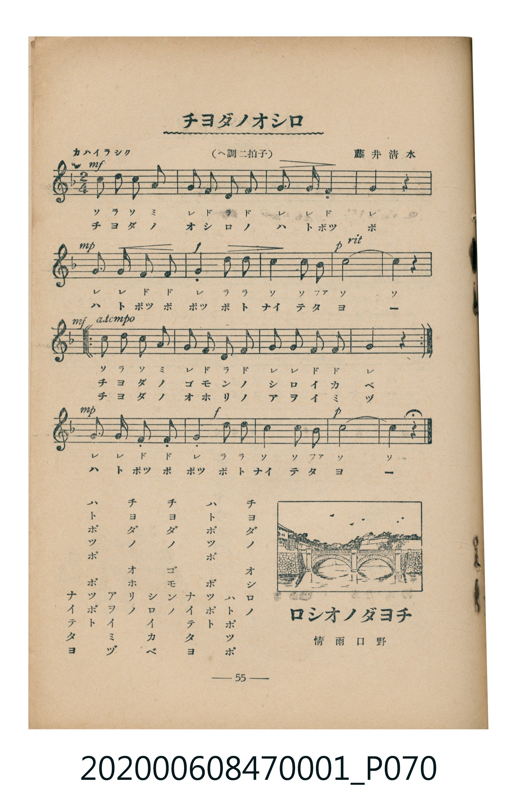

# チヨダノオシロ

<audio controls src="chiyoda_no_oshiro.mp3"></audio>

- 詞：野口雨情
- 曲：藤井清水
- 臺灣教育會公認《新定兒童唱歌》尋常科第一學年用（2020.006.0847.0001）

## 說明

・出處：臺灣教育會公認《新定兒童唱歌》尋常科第一學年用（2020.006.0847.0001）
・調性與拍號：調號 ?= F，拍號 <2/4>，速度 != 92

## 歌詞

```text
チヨダノ　オシロノ
ハトポツポ
ハトポツポ　ポツポト
ナイテタヨ
チヨダノ　ゴモンノ
シロイカベ
チヨダノ　オホリノ
アヲイミヅ
ハトポツポ　ポツポト
ナイテタヨ
```

## ABC

```abc
X:1
T:チヨダノオシロ
C:曲：藤井清水
M:2/4
L:1/16
Q:1/4=92
K:F
V:V1 name="Piano" snm="Pia"
[V:V1]
c2 d2 c2 A2 | G2 F2 D2 F2 | G3 G F4 | G4 z2 z2 |
G3 G F2 F2 | G4 D2 D2 | C4 C2 B,2 | C8 |
C4 z2 z2 | c2 d2 c2 A2 | G2 F2 D2 F2 | G2 G2 F2 F2 |
G4 z2 z2 | c2 d2 c2 A2 | G2 F2 D2 F2 | G2 G2 F2 F2 |
G4 z2 z2 | G3 G F2 F2 | G4 D2 D2 | C4 C2 B,2 |
C8 | C4 z2 z2 |
```

## TMD 檔案連結

- [主旋律 TMD 檔案](chiyoda_no_oshiro.tmd) [[在 TMD Studio 編輯](https://tmdlang.github.io/Tmd-TS/#tmd=s7IKdvYPcrWy4tLSUnjc3Pi4ecXj5obHzX2Pm1Y9btr-uHmtgpYWl6KtgqURl72tghuXjZG-iR1XnYLSi5Xz3u-Z9bK972n_4pezVzxrblUCCT-bvQko_GL6kie7pj7b0fpswxaw8Iv2Xc8bFz-bOvNF06Znc5qftq55sar3cUPXs2kbnq6b9bR10vPVS59O2fhsbc_jhu6nG7qf7tjxfPnE52vWPNnR8HTtjqc7tzyfsuL9ng4jAyMDPQMDMz0DCxNzIMPA8P2eTiUuLn0tLhTXNzTAPQDkAuX6Hzd3PG6e-7i5BUii80HK4ezmDqB01-OmJY-b2x437QeaiWn0lsfNix43bwYbDbEEqLxp9ePmmdic0Tz7cTOQBKkF6toENnr-4-ZWUp2hpc_F5WgVkJmYl-9QY1CjUM2lAAQ2hmZadmBWjYKpgq6CGRCDaGMgrlEwApKGINF4KAMipAskQTwQhInoKhhAcQ3UOGSVyHqhxoEJoKUgCgTBDBM0QRhEEkJYU8vF5UQdD8GEUZ2JYpMzXpvo4VddOwVHBSDhBCecQYQyFxcA)]
- [鋼琴伴奏 TMD 檔案](chiyoda_no_oshiro_piano.tmd) [[在 TMD Studio 編輯](https://tmdlang.github.io/Tmd-TS/#tmd=s7IKdvYPcrWy4tLSUnjc3Pi4ecXj5obHzX2Pm1Y9btr-uHnt-z0dj5unPG5aBBR8smfL06X9T3bPeL-nU0FLi0vRVsHSiMveVsGNy8ZI38SOq05B6cXKee_3zHrZ3ve0f_HL2SueNbcqgYSfzd4EFH4xfcmTXVOf7Wh9tmELWPhF-67njYufTZ35omnTsznNT1vXvFjV-7ih69m0DU_XzXraOun56qVPp2x8trbncUP30w3dT3fseL584vM1a57saHi6dsfTnVueT1kBdKKRgZGBnoGBmZ6BhYk5kGFgCHSiEheXo1VAZmJefpCHQ41BjUI1lwIQ2BiaadmBWTUKpgq6CmZADKKNgbhGwQhIGoJE46EMiJAukATxQBAmoqtgAMU1UOOQVSLrhRoHJoCWgigQBDNM0ARhEEkIYU0t3Es-KF6ygPso2jAWqBJCAnmm8WCuCZhC8FGlkb2AXQXCAIjxEFEYF-JcCBvuTidqBT1MGDVAUcIEahf1wwRotjMBf9AjzqFuwOk_asWZrp2CowKQcIITziBCmYsLAA)]

## 分析

```text
================================================================================
📊 TMD Song Profile: [ チヨダノオシロ ]
================================================================================
⏱  Duration:       0:28 (28.7s), 22 measures total
🎼 Key & Tempo:    首調基準 F, != 92.0 BPM, <2/4>
   - 分析範圍：      由實際發聲的音符與和弦推測調性；播放脈絡另行呈現
🎤 人聲音域:    A#3 (MIDI 58) – D5 (MIDI 74) [跨度: 16 個半音 / 1.3 個八度, 難度: moderate]
   - 最低音:  A#3 in [A #1 @ m.7, 0:08]
   - 最高音: D5 in [A #1 @ m.1, 0:00]
   - 適合: soprano, mezzo-soprano, contralto, tenor, baritone, bass
🏛  結構:      A (11.7s) -> B (5.2s) -> B (5.2s) -> C (6.5s)
⚡ 編曲密度:        Peak 1 軌道同時演奏
🗝  調性診斷：       C 大調（純淨自然大調，未偵測到可信轉調）
   - 風格氣質:    純淨自然大調（陽光明朗、易唱易記，無明顯調外色彩）
   - 轉調歷程:    全曲維持單一推測調性（未偵測到可信轉調）
   - 核心骨幹音:  C, G, F, D, A
   - 調性數值:    C 大調 [相關度: 0.85, 穩定度: High, 自然音純度: 97.4%]
   - 候選調性 (K-S): C 大調 (0.85), F 大調 (0.68), C 小調 (0.63)
   - 五度圈歷程:   +0 -> +0 -> +0 -> +0
   - 各段落調性細節:
     • [A #1]: C 大調 (r: 0.87, 自然音純度: 96.9%, 調外音: A#)
     • [B #1]: C 調性不明確 (r: 0.66, 自然音純度: 100.0%)
     • [B #2]: C 調性不明確 (r: 0.66, 自然音純度: 100.0%)
     • [C #1]: C 大調 (r: 0.84, 自然音純度: 94.4%, 調外音: A#)

  [ 五度圈游移軌跡 ]
              [C ]*
         F            G  
      Bb               D  
      Eb               A  
         Ab           E  
            Db       B  
               F# 
     (* = active key center)

  [ 十二半音累積音高分佈 ]
     C  : ████████████████████████  30.8%
     C# :                            0.0%
     D  : ██████████                12.8%
     D# :                            0.0%
     E  :                            0.0%
     F  : ████████████████          20.5%
     F# :                            0.0%
     G  : ███████████████████████   29.5%
     G# :                            0.0%
     A  : ███                        3.8%
     A# : ██                         2.6%
     B  :                            0.0%
--------------------------------------------------------------------------------
Assignment 軌道音域：
  - Piano         : A#3 – D5 (16 個半音 / 1.3 個八度, 62 個音符)
================================================================================
```


## 原書掃描頁




