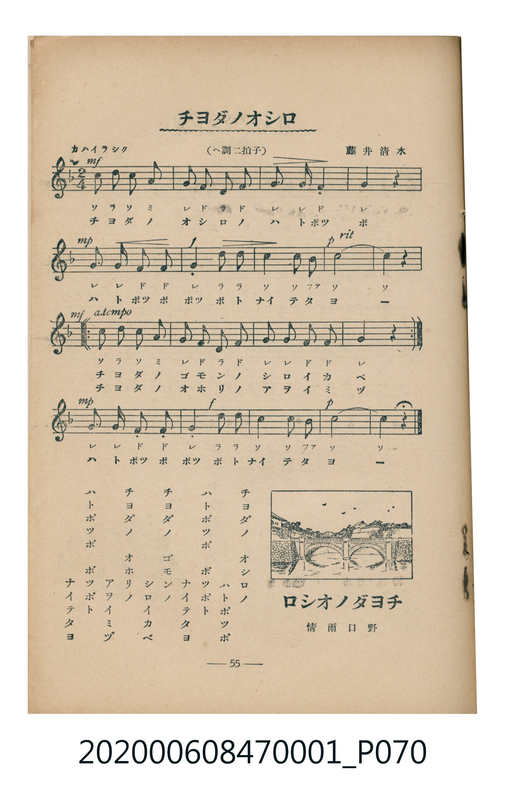

# チヨダノオシロ（千代田城）

> Re:Shōka 使用 AI 協助辨識與重建樂譜，可能會有錯誤。歡迎[回報](https://github.com/TMDLang/reshoka/issues)。

- **鋼琴伴奏版**：<br><audio controls src="chiyoda_no_oshiro.mp3"></audio>
- **NEUTRINO 歌聲合成版**：<br><audio controls src="chiyoda_no_oshiro_neutrino.mp3"></audio>

- 詞：野口雨情
- 曲：藤井清水
- 臺灣教育會公認《新定兒童唱歌》尋常科第一學年用（2020.006.0847.0001）

## 說明

曲目說明
中文解釋：描寫東京皇居一帶的城郭與莊嚴景色。


## 歌詞

```text
チヨダノ　オシロノ
ハトポツポ
ハトポツポ　ポツポト
ナイテタヨ
チヨダノ　ゴモンノ
シロイカベ
チヨダノ　オホリノ
アヲイミヅ
ハトポツポ　ポツポト
ナイテタヨ
```

## ABC

<div class="abc-score" data-abc-src="chiyoda_no_oshiro.abc" aria-label="五線譜載入中"></div>

[下載 ABC 原始檔](chiyoda_no_oshiro.abc)

## TMD 檔案連結

- [主旋律 TMD 檔案](chiyoda_no_oshiro.tmd) [[在 TMD Studio 編輯](https://tmdlang.github.io/Tmd-TS/#tmd=s7IKdvYPcrWy4qpTUCpJTLdSSM7PyUlNLsnMz7MqzsjMK0nNjM_KTMmPL87Iz05Ugisry88pzU21Si9KTEmNN4w3MjAyiDcwMIs3sDAxBzIMDBFKi_NLi5JTrYqTM_Lzc-JLUitKkvLzsxHyBUX5Zal5iXlANQVFIBtTwIoQClLLMlNSQdKpKZkl-UWZiTlI7kgtKga7FWxJfElRYl5xclFmAcgDCFUlGalAxxbkJCanIgSBJqVn5lmVJGYC_QbyX3lifG5iZl5OYl4KsqqSjHygNwsyKq0yMotB9icn5sRnJ-YhhQbU9oLE9FSrAANzAyUuLS2Fx82Nj5tXPG5ueNzc97hp1eOm7Y-b177f0_G0t_nJ7sXPp2x4Or_v_Z5OBS0tLkVbBUsjLntbBTcuGyN9EzuQwS9Wznu_Z9bL9r6n_Ytfzl7xrLkVbN-z2ZuAwi-mL3mya-qzHa3PNmwBC79o3_W8cfGzqTNfNG16Nqf5aeuaF6t6Hzd0PZu24em6WU9bJz1fvfTplI3P1vY8buh-uqH76Y4dz5dPfL5mzZMdDU_X7ni6c8vzKSuAjgNFpB4wIvVAEQlkGBgCnajEpa-lALT4-ex1L1atejajj0tBQeHJjrXPprW_WL74ZXs30EXP-vufrl_9bO7GJ7vWPJ_V_nRjK8jkHduez2oB-vNl89oXHe0v-rqeztrybOb6F52bHjc0cWnpcwFN5kIJqIYGeFgBuUC5_sfNHY-b5z5ubgGS6HyQcji7uQMo3fW4acnj5rbHTfuBZmIaveVx86LHzZvBRkMsASpvWv24eSY2ZzTPftwMJEFqgbo2gY2e_7i5lVRngDzqaBWQmZiX71BjUFMNCj8FG0MzLTswq0ahOjetVsFUQVfBDIhBtDEQ1ygYAUlDkGg8lAER0gWSIB4IwkR0FQxgImAzfWpACRDIBdoPJhvAZB9YC9BvIF7TdrDYWmSZ5n6wIUBfADHIS3B7gFwoG-QahE0g1xfUojgM2akQP4FwDdhnIAiiTVBEYBAhgsU7WJwGcRTYcQi3QgRB6iBSoMiAS7WBfb4fKgUKG1T7YSyEJ2u5uJyoF3kwYdQwAvkWhKG-NcQfe1vAvEVgcjOKDFKMgv0MTNtQn85E8hcIQ20yIiKdNM8GkxA2TAZi-yaETc3zoTa1YtgEDEFn_CFIxQQEYw2qBKRrp-CoACScon0MY6EMIzDDGUQocwEA)]
- [鋼琴伴奏 TMD 檔案](chiyoda_no_oshiro_piano.tmd) [[在 TMD Studio 編輯](https://tmdlang.github.io/Tmd-TS/#tmd=s7IKdvYPcrWy4qpTUCpJTLdSyC8qychPL0osyKi0ysgsLskvykxOzInPTsxLVIIrKs4vLUpOjS9ITE-1CjAwN1Di0tJSeNzc-Lh5xePmhsfNfY-bVj1u2v64ee37PR2Pm6c8bloEFHyyZ8vTpf1Pds94v6dTQUuLS9FWwdKIy95WwY3LxkjfxA5k_IuV897vmfWyve9p_-KXs1c8a24F2_ps9iag8IvpS57smvpsR-uzDVvAwi_adz1vXPxs6swXTZuezWl-2rrmxarexw1dz6ZteLpu1tPWSc9XL306ZeOztT2PG7qfbuh-umPH8-UTn69Z82RHw9O1O57u3PJ8ygqgE40MjAz0DAzM9AwsTMyBDANDoBOVuLgcrQIyE_PygzwcagxqqrkUgMDG0EzLDsyqUajOTatVMFXQVTADYhBtDMQ1CkZA0hAkGg9lQIR0gSSIB4IwEV0FA5gI2EyfGlAwArnAkASTDWCyD6wFGKggXtN2sNhaZJnmfrAhj5s7gHju4-YWuD1ALpQNcg3CJpDrC2pRHIbsVIifQLgG7DMQBNEmKCIwiBDB4h0sToM4Cuw4hFshgiB1EKmux01L4FJtYJ_vh0qBwgbVfhgL4claePT5IEefCTz2og1jwRjIMo0HMk2ABIyNEDaAhxe6DEwDyBgQH8IEOQZEg_QBneBEzRQEE0aNKFCQgzA0yA3xJ6EtYN4iMLkZRQYpWYED_nHTamhwz0QKXBCG2mRERGJtng0mIWyYDMT2TQibmudDZXZh2IQIQ4qjEWiUM6HooGKWgLEGVZaABgCusCQnievaKTgqAAmnaB-QJJhhBGY4gwhlLgA)]

## 分析

```text
================================================================================
📊 TMD Song Profile: [ チヨダノオシロ（千代田城） ]
================================================================================
⏱  Duration:       0:28 (28.7s), 22 measures total
🎼 Key & Tempo:    首調基準 F, != 92.0 BPM, <2/4>
   - 分析範圍：      由實際發聲的音符與和弦推測調性；播放脈絡另行呈現
🎤 人聲音域:    D4 (MIDI 62) – D5 (MIDI 74) [跨度: 12 個半音 / 1.0 個八度, 難度: easy]
   - 最低音:  D4 in [A #1 @ m.2, 0:01]
   - 最高音: D5 in [A #1 @ m.1, 0:00]
   - 適合: soprano, mezzo-soprano, contralto, tenor, baritone, bass
🏛  結構:      A (11.7s) -> B[L1] (5.2s) -> B[L2] (5.2s) -> C (6.5s)
⚡ 編曲密度:        Peak 1 軌道同時演奏
🗝  調性診斷：       C 大調（純淨自然大調，未偵測到可信轉調）
   - 風格氣質:    純淨自然大調（陽光明朗、易唱易記，無明顯調外色彩）
   - 轉調歷程:    全曲維持單一推測調性（未偵測到可信轉調）
   - 核心骨幹音:  C, G, F, D, A
   - 調性數值:    C 大調 [相關度: 0.85, 穩定度: High, 自然音純度: 97.4%]
   - 候選調性 (K-S): C 大調 (0.85), F 大調 (0.68), C 小調 (0.63)
   - 五度圈歷程:   +0 -> +0 -> +0 -> +0
   - 各段落調性細節:
     • [A #1]: C 大調 (r: 0.87, 自然音純度: 96.9%, 調外音: A#)
     • [B[L1] #1]: C 調性不明確 (r: 0.66, 自然音純度: 100.0%)
     • [B[L2] #1]: C 調性不明確 (r: 0.66, 自然音純度: 100.0%)
     • [C #1]: C 大調 (r: 0.84, 自然音純度: 94.4%, 調外音: A#)

  [ 五度圈游移軌跡 ]
              [C ]*
         F            G  
      Bb               D  
      Eb               A  
         Ab           E  
            Db       B  
               F# 
     (* = active key center)

  [ 十二半音累積音高分佈 ]
     C  : ████████████████████████  30.8%
     C# :                            0.0%
     D  : ██████████                12.8%
     D# :                            0.0%
     E  :                            0.0%
     F  : ████████████████          20.5%
     F# :                            0.0%
     G  : ███████████████████████   29.5%
     G# :                            0.0%
     A  : ███                        3.8%
     A# : ██                         2.6%
     B  :                            0.0%
--------------------------------------------------------------------------------
Assignment 軌道音域：
  - Piano         : D4 – D5 (12 個半音 / 1.0 個八度, 61 個音符)
================================================================================
```


## 原書掃描頁




