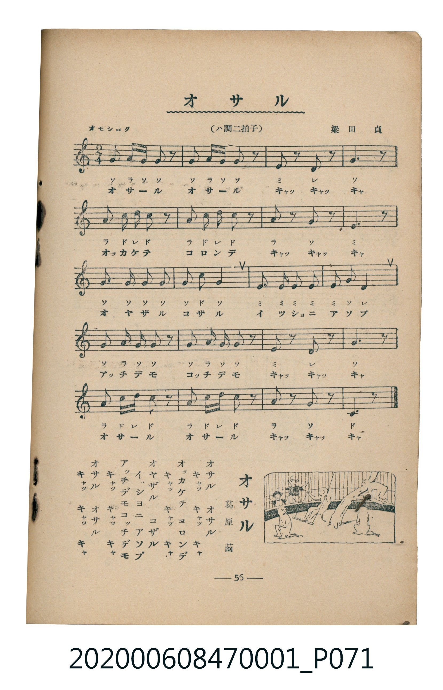

# オサル（猴子）

> Re:Shōka 使用 AI 協助辨識與重建樂譜，可能會有錯誤。歡迎回報。

- **鋼琴伴奏版**：<br><audio controls src="osaru.mp3"></audio>
- **NEUTRINO 歌聲合成版**：<br><audio controls src="osaru_neutrino.mp3"></audio>

- 詞：葛原𦱳
- 曲：梁田貞
- 臺灣教育會公認《新定兒童唱歌》尋常科第一學年用（2020.006.0847.0001）

## 說明

曲目說明
中文解釋：描寫猴子的動作、玩耍與淘氣模樣。


## 歌詞

```text
オサル　オサル
キヤツ　キヤツ　キヤ
オツカケテ　コロンデ
キヤツ　キヤツ　キヤ
オヤザル　コザル
イツシヨニ　アソブ
アツチデモ　コツチデモ
キヤツ　キヤツ　キヤ
オサル　オサル
キヤツ　キヤツ　キヤ
```

## ABC

<div class="abc-score" data-abc-src="osaru.abc" aria-label="五線譜載入中"></div>

[下載 ABC 原始檔](osaru.abc)

## TMD 檔案連結

- [主旋律 TMD 檔案](osaru.tmd) [[在 TMD Studio 編輯](https://tmdlang.github.io/Tmd-TS/#tmd=s7IKdvYPcrWy4qpTUCpJTLdSSM7PyUlNLsnMz7MqzsjMK0nNjM_KTMmPL87Iz05Ugisry88pzU21Si9KTEmNN4w3MjAyiDcwMIs3sDAxBzIMDBFKi_NLi5JTrYqTM_Lzc-JLUitKkvLzsxHyBUX5Zal5iXlANQVFIBtTwIoQClLLMlNSQdKpKZkl-UWZiTlI7kgtKga7FWxJfElRYl5xclFmAcgDCFUlGalAxybmZeYi6wUalZ6ZZ5WbmpmVicVdUOmSxEyg30H-L0-Mz03MzMtJzEtR4tLSUnjctOpx09bHzavf7-l43rPl6doJ7_d0KmhpcSnaKhgaWHDZ2yo4c9kY6ZvYgcx8sXLe-z2zXkyc_bRv_odlGzeDLXo2exNQ8NmixudTNrzYNA8s9qJ91_PGxc-mznzRtOnZnOanrWterOp93ND1bNqGp-tmPW2d9Hz10qdTNj5b2_O4ofvphu6nO3Y8Xz7x-Zo1T3Y0PF274-nOLc-nrAA6CRQnesA40QPFCZBhYAh0nhKXvpYC0Nbns9e9WLXq2Yw-LgUFhSc71j6b1v5i-eKX7d0g5_T3P12_GuKj57NannZPfbJ3zuOGxud9K1809L7oaH-2fcazDYufrVj4bMXixw1NXFr6XEBjueDh8bihAc4Giq593LzkcXMLWBSdDdYE5Detfty08XFzG1hi8-NmoByQbCdK95LHTdtgtm6GsIESYIVN2x83r3jc3A2WW_S4ae_j5mlAuUUgueZGoAWPmxfBrESIEGMryR4FBZIvMPlYBWQm5uU71BjUVIPCXsHG0EzLDsyqUTBV0FUwA5Ig2gCIsYkYQ1lGKGpgECwCNs2nBpRAgVyg80Bk82ogGQ_WgFsc6NLFj5uboSLofJgKJPvAwlDXmwHZhnEKRnEgEuY4nIIgFqqvcPkB4gBgEgHijUAHtyE5ZzPYC2uBeDMQt1PLKyCHIWOICNgHsNCGuNkYDEE0TAQkD4obsBq0mGheAnbKNni4w72AJAYxHJiAwSItYFlgMl4O5nZDJReBhfeCxaah2EaDVATMLuAYaG4EhzEwhyCFIjDn4JYcsPRkiNs3dMoTtVxcunYKoByvAKSVuQA)]
- [鋼琴伴奏 TMD 檔案](osaru_piano.tmd) [[在 TMD Studio 編輯](https://tmdlang.github.io/Tmd-TS/#tmd=s7IKdvYPcrWy4tLSUnjctOpx09bHzavf7-l43DzlcdOix819T_Zsebq0_8nuGe_3dCpoaXEp2ioYGlhw2dsqOHPZGOmb2HHVKSi9WDnv_Z5ZLybOfto3_8OyjZuVQILPZm8CCj5b1Ph8yoYXm-aBxV6073reuPjZ1JkvmjY9m9P8tHXNi1W9jxu6nk3b8HTdrKetk56vXvp0ysZna3seN3Q_3dD9dMeO58snPl-z5smOhqdrdzzdueX5lBVA5xkZGBnoGRiY6RlYmJgDGQaGQOcpcXH5JmbmWQVkJublB3k41BjUVHMpAIGNoZmWHZhVo2CqoKtgBiRBtAEQYxMxhrKMUNTAIFgEbJpPDSjMgFxgsIHI5tVAMh6sAbf42sfNix83N0NF0PkwFUj2gYWhrjcDsg3jFIziQCTMcTgFQSxUX-HyA8QBj5tWA_FGoIPbkJyzGeyFtUC8GYjbqeUVkMOQMUQE7ANYaEPcbAyGIBomApIHxQ1YDVpMNC8BO2UbPNzhXkASgxj-uAmstrkFLLv9cfNyMLcbKrkILLwXLDYNxTYapCJgVgPHQHMjOIwfN4Nsh8cAPskBS0-GuH1DpzxRi5zhfZAzvAU8v0cbxgLVgkgDrDwDhWjTeGRJkGdgwRNtgqIcgwfUjGIwil64VSAfEMEDOQMRM7R2NzbNwPDUtVMABakCkFbmAgA)]

## 分析

```text
================================================================================
📊 TMD Song Profile: [ オサル（猴子） ]
================================================================================
⏱  Duration:       0:22 (22.2s), 20 measures total
🎼 Key & Tempo:    首調基準 C, != 108.0 BPM, <2/4>
   - 分析範圍：      由實際發聲的音符與和弦推測調性；播放脈絡另行呈現
🎤 人聲音域:    C4 (MIDI 60) – D5 (MIDI 74) [跨度: 14 個半音 / 1.2 個八度, 難度: moderate]
   - 最低音:  C4 in [Main #1 @ m.20, 0:21]
   - 最高音: D5 in [Main #1 @ m.5, 0:04]
   - 適合: soprano, mezzo-soprano, contralto, tenor, baritone, bass
🏛  結構:      Main (22.2s)
⚡ 編曲密度:        Peak 1 軌道同時演奏
🗝  調性診斷：       G 大調（純淨自然大調，未偵測到可信轉調）
   - 風格氣質:    純淨自然大調（陽光明朗、易唱易記，無明顯調外色彩）
   - 轉調歷程:    全曲維持單一推測調性（未偵測到可信轉調）
   - 核心骨幹音:  G, C, E, A, D
   - 調性數值:    G 大調 [相關度: 0.81, 穩定度: Moderate, 自然音純度: 100.0%]
   - 候選調性 (K-S): G 大調 (0.81), C 大調 (0.73), E 小調 (0.66)
   - 五度圈歷程:   +1
   - 各段落調性細節:
     • [Main #1]: G 大調 (r: 0.81, 自然音純度: 100.0%)

  [ 五度圈游移軌跡 ]
               C  
         F           [G ]*
      Bb               D  
      Eb               A  
         Ab           E  
            Db       B  
               F# 
     (* = active key center)

  [ 十二半音累積音高分佈 ]
     C  : █████████                 16.7%
     C# :                            0.0%
     D  : ██████                    10.0%
     D# :                            0.0%
     E  : █████████                 16.7%
     F  :                            0.0%
     F# :                            0.0%
     G  : ████████████████████████  43.3%
     G# :                            0.0%
     A  : ███████                   13.3%
     A# :                            0.0%
     B  :                            0.0%
--------------------------------------------------------------------------------
Assignment 軌道音域：
  - Piano         : C4 – D5 (14 個半音 / 1.2 個八度, 59 個音符)
================================================================================
```


## 原書掃描頁




