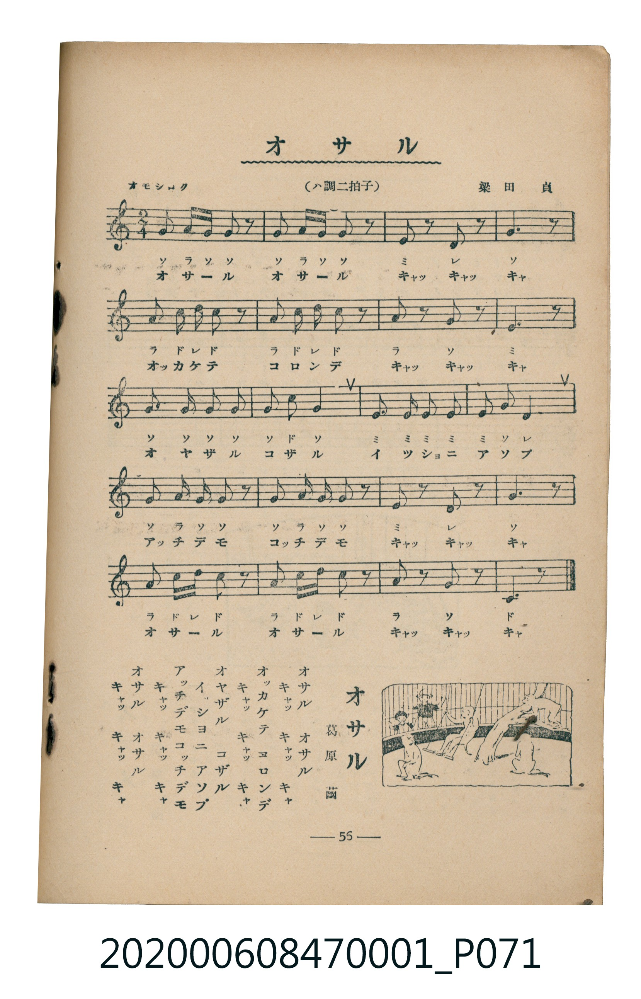

# オサル

<audio controls src="osaru.mp3"></audio>

- 詞：葛原𦱳
- 曲：梁田貞
- 臺灣教育會公認《新定兒童唱歌》尋常科第一學年用（2020.006.0847.0001）

## 說明

・出處：臺灣教育會公認《新定兒童唱歌》尋常科第一學年用（2020.006.0847.0001）
・調性與拍號：調號 ?= C，拍號 <2/4>，速度 != 108

## 歌詞

```text
オサル　オサル
キヤツ　キヤツ　キヤ
オツカケテ　コロンデ
キヤツ　キヤツ　キヤ
オヤザル　コザル
イツシヨニ　アソブ
アツチデモ　コツチデモ
キヤツ　キヤツ　キヤ
オサル　オサル
キヤツ　キヤツ　キヤ
```

## ABC

```abc
X:1
T:オサル
C:曲：梁田貞
M:2/4
L:1/16
Q:1/4=108
K:C
V:V1 name="Piano" snm="Pia"
[V:V1]
G2 A G G2 z2 | G2 A G G2 z2 | E2 z2 D2 z2 | G6 z2 |
A2 c d c2 z2 | A2 c d c2 z2 | A2 z2 G2 z2 | E6 z2 |
G2 G2 G2 G2 | G2 c2 G4 | E2 E E E2 E2 | E2 G2 D4 |
G2 A G G2 z2 | G2 A G G2 z2 | E2 z2 D2 z2 | G6 z2 |
A2 c d c2 z2 | A2 c d c2 z2 | A2 z2 G2 z2 | C6 z2 |
```

## TMD 檔案連結

- [主旋律 TMD 檔案](osaru.tmd)
- [鋼琴伴奏 TMD 檔案](osaru_piano.tmd)

## 分析

```text
================================================================================
📊 TMD Song Profile: [ オサル ]
================================================================================
⏱  Duration:       0:22 (22.2s), 20 measures total
🎼 Key & Tempo:    首調基準 C, != 108.0 BPM, <2/4>
   - 分析範圍：      由實際發聲的音符與和弦推測調性；播放脈絡另行呈現
🎤 人聲音域:    C4 (MIDI 60) – D5 (MIDI 74) [跨度: 14 個半音 / 1.2 個八度, 難度: moderate]
   - 最低音:  C4 in [Main #1 @ m.20, 0:21]
   - 最高音: D5 in [Main #1 @ m.5, 0:04]
   - 適合: soprano, mezzo-soprano, contralto, tenor, baritone, bass
🏛  結構:      Main (22.2s)
⚡ 編曲密度:        Peak 1 軌道同時演奏
🗝  調性診斷：       G 大調（純淨自然大調，未偵測到可信轉調）
   - 風格氣質:    純淨自然大調（陽光明朗、易唱易記，無明顯調外色彩）
   - 轉調歷程:    全曲維持單一推測調性（未偵測到可信轉調）
   - 核心骨幹音:  G, C, E, A, D
   - 調性數值:    G 大調 [相關度: 0.81, 穩定度: Moderate, 自然音純度: 100.0%]
   - 候選調性 (K-S): G 大調 (0.81), C 大調 (0.73), E 小調 (0.66)
   - 五度圈歷程:   +1
   - 各段落調性細節:
     • [Main #1]: G 大調 (r: 0.81, 自然音純度: 100.0%)

  [ 五度圈游移軌跡 ]
               C  
         F           [G ]*
      Bb               D  
      Eb               A  
         Ab           E  
            Db       B  
               F# 
     (* = active key center)

  [ 十二半音累積音高分佈 ]
     C  : █████████                 16.7%
     C# :                            0.0%
     D  : ██████                    10.0%
     D# :                            0.0%
     E  : █████████                 16.7%
     F  :                            0.0%
     F# :                            0.0%
     G  : ████████████████████████  43.3%
     G# :                            0.0%
     A  : ███████                   13.3%
     A# :                            0.0%
     B  :                            0.0%
--------------------------------------------------------------------------------
Assignment 軌道音域：
  - Piano         : C4 – D5 (14 個半音 / 1.2 個八度, 59 個音符)
================================================================================
```


## 原書掃描頁




