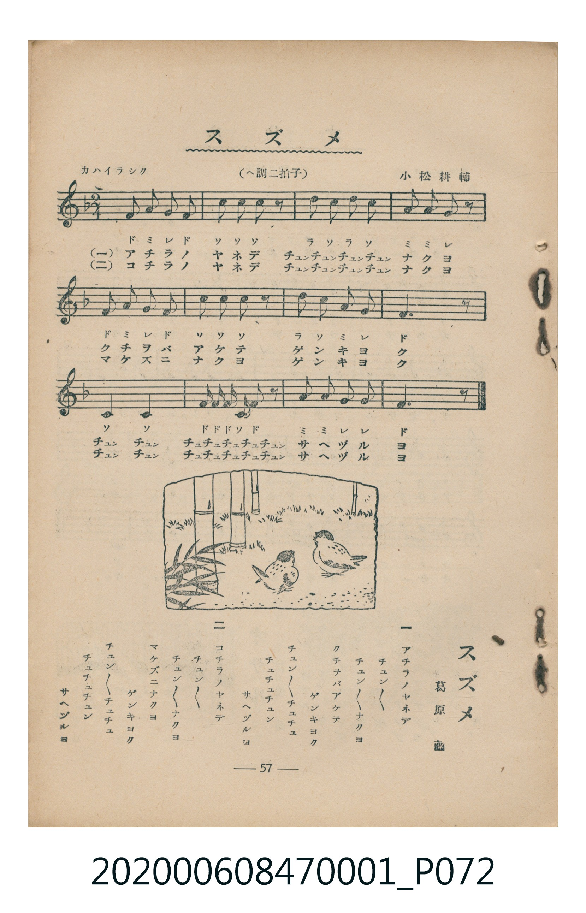

# スズメ（麻雀）

> Re:Shōka 使用 AI 協助辨識與重建樂譜，可能會有錯誤。歡迎回報。

- **NEUTRINO 歌聲合成版**：<br><audio controls src="suzume_neutrino.mp3"></audio>
- **鋼琴伴奏版**：<br><audio controls src="suzume.mp3"></audio>


- 詞：葛原𦱳
- 曲：小松耕輔
- 臺灣教育會公認《新定兒童唱歌》尋常科第一學年用（2020.006.0847.0001）

## 說明

曲目說明
中文解釋：描寫麻雀在屋簷、庭院間飛跳覓食的情景。


## 歌詞

```text
一
アチラノヤネデ
チユンチユンチユンチユンナクヨ
クチバシアケテ
ゲンキヨク
チユンチユンチユチユチユチユチユン
サヘヅルヨ

二
コチラノヤネデ
チユンチユンチユンチユンナクヨ
マケズニナクヨ
ゲンキヨク
チユンチユンチユチユチユチユチユン
サヘヅルヨ
```

## ABC

```abc
X:1
T:スズメ（麻雀）
C:曲：小松耕輔
M:2/4
L:1/16
Q:1/4=100
K:F
V:V1 name="Piano" snm="Pia"
[V:V1]
F2 A2 G2 F2 | c2 c2 c2 z2 | d2 c2 d2 c2 | A2 A2 G2 z2 |
w: 1.~ア チ ラ ノ | ヤ ネ デ | チュン チュン チュン チュン | ナ ク ヨ
w: 2.~コ チ ラ ノ | ヤ ネ デ | チュン チュン チュン チュン | ナ ク ヨ
F2 A2 G2 F2 | c2 c2 c2 z2 | d2 c2 A2 G2 | F6 z2 |
w: 1.~ク チ バ シ | ア ケ テ | ゲ ン キ ヨ | ク
w: 2.~マ ケ ズ ニ | ナ ク ヨ | ゲ ン キ ヨ | ク
C4 C4 | F F F C F2 z2 | A2 A2 G2 G2 | F6 z2 |
w: 1.~チュン チュン | チュ チュ チュ チュ チュン | サ ヘ ヅ ル | ヨ
w: 2.~チュン チュン | チュ チュ チュ チュ チュン | サ ヘ ヅ ル | ヨ
```

## TMD 檔案連結

- [主旋律 TMD 檔案](suzume.tmd) [[在 TMD Studio 編輯](https://tmdlang.github.io/Tmd-TS/#tmd=s7IKdvYPcrWy4qpTUCpJTLdSSM7PyUlNLsnMz7MqzsjMK0nNjM_KTMmPL87Iz05Ugisry88pzU21Si9KTEmNN4w3MjAyiDcwMIs3sDAxBzIMDBFKi_NLi5JTrYqTM_Lzc-JLUitKkvLzsxHyBUX5Zal5iXlANQVFIBtTwIoQClLLMlNSQdKpKZkl-UWZiTlI7kgtKga7FWxJfElRYl5xclFmAcgDCFUlGalAxybmZeYi6wUalZ6ZZ1WSmAn0HMiD5YnxuYmZeTmJeSlKXFpaCo-bdj5u2vW4eeH7PR0vd-1-Obvh_Z5OBS0tLkVbBUMDAy57WwU3LhsjfRM7kJkvVs57v2fWi4mzn_bN_7Bs42awRc9mbwIKPt3Q_2zuvhcNU1_smQIWftG-63nj4mdTZ75o2vRsTvPT1jUvVvU-buh6Nm3D03WznrZOer566dMpG5-t7Xnc0P10Q_fTHTueL5_4fM2aJzsanq7d8XTnludTVgBdBQp3PWC464HCHcgwMAS6UIlLX0sBaPHz2eterFr1bEYfl4KCwpMda59Na3-xfPHL9m6gi5719z9dvxriqadzVjzd2P18w_bHDY1Pd619OXPRy2mTXy6e_WL75hfLgIz5z2e1PGtufTZz_eOGJi4tfS6g-VxAh3A9blr0uLnxcfPKx819j5uXPG7ufdzczgUWWva4eTNeRtfjpvWPm1cAzQBSQNEJj5u2g8xr2vi4uQ0ougmkqmktUAlQBR4zcZGbgWZsfdw843Fz6-Pm1SCbuJ7s6gEKQnRS5OTmeSBnglJGN7JHqO9kUFj7AlOkVUBmYl6-Q41BTTUoLhVsDM207MCsGgVDBV0FYyA2AmIQu0bBFEjCsAFYxAzKg9E1YB0wXWA1YNN8DGuAiX4RkA90E5hcCSb7wHqA4QXm9YLJdiAZDxUHun8p0P0QfQTZIB1dILGm9WCZFTCTIG4wArkBqmeA3EBaqMLUQXTBIHqoQuyB-GgC2ObtEHdAwrtpI1imDeGjpk1gEbDLm9bCXQkzCwbRQq55HsK0pl1gXd34_EuGPcCwAHFAEM4A-R0EgQKgQIAEEHIiIxhASJEDguh8mAp8FEQ1zFtbwabMAJOtYHI11ByQ93AF30C6opaLS9dOAZThFYC0MhcA)]
- [鋼琴伴奏 TMD 檔案](suzume_piano.tmd) [[在 TMD Studio 編輯](https://tmdlang.github.io/Tmd-TS/#tmd=s7IKdvYPcrWy4tLSUnjctPNx067HzQvf7-l43DzlcdOix819T_Zsebq0_8nuGe_3dCpoaXEp2ioYGhhw2dsquHHZGOmb2HHVKSi9WDnv_Z5ZLybOfto3_8OyjZuVQILPZm8CCj7d0P9s7r4XDVNf7JkCFn7Rvut54-JnU2e-aNr0bE7z09Y1L1b1Pm7oejZtw9N1s562Tnq-eunTKRufre153ND9dEP30x07ni-f-HzNmic7Gp6u3fF055bnU1YAXWhkYGSgZ2BgpmdgYWIOZBgYAl2oxMXlm5iZZxWQmZiXH-ThUGNQU82lAAQ2hmZadmBWjYKhgq6CMRAbATGIXaNgCiRh2AAsYgblwegasA6YLrAasGk-hjXAcFsE5D9ubgSTK8FkH1jP4-YlYF4vmGwHkvFQ8cbHzUsfN2-G6CPIBunoAok1rQfLrICZBHGDEcgNUD0D5AbSQhWmDqILBtFDFWIPxEcTwDZvh7gDEt5NG8EybQgfNW0Ci4Bd3rQW7kqYWTCIFnLN8xCmNe0C6-rG518y7AGGBYgDgnAGyO8gCBQABQIkgJATGcEAQoocEETnw1TgoyCqYd7aCjZlBphsBZOroeaAvIcr-AbSFbXI-d0HOb9bwLN7tGEsUG20aTyIgnOBpAGIZwLmgUkUpUBJEvSjSoJiCq4bIoVLOzazIdqBXtO1UwD5LtoHJAxjG4HZylwA)]

## 分析

```text
================================================================================
📊 TMD Song Profile: [ スズメ（麻雀） ]
================================================================================
⏱  Duration:       0:14 (14.4s), 12 measures total
🎼 Key & Tempo:    首調基準 F, != 100.0 BPM, <2/4>
   - 分析範圍：      由實際發聲的音符與和弦推測調性；播放脈絡另行呈現
🎤 人聲音域:    C4 (MIDI 60) – D5 (MIDI 74) [跨度: 14 個半音 / 1.2 個八度, 難度: moderate]
   - 最低音:  C4 in [Main #1 @ m.9, 0:09]
   - 最高音: D5 in [Main #1 @ m.3, 0:02]
   - 適合: soprano, mezzo-soprano, contralto, tenor, baritone, bass
🏛  結構:      Main (14.4s)
⚡ 編曲密度:        Peak 1 軌道同時演奏
🗝  調性診斷：       F 大調（純淨自然大調，未偵測到可信轉調）
   - 風格氣質:    純淨自然大調（陽光明朗、易唱易記，無明顯調外色彩）
   - 轉調歷程:    全曲維持單一推測調性（未偵測到可信轉調）
   - 核心骨幹音:  C, F, A, G, D
   - 調性數值:    F 大調 [相關度: 0.89, 穩定度: Moderate, 自然音純度: 100.0%]
   - 候選調性 (K-S): F 大調 (0.89), C 大調 (0.78), A 小調 (0.61)
   - 五度圈歷程:   -1
   - 各段落調性細節:
     • [Main #1]: F 大調 (r: 0.89, 自然音純度: 100.0%)

  [ 五度圈游移軌跡 ]
               C  
        [F ]*          G  
      Bb               D  
      Eb               A  
         Ab           E  
            Db       B  
               F# 
     (* = active key center)

  [ 十二半音累積音高分佈 ]
     C  : ████████████████████████  32.1%
     C# :                            0.0%
     D  : █████                      7.1%
     D# :                            0.0%
     E  :                            0.0%
     F  : ██████████████████████    29.8%
     F# :                            0.0%
     G  : ███████████               14.3%
     G# :                            0.0%
     A  : ████████████              16.7%
     A# :                            0.0%
     B  :                            0.0%
--------------------------------------------------------------------------------
Assignment 軌道音域：
  - Piano         : C4 – D5 (14 個半音 / 1.2 個八度, 38 個音符)
================================================================================
```


## 原書掃描頁




