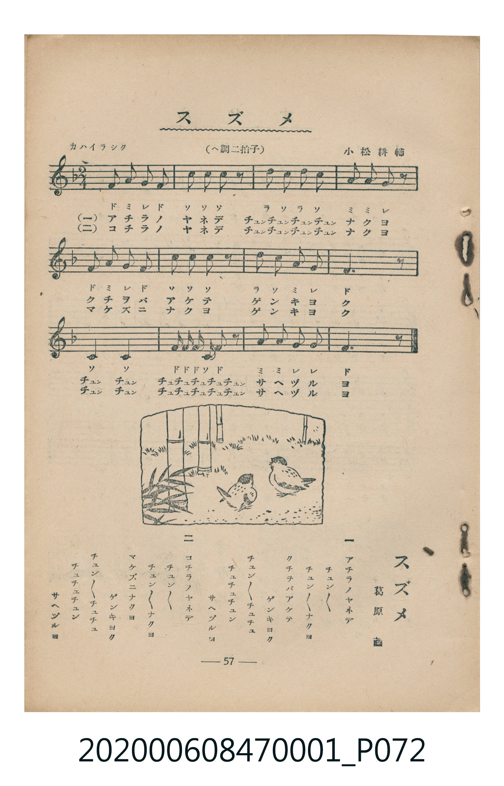

# スズメ（麻雀）

> Re:Shōka 使用 AI 協助辨識與重建樂譜，可能會有錯誤。歡迎回報。

- **鋼琴伴奏版**：<br><audio controls src="suzume.mp3"></audio>
- **NEUTRINO 歌聲合成版**：<br><audio controls src="suzume_neutrino.mp3"></audio>

- 詞：葛原𦱳
- 曲：小松耕輔
- 臺灣教育會公認《新定兒童唱歌》尋常科第一學年用（2020.006.0847.0001）

## 說明

曲目說明
中文解釋：描寫麻雀在屋簷、庭院間飛跳覓食的情景。


## 歌詞

```text
一
アチラノヤネデ
チユンチユンチユンチユンナクヨ
クチバシアケテ
ゲンキヨク
チユンチユンチユチユチユチユチユン
サヘヅルヨ

二
コチラノヤネデ
チユンチユンチユンチユンナクヨ
マケズニナクヨ
ゲンキヨク
チユンチユンチユチユチユチユチユン
サヘヅルヨ
```

## ABC

<div class="abc-score" data-abc-src="suzume.abc" aria-label="五線譜載入中"></div>

[下載 ABC 原始檔](suzume.abc)

## TMD 檔案連結

- [主旋律 TMD 檔案](suzume.tmd) [[在 TMD Studio 編輯](https://tmdlang.github.io/Tmd-TS/#tmd=s7IKdvYPcrWy4qpTUCpJTLdSSM7PyUlNLsnMz7MqzsjMK0nNjM_KTMmPL87Iz05Ugisry88pzU21Si9KTEmNN4w3MjAyiDcwMIs3sDAxBzIMDBFKi_NLi5JTrYqTM_Lzc-JLUitKkvLzsxHyBUX5Zal5iXlANQVFIBtTwIoQClLLMlNSQdKpKZkl-UWZiTlI7kgtKga7FWxJfElRYl5xclFmAcgDCFUlGalAxybmZeYi6wUalZ6ZZ1WSmAn0HMiD5YnxuYmZeTmJeSnIqkoy8oH-LMiotMrILAY5IDkxJz47MQ8pOKDWFySmp1oFGJgbKXFpaSk8btr5uGnX4-aF7_d0vNy1--Xshvd7OhW0tLgUbRUMDQy47G0V3LhsjPRN7EDmvFg57_2eWS8mzn7aN__Dso2bwYY_m70JKPh0Q_-zufteNEx9sWcKWPhF-67njYufTZ35omnTsznNT1vXvFjV-7ih69m0DU_XzXraOun56qVPp2x8trbncUP30w3dT3fseL584vM1a57saHi6dsfTnVueT1kBdBUo2vSA0aYHijYgw8AQ6EIlLn0tBaDFz2eve7Fq1bMZfVwKCgpPdqx9Nq39xfLFL9u7gS561t__dP1qiKeezlnxdGP38w3bHzc0Pt219uXMRS-nTX65ePaL7ZtfLAMy5j-f1fKsufXZzPWPG5q4tPS5gOZzAR3C9bhp0ePmxsfNKx839z1uXvK4ufdxczsXWGjZ4-bNeBldj5vWP25eATQDSAFFJzxu2g4yr2nj4-Y2oOgmkKqmtUAlQBV4zMRFbgaasfVx84zHza2Pm1eDbOJ6sqsHKAjRSZGTm-eBnAlKGd3IHqG-k0Fh7QtM0FYBmYl5-Q41BjXVoLhUsDE007IDs2oUDBV0FYyB2AiIQewaBVMgCcMGYBEzKA9G14B1wHSB1YBN8zGsASb6RUA-0E1gciWY7APrAYYXmNcLJtuBZDxUHOj-pUD3Q_QRZIN0dIHEmtaDZVbATIK4wQjkBqieAXIDaaEKUwfRBYPooQqxB-KjCWCbt0PcAQnvpo1gmTaEj5o2gUXALm9aC3clzCwYRAu55nkI05p2gXV14_MvGfYAwwLEAUE4A-R3EAQKgAIBEkDIiYxgACFFDgii82Eq8FEQ1TBvbQWbMgNMtoLJ1VBzQN7DFXwD6YpaLi5dOwVQhlcA0spcAA)]
- [鋼琴伴奏 TMD 檔案](suzume_piano.tmd) [[在 TMD Studio 編輯](https://tmdlang.github.io/Tmd-TS/#tmd=s7IKdvYPcrWy4qpTUCpJTLdSyC8qychPL0osyKi0ysgsLskvykxOzInPTsxLVIIrKs4vLUpOjS9ITE-1CjAwN1Li0tJSeNy083HTrsfNC9_v6XjcPOVx06LHzX1P9mx5urT_ye4Z7_d0KmhpcSnaKhgaGHDZ2yq4cdkY6ZvYgcx8sXLe-z2zXkyc_bRv_odlGzeDLXo2exNQ8OmG_mdz971omPpizxSw8Iv2Xc8bFz-bOvNF06Znc5qftq55sar3cUPXs2kbnq6b9bR10vPVS59O2fhsbc_jhu6nG7qf7tjxfPnE52vWPNnR8HTtjqc7tzyfsgLoQiMDIwM9AwMzPQMLE3Mgw8AQ6EIlLi7fxMw8q4DMxLz8IA-HGoOaai4FILAxNNOyA7NqFAwVdBWMgdgIiEHsGgVTIAnDBmARMygPRteAdcB0gdWATfMxrAGG2yIg_3FzI5hcCSb7wHoeNy8B83rBZDuQjIeKNz5uXvq4eTNEH0E2SEcXSKxpPVhmBcwkiBuMQG6A6hkgN5AWqjB1EF0wiB6qEHsgPpoAtnk7xB2Q8G7aCJZpQ_ioaRNYBOzyprVwV8LMgkG0kGuehzCtaRdYVzc-_5JhDzAsQBwQhDNAfgdBoAAoECABhJzICAYQUuSAIDofpgIfBVEN89ZWsCkzkAJiNdQckPdwBd9AuqIWOb_7IOd3C3h2jzaMBaqNNo0HUXAukDQA8UzAPDCJohQoSYJ-VElQTMF1Q6RwacdmNkQ70Gu6dgog30X7gIRhbCMwW5kLAA)]

## 分析

```text
================================================================================
📊 TMD Song Profile: [ スズメ（麻雀） ]
================================================================================
⏱  Duration:       0:14 (14.4s), 12 measures total
🎼 Key & Tempo:    首調基準 F, != 100.0 BPM, <2/4>
   - 分析範圍：      由實際發聲的音符與和弦推測調性；播放脈絡另行呈現
🎤 人聲音域:    C4 (MIDI 60) – D5 (MIDI 74) [跨度: 14 個半音 / 1.2 個八度, 難度: moderate]
   - 最低音:  C4 in [Main #1 @ m.9, 0:09]
   - 最高音: D5 in [Main #1 @ m.3, 0:02]
   - 適合: soprano, mezzo-soprano, contralto, tenor, baritone, bass
🏛  結構:      Main (14.4s)
⚡ 編曲密度:        Peak 1 軌道同時演奏
🗝  調性診斷：       F 大調（純淨自然大調，未偵測到可信轉調）
   - 風格氣質:    純淨自然大調（陽光明朗、易唱易記，無明顯調外色彩）
   - 轉調歷程:    全曲維持單一推測調性（未偵測到可信轉調）
   - 核心骨幹音:  C, F, A, G, D
   - 調性數值:    F 大調 [相關度: 0.89, 穩定度: Moderate, 自然音純度: 100.0%]
   - 候選調性 (K-S): F 大調 (0.89), C 大調 (0.78), A 小調 (0.61)
   - 五度圈歷程:   -1
   - 各段落調性細節:
     • [Main #1]: F 大調 (r: 0.89, 自然音純度: 100.0%)

  [ 五度圈游移軌跡 ]
               C  
        [F ]*          G  
      Bb               D  
      Eb               A  
         Ab           E  
            Db       B  
               F# 
     (* = active key center)

  [ 十二半音累積音高分佈 ]
     C  : ████████████████████████  32.1%
     C# :                            0.0%
     D  : █████                      7.1%
     D# :                            0.0%
     E  :                            0.0%
     F  : ██████████████████████    29.8%
     F# :                            0.0%
     G  : ███████████               14.3%
     G# :                            0.0%
     A  : ████████████              16.7%
     A# :                            0.0%
     B  :                            0.0%
--------------------------------------------------------------------------------
Assignment 軌道音域：
  - Piano         : C4 – D5 (14 個半音 / 1.2 個八度, 38 個音符)
================================================================================
```


## 原書掃描頁




