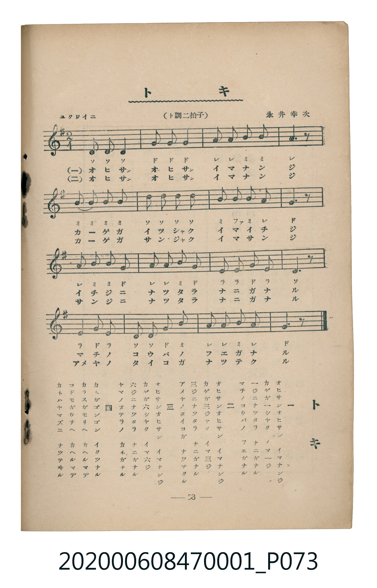

# トキ

<audio controls src="toki.mp3"></audio>

- 曲：永井幸次
- 臺灣教育會公認《新定兒童唱歌》尋常科第一學年用（2020.006.0847.0001）

## 說明

・出處：臺灣教育會公認《新定兒童唱歌》尋常科第一學年用（2020.006.0847.0001）
・調性與拍號：調號 ?= G，拍號 <2/4>，速度 != 104

## 歌詞

```text
一
オヒサンオヒサン　イマナンジ
カゲガ一シヤク　イマ一ジ
一ジニナツタラ　ナニガナル
マチノコウバノ　フエガナル

二
オヒサンオヒサン　イマナンジ
カゲガ三ジヤク　イマ三ジ
三ジニナツタラ　ナニガナル
アメヤノタイコガ　ナツテクル

三
オヒサンオヒサン　イマナンジ
カゲガ六シヤク　イマ六ジ
六ジニナツタラ　ナニガナル
ヤマノオテラノ　カネガナル

四
カネガゴンゴン　イクツナル
カラスガモリヘ　カヘルマデ
コドモガウチヘ　カヘルマデ
カネハヤマズニ　ナツテヰル
```

## ABC

```abc
X:1
T:トキ
C:曲：永井幸次
M:2/4
L:1/16
Q:1/4=104
K:G
V:V1 name="Piano" snm="Pia"
[V:V1]
D2 D2 D4 | G2 G2 G4 | A2 A2 B2 B2 | A6 z2 |
B2 B2 B2 B2 | d2 d2 d2 d2 | B2 c2 B2 A2 | G6 z2 |
A2 B2 B2 G2 | A2 A2 B2 G2 | E2 E2 G2 E2 | D6 z2 |
E2 G2 E4 | D2 D2 G2 B2 | A2 A2 B2 A2 | G6 z2 |
D2 D2 D4 | G2 G2 G4 | A2 A2 B2 B2 | A6 z2 |
B2 B2 B2 B2 | d2 d2 d2 d2 | B2 c2 B2 A2 | G6 z2 |
A2 B2 B2 G2 | A2 A2 B2 G2 | E2 E2 G2 E2 | D6 z2 |
E2 G2 E4 | D2 D2 G2 B2 | A2 A2 B2 A2 | G6 z2 |
D2 D2 D4 | G2 G2 G4 | A2 A2 B2 B2 | A6 z2 |
B2 B2 B2 B2 | d2 d2 d2 d2 | B2 c2 B2 A2 | G6 z2 |
A2 B2 B2 G2 | A2 A2 B2 G2 | E2 E2 G2 E2 | D6 z2 |
E2 G2 E4 | D2 D2 G2 B2 | A2 A2 B2 A2 | G6 z2 |
D2 D2 D4 | G2 G2 G4 | A2 A2 B2 B2 | A6 z2 |
B2 B2 B2 B2 | d2 d2 d2 d2 | B2 c2 B2 A2 | G6 z2 |
A2 B2 B2 G2 | A2 A2 B2 G2 | E2 E2 G2 E2 | D6 z2 |
E2 G2 E4 | D2 D2 G2 B2 | A2 A2 B2 A2 | G6 z2 |
```

## TMD 檔案連結

- [主旋律 TMD 檔案](toki.tmd) [[在 TMD Studio 編輯](https://tmdlang.github.io/Tmd-TS/#tmd=s7IKdvYPcrWy4qpTUCpJTLdSSM7PyUlNLsnMz7MqzsjMK0nNjM_KTMmPL87Iz05Ugisry88pzU21Si9KTEmNN4w3MjAyiDcwMIs3sDAxBzIMDBFKi_NLi5JTrYqTM_Lzc-JLUitKkvLzsxHyBUX5Zal5iXlANQVFIBtTwIoQClLLMlNSQdKpKZkl-UWZiTlI7kgtKga7FWxJfElRYl5xclFmAcgDCFUlGalAxybmZeaC9GppKTxu7njctFZBS4tL0VbB0MCEy95WwZ3LxkjfxA6k6dnsTe_3zHq2YceTXVOf7tzxbM1CsFkv2nc9b1z8bOrMF02bns1pftq65sWq3scNXc-mbXi6btbT1knPVy99OmXjs7U9jxu6n27ofrpjx_PlE5-vWfNkR8PTtTue7tzyfMqK93s6QKGlBwwtPVBoARkGhu_3dCpxcelrcQFVcj1uWvW4edLjpq2PmzejsBsaHjctedw873FzF1hqB1Dp6sdNmx43gWx43LT9cfOSx03r4erAgjtAZgKpx83dYH0tj5v2P25eCVIE4nYDNYMZq7nAJjc-bu573AQ0fNnj5gkgNkjd1MdNKxDquJ7s6iHTkZ1gh6A5EiQIdCREjqAjmxY9bl4IMgPkzv0gM0CuXQNT2vK4uQ1kPNidOzrJcufT1rWYgQkW3MEFoYgJTIjhQEcCLW0DKYIEJtCS5l6kwHw6ezbYZohg0xawY8AkxGaQX4CegnoeqG7l46adYP3AgAAaPQNm6AygCrCV7UB1mx83d4JUgIwExiQwVrGrA9vb3A91bdMukB-QQ7J5A8heLX0uLt_EzDyrgMzEvHyHGoMahWouBSCwMTTTsgOzahRM4xV0kQgQrFEwBJIwDBExApIgbAzFEBEYNACJQA2EqUCoNAUZjoQhakyg8iBzIDZiMw3ZTpAaVJdARMxADgcTID6YAfUXNhNRFUJ8h_A_SALhP5g9uNxYy8Wla6cACmMFPLQyFxcA)]
- [鋼琴伴奏 TMD 檔案](toki_piano.tmd) [[在 TMD Studio 編輯](https://tmdlang.github.io/Tmd-TS/#tmd=s7IKdvYPcrWy4tLSUnjc3PG4ae37PR2Pm6c8blr0uLnvyZ4tT5f2P9k94_2eTgUtLS5FWwVDAxMue1sFdy4bI30TO646BaVnsze93zPr2YYdT3ZNfbpzx7M1C5VAwi_adz1vXPxs6swXTZuezWl-2rrmxarexw1dz6ZteLpu1tPWSc9XL306ZeOztT2PG7qfbuh-umPH8-UTn69Z82RHw9O1O57u3PJ8ygqgY4wMjAz0DAzM9AwsTMyBDANDoGOUuLh8EzPzrAIyE_PygzwcagxqFKq5FIDAxtBMyw7MqlEwjVfQRSJAsEbBEEjCMETECEiCsDEUQ0Rg0AAkAjUQpgKh0hRkOBKGqDGByoPMgdiIzTRkO0FqUF0CETEDORxMgPhgBtRf2ExEVQjxHcL_IAmE_2D24HJjLXIQ-6AEsQU8hKNN42OBqqEUkG8I5oJJhCwqF2QBzMFo6rHxUI1G0YzVeDjXBMKFUFj1Y1WBbhw2-4Fho2unAAoeBTy0MhcXAA)]

## 分析

```text
================================================================================
📊 TMD Song Profile: [ トキ ]
================================================================================
⏱  Duration:       1:13 (73.8s), 64 measures total
🎼 Key & Tempo:    首調基準 G, != 104.0 BPM, <2/4>
   - 分析範圍：      由實際發聲的音符與和弦推測調性；播放脈絡另行呈現
🎤 人聲音域:    D4 (MIDI 62) – D5 (MIDI 74) [跨度: 12 個半音 / 1.0 個八度, 難度: easy]
   - 最低音:  D4 in [Main #1 @ m.1, 0:00]
   - 最高音: D5 in [Main #1 @ m.6, 0:05]
   - 適合: soprano, mezzo-soprano, contralto, tenor, baritone, bass
🏛  結構:      Main (18.5s) -> Main (18.5s) -> Main (18.5s) -> Main (18.5s)
⚡ 編曲密度:        Peak 1 軌道同時演奏
🗝  調性診斷：       G 大調（純淨自然大調，未偵測到可信轉調）
   - 風格氣質:    純淨自然大調（陽光明朗、易唱易記，無明顯調外色彩）
   - 轉調歷程:    全曲維持單一推測調性（未偵測到可信轉調）
   - 核心骨幹音:  G, D, B, A, E
   - 調性數值:    G 大調 [相關度: 0.85, 穩定度: Moderate, 自然音純度: 100.0%]
   - 候選調性 (K-S): G 大調 (0.85), D 大調 (0.74), B 小調 (0.63)
   - 五度圈歷程:   +1 -> +1 -> +1 -> +1
   - 各段落調性細節:
     • [Main #1]: G 大調 (r: 0.85, 自然音純度: 100.0%)
     • [Main #2]: G 大調 (r: 0.85, 自然音純度: 100.0%)
     • [Main #3]: G 大調 (r: 0.85, 自然音純度: 100.0%)
     • [Main #4]: G 大調 (r: 0.85, 自然音純度: 100.0%)

  [ 五度圈游移軌跡 ]
               C  
         F           [G ]*
      Bb               D  
      Eb               A  
         Ab           E  
            Db       B  
               F# 
     (* = active key center)

  [ 十二半音累積音高分佈 ]
     C  : ██                         1.7%
     C# :                            0.0%
     D  : █████████████████████     21.7%
     D# :                            0.0%
     E  : ██████████                10.0%
     F  :                            0.0%
     F# :                            0.0%
     G  : ████████████████████████  25.0%
     G# :                            0.0%
     A  : ███████████████████       20.0%
     A# :                            0.0%
     B  : █████████████████████     21.7%
--------------------------------------------------------------------------------
Assignment 軌道音域：
  - Piano         : D4 – D5 (12 個半音 / 1.0 個八度, 196 個音符)
================================================================================
```


## 原書掃描頁




