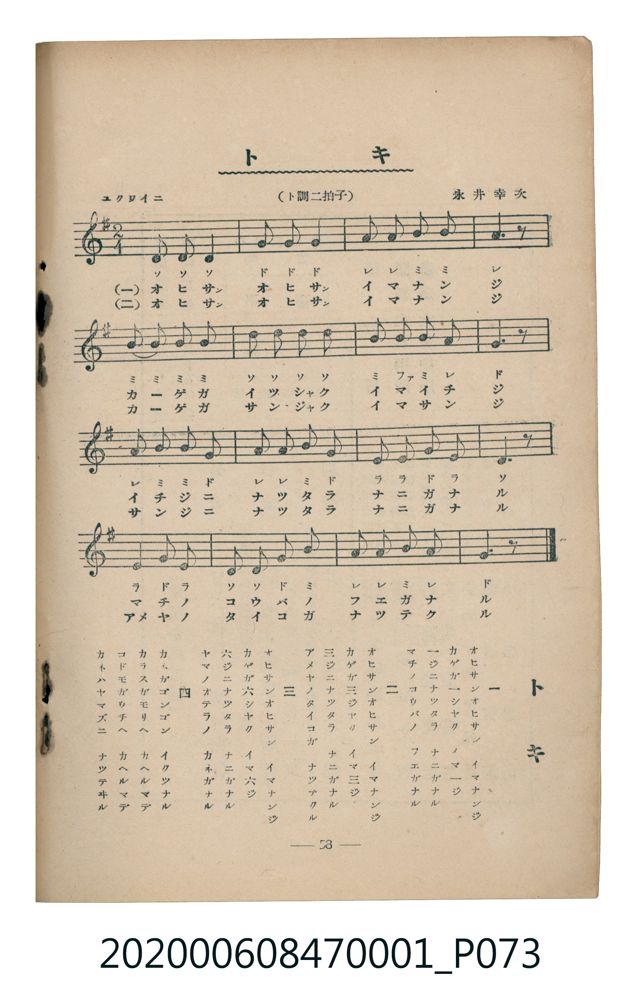

# トキ（朱鷺）

> Re:Shōka 使用 AI 協助辨識與重建樂譜，可能會有錯誤。歡迎回報。

- **NEUTRINO 歌聲合成版**：<br><audio controls src="toki_neutrino.mp3"></audio>
- **鋼琴伴奏版**：<br><audio controls src="toki.mp3"></audio>


- 曲：永井幸次
- 臺灣教育會公認《新定兒童唱歌》尋常科第一學年用（2020.006.0847.0001）

## 說明

曲目說明
中文解釋：歌唱朱鷺飛翔的姿態與優美形象。

## 歌詞

```text
一
オヒサンオヒサン　イマナンジ
カゲガ一シヤク　イマ一ジ
一ジニナツタラ　ナニガナル
マチノコウバノ　フエガナル

二
オヒサンオヒサン　イマナンジ
カゲガ三ジヤク　イマ三ジ
三ジニナツタラ　ナニガナル
アメヤノタイコガ　ナツテクル

三
オヒサンオヒサン　イマナンジ
カゲガ六シヤク　イマ六ジ
六ジニナツタラ　ナニガナル
ヤマノオテラノ　カネガナル

四
カネガゴンゴン　イクツナル
カラスガモリヘ　カヘルマデ
コドモガウチヘ　カヘルマデ
カネハヤマズニ　ナツテヰル
```

## ABC

```abc
X:1
T:トキ（朱鷺）
C:曲：永井幸次
M:2/4
L:1/16
Q:1/4=104
K:G
V:V1 name="Piano" snm="Pia"
[V:V1]
D2 D2 D4 | G2 G2 G4 | A2 A2 B2 B2 | A6 z2 |
w: 1.~オ ヒ サン | オ ヒ サン | イ マ ナ ン | ジ
w: 2.~オ ヒ サン | オ ヒ サン | イ マ ナ ン | ジ
w: 3.~オ ヒ サン | オ ヒ サン | イ マ ナ ン | ジ
w: 4.~カ ネ ガ | ゴ ン ゴン | イ ク ツ ナ | ル
B2 B2 B2 B2 | d2 d2 d2 d2 | B2 B2 B2 A2 | G6 z2 |
w: 1.~カ _ ゲ ガ | イ ツ シャ ク | イ マ イ チ | ジ
w: 2.~カ _ ゲ ガ | サ ン ジャ ク | イ マ サ ン | ジ
w: 3.~カ _ ゲ ガ | ロ ク シャ ク | イ マ ロ ク | ジ
w: 4.~カ ラ ス ガ | モ リ ヘ _ | カ ヘ ル マ | デ
A2 B2 B2 G2 | A2 A2 B2 G2 | E2 E2 G2 E2 | D6 z2 |
w: 1.~イ チ ジ ニ | ナ ツ タ ラ | ナ ニ ガ ナ | ル
w: 2.~サ ン ジ ニ | ナ ツ タ ラ | ナ ニ ガ ナ | ル
w: 3.~ロ ク ジ ニ | ナ ツ タ ラ | ナ ニ ガ ナ | ル
w: 4.~コ ド モ ガ | ウ チ ヘ _ | カ ヘ ル マ | デ
E2 G2 E4 | D2 D2 G2 B2 | A2 A2 B2 A2 | G6 z2 |
w: 1.~マ チ ノ | コ ウ バ ノ | フ エ ガ ナ | ル
w: 2.~アメ ヤ ノ | タ イ コ ガ | ナ ツ テ ク | ル
w: 3.~ヤ マ ノ | オ テ ラ ノ | カ ネ ガ ナ | ル
w: 4.~カ ネ ハ | ヤ マ ズ ニ | ナ ツ テ ヰ | ル
```

## TMD 檔案連結

- [主旋律 TMD 檔案](toki.tmd) [[在 TMD Studio 編輯](https://tmdlang.github.io/Tmd-TS/#tmd=s7IKdvYPcrWy4qpTUCpJTLdSSM7PyUlNLsnMz7MqzsjMK0nNjM_KTMmPL87Iz05Ugisry88pzU21Si9KTEmNN4w3MjAyiDcwMIs3sDAxBzIMDBFKi_NLi5JTrYqTM_Lzc-JLUitKkvLzsxHyBUX5Zal5iXlANQVFIBtTwIoQClLLMlNSQdKpKZkl-UWZiTlI7kgtKga7FWxJfElRYl5xclFmAcgDCFUlGalAxybmZeaC9GppKTxu7njctPb9no5ncza-3L7r_Z5OBS0tLkVbBUMDEy57WwV3LhsjfRM7kAHPZm96v2fWsw07nuya-nTnjmdrFoLNfdG-63nj4mdTZ75o2vRsTvPT1jUvVvU-buh6Nm3D03WznrZOer566dMpG5-t7Xnc0P10Q_fTHTueL5_4fM2aJzsanq7d8XTnludTVgAdAAo5PWDI6YFCDsgwMAQ6RolLX0sBaPHz2eterFr1bEYfl4KCwpMda59Na3-xfPHL9m6Qi9b2gMwHu__l4tnP9095Pqvl6fL9z1q7X3S0P21Z9Xxf39O9i15sXPi4oYlLS58LaCYX0HKux02rHjdPety09XHzZhR2Q8PjpiWPm-c9bu4CS-0AKl39uGnT4yaQox83bX_cvORx03q4OrDgDpCZQOpxczdYX8vjpv2Pm1eCFIG43UDNYMZqLrDJjY-b-x43AQ1f9rh5AogNUjf1cdMKhDquJ7t6yHRkJ9ghaI4ECQIdCZEj6MimRY-bF4LMALlzP8gMkGvXwJS2PG5uAxkPdueOTrLc-bR1LWZgggV3cEEoYgITYjjQkUBL20CKIIEJtKS5Fykwn86eDbYZIti0BewYMAmxGeQXoKegngeqW_m4aSdYPzAggEbPgBk6A6gCbGU7UN3mx82dIBUgI4ExCYxV7OrA9jb3Q13btAvkB-SQbN4AsheUOH0TM_OsAjIT8_IdagxqqkEJXsHG0EzLDsyqUTCNV9BFIkCwRsEQSMIwRMQISIKwMRRDRGDQACQCNtDHsEYBGHRAPjDKQCQ41uDG4JVaApaaBya7wCRIFiSzA8kukCuhdhnR0S5jOtplApJbDVbZCzZwDZJpW-AmQNIbukVN68EKWuDWAWWaQYZhWlQDj05EtJoCSWSMqgYU6ZDkgSvqYTYBsyTc6YhAALsKlEcXw52KFkJQdiP-EALHPC6rtiKFEDDL47YKoZBQxOOwqnkt3Gz8vkJSSFy8rwSr34li2SKwDCShzYDqRugAiUAiGmInSEc7VnsgeRcWpaDIRM3fEBEzkAYwAeKDGdDSAlfUI2IO4kNgoQR1ByTVQyJ_P9x_CBmQOog_CSVZSMyjxDCtbAJFPEoE08wmcLyDfdPcCSbBMQ1Pz8sQ4UphvKNGJ8QcRNkPkkCU7bDUQDDLQ1M4xH19SO6DxA_E9RPgsiAdU8EyK4gPIXCsg1oQYMWQhIZsFTgCoOUfxFpYpkGKpuY2sAw0E-KNduSsi2wPJPOBzYFkUZiXMIpr4iIdSVdzP8IeZPubdoHZWJId1B0bcNpTy8Wla6cAagEoAGllLgA)]
- [鋼琴伴奏 TMD 檔案](toki_piano.tmd) [[在 TMD Studio 編輯](https://tmdlang.github.io/Tmd-TS/#tmd=s7IKdvYPcrWy4tLSUnjc3PG4ae37PR2Pm6c8blr0uLnvyZ4tT5f2P9k94_2eTgUtLS5FWwVDAxMue1sFdy4bI30TO646BaVnsze93zPr2YYdT3ZNfbpzx7M1C5VAwi_adz1vXPxs6swXTZuezWl-2rrmxarexw1dz6ZteLpu1tPWSc9XL306ZeOztT2PG7qfbuh-umPH8-UTn69Z82RHw9O1O57u3PJ8ygqgY4wMjAz0DAzM9AwsTMyBDANDoGOUuLh8EzPzrAIyE_PygzwcagxqqrkUgMDG0EzLDsyqUTCNV9BFIkCwRsEQSMIwRMQISIKwMRRDRGDQACQCNtDHsEbhcdMqIP9x8yQQ2bT1cfNmuDF4pZaApeaByS4wCZIFyexAsgvkSqhdRnS0y5iOdpmA5FaDVfaCDVyDZNoWuAlANhaLmtaDFbTArQPKNIMMw7SoBh6diGg1BZLIGFUNKNIhyQNX1MNsety0Ce50RCCAXdW0_XHzYrhT0UIIym7EH0LgmMdl1VakENqBzyqEQkIRj8Oq5rVws_H7CkkhcfG-Eqx-J4pli8AykIQ2A6oboQMkAoloiJ0gHe1Y7YHkXViUgiITNX9DRMxAGsAEiA9mQEsLXFGPiDmIDx83d0PdAUn1kMjfD_cfQgakDuJPQkkWEvMoMUwrm0ARjxLBNLMJHO9g3zR3gklwTMPT8zJEuFIY76jRCTEHUfaDJBBlOyw1EMzy0BQOcV8fkvsg8QNx_QS4LEjHVLDMCuJDCBzrwMp2IVgxJKEhWwWOAGj5B7EWlmmQoqm5DSwDzYR4ox056yLbA8l8YHMgWRTmJYzimrhIR9LV3I-wB9n-pl1gNpZkB3XHBpz21CI3AHyQGwAW8Po_2jQ-FqgYSgH5hmAumETIonJBSQCWpNDUY-OhGo2iGavxcK4JhAuhsOrHqgLdOGz2A4NG104BFDrRPiBhGNsIiW2MxDYBs5W5AA)]

## 分析

```text
================================================================================
📊 TMD Song Profile: [ トキ（朱鷺） ]
================================================================================
⏱  Duration:       0:18 (18.5s), 16 measures total
🎼 Key & Tempo:    首調基準 G, != 104.0 BPM, <2/4>
   - 分析範圍：      由實際發聲的音符與和弦推測調性；播放脈絡另行呈現
🎤 人聲音域:    D4 (MIDI 62) – D5 (MIDI 74) [跨度: 12 個半音 / 1.0 個八度, 難度: easy]
   - 最低音:  D4 in [Main #1 @ m.1, 0:00]
   - 最高音: D5 in [Main #1 @ m.6, 0:05]
   - 適合: soprano, mezzo-soprano, contralto, tenor, baritone, bass
🏛  結構:      Main (18.5s)
⚡ 編曲密度:        Peak 1 軌道同時演奏
🗝  調性診斷：       G 大調（純淨自然大調，未偵測到可信轉調）
   - 風格氣質:    純淨自然大調（陽光明朗、易唱易記，無明顯調外色彩）
   - 轉調歷程:    全曲維持單一推測調性（未偵測到可信轉調）
   - 核心骨幹音:  G, B, D, A, E
   - 調性數值:    G 大調 [相關度: 0.83, 穩定度: Moderate, 自然音純度: 100.0%]
   - 候選調性 (K-S): G 大調 (0.83), D 大調 (0.73), B 小調 (0.66)
   - 五度圈歷程:   +1
   - 各段落調性細節:
     • [Main #1]: G 大調 (r: 0.83, 自然音純度: 100.0%)

  [ 五度圈游移軌跡 ]
               C  
         F           [G ]*
      Bb               D  
      Eb               A  
         Ab           E  
            Db       B  
               F# 
     (* = active key center)

  [ 十二半音累積音高分佈 ]
     C  :                            0.0%
     C# :                            0.0%
     D  : █████████████████████     21.7%
     D# :                            0.0%
     E  : ██████████                10.0%
     F  :                            0.0%
     F# :                            0.0%
     G  : ████████████████████████  25.0%
     G# :                            0.0%
     A  : ███████████████████       20.0%
     A# :                            0.0%
     B  : ██████████████████████    23.3%
--------------------------------------------------------------------------------
Assignment 軌道音域：
  - Piano         : D4 – D5 (12 個半音 / 1.0 個八度, 49 個音符)
================================================================================
```


## 原書掃描頁




