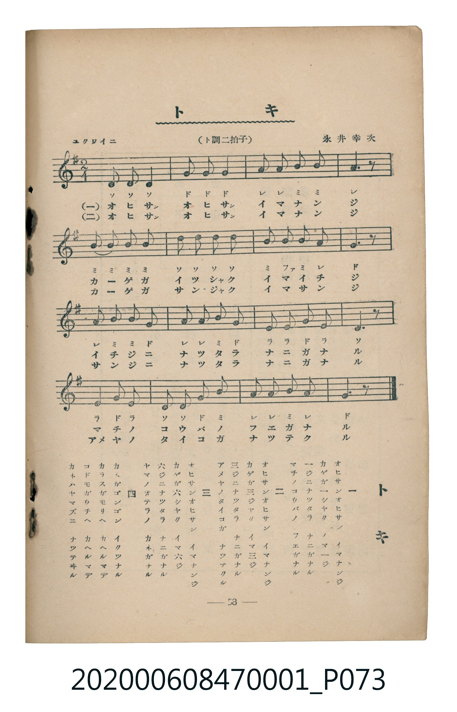

# トキ（朱鷺）

> Re:Shōka 使用 AI 協助辨識與重建樂譜，可能會有錯誤。歡迎回報。

- **鋼琴伴奏版**：<br><audio controls src="toki.mp3"></audio>
- **NEUTRINO 歌聲合成版**：<br><audio controls src="toki_neutrino.mp3"></audio>

- 曲：永井幸次
- 臺灣教育會公認《新定兒童唱歌》尋常科第一學年用（2020.006.0847.0001）

## 說明

曲目說明
中文解釋：歌唱朱鷺飛翔的姿態與優美形象。


## 歌詞

```text
一
オヒサンオヒサン　イマナンジ
カゲガ一シヤク　イマ一ジ
一ジニナツタラ　ナニガナル
マチノコウバノ　フエガナル

二
オヒサンオヒサン　イマナンジ
カゲガ三ジヤク　イマ三ジ
三ジニナツタラ　ナニガナル
アメヤノタイコガ　ナツテクル

三
オヒサンオヒサン　イマナンジ
カゲガ六シヤク　イマ六ジ
六ジニナツタラ　ナニガナル
ヤマノオテラノ　カネガナル

四
カネガゴンゴン　イクツナル
カラスガモリヘ　カヘルマデ
コドモガウチヘ　カヘルマデ
カネハヤマズニ　ナツテヰル
```

## ABC

<div class="abc-score" data-abc-src="toki.abc" aria-label="五線譜載入中"></div>

[下載 ABC 原始檔](toki.abc)

## TMD 檔案連結

- [主旋律 TMD 檔案](toki.tmd) [[在 TMD Studio 編輯](https://tmdlang.github.io/Tmd-TS/#tmd=s7IKdvYPcrWy4qpTUCpJTLdSSM7PyUlNLsnMz7MqzsjMK0nNjM_KTMmPL87Iz05Ugisry88pzU21Si9KTEmNN4w3MjAyiDcwMIs3sDAxBzIMDBFKi_NLi5JTrYqTM_Lzc-JLUitKkvLzsxHyBUX5Zal5iXlANQVFIBtTwIoQClLLMlNSQdKpKZkl-UWZiTlI7kgtKga7FWxJfElRYl5xclFmAcgDCFUlGalAxybmZeYi6wUalZ6ZZ1WSmAn0HMiD5YnxuYmZeTmJeSnIqkoy8oH-LMiotMrILAY5IDkxJz47MQ8pOKDWFySmp1oFGJgbK3FpaSk8bu543LT2_Z6OZ3M2vty-6_2eTgUtLS5FWwVDAxMue1sFdy4bI30TO5Ahz2Zver9n1rMNO57smvp0545naxaCzX7Rvut54-JnU2e-aNr0bE7z09Y1L1b1Pm7oejZtw9N1s562Tnq-eunTKRufre153ND9dEP30x07ni-f-HzNmic7Gp6u3fF055bnU1YAHQCKHj1g9OiBogfIMDAEOkaJS19LAWjx89nrXqxa9WxGH5eCgsKTHWufTWt_sXzxy_ZukIvW9oDMB7v_5eLZz_dPeT6r5eny_c9au190tD9tWfV8X9_TvYtebFz4uKGJS0ufC2gmF9ByrsdNqx43T3rctPVx82YUdkPD46Ylj5vnPW7uAkvtACpd_bhp0-MmkKMfN21_3LzkcdN6uDqw4A6QmUDqcXM3WF_L46b9j5tXghSBuN1AzWDGai6wyY2Pm_seNwENX_a4eQKIDVI39XHTCoQ6rie7esh0ZCfYIWiOBAkCHQmRI-jIpkWPmxeCzAC5cz_IDJBr18CUtjxubgMZD3bnjk6y3Pm0dS1mYIIFd3BBKGICE2I40JFAS9tAiiCBCbSkuRcpMJ_Ong22GSLYtAXsGDAJsRnkF6CnoJ4Hqlv5uGknWD8wIIBGz4AZOgOoAmxlO1Dd5sfNnSAVICOBMQmMVezqwPY290Nd27QL5AfkkGzeALIXlDh9gbnbKiAzMS_focagphqU4BVsLLTswIwaBdN4KNIFcgzBEMQyAkJjIASxdIHQQKEGrMHHsEYBGDLAfD4JSIMiBKwcq9ASoNA8IO4C4s1gkR1gs-JhZhlR0SxjKpplAhJbDZTtBdJroLq2gFVDohhhUNN6oHAL2DCgSPNqFINqwEEICUZTKISJGYGDGzNoQSYAUzPYYphjgeaDkvVisHVIPgDTjThDFt2orVAfAHMBplEQSVwBi2ZU81qIz7G6CiqJL1xXAumdcMMWATEommZAgxWkYgY4MEHmgVS0owUrJG0awtMpiGUWD0KGIAKcqjGDFhJaIFcBcwvYXFAKAAXufrCbYCLdYJdhj1JIyMJDkhKTQAELD0iKTAKHK9A9zZ2Q0ITG9zKIf0kIV1gAgtRDSgVDaBkACmUcSRYc5yB7-qD2gEIGZPcEsBhIxVSgyAqCoQqqIIBSoGiCGQUMBHAuAxkJSSzQ4GlugyUyrMEKS4owc0DJC6gDlPAgTkLK3vgCFaqquR9iDszcpl3o0QU2fQOaObVcXLp2CqACWAFIK3MBAA)]
- [鋼琴伴奏 TMD 檔案](toki_piano.tmd) [[在 TMD Studio 編輯](https://tmdlang.github.io/Tmd-TS/#tmd=s7IKdvYPcrWy4qpTUCpJTLdSyC8qychPL0osyKi0ysgsLskvykxOzInPTsxLVIIrKs4vLUpOjS9ITE-1CjAwN1bi0tJSeNzc8bhp7fs9HY-bpzxuWvS4ue_Jni1Pl_Y_2T3j_Z5OBS0tLkVbBUMDEy57WwV3LhsjfRM7kIHPZm96v2fWsw07nuya-nTnjmdrFoLtedG-63nj4mdTZ75o2vRsTvPT1jUvVvU-buh6Nm3D03WznrZOer566dMpG5-t7Xnc0P10Q_fTHTueL5_4fM2aJzsanq7d8XTnludTVgAdY2RgZKBnYGCmZ2BhYg5kGBgCHaPExeWbmJlnFZCZmJcf5OFQY1BTzaUABDYWWnZgRo2CaTwU6QI5hmAIYhkBoTEQgli6QGigUAPW4GNYo_C4aRUwFCYB6a2PmzeDlWMVWgIUmgfEXUC8GSyyA2xWPMwsIyqaZUxFs0xAYquBsr1Aeg1U1xawaiCNYlDTeqBwC9gwoEjzahSDasBBCAlGUyiEiRmBgxszaEEmPG7aBLYY5lig-U3bHzcvBluH5AMw3YgzZNGN2gr1wQ5sRkEkcQUsmlHNayE-x-oqqCS-cF0JpHfCDVsExKBomgENVpCKGeDABJkHUtGOFqyQtGkIT6cgllk8CBmCCHCqxgxaSGiBXPW4uRtsLigFgAJ3P9hNMJFusMuwRykkZOEhSYlJoICFByRFJoHDFeie5k5IaELjexnEvySEKywAQeohpYIhtAwAhTKOJAuOc5A9fVB7QCEDsnsCWAykYipQZAXBUAWWpQuBUqBoghkFDARwLgMZCUks0OBpboMlMqzBCkuKMHNAyQuoA5TwIE5Cyt74AhWqqrkfYg7M3KZd6NEFds8SNHNqkctfH-zlb7RpfCxQOZQC8g3BXDCJkEXlIiIAQz02HqrRKJqxGg_nmkC4EAqrfqwq0I3DZj8waHTtFEChE-0DEoaxjZDYxkhsEzBbmQsA)]

## 分析

```text
================================================================================
📊 TMD Song Profile: [ トキ（朱鷺） ]
================================================================================
⏱  Duration:       0:18 (18.5s), 16 measures total
🎼 Key & Tempo:    首調基準 G, != 104.0 BPM, <2/4>
   - 分析範圍：      由實際發聲的音符與和弦推測調性；播放脈絡另行呈現
🎤 人聲音域:    D4 (MIDI 62) – D5 (MIDI 74) [跨度: 12 個半音 / 1.0 個八度, 難度: easy]
   - 最低音:  D4 in [Main #1 @ m.1, 0:00]
   - 最高音: D5 in [Main #1 @ m.6, 0:05]
   - 適合: soprano, mezzo-soprano, contralto, tenor, baritone, bass
🏛  結構:      Main (18.5s)
⚡ 編曲密度:        Peak 1 軌道同時演奏
🗝  調性診斷：       G 大調（純淨自然大調，未偵測到可信轉調）
   - 風格氣質:    純淨自然大調（陽光明朗、易唱易記，無明顯調外色彩）
   - 轉調歷程:    全曲維持單一推測調性（未偵測到可信轉調）
   - 核心骨幹音:  G, B, D, A, E
   - 調性數值:    G 大調 [相關度: 0.83, 穩定度: Moderate, 自然音純度: 100.0%]
   - 候選調性 (K-S): G 大調 (0.83), D 大調 (0.73), B 小調 (0.66)
   - 五度圈歷程:   +1
   - 各段落調性細節:
     • [Main #1]: G 大調 (r: 0.83, 自然音純度: 100.0%)

  [ 五度圈游移軌跡 ]
               C  
         F           [G ]*
      Bb               D  
      Eb               A  
         Ab           E  
            Db       B  
               F# 
     (* = active key center)

  [ 十二半音累積音高分佈 ]
     C  :                            0.0%
     C# :                            0.0%
     D  : █████████████████████     21.7%
     D# :                            0.0%
     E  : ██████████                10.0%
     F  :                            0.0%
     F# :                            0.0%
     G  : ████████████████████████  25.0%
     G# :                            0.0%
     A  : ███████████████████       20.0%
     A# :                            0.0%
     B  : ██████████████████████    23.3%
--------------------------------------------------------------------------------
Assignment 軌道音域：
  - Piano         : D4 – D5 (12 個半音 / 1.0 個八度, 49 個音符)
================================================================================
```


## 原書掃描頁




