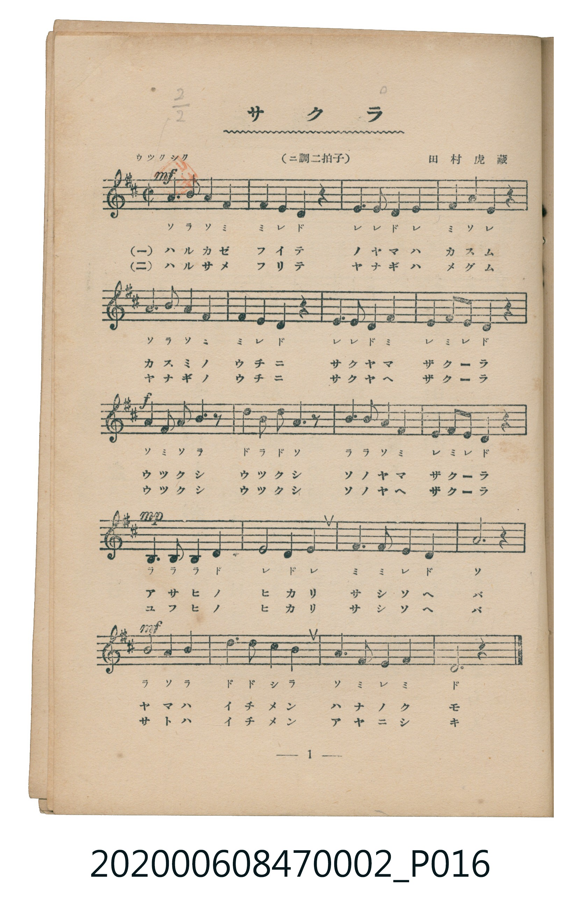
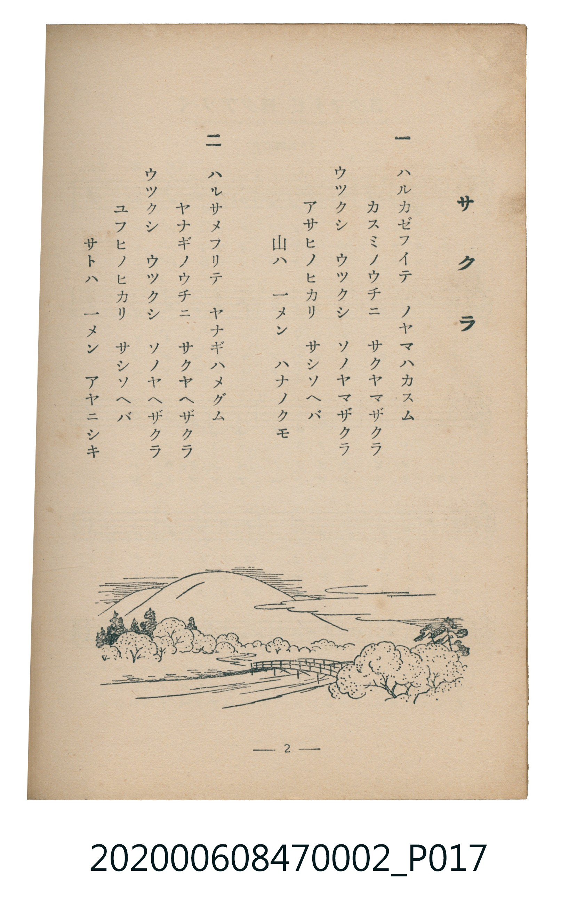

# サクラ

<audio controls src="sakura.mp3"></audio>

- 曲：田村虎藏
- 臺灣教育會公認《新定兒童唱歌》尋常科第二學年用（2020.006.0847.0002）

## 說明

原書資訊與歌詞全文（對應 P016.jpg – P017.jpg，書頁 pp. 1–2，第一學期第 1 首）：
調性與拍號：ニ調二拍子（D 大調二二拍子／四四拍子），「ウツクシク」

## 歌詞

```text
一
ハルカゼフイテ　ノヤマハカスム
カスミノウチニ　サクヤマザクラ
ウツクシ　ウツクシ　ソノヤマザクラ
アサヒノヒカリ　サシソヘバ
山ハ　一メン　ハナノクモ

二
ハルサメフリテ　ヤナギハメグム
ヤナギノウチニ　サクヤヘザクラ
ウツクシ　ウツクシ　ソノヤヘザクラ
ユフヒノヒカリ　サシソヘバ
サトハ　一メン　アヤニシキ
```

## ABC

```abc
X:1
T:サクラ
C:曲：田村虎藏
M:4/4
L:1/16
Q:1/4=88
K:D
V:V1 name="Piano" snm="Pia"
[V:V1]
!mf! A6 B2 A4 F4 | F4 E4 D4 z4 | E6 E2 D4 E4 | F4 A4 E4 z4 |
A6 B2 A4 F4 | F4 E4 D4 z4 | E6 E2 D4 F4 | E4 F2 E2 D4 z4 |
!f! A6 F2 A2 B4 z2 | d6 B2 d2 A4 z2 | B6 B2 A4 F4 | E4 F2 E2 D4 z4 |
!mp! B,6 B,2 B,4 D4 | E4 D4 E8 | F6 F2 E4 D4 | A,12 z4 |
!mf! B4 A4 B8 | d6 d2 c4 B4 | A6 F2 E4 F4 | D12 z4 |
```

## TMD 檔案連結

- [主旋律 TMD 檔案](sakura.tmd) [[在 TMD Studio 編輯](https://tmdlang.github.io/Tmd-TS/#tmd=s7IKdvYPcrWy4tLSUnjctPVx0_rHzSsVtLS4FG0VLCy47G0VXLhsTPRN7LjqFJSezd70fs-s51M2PJs78cXMvhfT-5VAwi_adz1vXPxs6swXTZuezWl-2rrmxarexw1dz6ZteLpu1tPWSc9XL306ZeOztT2PG7qfbuh-umPH8-UTn69Z82RXz9O1O57u3PJ8yor3ezqMDIwM9AwMzPQMLEzMgQwDo_d7OpW4uPS1FGypBbgUFBSe9s1_NnvHi83tL1Z0vehoB7rrxcp5T1tXPJvWDnTF0w29z9o7FQIMDM30sgrSFR41TAZxzEGc93t6gDpfLmhUKCjQUzAESgGd2APyyY4GoE-ezZkPZCsYKrxcNg3odGBYgax7sWr_s4blIIu6e1_MnA8UfdzcDRQE-h4o8nTtBKClLgpPlyyHiCEJ9z-dPRuIYFyggcAQ7HnctOxxcwsoppq2g8iGXi6QNUAngKjHzf2Pm1c_bgKiPY-bpz5uWvK4ue1xQ8Pj5r7HzUD2PJACkOzOx80LwBqgnPkgFSCjG4HOA2mApgawnqZtkJQB0YBkP0gdGncvwipUbYtARjZPAktPAlnbvApmD9AjQG0zHjdPAEfQxo0gVzY0AP30uHnh4-bNYA8APdYFdiTQyEUQP-_qQfYz0HSg4qkgc6F-Brqi63HTOrCChY-bNsD8jJDA5ecZ5PkZTVszUB3QPUT4Gez6DizeBgYbyOBusIa1IKWU5wIoUNDS5-IKTswuLUq0CshMzMt3qDGoUagG2aFgY6FlB2Zgy30KkCT_YmGPgoaJwtMN_c_XN-jAs4wmFg1Am6CGvZzV93RCrxXQw3tBIsAwWgllA9MgkKyB0o-b14DJTrAqiDhIBCIDEYeIwHVATYGoUkCyUwPoWE2glc39UANWg5I9WMseqAFTwbwlYNk2JCv7oDqWAPE8SFqDyED17wSLLcBi5a4eDCu3glkLka1sXoVhJcgRILEuoI51yFaCdQJTMTYrgfGWm1arYKqgC4RmYNoYiGvApBEQGwKxAVgExAOJgURAbIgakA4QD6wGnLtwR_2unkEQ9TAdELXzkeTQYwIS-eAIg0QZzBpQ5IKichmY1wgmuxGWguMLpGM9NFYgSQAksw0uvgfsDUxLodGPGZmkWzqDGEtrSI57iBqQiDFUhJi439FJpbgHxhiQDfMHKCYhcQdOFUA2TCVIBqIGW3ohOvZBwQ1S2gIJwqbt8ADHLQNzah_Z8U8la4lMAdXwEsAYSJuBY7RGwTAOmjCADJAsSAwkh5pWSEwHwHYJZekAOU7BbEjsIeIUUcBDwwUc54jYRtIBDTFkgCUFLIJoB2YwYF0MDWCIwWAepEAHl8ewiIBlxe3wZAeNiOYJeC2E5n1YDE-lpYWggr-gVsEsHhKj8RAWKBYhcQor5UEQUiJA4hmmxhSiEQKJKvynUCHiYd6DJWHk7A_K-qDMAJFFzhCIiIdlf1iGxwgW5FofkXVh1THEWFjZ3AjE4Kq1eTPUWFilDSy1wXEGynMQGUgiwmUhNNND6vkO4i2EpU1wMwNUGUBCACSzFpeF0BoflJNBuRiSo0ExCs3vQMocKg6rGyDxDsnvoNhHjfZaLi5dOwVIe1AByFLm4gIA)]
- [鋼琴伴奏 TMD 檔案](sakura_piano.tmd) [[在 TMD Studio 編輯](https://tmdlang.github.io/Tmd-TS/#tmd=s7IKdvYPcrWy4tLSUnjctPVx0_rHzSvf7-l42b3n-YQtT_Zsebq0_3lnx_s9nQpaWlyKtgoWFlz2tgouXDYm-iZ2XHUKSs9mb3q_Z9bzKRuezZ34Ymbfi-n9SiDhF-27njcufjZ15oumTc_mND9tXfNiVe_jhq5n0zY8XTfraeuk56uXPp2y8dnanscN3U83dD_dseP58onP16x5sqvn6dodT3dueT5lBdAhRgZGBnoGBmZ6BhYm5kCGgRHQLUpcXMGJ2aVFiVYBmYl5-UEeDjUGNQrVXApAYGOhZQdm6Gsp2KIDBZAFOxpeLOxR0DBReLqh__n6Bh2FAANDM72sgnRNLBq09MGGAU3PTatVMFXQBUIzMG0MxDVg0giIDYHYACwC4oHEQCIgNkQNSAeIB1bDhd-Bu3rIcSCpboOoAYkYQ0WIcduOTrICDx52xkDaDGxXjYJhHNTJQAZIFiQGkkP1BYkufDp7NnnRW1CrYBYPsT0ewgLZCLEfFpcgCAlXiJtgakwhGiGQqCieQnYaBIUQKHQgIQWyHRqOQMocKg5LDRA3QsIR5FJUJ9aiZiMflGxkgshGT1tWPd_X96xr0rPm1qfblz3r7IYUDAiHGcYrRBvGwihkPihOTeOBXNP4WAQDrgIkAlRCmjFweWQRDFNMgJQJSBWUAdeFzsduClQV3BQ8nsA0CdVb6Eah85HCAsNgkCnAeNK1U4BElQIKS5mLCwA)]

## 分析

```text
================================================================================
📊 TMD Song Profile: [ サクラ ]
================================================================================
⏱  Duration:       0:54 (54.5s), 20 measures total
🎼 Key & Tempo:    首調基準 D, != 88.0 BPM, <4/4>
   - 分析範圍：      由實際發聲的音符與和弦推測調性；播放脈絡另行呈現
🎤 人聲音域:    A3 (MIDI 57) – D5 (MIDI 74) [跨度: 17 個半音 / 1.4 個八度, 難度: challenging]
   - 最低音:  A3 in [Sakura #1 @ m.16, 0:40]
   - 最高音: D5 in [Sakura #1 @ m.10, 0:24]
   - 適合: soprano, mezzo-soprano, contralto, tenor, baritone, bass
🏛  結構:      Sakura (54.5s)
⚡ 編曲密度:        Peak 1 軌道同時演奏
🗝  調性診斷：       D 調性不明確（純淨自然大調，未偵測到可信轉調）
   - 風格氣質:    純淨自然大調（陽光明朗、易唱易記，無明顯調外色彩）
   - 轉調歷程:    全曲維持單一推測調性（未偵測到可信轉調）
   - 核心骨幹音:  D, E, A, F#, B
   - 調性數值:    D 調性不明確 [相關度: 0.79, 穩定度: Ambiguous, 自然音純度: 100.0%]
   - 候選調性 (K-S): D 大調 (0.79), A 大調 (0.79), B 小調 (0.62)
   - 五度圈歷程:   +2
   - 各段落調性細節:
     • [Sakura #1]: D 調性不明確 (r: 0.79, 自然音純度: 100.0%)

  [ 五度圈游移軌跡 ]
               C  
         F            G  
      Bb              [D ]*
      Eb               A  
         Ab           E  
            Db       B  
               F# 
     (* = active key center)

  [ 十二半音累積音高分佈 ]
     C  :                            0.0%
     C# : ██                         1.4%
     D  : ████████████████████████  22.2%
     D# :                            0.0%
     E  : ████████████████████████  22.2%
     F  :                            0.0%
     F# : ██████████████████        16.7%
     G  :                            0.0%
     G# :                            0.0%
     A  : ███████████████████████   21.5%
     A# :                            0.0%
     B  : █████████████████         16.0%
--------------------------------------------------------------------------------
Assignment 軌道音域：
  - Piano         : A3 – D5 (17 個半音 / 1.4 個八度, 69 個音符)
================================================================================
```


## 原書掃描頁






