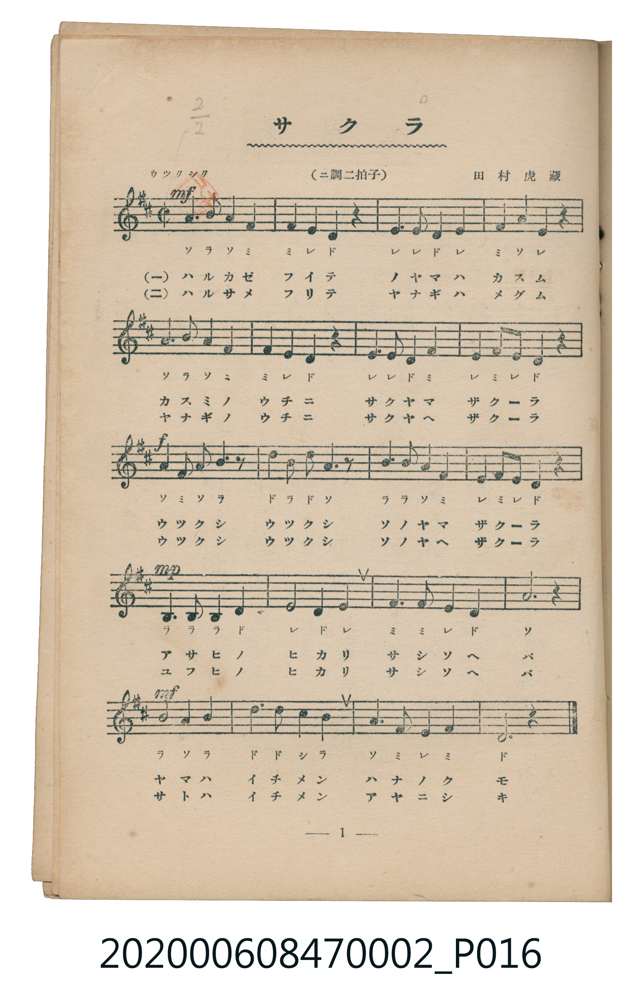
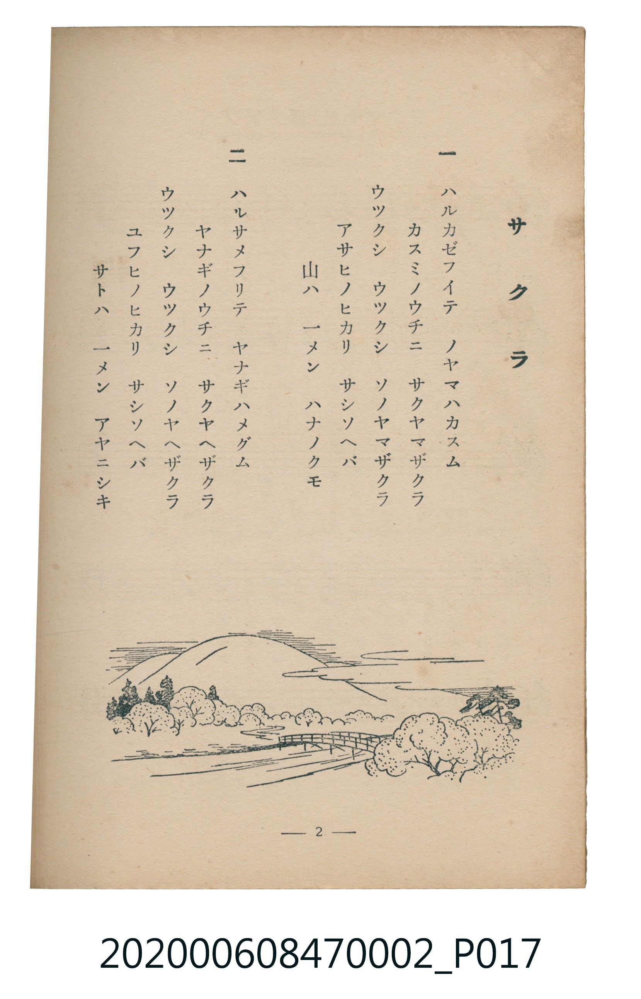

# サクラ（櫻花）

> Re:Shōka 使用 AI 協助辨識與重建樂譜，可能會有錯誤。歡迎回報。

- **鋼琴伴奏版**：<br><audio controls src="sakura.mp3"></audio>
- **NEUTRINO 歌聲合成版**：<br><audio controls src="sakura_neutrino.mp3"></audio>

- 曲：田村虎藏
- 臺灣教育會公認《新定兒童唱歌》尋常科第二學年用（2020.006.0847.0002）

## 說明

曲目說明
中文解釋：描寫櫻花盛開、花瓣飄落，以及春天到來的美景。

原書資訊與歌詞全文（對應 P016.jpg – P017.jpg，書頁 pp. 1–2，第一學期第 1 首）：
調性與拍號：ニ調二拍子（D 大調二二拍子／四四拍子），「ウツクシク」


## 歌詞

```text
一
ハルカゼフイテ　ノヤマハカスム
カスミノウチニ　サクヤマザクラ
ウツクシ　ウツクシ　ソノヤマザクラ
アサヒノヒカリ　サシソヘバ
山ハ　一メン　ハナノクモ

二
ハルサメフリテ　ヤナギハメグム
ヤナギノウチニ　サクヤヘザクラ
ウツクシ　ウツクシ　ソノヤヘザクラ
ユフヒノヒカリ　サシソヘバ
サトハ　一メン　アヤニシキ
```

## ABC

<div class="abc-score" data-abc-src="sakura.abc" aria-label="五線譜載入中"></div>

[下載 ABC 原始檔](sakura.abc)

## TMD 檔案連結

- [主旋律 TMD 檔案](sakura.tmd) [[在 TMD Studio 編輯](https://tmdlang.github.io/Tmd-TS/#tmd=s7IKdvYPcrWy4qpTUCpJTLdSSM7PyUlNLsnMz7MqzsjMK0nNjM_KTMmPL87Iz05Ugisry88pzU21Si9KTEmNN4o3MjAyiDcwMIs3sDAxBzIMjBBKi_NLi5JTrYqTM_Lzc-JLUitKkvLzsxHyBUX5Zal5iXlANQVFIBtTwIoQClLLMlNSQdKpKZkl-UWZiTlI7kgtKga7FWxJfElRYl5xclFmAcgDCFUlGalAxxbkJOYhGQs0KT0zzyo3NTMrE4uz8otKMvKB_ivIqLTKyCwGWZycmBOfnZiHFAxQawsS01OtAgwMzXSBhLkSl5aWwuOmrY-b1j9uXvl-T8ez1btfdG18v6dTQUuLS9FWwcKCy95WwYXLxkTfxA5k1rPZm97vmfV8yoZncye-mNn3Yno_2IoX7bueNy5-NnXmi6ZNz-Y0P21d82JV7-OGrmfTNjxdN-tp66Tnq5c-nbLx2dqexw3dTzd0P92x4_nyic_XrHmyq-fp2h1Pd255PmUF0H5Q7OgBY0cPFDtAhoER0C1KXPpaCkCLn89e92LVqmcz-rgUFBSe7Fj7bFr7i-WLX7Z3A130rL__6frVEOc_nz375bTuxw2NIPbkxS8Xt7yYsPf9np4nu5c-7e96NmPp0yUrn3ZseLKv7fmsluf7-p7NXP-4oYlLS58LZJEttQDIlU_75j-bvePF5vYXK7pedLQD_f9i5bynrSuATgf69umG3mftnQqg6NDLKkhXeNQwGcQxB3GA7gXqfLmgUaGgQE_BECgFDIoeUIjtaACG2LM584FsBUOFl8umAYMIGAIg616s2v-sYTnIou7eFzPnA0UfN3cDBYGhDBR5unYC0FIXhadLlkPEkIT7n86eDUQwLtBAYEz1PG5a9ri5BZQ6mraDyIZeLkjYN4Cox839j5tXP24Coj2Pm6c-blryuLntcUPD4-a-x81A9jyQApDszsfNC8AaoJz5IBUgoxuBzgNpgKZAsJ6mbZDUCNGAZD9IHRp3L8IqVG2LQEY2TwJLTwJZ27wKZg_QI0BtMx43TwBH0MaNIFc2NAD99Lh54ePmzWAPAD3WBXYk0MhFED_v6kH2M9B0oOKpIHOhfga6outx0zqwgoWPmzbA_IyQwOXnGeT5GU1bM1Ad0D1E-Bns-g4s3gYGG8jgbrCGtSCllOcCKFAA5a7gxOzSokSrgMzEvHyHGoOaapAVCjYWWnZgBrbMpwBJ8S8W9ihomCg83dD_fH2DDjzHaGLRALQIatjLWX1PJ_RaAf27FyQCDKKVUDYwCQLJGij9uHkNmOwEq4KIg0QgMhBxiAhcB9QUiCoFJDs1gI7VBFrZ3A81YDUo1YO17IEaMBXMWwKWbUOysg-qYwkQz4MkNYgMVP9OsNgCLFbu6sGwciuYtRDZyuZVGFaCHAES6wLqWIdsJVgnMBFjs7JGoTo3rVbBVEEXCM3AtDEQ14BJIyA2BGIDsAiIBxIDiYDYEDUgHSAeWA3YSB9DkJ39YNWwIAOygEEG0gNyP4i3BCzbBiTjoeJ9UB2QIAOxQGZAggykYydYbAFMB8QuI3S7toJZC5HtAoYVul0g20FikLBCsgusExRWqHbhT9K7egZBkobpgKidjySHnsIgiRqcECFJEWYNKNGCwnsZmNcIJrsRloLTIUjHemhqgyRtkMw2uPgesDcwLYUma8xESrqlM4ixtIbkNA1RAxIxhoqgpWlwOoSkRFCIgVIIKM1CHA_iNYLJbkQ6A6dGkA6I40GyoJQNcTxEHCS2EkuaxkyhpNs1A69dBIrpTiqlaWBKBLJh8QPyGiRNglM7kA1TCZKBqMGWD4hO1aBkBFLaAgmJpu3whIRbBubUPrLTNZWsJTJlV8NLbGMgbQZOqTUKhnHQBA9kgGRBYiA51DyAL32DUhYojSCcCkor-GX2QmUgniAhhVPJNgrSOLCJTFkaR06vYDYkZSLSK6KxAY1zcHpGpGQkHdDUgAywpO5FEO3AvA5sFkITD8RgMA_SuAC3DaAWwovP7fAsBU1kzRPwWggtr2GpdyotLQQ1QgpqFcxAcQZMrfEQFiiFQtIrrMUBgpBSHJKGYWpMIRohED1RL4IkGWiQIRWkEB6kcQFuIkCMRxSkEB8gJTKgDxD2oBfYsEQLCSlq20OgATKFCgkZFl2w4ga5qAYV06CCCyKLXHghEjKsqIYVzhjRjNyiRhSzsKYuxFhY-6ARiMHN1ubNUGNhDWJghQhOg6DMDpGBZApcFkILaEgbuoN4C2F5DdweBTVIICEAklmLy0JoaxpU6oJKXEjpC4pSaNkMpMyh4rD2CSQdQ8pmUGrGkYyRylZYexeSiGDtBIj7QazN0EQEaxVDAgxWOkICDGcyhrafO4i3B5bBoOEESdAQmbUY9tRycenaKUC6jgpAljIXAA)]
- [鋼琴伴奏 TMD 檔案](sakura_piano.tmd) [[在 TMD Studio 編輯](https://tmdlang.github.io/Tmd-TS/#tmd=s7IKdvYPcrWy4qpTUCpJTLdSyC8qychPL0osyKi0ysgsLskvykxOzInPTsxLVIIrKs4vLUpOjS9ITE-1CjAwNNMFEuZKXFpaCo-btj5uWv-4eeX7PR0vu_c8n7DlyZ4tT5f2P-_seL-nU0FLi0vRVsHCgsveVsGFy8ZE38QOZOiz2Zve75n1fMqGZ3MnvpjZ92J6P9iuF-27njcufjZ15oumTc_mND9tXfNiVe_jhq5n0zY8XTfraeuk56uXPp2y8dnanscN3U83dD_dseP58onP16x5sqvn6dodT3dueT5lBdAhRgZGBnoGBmZ6BhYm5kCGgRHQLUpcXMGJ2aVFiVYBmYl5-UEeDjUGNdVcCkBgY6FlB2boaynYogMFkPk7Gl4s7FHQMFF4uqH_-foGHQVQKOhlFaRrYtGgpQ82rEahOjetVsFUQRcIzcC0MRDXgEkjIDYEYgOwCIgHEgOJgNgQNSAdIB5YDdhIH8MahcfN_WDVj5tXA0N_NYjVtAes53HzVDBvCVi2DUjGQ8X7oDqWAPE8MAtkBlAGqn8nWGwBTAfELiN0u7aCWQuR7WpehWEXyHaQWBdQxzpku8A6HzdtQLMLf8Dv6iEn4EkNc4gakIgxVAQtzMHhBAmpx83zwT4AhSlIZhmY1wgmuxHhAA4tkI710DCBhDxIZhtUHCS2EkuYY4Yg6XbNwGsXgcTeSVZih6d1YyBtBg7DGgXDOGhUABkgWZAYSA41dvCFPMjPINe3QPzXtB3sC_wye6EyfaSGPZVsoyD0n86eTV5RU1CrYAYyHxiy8RAWKDQhYQsrV0AQkhcg4Q1TYwrRCIHoEbAI4j1gInvcPAnqUUiGBvMgRQi4IIAYj0iO26GBAw-Q5glI9qAne1gAT6WJPQSKmSlkl--g1AxKyZBUDbIemuaBlDlUHFYiQcIckuZBIY8jyJHSLKwEhngYVjI0wkrT5s1QD8PKaWCZAQ42SKoDyUCiD2uQQ0v0DuLtgSUGcE0CKoEg-QAksxbDnlrUGtcHucY1QdS4T1tWPd_X96xr0rPm1qfblz3r7IY0IRDhbBivEG0YC6OQ-aDixDQeyDWNj0Uw4CpAIkAlpBkDl0cWwTDFBEiZgFRBGXBd6HzspkBVwU3B4wlMk1C9hW4UOh8pLDAMBpkCjCZdOwVITEX7AMWReEZgnjIXAA)]

## 分析

```text
================================================================================
📊 TMD Song Profile: [ サクラ（櫻花） ]
================================================================================
⏱  Duration:       0:54 (54.5s), 20 measures total
🎼 Key & Tempo:    首調基準 D, != 88.0 BPM, <4/4>
   - 分析範圍：      由實際發聲的音符與和弦推測調性；播放脈絡另行呈現
🎤 人聲音域:    A3 (MIDI 57) – D5 (MIDI 74) [跨度: 17 個半音 / 1.4 個八度, 難度: challenging]
   - 最低音:  A3 in [Sakura #1 @ m.16, 0:40]
   - 最高音: D5 in [Sakura #1 @ m.10, 0:24]
   - 適合: soprano, mezzo-soprano, contralto, tenor, baritone, bass
🏛  結構:      Sakura (54.5s)
⚡ 編曲密度:        Peak 1 軌道同時演奏
🗝  調性診斷：       D 調性不明確（純淨自然大調，未偵測到可信轉調）
   - 風格氣質:    純淨自然大調（陽光明朗、易唱易記，無明顯調外色彩）
   - 轉調歷程:    全曲維持單一推測調性（未偵測到可信轉調）
   - 核心骨幹音:  D, E, A, F#, B
   - 調性數值:    D 調性不明確 [相關度: 0.79, 穩定度: Ambiguous, 自然音純度: 100.0%]
   - 候選調性 (K-S): D 大調 (0.79), A 大調 (0.79), B 小調 (0.62)
   - 五度圈歷程:   +2
   - 各段落調性細節:
     • [Sakura #1]: D 調性不明確 (r: 0.79, 自然音純度: 100.0%)

  [ 五度圈游移軌跡 ]
               C  
         F            G  
      Bb              [D ]*
      Eb               A  
         Ab           E  
            Db       B  
               F# 
     (* = active key center)

  [ 十二半音累積音高分佈 ]
     C  :                            0.0%
     C# : ██                         1.4%
     D  : ████████████████████████  22.2%
     D# :                            0.0%
     E  : ████████████████████████  22.2%
     F  :                            0.0%
     F# : ██████████████████        16.7%
     G  :                            0.0%
     G# :                            0.0%
     A  : ███████████████████████   21.5%
     A# :                            0.0%
     B  : █████████████████         16.0%
--------------------------------------------------------------------------------
Assignment 軌道音域：
  - Piano         : A3 – D5 (17 個半音 / 1.4 個八度, 69 個音符)
================================================================================
```


## 原書掃描頁






