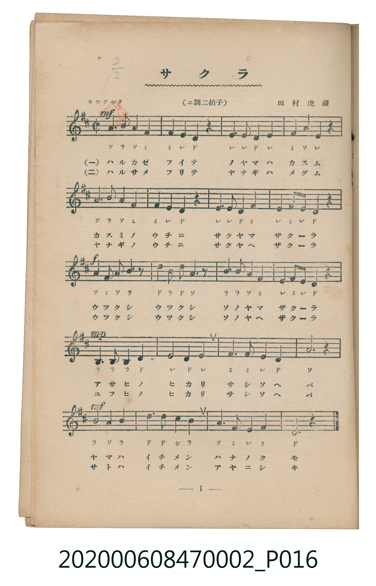
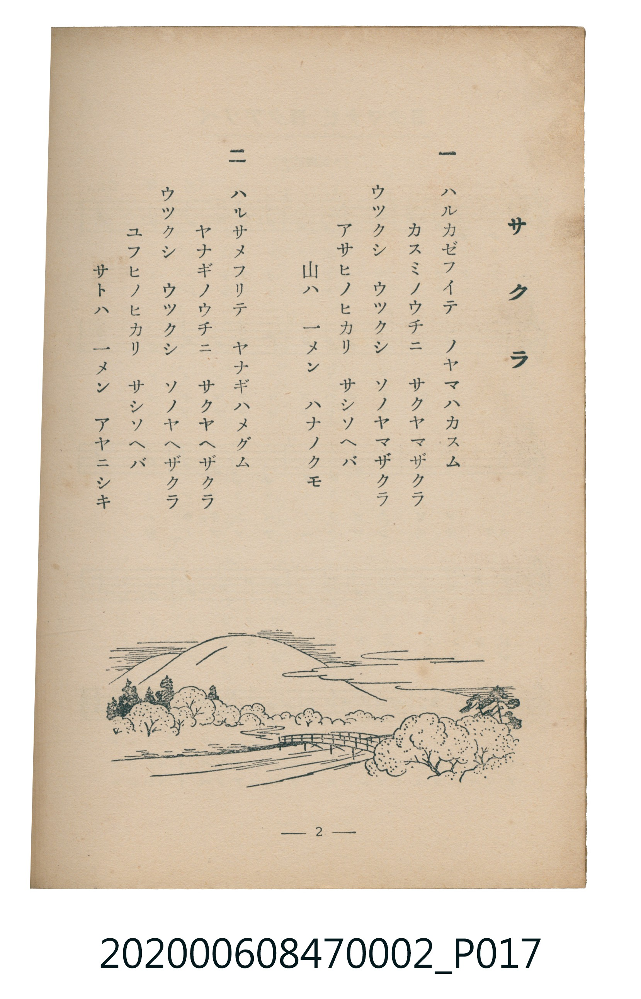

# サクラ（櫻花）

> Re:Shōka 使用 AI 協助辨識與重建樂譜，可能會有錯誤。歡迎回報。

- **NEUTRINO 歌聲合成版**：<br><audio controls src="sakura_neutrino.mp3"></audio>
- **鋼琴伴奏版**：<br><audio controls src="sakura.mp3"></audio>


- 曲：田村虎藏
- 臺灣教育會公認《新定兒童唱歌》尋常科第二學年用（2020.006.0847.0002）

## 說明

曲目說明
中文解釋：描寫櫻花盛開、花瓣飄落，以及春天到來的美景。

原書資訊與歌詞全文（對應 P016.jpg – P017.jpg，書頁 pp. 1–2，第一學期第 1 首）：
調性與拍號：ニ調二拍子（D 大調二二拍子／四四拍子），「ウツクシク」


## 歌詞

```text
一
ハルカゼフイテ　ノヤマハカスム
カスミノウチニ　サクヤマザクラ
ウツクシ　ウツクシ　ソノヤマザクラ
アサヒノヒカリ　サシソヘバ
山ハ　一メン　ハナノクモ

二
ハルサメフリテ　ヤナギハメグム
ヤナギノウチニ　サクヤヘザクラ
ウツクシ　ウツクシ　ソノヤヘザクラ
ユフヒノヒカリ　サシソヘバ
サトハ　一メン　アヤニシキ
```

## ABC

```abc
X:1
T:サクラ（櫻花）
C:曲：田村虎藏
M:4/4
L:1/16
Q:1/4=88
K:D
V:V1 name="Piano" snm="Pia"
[V:V1]
!mf! A6 B2 A4 F4 | F4 E4 D4 z4 | E6 E2 D4 E4 | F4 A4 E4 z4 |
w: 1.~ハ ル カ ゼ | フ イ テ | ノ ヤ マ ハ | カ ス ム
w: 2.~ハ ル サ メ | フ リ テ | ヤ ナ ギ ハ | メ グ ム
A6 B2 A4 F4 | F4 E4 D4 z4 | E6 E2 D4 F4 | E4 F2 E2 D4 z4 |
w: 1.~カ ス ミ ノ | ウ チ ニ | サ ク ヤ マ | ザ ク _ ラ
w: 2.~ヤ ナ ギ ノ | ウ チ ニ | サ ク ヤ ヘ | ザ ク _ ラ
!f! A6 F2 A2 B4 z2 | d6 B2 d2 A4 z2 | B6 B2 A4 F4 | E4 F2 E2 D4 z4 |
w: 1.~ウ ツ ク シ | ウ ツ ク シ | ソ ノ ヤ マ | ザ ク _ ラ
w: 2.~ウ ツ ク シ | ウ ツ ク シ | ソ ノ ヤ ヘ | ザ ク _ ラ
!mp! B,6 B,2 B,4 D4 | E4 D4 E8 | F6 F2 E4 D4 | A,12 z4 |
w: 1.~ア サ ヒ ノ | ヒ カ リ | サ シ ソ ヘ | バ
w: 2.~ユ フ ヒ ノ | ヒ カ リ | サ シ ソ ヘ | バ
!mf! B4 A4 B8 | d6 d2 c4 B4 | A6 F2 E4 F4 | D12 z4 |
w: 1.~ヤ マ ハ | イ チ メ ン | ハ ナ ノ ク | モ
w: 2.~サ ト ハ | イ チ メ ン | ア ヤ ニ シ | キ
```

## TMD 檔案連結

- [主旋律 TMD 檔案](sakura.tmd) [[在 TMD Studio 編輯](https://tmdlang.github.io/Tmd-TS/#tmd=s7IKdvYPcrWy4qpTUCpJTLdSSM7PyUlNLsnMz7MqzsjMK0nNjM_KTMmPL87Iz05Ugisry88pzU21Si9KTEmNN4o3MjAyiDcwMIs3sDAxBzIMjBBKi_NLi5JTrYqTM_Lzc-JLUitKkvLzsxHyBUX5Zal5iXlANQVFIBtTwIoQClLLMlNSQdKpKZkl-UWZiTlI7kgtKga7FWxJfElRYl5xclFmAcgDCFUlGalAxxbkJOYhGQs0KT0zzyo3NTMrE8lZWloKj5u2Pm5a_7h55fs9Hc9W737RtfH9nk4FLS0uRVsFCwsue1sFFy4bE30TO5BZz2Zver9n1vMpG57NnfhiZt-L6f1gK16073reuPjZ1JkvmjY9m9P8tHXNi1W9jxu6nk3b8HTdrKetk56vXvp0ysZna3seN3Q_3dD9dMeO58snPl-z5smunqdrdzzdueX5lBVA-0EhqwcMWT1QyAIZBkZAtyhx6WspAC1-Pnvdi1Wrns3o41JQUHiyY-2zae0vli9-2d4NdNGz_v6n61dDnP989uyX07ofNzSC2JMXv1zc8mLC3vd7ep7sXvq0v-vZjKVPl6x82rHhyb6257Nanu_rezZz_eOGJi4tfS6QRbbUAiBXPu2b_2z2jheb21-s6HrR0Q70_4uV8562rgA6Hejbpxt6n7V3KgQYGJrpZRWkKzxqmAzimIM4QPcCdb5c0KhQUKCnYAiUAgZFDyjEdjQAQ-zZnPlAtoKhwstl04BBBAwBkHUvVu1_1rAcZFF374uZ84Gij5u7gYLAUAaKPF07AWipi8LTJcshYkjC_U9nzwYiGBdoIDCmeh43LXvc3AJKHU3bQWRDLxck7BtA1OPm_sfNqx83AdGex81THzctedzc9rih4XFz3-NmIHseSAFIdufj5gVgDVDOfJAKkNGNQOeBNEBTIFhP0zZIaoRoQLIfpA6NuxdhFaq2RSAjmyeBpSeBrG1eBbMH6BGgthmPmyeAI2jjRpArGxqAfnrcvPBx82awB4Ae6wI7EmjkIoifd_Ug-xloOlDxVJC5UD8DXdH1uGkdWMHCx00bYH5GSODy8wzy_IymrRmoDugeIvwMdn0HFm8Dgw1kcDdYw1qQUspzARQogHJXcGJ2aVGiVUBmYl6-Q41BTTXICgUbCy07MANb5lOApPgXC3sUNEwUnm7of76-QQeeYzSxaABaBDXs5ay-pxN6rYD-3QsSAQbRSigbmASBZA2Ufty8Bkx2glVBxEEiEBmIOEQErgNqCkSVApKdGkDHagKtbO6HGrAalOrBWvZADZgK5i0By7YhWdkH1bEEiOdBkhpEBqp_J1hsARYrd_VgWLkVzFqIbGXzKgwrQY4AiXUBdaxDthKsE5iIsVlZo1Cdm1arYKqgC4RmYNoYiGvApBEQGwKxAVgExAOJgURAbIgakA4QD6wGbKSPIcjOfrBqWJABWcAgA-kBuR_EWwKWbQOS8VDxPqgOSJCBWCAzIEEG0rETLLYApgNilxG6XVvBrIXIdgHDCt0ukO0gMUhYIdkF1gkKK1S78CfpXT2DIEnDdEDUzkeSQ09hkEQNToiQpAizBpRoQeG9DMxrBJPdCEvB6RCkYz00tUGSNkhmG1x8D9gbmJZCkzVmIiXd0hnEWFpDcpqGqAGJGENF0NI0OB1CUiIoxEApBJRmIY4H8RrBZDcinYFTI0gHxPEgWVDKhjgeIg4SW4klTWOmUNLtmoHXLgLFdCeV0jQwJQLZsPgBeQ2SJsGpHciGqQTJQNRgywdEp2pQMgIpbYGERNN2eELCLQNzah_Z6ZpK1hKZsqvhJbYxkDYDp9QaBcM4aIIHMkCyIDGQHGoewJe-QSkLlEYQTgWlFfwye6EyEE-QkMKpZBsFaRzYRKYsjSOnVzAbkjIR6RXR2IDGOTg9I1Iykg5oakAGWFL3Ioh2YF4HNguhiQdiMJgHaVyA2wZQC-HF53Z4loImsuYJeC2Eltew1DuVlhaCGiEFtQpmoDgDptZ4CAuUQiHpFdbiAEFIKQ5JwzA1phCNEIieqBdBkgw0yJAKUggP0rgANxEgxiMKUogPkBIZ0AcIe9ALbFiihYQUte0h0ACZQoWEDIsuWHGDXFSDimlQwQWRRS68EAkZVlTDCmeMaEZuUSOKWVhTF2IsrH3QCMTgZmvzZqixsAYxsEIEp0FQZofIQDIFLguhBTSkDd1BvIWwvAZuj4IaJJAQAMmsxWUhtDUNKnVBJS6k9AVFKbRsBlLmUHFY-wSSjiFlMyg140jGSGUrrL0LSUSwdgLE_SDWZmgigrWKIQEGKx0hAYYzGUPbzx3E2wPLYNBwgiRoiMxaDHtqubh07RQgXUcFIEuZCwA)]
- [鋼琴伴奏 TMD 檔案](sakura_piano.tmd) [[在 TMD Studio 編輯](https://tmdlang.github.io/Tmd-TS/#tmd=s7IKdvYPcrWy4tLSUnjctPVx0_rHzSvf7-l42b3n-YQtT_Zsebq0_3lnx_s9nQpaWlyKtgoWFlz2tgouXDYm-iZ2XHUKSs9mb3q_Z9bzKRuezZ34Ymbfi-n9SiDhF-27njcufjZ15oumTc_mND9tXfNiVe_jhq5n0zY8XTfraeuk56uXPp2y8dnanscN3U83dD_dseP58onP16x5sqvn6dodT3dueT5lBdAhRgZGBnoGBmZ6BhYm5kCGgRHQLUpcXMGJ2aVFiVYBmYl5-UEeDjUGNdVcCkBgY6FlB2boaynYogMFkPk7Gl4s7FHQMFF4uqH_-foGHYUAA0MzvayCdE0sGrT0wYbVKFTnptUqmCroAqEZmDYG4howaQTEhkBsABYB8UBiIBEQG6IGpAPEA6sBG-ljWKPwuLkfrPpx82pg6K8GsZr2gPU8bp4K5i0By7YByXioeB9UxxIgngdmgcwAykD17wSLLYDpgNhlhG7XVjBrIbJdzasw7ALZDhLrAupYh2wXWOfjpg1oduEP-F095AQ8qWEOUQMSMYaKoIU5OJwgIfW4eT7YB6AwBcksA_MawWQ3IhzAoQXSsR4aJpCQB8lsg4qDxFZiCXPMECTdrhl47SKQ2DvJSuzwtG4MpM3AYVijYBgHjQogAyQLEgPJocYOvpAH-Rnk-haI_5q2g32BX2YvVKaP1LCnkm0UhP7T2bPJK2oKahXMQOYDQzYewgKFJiRsYeUKCELyAiS8YWpMIRohED0CFkG8B0xkj5snQT0KydBgHqQIARcEEOMRyXE7NHDgAdI8Acke9GQPC-CpNLGHQDEzhezyHZSaQSkZkqpB1kPTPJAyh4rDSiRImEPSPCjkcQQ5UpqFlcAQD8NKhkZYadq8GephWDkNLDPAwQZJdSAZSPRhDXJoid5BvD2wxACuSUAlECQfgGTWYthTi1rj-iDXuCaIGvdpy6rn-_qedU161tz6dPuyZ53dkCYEIpwN4xWiDWNhFDIfVJyYxgO5pvGxCAZcBUgEqIQ0Y-DyyCIYppgAKROQKigDrgudj90UqCq4KXg8gWkSqrfQjULnI4UFhsEgU4DRpGunAImpaB-gOBLPCMxT5gIA)]

## 分析

```text
================================================================================
📊 TMD Song Profile: [ サクラ（櫻花） ]
================================================================================
⏱  Duration:       0:54 (54.5s), 20 measures total
🎼 Key & Tempo:    首調基準 D, != 88.0 BPM, <4/4>
   - 分析範圍：      由實際發聲的音符與和弦推測調性；播放脈絡另行呈現
🎤 人聲音域:    A3 (MIDI 57) – D5 (MIDI 74) [跨度: 17 個半音 / 1.4 個八度, 難度: challenging]
   - 最低音:  A3 in [Sakura #1 @ m.16, 0:40]
   - 最高音: D5 in [Sakura #1 @ m.10, 0:24]
   - 適合: soprano, mezzo-soprano, contralto, tenor, baritone, bass
🏛  結構:      Sakura (54.5s)
⚡ 編曲密度:        Peak 1 軌道同時演奏
🗝  調性診斷：       D 調性不明確（純淨自然大調，未偵測到可信轉調）
   - 風格氣質:    純淨自然大調（陽光明朗、易唱易記，無明顯調外色彩）
   - 轉調歷程:    全曲維持單一推測調性（未偵測到可信轉調）
   - 核心骨幹音:  D, E, A, F#, B
   - 調性數值:    D 調性不明確 [相關度: 0.79, 穩定度: Ambiguous, 自然音純度: 100.0%]
   - 候選調性 (K-S): D 大調 (0.79), A 大調 (0.79), B 小調 (0.62)
   - 五度圈歷程:   +2
   - 各段落調性細節:
     • [Sakura #1]: D 調性不明確 (r: 0.79, 自然音純度: 100.0%)

  [ 五度圈游移軌跡 ]
               C  
         F            G  
      Bb              [D ]*
      Eb               A  
         Ab           E  
            Db       B  
               F# 
     (* = active key center)

  [ 十二半音累積音高分佈 ]
     C  :                            0.0%
     C# : ██                         1.4%
     D  : ████████████████████████  22.2%
     D# :                            0.0%
     E  : ████████████████████████  22.2%
     F  :                            0.0%
     F# : ██████████████████        16.7%
     G  :                            0.0%
     G# :                            0.0%
     A  : ███████████████████████   21.5%
     A# :                            0.0%
     B  : █████████████████         16.0%
--------------------------------------------------------------------------------
Assignment 軌道音域：
  - Piano         : A3 – D5 (17 個半音 / 1.4 個八度, 69 個音符)
================================================================================
```


## 原書掃描頁






