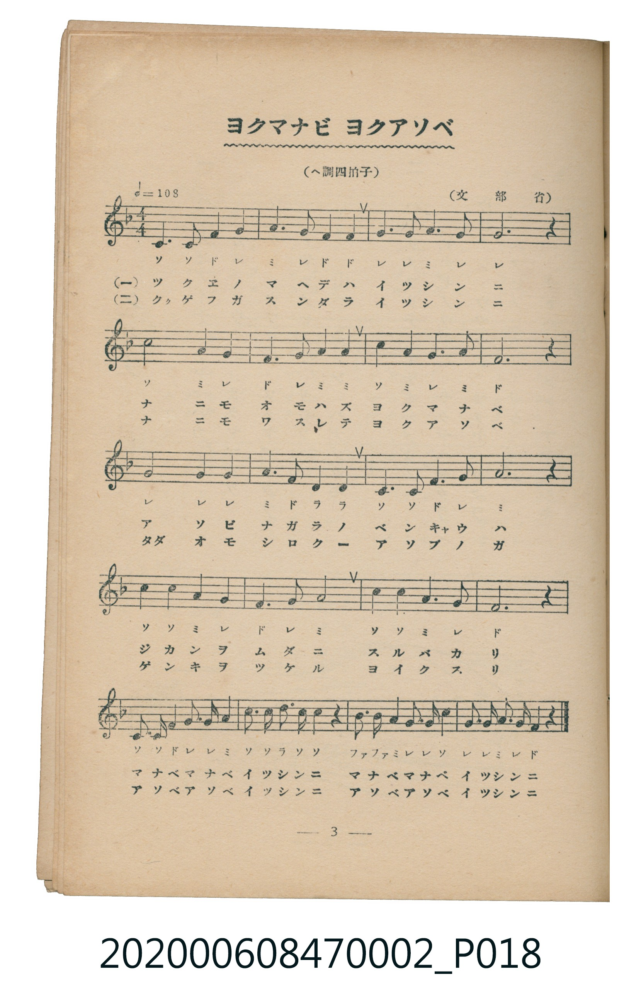
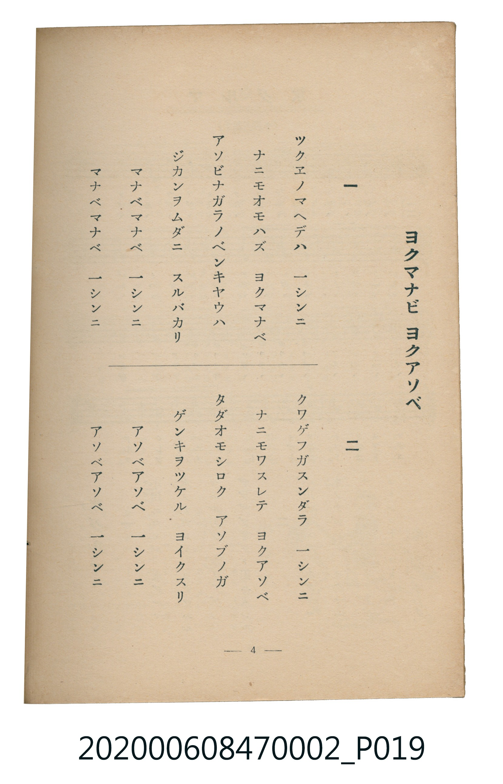

# ヨクマナビ ヨクアソベ（好好學習，好好遊玩）

> Re:Shōka 使用 AI 協助辨識與重建樂譜，可能會有錯誤。歡迎[回報](https://github.com/TMDLang/reshoka/issues)。

- **鋼琴伴奏版**：<br><audio controls src="yoku_manabi_yoku_asobe.mp3"></audio>
- **NEUTRINO 歌聲合成版**：<br><audio controls src="yoku_manabi_yoku_asobe_neutrino.mp3"></audio>

- 文部省
- 臺灣教育會公認《新定兒童唱歌》尋常科第二學年用（2020.006.0847.0002）

## 說明

曲目說明
中文解釋：勉勵孩子認真學習，也要健康快樂地遊戲。

原書資訊與歌詞全文（對應 P018.jpg – P019.jpg，書頁 pp. 3–4，第一學期第 2 首）：
調性與拍號：ヘ調四拍子（F 大調 4/4 拍），♩＝108


## 歌詞

```text
一
ツクエノマヘデハ　一シンニ
ナニモオモハズ　ヨクマナベ
アソビナガラノベンキヤウハ
ジカンヲムダニ　スルバカリ
マナベマナベ　一シンニ
マナベマナベ　一シンニ

二
クワゲフガスンダラ　一シンニ
ナニモワスレテ　ヨクアソベ
タダオモシロク　アソブノガ
ゲンキヲツケル　ヨイクスリ
アソベアソベ　一シンニ
アソベアソベ　一シンニ
```

## ABC

<div class="abc-score" data-abc-src="yoku_manabi_yoku_asobe.abc" aria-label="五線譜載入中"></div>

[下載 ABC 原始檔](yoku_manabi_yoku_asobe.abc)

## TMD 檔案連結

- [主旋律 TMD 檔案](yoku_manabi_yoku_asobe.tmd) [[在 TMD Studio 編輯](https://tmdlang.github.io/Tmd-TS/#tmd=s7IKdvYPcrWy4qpTUCpJTLdSSM7PyUlNLsnMz7MqzsjMK0nNjM_KTMmPL87Iz05Ugisry88pzU21Si9KTEmNN4o3MjAyiDcwMIs3sDAxBzIMjBBKi_NLi5JTrYqTM_Lzc-JLUitKkvLzsxHyBUX5Zal5iXlANQVFIBtTwIoQClLLMlNSQdKpKZkl-UWZiTlI7kgtKga7FWxJfElRYl5xclFmAcgDCFUlGalAx0JdkJOZloqQApqXnplnlZufl1QK9COyRElGPtB_BRmVVhmZxSCLkxNz4rMT85CCAWptQWJ6qlWAgaGFLpCwVOLS0lJ43LzicdP6x83zHjd3PW6eDOM3LXrctPdx88z3ezqeLt0LQmt3PN8_6f2eHgj3ZWPX876V7_d0KmhpcSnaKhgaWHDZ2yq4cdmY6JvYgex9Nq39ZfOK53Mawa540b7reePiZ1Nnvmja9GxO89PWNS9W9T5u6Ho2bcPTdbOetk56vnrp0ykbn63tedzQ_XRD99MdO54vn_h8zZonu3qAVj_dueX5lBVAx4AiUA8YgXqgCAQyDIyAblDi0tdSeDZ70_PZ616sWvVsRh-XgoLCkx1rgU54sXzxy_bu93tmPe3ufNq99enalU_XTgBa_XzOfLiPnuyc_2JZ49PGpU93bX-6f_WzFU1P52wAevBZx6bHDU1cWvpcIPNtqQVAjnvaN__Z7B0vNre_WNH1oqMd6O0XK-c9bV0BdDEoxDf0PmvvVABFlF5WQbrCo4bJII4liAN0L1DnywWNCgUFegrGQCkToBAooHY0AH30bM58IFvBSOHlsmnAkAF6HGTdi1X7nzUsB1nU3fti5nyg6OPmGUDBp7NnA0WAIQK01E3h6ZLlQDEFYAQqAEXBunsezQRG8lxQ7ELCtAFEPW5uAaeRFY-b-8ApZ8bj5vbHzf2PGxqAKh43bX_cvPlxczdEKTBVdT9uBianVSASqKhpF1AdarKbCVYKTXOTQUJNax43rwQbPxNkWNPax81LHjctA-qHKN3xuGk12JZNj5sXPG4GmtcNMrVp5-NmoPgEsOwqiAOgViAY2FxJSBHY97t6IJYD3Q30PdDmqSB3guwEqgE6YSXeAADpASoFeqwNEQCwfAYxeD_IGEhAgcxYC1IB8hVE0TRQeDStgSgF2g4JFiADGBsbQf6GmgoMKIhVkACAWYFgYHElMYooT_pQoADKUpH52aW-wEIqKRPEcizOTwIWTZmJefkONQY11SD7FGwstOzADGzZTwGS5l8s7FHQMFF4uqH_-foGHXie0cSiAWgr1LCXs_qeTui1Anp7L0gETD9u7gRH1xogWQOk50NkgHyYDIgEyYBUwGQQqhAyyABhpwbQsZpAK5tboFauB-IVYM19UIPnQQ2bAcTtYFY_RKZpCVSmBcjeDmVvBuvpxmvlrh6QlaAEuw5s5yagjqlgFtSbTTvhpgHTHpi1knw7axRM4xV0gRBIGQIpIyCuUTAGCxmBRUC4BiwOEoHJwEQg0ACkBmyejyHIuhawKCzAgCxggIFMAQUYWAYaYCBWP0QG6HiIDMTxEDbM8QibQI6F2mQE0gUOJ4hlkJACsdZAjdwJNwYUUiDWSjIsw5-ed_VQJT2DogqUMhGpGZR2kdMshAQ5HqQDWTWEh9CDJZqRU3MX3EJQqgCWXFBjV0FFF0FTMbDYhzoFnOaBkQkudqGqusAyM_FaCEnLuCxsBhkIMngn1B_AYhbTwiaQakh-x2shMCFDYw2URCHJGJR0YYkWhCFqYPIgFkwN9mTcBRWHpAqQwyGpZxVUFBJSoBS3C5q8wYkd6HCQLCypw0IKZyLGZQ8wgCApGxJAIJk2THuAAQRRBQsg0tLvjk7K0i-8BIXFIXpp3AnOdsjFFKESHEvsIqVfaIKAGADSPBmqGZLMQLkfZiGslIYkGnA5AKp_FwOpZVApUELHbSO0MAZV8lDDQZkEkWVghexaePbYA5VBpFpgKwDZMeBiHKuNiCIVRCMXxIYKZqCoBBP4CmysqRiaPiApBJSGJkPTECTVwcILuZCGpCGk8AIpWwaVBCV4XKUxOKBgtoFyCSLPwEpZSFBB1CBcBwsoJFeAS3ESUjKwZUzFlgX-shgSXZg6EO0KYkriph1Q7avBYQ3SvAlq4QKoYQ3gMgFhIazuB-mYANcN0gEpvXFZCE3IIOPhGQHFQlgTZyPYcLiF4JIYJL4EmsIh5TVeC2ElsSmOkhgS84hUjGhS4CmLgWEFSSeQsAKlk03QBLkAmrIgYYVIWbDaHxJWMN0Qp-NOwiBT4WkfxR5YowYSRHB7wGUxSBwSRLASG7s9kEayoRmhVvKuKVRIy-glLCL9wlsRYBXgwhLEgrdFQI4H9pQWIihEfgCbAlYJUoVqLqLtjZQekNseoNYDqOSBlMnofFgbFtGChbTdkHIAXAeIJMcMLLkCVFZDQgJsIBqfCEfBdcAdRaIZOBrjsLoALedAlCiYQWlYuweUYyAqTMC0CVwPzAyo6dja8zDr4IYgNYMQDRlE8wK7KO6mNSJrItxAM5ORsjNy9QK3AasoiW6nlclctVxcunYKWPraCkBhZS4A)]
- [鋼琴伴奏 TMD 檔案](yoku_manabi_yoku_asobe_piano.tmd) [[在 TMD Studio 編輯](https://tmdlang.github.io/Tmd-TS/#tmd=s7IKdvYPcrWy4qpTUCpJTLdSyC8qychPL0osyKi0ysgsLskvykxOzInPTsxLVIIrKs4vLUpOjS9ITE-1CjAwtNAFEpZKXFpaCo-bVzxuWv-4ed7j5q7HzZNh_KZFj5v2Pm6e-X5Px8vuPc8nbHmyZ8vTpf3POzve7-lU0NLiUrRVMDSw4LK3VXDjsjHRN7ED2fVsWvvL5hXP5zSCbX7Rvut54-JnU2e-aNr0bE7z09Y1L1b1Pm7oejZtw9N1s562Tnq-eunTKRufre153ND9dEP30x07ni-f-HzNmie7ep6u3fF055bnU1YAHWBkYGSgZ2BgpmdgYWIOZBgYAd2gxMUVmZ9d6gv0ZlImiOVYnJ8E9FxmYl5-kIdDjUFNNZcCENhYaNmBGfpaCrboQAFk2Y6GFwt7FDRMFJ5u6H--vkFHARRAelkF6ZpYNGjpgw2rUTCNV9AFQiBlCKSMgLhGwRgsZAQWAeEasDhIBCYDE4FAA5AasHk-hjXAkG8BiwKDH4hXgFjNfWBTgLEDkWmeAcTtYFY_RKZpCVSmBcjeDmVvBuvpRrIJ5FioTUYgXcAIXwe1bBNQ6VQwaw3UyJ1wYx43N4BZK8mwDH-g7-ohK9ChNoCCExLkoGCGBTAIQ9TA5EEsmBrsQd4FFYf44HHzIqhPV0FFF0GD-nHTLmhUgCMGGEUgWVi0dIFlZuIOcFz2NIPMAZm3E8gGhf_j5jZMe5pAqkH0Xhz2EEjgneSENSyhgmjk5G2oYAayFEzgywZYwxvqE4hfQL6dDPUtJHxAaRCS2hBJH-JbcGpsWvu4eTFY2TKoJChqcKXx_ZDUCzEXFJ-I2IWl3bXQEAZBhOtAbnvcPA3ZFeC8QUKYP509m_z0bYojfUNciQhxRKGCJ4U37YD6aTU4DEF-2gQNvAXQUGhAyr_I-R-kYwJcN0gHJFdgD26QqfB4QrEHVqxtBJsJtwecwkHiS-CxALIbuz2QstzQjFBhvmsK5YU5LNWjhTtEiYIZlIaVRaDwhqgwAdMmcD0wM6CmY6sPYNbBDUEqmhCFCyLLYxfFXTQjIhbhBpqZjJQYkDMS3AasoiS6nVYmc9XiaU_4ILcnTBBJ8Nmcuc82LH4xec3T7uan25c96-yGtJIQCcswXiHaMBZGYfJN44Es0_hYBANNzAAarISNgjKQDEKoQJiCzUKoOhMgZYLLUdjMIsdzeMzBpQrmMGxBBDUHGHm6dgpY4i_aB2gMLikjsJQyFwA)]

## 分析

```text
================================================================================
📊 TMD Song Profile: [ ヨクマナビ ヨクアソベ（好好學習，好好遊玩） ]
================================================================================
⏱  Duration:       0:44 (44.4s), 20 measures total
🎼 Key & Tempo:    首調基準 F, != 108.0 BPM, <4/4>
   - 分析範圍：      由實際發聲的音符與和弦推測調性；播放脈絡另行呈現
🎤 人聲音域:    C4 (MIDI 60) – D5 (MIDI 74) [跨度: 14 個半音 / 1.2 個八度, 難度: moderate]
   - 最低音:  C4 in [YokuManabiYokuAsobe #1 @ m.1, 0:00]
   - 最高音: D5 in [YokuManabiYokuAsobe #1 @ m.18, 0:38]
   - 適合: soprano, mezzo-soprano, contralto, tenor, baritone, bass
🏛  結構:      YokuManabiYokuAsobe (44.4s)
⚡ 編曲密度:        Peak 1 軌道同時演奏
🗝  調性診斷：       C 調性不明確（純淨自然大調，未偵測到可信轉調）
   - 風格氣質:    純淨自然大調（陽光明朗、易唱易記，無明顯調外色彩）
   - 轉調歷程:    全曲維持單一推測調性（未偵測到可信轉調）
   - 核心骨幹音:  G, A, F, C, D
   - 調性數值:    C 調性不明確 [相關度: 0.72, 穩定度: Ambiguous, 自然音純度: 98.6%]
   - 候選調性 (K-S): C 大調 (0.72), F 大調 (0.72), A 小調 (0.63)
   - 五度圈歷程:   +0
   - 各段落調性細節:
     • [YokuManabiYokuAsobe #1]: C 調性不明確 (r: 0.72, 自然音純度: 98.6%, 調外音: A#)

  [ 五度圈游移軌跡 ]
              [C ]*
         F            G  
      Bb               D  
      Eb               A  
         Ab           E  
            Db       B  
               F# 
     (* = active key center)

  [ 十二半音累積音高分佈 ]
     C  : ██████████████████        20.6%
     C# :                            0.0%
     D  : ███                        3.7%
     D# :                            0.0%
     E  :                            0.0%
     F  : ██████████████████        20.9%
     F# :                            0.0%
     G  : ████████████████████████  27.4%
     G# :                            0.0%
     A  : ███████████████████████   26.0%
     A# : █                          1.4%
     B  :                            0.0%
--------------------------------------------------------------------------------
Assignment 軌道音域：
  - Piano         : C4 – D5 (14 個半音 / 1.2 個八度, 71 個音符)
================================================================================
```


## 原書掃描頁






