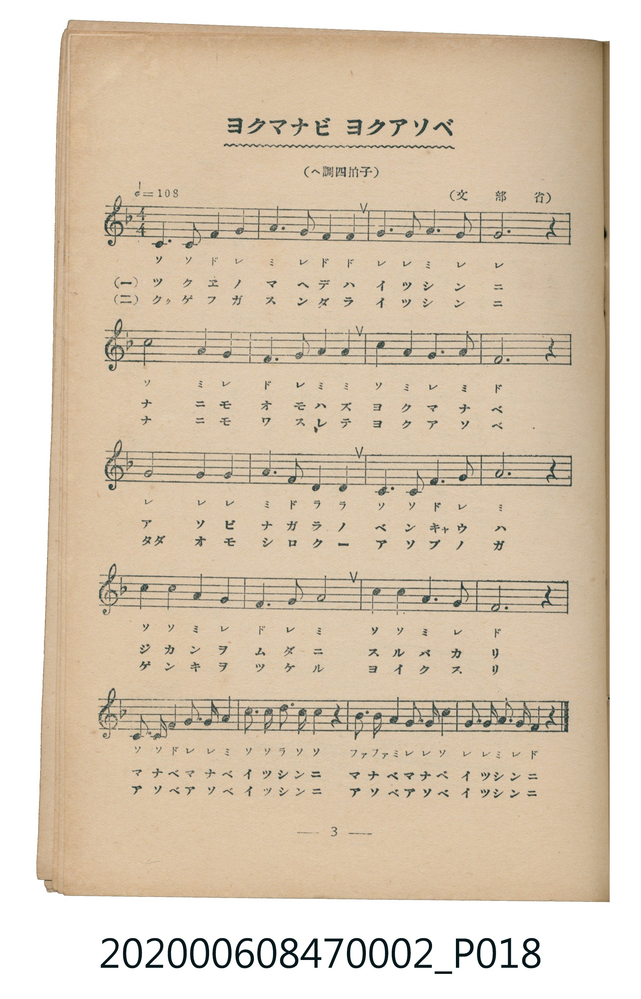
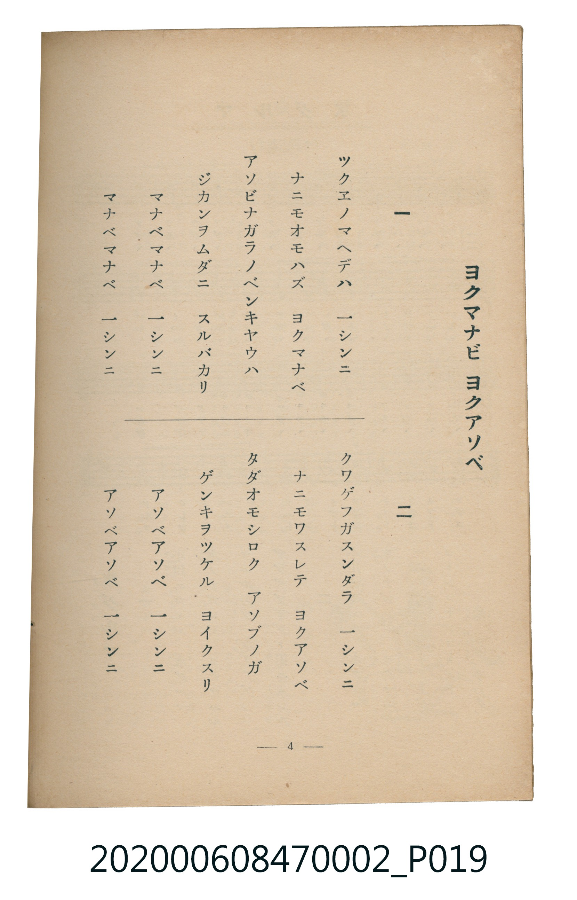

# ヨクマナビ ヨクアソベ（好好學習，好好遊玩）

> Re:Shōka 使用 AI 協助辨識與重建樂譜，可能會有錯誤。歡迎回報。

- **NEUTRINO 歌聲合成版**：<br><audio controls src="yoku_manabi_yoku_asobe_neutrino.mp3"></audio>
- **鋼琴伴奏版**：<br><audio controls src="yoku_manabi_yoku_asobe.mp3"></audio>


- 文部省
- 臺灣教育會公認《新定兒童唱歌》尋常科第二學年用（2020.006.0847.0002）

## 說明

曲目說明
中文解釋：勉勵孩子認真學習，也要健康快樂地遊戲。

原書資訊與歌詞全文（對應 P018.jpg – P019.jpg，書頁 pp. 3–4，第一學期第 2 首）：
調性與拍號：ヘ調四拍子（F 大調 4/4 拍），♩＝108


## 歌詞

```text
一
ツクエノマヘデハ　一シンニ
ナニモオモハズ　ヨクマナベ
アソビナガラノベンキヤウハ
ジカンヲムダニ　スルバカリ
マナベマナベ　一シンニ
マナベマナベ　一シンニ

二
クワゲフガスンダラ　一シンニ
ナニモワスレテ　ヨクアソベ
タダオモシロク　アソブノガ
ゲンキヲツケル　ヨイクスリ
アソベアソベ　一シンニ
アソベアソベ　一シンニ
```

## ABC

```abc
X:1
T:ヨクマナビ ヨクアソベ（好好學習，好好遊玩）
M:4/4
L:1/16
Q:1/4=108
K:F
V:V1 name="Piano" snm="Pia"
[V:V1]
C6 C2 F4 G4 | A6 G2 F4 F4 | G6 G2 A6 G2 | G12 z4 |
w: 1.~ツ ク エ ノ | マ ヘ デ ハ | イ ツ シ ン | ニ
w: 2.~クヮ ゲ フ ガ | ス ン ダ ラ | イ ツ シ ン | ニ
c8 A4 G4 | F6 G2 A4 A4 | c4 A4 G6 A2 | F12 z4 |
w: 1.~ナ ニ モ | オ モ ハ ズ | ヨ ク マ ナ | ベ
w: 2.~ナ ニ モ | ワ ス レ テ | ヨ ク ア ソ | ベ
G8 G4 G4 | A6 F2 D4 D4 | C6 C2 F4 G4 | A12 z4 |
w: 1.~ア ソ ビ | ナ ガ ラ ノ | ベ ン キャ ウ | ハ
w: 2.~タダ オ モ | シ ロ ク _ | ア ソ ブ ノ | ガ
c6 c2 A4 G4 | F6 G2 A8 | C6 C2 A6 G2 | F12 z4 |
w: 1.~ジ カ ン ヲ | ム ダ ニ | ス ル バ カ | リ
w: 2.~ゲ ン キ ヲ | ツ ケ ル | ヨ イ ク ス | リ
C3 C F4 G3 G A4 | c3 c d3 c c4 z4 | B3 B A4 G3 G C4 | G3 G A3 G F4 z4 |
w: 1.~マ ナ ベ マ ナ ベ | イ ツ シ ン ニ | マ ナ ベ マ ナ ベ | イ ツ シ ン ニ
w: 2.~ア ソ ベ ア ソ ベ | イ ツ シ ン ニ | ア ソ ベ ア ソ ベ | イ ツ シ ン ニ
```

## TMD 檔案連結

- [主旋律 TMD 檔案](yoku_manabi_yoku_asobe.tmd) [[在 TMD Studio 編輯](https://tmdlang.github.io/Tmd-TS/#tmd=s7IKdvYPcrWy4qpTUCpJTLdSSM7PyUlNLsnMz7MqzsjMK0nNjM_KTMmPL87Iz05Ugisry88pzU21Si9KTEmNN4o3MjAyiDcwMIs3sDAxBzIMjBBKi_NLi5JTrYqTM_Lzc-JLUitKkvLzsxHyBUX5Zal5iXlANQVFIBtTwIoQClLLMlNSQdKpKZkl-UWZiTlI7kgtKga7FWxJfElRYl5xclFmAcgDCFUlGalAx0JdkJOZloqQApqXnplnlZufl1QK9KMSl5aWwuPmFY-b1j9unve4uetx82QYv2nR46a9j5tnvt_T8XTpXhBau-P5_knv9_RAuC8bu573rXy_p1NBS4tL0VbB0MCCy95WwY3LxkTfxA5k47Np7S-bVzyf0wi2_0X7rueNi59NnfmiadOzOc1PW9e8WNX7uKHr2bQNT9fNeto66fnqpU-nbHy2tudxQ_fTDd1Pd-x4vnzi8zVrnuzqAVr9dOeW51NWAB0DCnw9YODrgQIfyDAwArpBiUtfS-HZ7E3PZ697sWrVsxl9XAoKCk92rAU64cXyxS_bu9_vmfW0u_Np99ana1c-XTsBaPXzOfPhPnqyc_6LZY1PG5c-3bX96f7Vz1Y0PZ2zAejBZx2bHjc0cWnpc4HMt6UWADnuad_8Z7N3vNjc_mJF14uOdqC3X6yc97R1BdDFoBDf0PusvVMhwMDQQi-rIF3hUcNkEMcSxAG6F6jz5YJGhYICPQVjoJQJUAgUUDsagD56Nmc-kK1gpPBy2TRgyAA9DrLuxar9zxqWgyzq7n0xcz5Q9HHzDKDg09mzgSLAEAFa6qbwdMlyoJgCMAIVgKJg3T2PZgIjeS4odiFh2gCiHje3gNPIisfNfeCUM-Nxc_vj5v7HDQ1AFY-btj9u3vy4uRuiFJiquh83A5PTKhAJVNS0C6gONdnNBCuFprnJIKGmNY-bV4KNnwkyrGnt4-Ylj5uWAfVDlO543LQabMumx80LHjcDzesGmdq083EzUHwCWHYVxAFQKxAMbK4kpAjs-109EMuB7gb6HmjzVJA7QXYC1QCdsBJvAID0AJUCPdaGCABYPoMYvB9kDCSgQGasBakA-QqiaBooPJrWQJQCbYcEC5ABjI2NIH9DTQUGFMQqSADArEAwsLiSGEWUJ30oUABlqcj87FLfxLzEpEwQy7E4PynVKiAzMS_focagphpkn4KNhZYdmIEt-ylA0vyLhT0KGiYKTzf0P1_foAPPM5pYNABthRr2clbf0wm9VkBv7wWJgOnHzZ3g6FoDJGuA9HyIDJAPkwGRIBmQCpgMQhVCBhkg7NQAOlYTaGVzC9TK9UC8Aqy5D2rwPKhhM4C4Hczqh8g0LYHKtADZ26HszWA93Xit3NUDshKUYNeB7dwE1DEVzIJ6s2kn3DRg2gOzVpJvZ42CabyCLhACKUMgZQTENQrGYCEjsAgI14DFQSIwGZgIBBqA1IDN8zEEWdcCFoUFGJAFDDCQKaAAA8tAAwzE6ofIAB0PkYE4HsKGOR5hE8ixUJuMQLrA4QSxDBJSINYaqJE74caAQgrEWkmGZfjT864eqqRnUFSBUiYiNYPSLnKahZAgx4N0IKuG8BB6sEQzcmruglsIShXAkgtq7Cqo6CJoKgYW-1CngNM8MDLBxS5UVRdYZiZeCyFpGZeFzSADQQbvhPoDWMxiWtgEUg3J73gtBCZkaKyBkigkGYOSLizRgjBEDUwexIKpwZ6Mu6DikFQBcjgk9ayCikJCCpTidkGTNzixAx0OkoUldVhI4UzEuOwBBhAkZUMCCCTThmkPMIAgqmABRFr63dFJWfqFl6CwOEQvjTvB2Q65mCJUgmOJXaT0C00QEANAmidDNUOSGSj3wyyEldKQRAMuB0D172IgtQwqBUrouG2EFsagSh5qOCiTILIMrJBdC88ee6AyiFQLbAUgOwZcjGO1EVGkgmjkgthQwQwUlWACX4GNNRVD0wckhYDS0GRoGoKkOlh4IRfSkDSEFF4gZcugkqAEj6s0BgcUzDZQLkHkGVgpCwkqiBqE62ABheQKcClOQkoGtoyp2LLAXxZDogtTB6JdQUxJ3LQDqn01OKxBmjdBLVwANawBXCYgLITV_SAdE-C6QTogpTcuC6EJGWQ8PCOgWAhr4mwEGw63EFwSg8SXQFM4pLzGayGsJDbFURJDYh6RihFNCjxlMTCsIOkEElagdLIJmiAXQFMWJKwQKQtW-0PCCqYb4nTcSRhkKjzto9gDa9RAgghuD7gsBolDgghWYmO3B9JINjQj1EreNYUKaRm9hEWkX3grAqwCXFiCWPC2CMjxwJ7SQgSFyA9gU8AqQapQzUW0vZHSA3LbA9R6AJU8kDIZnQ9rwyJasJC2G1IOgOsAkeSYgSVXgMpqSEiADUTjE-EouA64o0g0A0djHFYXoOUciBIFMygNa_eAcgxEhQmYNoHrgZkBNR1bex5mHdwQpGYQoiGDaF5gF8XdtEZkTYQbaGYyUnZGrl7gNmAVJdHttDKZq5aLS9dOAUtfWwEorMwFAA)]
- [鋼琴伴奏 TMD 檔案](yoku_manabi_yoku_asobe_piano.tmd) [[在 TMD Studio 編輯](https://tmdlang.github.io/Tmd-TS/#tmd=s7IKdvYPcrWy4tLSUnjcvOJx0_rHzfMeN3c9bp4M4zctety093HzzPd7Ol5273k-YcuTPVueLu1_3tnxfk-ngpYWl6KtgqGBBZe9rYIbl42JvokdV52C0rNp7S-bVzyf06gE4r1o3_W8cfGzqTNfNG16Nqf5aeuaF6t6Hzd0PZu24em6WU9bJz1fvfTplI3P1vY8buh-uqH76Y4dz5dPfL5mzZNdPU_X7ni6c8vzKSuADjAyMDLQMzAw0zOwMDEHMgyMgG5Q4uKKzM8u9U3MS0zKBLEci_OTUq0CMhPz8oM8HGoMaqq5FIDAxkLLDszQ11KwRQcKIMt2NLxY2KOgYaLwdEP_8_UNOgoBBoYWelkF6ZpYNGjpgw2rUTCNV9AFQiBlCKSMgLhGwRgsZAQWAeEasDhIBCYDE4FAA5AasHk-hjXAkG8BiwKDH4hXgFjNfWBTgLEDkWmeAcTtYFY_RKZpCVSmBcjeDmVvBuvpRrIJ5FioTUYgXcAIXwe1bBNQ6VQwaw3UyJ1wYx43N4BZK8mwDH-g7-ohK9ChNoCCExLkoGCGBTAIQ9TA5EEsmBrsQd4FFYf44HHzIqhPV0FFF0GD-nHTLmhUgCMGGEUgWVi0dIFlZuIOcFz2NIPMAZm3E8gGhf_j5jZMe5pAqkH0Xhz2EEjgneSENSyhgmjk5G2oYAayFEzgywZYwxvqE4hfQL6dDPUtJHxAaRCS2hBJH-JbcGpsWvu4eTFY2TKoJChqcKXx_ZDUCzEXFJ-I2IWl3bXQEAZBhOtAbnvcPA3ZFeC8QUKYP509m_z0bYojfUNciQhxRKGCJ4U37YD6aTU4DEF-2gQNvAXQUGhAyr_I-R-kYwJcN0gHJFdgD26QqfB4QrEHVqxtBJsJtwecwkHiS-CxALIbuz2QstzQjFBhvmsK5YU5LNWjhTtEiYIZlIaVRaDwhqgwAdMmcD0wM6CmY6sPYNbBDUEqmhCFCyLLYxfFXTQjIhbhBpqZjJQYkDMS3AasoiS6nVYmc9XiaU_4ILcnTBBJ8Nmcuc82LH4xec3T7uan25c96-yGtJIQCcswXiHaMBZGYfJN44Es0_hYBANNzAAarISNgjKQDEKoQJiCzUKoOhMgZYLLUdjMIsdzeMzBpQrmMGxBBDUHGHm6dgpY4i_aB2gMLikjsJQyFwA)]

## 分析

```text
================================================================================
📊 TMD Song Profile: [ ヨクマナビ ヨクアソベ（好好學習，好好遊玩） ]
================================================================================
⏱  Duration:       0:44 (44.4s), 20 measures total
🎼 Key & Tempo:    首調基準 F, != 108.0 BPM, <4/4>
   - 分析範圍：      由實際發聲的音符與和弦推測調性；播放脈絡另行呈現
🎤 人聲音域:    C4 (MIDI 60) – D5 (MIDI 74) [跨度: 14 個半音 / 1.2 個八度, 難度: moderate]
   - 最低音:  C4 in [YokuManabiYokuAsobe #1 @ m.1, 0:00]
   - 最高音: D5 in [YokuManabiYokuAsobe #1 @ m.18, 0:38]
   - 適合: soprano, mezzo-soprano, contralto, tenor, baritone, bass
🏛  結構:      YokuManabiYokuAsobe (44.4s)
⚡ 編曲密度:        Peak 1 軌道同時演奏
🗝  調性診斷：       C 調性不明確（純淨自然大調，未偵測到可信轉調）
   - 風格氣質:    純淨自然大調（陽光明朗、易唱易記，無明顯調外色彩）
   - 轉調歷程:    全曲維持單一推測調性（未偵測到可信轉調）
   - 核心骨幹音:  G, A, F, C, D
   - 調性數值:    C 調性不明確 [相關度: 0.72, 穩定度: Ambiguous, 自然音純度: 98.6%]
   - 候選調性 (K-S): C 大調 (0.72), F 大調 (0.72), A 小調 (0.63)
   - 五度圈歷程:   +0
   - 各段落調性細節:
     • [YokuManabiYokuAsobe #1]: C 調性不明確 (r: 0.72, 自然音純度: 98.6%, 調外音: A#)

  [ 五度圈游移軌跡 ]
              [C ]*
         F            G  
      Bb               D  
      Eb               A  
         Ab           E  
            Db       B  
               F# 
     (* = active key center)

  [ 十二半音累積音高分佈 ]
     C  : ██████████████████        20.6%
     C# :                            0.0%
     D  : ███                        3.7%
     D# :                            0.0%
     E  :                            0.0%
     F  : ██████████████████        20.9%
     F# :                            0.0%
     G  : ████████████████████████  27.4%
     G# :                            0.0%
     A  : ███████████████████████   26.0%
     A# : █                          1.4%
     B  :                            0.0%
--------------------------------------------------------------------------------
Assignment 軌道音域：
  - Piano         : C4 – D5 (14 個半音 / 1.2 個八度, 71 個音符)
================================================================================
```


## 原書掃描頁






