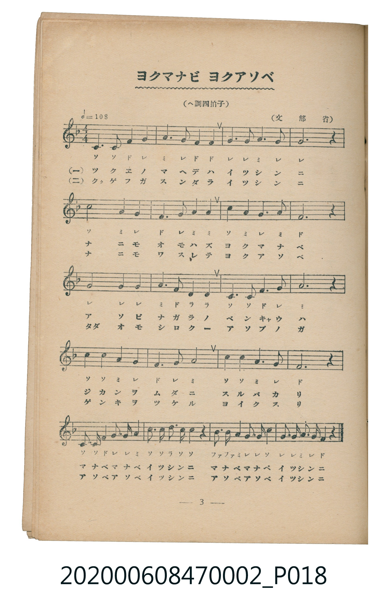
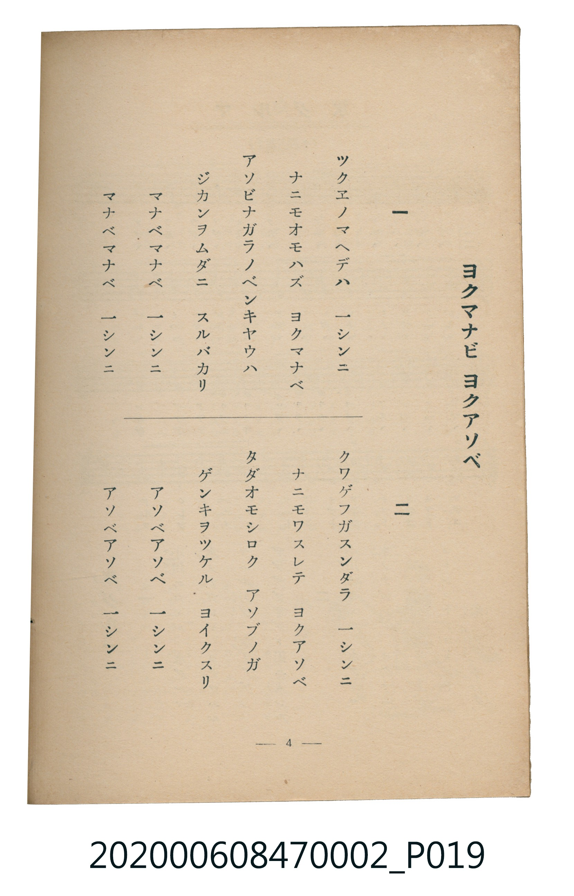

# ヨクマナビ ヨクアソベ

<audio controls src="yoku_manabi_yoku_asobe.mp3"></audio>

- 文部省
- 臺灣教育會公認《新定兒童唱歌》尋常科第二學年用（2020.006.0847.0002）

## 說明

原書資訊與歌詞全文（對應 P018.jpg – P019.jpg，書頁 pp. 3–4，第一學期第 2 首）：
調性與拍號：ヘ調四拍子（F 大調 4/4 拍），♩＝108

## 歌詞

```text
一
ツクエノマヘデハ　一シンニ
ナニモオモハズ　ヨクマナベ
アソビナガラノベンキヤウハ
ジカンヲムダニ　スルバカリ
マナベマナベ　一シンニ
マナベマナベ　一シンニ

二
クワゲフガスンダラ　一シンニ
ナニモワスレテ　ヨクアソベ
タダオモシロク　アソブノガ
ゲンキヲツケル　ヨイクスリ
アソベアソベ　一シンニ
アソベアソベ　一シンニ
```

## 原書掃描頁





## 分析

```text
================================================================================
📊 TMD Song Profile: [ ヨクマナビ ヨクアソベ ]
================================================================================
⏱  Duration:       0:44 (44.4s), 20 measures total
🎼 Key & Tempo:    首調基準 F, != 108.0 BPM, <4/4>
   - 分析範圍：      由實際發聲的音符與和弦推測調性；播放脈絡另行呈現
🎤 人聲音域:    C4 (MIDI 60) – D5 (MIDI 74) [跨度: 14 個半音 / 1.2 個八度, 難度: moderate]
   - 最低音:  C4 in [YokuManabiYokuAsobe #1 @ m.1, 0:00]
   - 最高音: D5 in [YokuManabiYokuAsobe #1 @ m.18, 0:38]
   - 適合: soprano, mezzo-soprano, contralto, tenor, baritone, bass
🏛  結構:      YokuManabiYokuAsobe (44.4s)
⚡ 編曲密度:        Peak 1 軌道同時演奏
🗝  調性診斷：       C 調性不明確（純淨自然大調，未偵測到可信轉調）
   - 風格氣質:    純淨自然大調（陽光明朗、易唱易記，無明顯調外色彩）
   - 轉調歷程:    全曲維持單一推測調性（未偵測到可信轉調）
   - 核心骨幹音:  G, A, F, C, D
   - 調性數值:    C 調性不明確 [相關度: 0.72, 穩定度: Ambiguous, 自然音純度: 98.6%]
   - 候選調性 (K-S): C 大調 (0.72), F 大調 (0.72), A 小調 (0.63)
   - 五度圈歷程:   +0
   - 各段落調性細節:
     • [YokuManabiYokuAsobe #1]: C 調性不明確 (r: 0.72, 自然音純度: 98.6%, 調外音: A#)

  [ 五度圈游移軌跡 ]
              [C ]*
         F            G  
      Bb               D  
      Eb               A  
         Ab           E  
            Db       B  
               F# 
     (* = active key center)

  [ 十二半音累積音高分佈 ]
     C  : ██████████████████        20.6%
     C# :                            0.0%
     D  : ███                        3.7%
     D# :                            0.0%
     E  :                            0.0%
     F  : ██████████████████        20.9%
     F# :                            0.0%
     G  : ████████████████████████  27.4%
     G# :                            0.0%
     A  : ███████████████████████   26.0%
     A# : █                          1.4%
     B  :                            0.0%
--------------------------------------------------------------------------------
Assignment 軌道音域：
  - Piano         : C4 – D5 (14 個半音 / 1.2 個八度, 71 個音符)
================================================================================
```

## ABC

```abc
X:1
T:ヨクマナビ ヨクアソベ
C:TMD (Chen, Chih-Han / aguai)
M:4/4
L:1/16
Q:1/4=108
K:F
V:V1 name="Piano" snm="Pia"
[V:V1]
c6 c2 f4 g4 | a6 g2 f4 f4 | g6 g2 a6 g2 | g12 z4 |
c8 a4 g4 | f6 g2 a4 a4 | c4 a4 g6 a2 | f12 z4 |
g8 g4 g4 | a6 f2 d4 d4 | c6 c2 f4 g4 | a12 z4 |
c6 c2 a4 g4 | f6 g2 a8 | c6 c2 a6 g2 | f12 z4 |
c3 c f4 g3 g a4 | c3 c d3 c c4 z4 | b3 b a4 g3 g c4 | g3 g a3 g f4 z4 |
```

- [主旋律 TMD 檔案](yoku_manabi_yoku_asobe.tmd)
- [鋼琴伴奏 TMD 檔案](yoku_manabi_yoku_asobe_piano.tmd)
