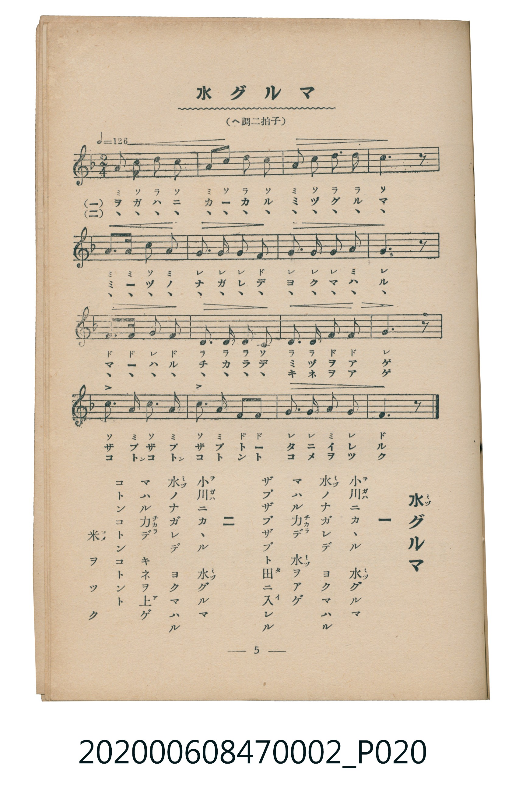

# 水グルマ

> Re:Shōka 使用 AI 協助辨識與重建樂譜，可能會有錯誤。歡迎[回報](https://github.com/TMDLang/reshoka/issues)。

- **鋼琴伴奏版**：<br><audio controls src="mizuguruma.mp3"></audio>
- **NEUTRINO 歌聲合成版**：<br><audio controls src="mizuguruma_neutrino.mp3"></audio>

- 臺灣教育會公認《新定兒童唱歌》尋常科第二學年用（2020.006.0847.0002）

## 說明

原書資訊與歌詞全文（對應 P020.jpg，書頁 p. 5，第一學期第 3 首）：
調性與拍號：ヘ調二拍子（F 大調 2/4 拍），♩＝126


## 歌詞

```text
一
小川（ヲガハ）ニカヽル　水（ミヅ）グルマ
水（ミヅ）ノナガレデ　ヨクマハル
マハル力（チカラ）デ　水（ミヅ）ヲアゲ
ザブザブザブト田（タ）ニ入（イ）レル

二
小川（ヲガハ）ニカヽル　水（ミヅ）グルマ
水（ミヅ）ノナガレデ　ヨクマハル
マハル力（チカラ）デ　キネヲ上（ア）ゲ
コトンコトンコトント　米（コメ）ヲツク
```

## ABC

<div class="abc-score" data-abc-src="mizuguruma.abc" aria-label="五線譜載入中"></div>

[下載 ABC 原始檔](mizuguruma.abc)

## TMD 檔案連結

- [主旋律 TMD 檔案](mizuguruma.tmd) [[在 TMD Studio 編輯](https://tmdlang.github.io/Tmd-TS/#tmd=s7IKdvYPcrWy4qpTUCpJTLdSSM7PyUlNLsnMz7MqzsjMK0nNjM_KTMmPL87Iz05Ugisry88pzU21Si9KTEmNN4o3MjAyiDcwMIs3sDAxBzIMjBBKi_NLi5JTrYqTM_Lzc-JLUitKkvLzsxHyBUX5Zal5iXlANQVFIBtTwIoQClLLMlNSQdKpKZkl-UWZiTlI7kgtKga7FWxJfElRYl5xclFmAcgDCFUlGalAx5YnlqQWIQSBJqVn5lmVJGaWJ-bF56elZSajGJ1fVJKRD_RgQUalVUZmMcjm5MSc-OzEPKRwgNpbkJieahUADAQlLi0thWcbtjxu2vC4efXj5nkKWlpcirYKhkZmXPa2Cm5cNkb6JnYg7S_adz1vXPxs6swXTZuezWl-2rrmxarexw1dz6ZteLpu1tPWSc9XL306ZeOztT2PG7qfbuh-umPH8-UTn69Z82RXz9O1O57u3PJ8yor3ezpAQa8HDHo9UNADGQZG7_d0KnFx6Wsp2FILcCkoKDztm_9s9o4Xm9tfrOh60dEOdNeLlfOetq54Nq0d6IqnG3qftXcqgIJAL6sg_f2eHqDilwsaFQr0FEyBPJC7dzQA3f1sznwgW8FY4eWyaUCHvt8zC2T4i1X7nzUsBxnb3fti5nyg6OPmGUBBoF-BIk_XTgBa4abwdMlyoJgCMAQVgKJg3T2PZq58v2cuKHhB5gDtALt1Q__T7XOBeh43b3rctOZxcz9Q8ePm7sdNwCjZC4qYhgZgJIEVzH_c3AqShUUYSD-6XHPf4-YusEFA1A7U_Lh5xeOm9UDVQKOB2kB64JynXbPBmhvBtgFdB9QP0oNhKNBpix43bQJrbtr2uHkaCtnc8XzKBpCGpv0Qxz9tXQrmLgFzgQ5ZDfHyrp5B6-XHTWsfN_cCXfRkRxfY7YvA1kK9vBnox8fNm7EwgGRDw_ONm8F6gNyF0PBqbgE6AaSZ8iQNBQpa-lxcvplVpemlRaW5iVYBmYl5-Q41BjXVIGsUbAzNtOzALGzZSQGSql8s7FHQMAHFwPP1DTrwPKCJRQPQNqhhL2f1PZ3QawUMw_ngwNgLDs-VcHYNaTJgEigDFkMGCBs1gE7VBFm4Cax5DVhbP5jshmpeDebtActD2CASbmFzK1hmA4rMPDwW7uqhn4U1wDJFV8EUiM2gNCEREFkD5sGgAUgN2DQfQ5BVm4B8kMOBJNDhILIbbArIsRAdEBbIcWBxoLNBvFawzAaICqAcxNkIe-IR9hjR3h786XdXDzXSL0qKBLFBToHEODLZiVMGWQ-u5ARNvxALwYkGkkCa-6Cau8COQDa2HSqzAiyzHiwGSkCQhAiSASUrXBZC0y9dLISkTV0gCUqRIHaNghGQhGFDuAiID6IRanClX1AqgaQNcEoBOhuSerqQ0huEbIfKrICmtvXQlARJjxBn406_tLWHQPnbSWH6BaVJGImaShElK3r5iyyD0E9k-oUkB0hyghSHsKKtEWwJpCCEGA5LTkjFIbQ4XQSRaQLxcFkITb9kWNi0FszrJd7CGnAKBaVTRGo1A0UgsJiNh7BMwfGJJApShZyusadiWIkGKxthZWAjNA2tBjseOXVB0iMovGBl6yKIDNDxuFMxyfYAAwmivpcIe_Cm4qezZ1OWipFKXrRSGFkGS1pFLn8hbJAMSAWuRAVJxU3bwBqmgS1EsEEWIsk0d4BJUNIDyewH80CVP7AZi2Ih4VK4aTPEQGD7EJUDMhjKBZMINkJmIZgEp-PmFqgMqGzGYiWsRQAph0E0QgSWwhHlMKgMBrFhqR9rCgaGCCSdTENho8kAnQzRDQkpiHg3OKRg5SeBchjoWYgueCAhcVHkwcEEYyPLLISlZGAwQVyyHsO-Wi4uXTsFRKNZAchT5gIA)]
- [鋼琴伴奏 TMD 檔案](mizuguruma_piano.tmd) [[在 TMD Studio 編輯](https://tmdlang.github.io/Tmd-TS/#tmd=s7IKdvYPcrWy4qpTUCpJTLdSyC8qychPL0osyKi0ysgsLskvykxOzInPTsxLVIIrKs4vLUpOjS9ITE-1CjAwMlDi0tJSeLZhy-OmDY-bVz9unvd-T8fL7j3PJ2x5smfL06X9zzs73u_pVNDS4lK0VTA0MuOyt1Vw47Ix0jexA5n5on3X88bFz6bOfNG06dmc5qeta16s6n3c0PVs2oan62Y9bZ30fPXSp1M2Plvb87ih--mG7qc7djxfPvH5mjVPdvU8Xbvj6c4tz6esAFppBHSKnoGBmZ6BhYk5kGFgBLRViYvLN7OqNL20qDQ30SogMzEv36HGoKaaSwEIbAzNtOzALH0tBVt0oACyYkfDi4U9ChomCk839D9f36CjAPKwXlZBuiYWDVr6MMNezup7OqHXSuFx83ygwOOmvSCyeSWcXUOaDJgEyoDFkAHCRg2gUzVBFm4Ca14D1tYPJruhmleDeXvA8hA2iIRb2NwKltmAIjMPj4W7euhnYY2CsYKugikQm0FpQiIgsgbMg0EDkBqwaT6GIKs2AfkghwNJoMNBZDfYFJBjITogLJDjwOJAZ4PEdoHJDRAVQDmIsxH2xCPsMaK9PfjT764eaqRflBQJYoOcAolxZLITpwyyHlzJCZp-IRaCEw0kgTT3QTV3gR2BbGw7VGYFWGY9WAyUgCAJESQDSla4LISmX7pYCEmbukASlCJB7BoFIyAJw4ZwERAfRCPU4Eq_oFQCST3glAJ0NiT1dCGlNwjZDpVZAVW_HpqSIOkR4mzc6Ze29hAofzspTL-gNAkjUVMpomRFL3-RZRD6iUy_kOQASU6Q4hBWtDWCLYEUhBDDYckJqTiEFqeLIDJNIB4uC6HplwwLm9aCeb3EW1gDTqGgdIpIrWagCAQWs_EQlik4PpFEQaqQ0zX2VAwr0WBlI6wMbISmodVgxyOnLkh6BKVGWNm6CCIDdDzuVEyyPcBAgqjvJcIevKn46ezZlKVipJIXrRRGlsGSVpHLXwgbJANSgStRQVJx0zawhmlgCxFskIVIMs0dYBKU9EAy-8E8UOX_uGkJioWES-GmzRADHzdvRuWADIZywSSCjZBZCCbB6bi5BSoDKpuxWAlrEUDKYRCNEIGlcEQ5DCqDQWxY6seagoEhAkkn01DYaDJAJ0N0Q0IKIt4NDilY-UmgHAZ6FqILHkhIXBR5cDDB2MgyC2EpGRhMEJesx7CvFrPF7OOB1GY2QTSZgW3-F7u7XuyZ-nT_6hd7O592T326fdmzzm5Isx-p6IhXiDaMxcUwgHoSSdQ0HsgyjcfCxKLYBMgwQWHgUIjNeKj9QE_r2ikg_B3tA1SIJmIEFlHmAgA)]

## 分析

```text
================================================================================
📊 TMD Song Profile: [ 水グルマ ]
================================================================================
⏱  Duration:       0:15 (15.2s), 16 measures total
🎼 Key & Tempo:    首調基準 F, != 126.0 BPM, <2/4>
   - 分析範圍：      由實際發聲的音符與和弦推測調性；播放脈絡另行呈現
🎤 人聲音域:    C4 (MIDI 60) – D5 (MIDI 74) [跨度: 14 個半音 / 1.2 個八度, 難度: moderate]
   - 最低音:  C4 in [Mizuguruma #1 @ m.10, 0:09]
   - 最高音: D5 in [Mizuguruma #1 @ m.1, 0:00]
   - 適合: soprano, mezzo-soprano, contralto, tenor, baritone, bass
🏛  結構:      Mizuguruma (15.2s)
⚡ 編曲密度:        Peak 1 軌道同時演奏
🗝  調性診斷：       C 大調（純淨自然大調，未偵測到可信轉調）
   - 風格氣質:    純淨自然大調（陽光明朗、易唱易記，無明顯調外色彩）
   - 轉調歷程:    全曲維持單一推測調性（未偵測到可信轉調）
   - 核心骨幹音:  G, C, F, A, D
   - 調性數值:    C 大調 [相關度: 0.82, 穩定度: Moderate, 自然音純度: 100.0%]
   - 候選調性 (K-S): C 大調 (0.82), F 大調 (0.71), G 大調 (0.61)
   - 五度圈歷程:   +0
   - 各段落調性細節:
     • [Mizuguruma #1]: C 大調 (r: 0.82, 自然音純度: 100.0%)

  [ 五度圈游移軌跡 ]
              [C ]*
         F            G  
      Bb               D  
      Eb               A  
         Ab           E  
            Db       B  
               F# 
     (* = active key center)

  [ 十二半音累積音高分佈 ]
     C  : ██████████████████████    24.2%
     C# :                            0.0%
     D  : ██████████████            15.0%
     D# :                            0.0%
     E  :                            0.0%
     F  : █████████████████         18.3%
     F# :                            0.0%
     G  : ████████████████████████  26.7%
     G# :                            0.0%
     A  : ██████████████            15.8%
     A# :                            0.0%
     B  :                            0.0%
--------------------------------------------------------------------------------
Assignment 軌道音域：
  - Piano         : C4 – D5 (14 個半音 / 1.2 個八度, 52 個音符)
================================================================================
```


## 原書掃描頁




