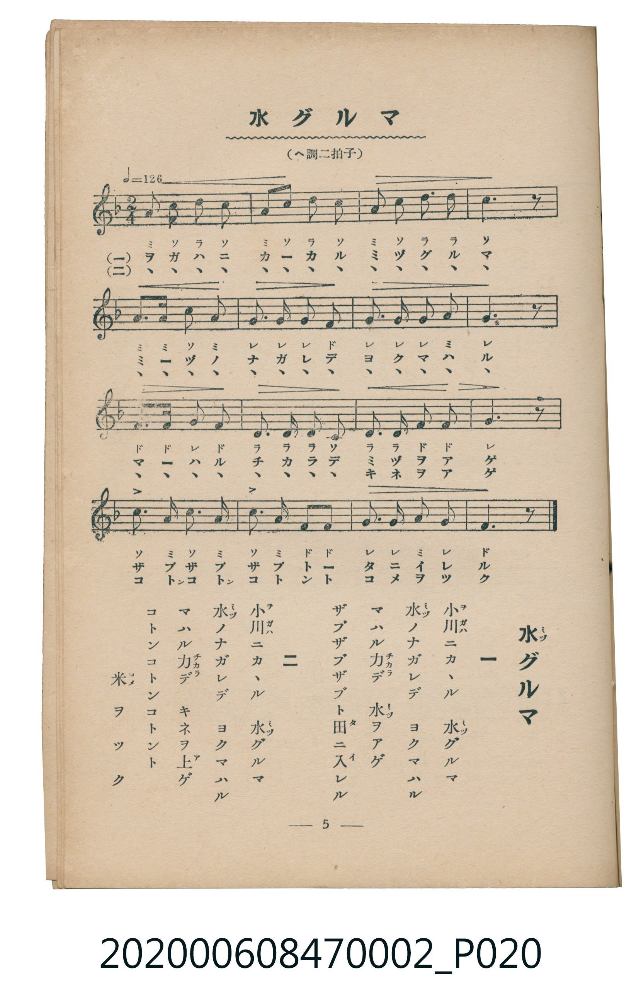

# 水グルマ

> Re:Shōka 使用 AI 協助辨識與重建樂譜，可能會有錯誤。歡迎回報。

- **鋼琴伴奏版**：<br><audio controls src="mizuguruma.mp3"></audio>
- **NEUTRINO 歌聲合成版**：<br><audio controls src="mizuguruma_neutrino.mp3"></audio>

- 臺灣教育會公認《新定兒童唱歌》尋常科第二學年用（2020.006.0847.0002）

## 說明

原書資訊與歌詞全文（對應 P020.jpg，書頁 p. 5，第一學期第 3 首）：
調性與拍號：ヘ調二拍子（F 大調 2/4 拍），♩＝126

## 跨冊／重複收錄參照

> 同名異曲（各冊收錄之不同詞曲版本）

- **[同名異曲]** 楊金土手抄《唱歌帖》第 7 冊・VII（2020.006.0843）：[**〈水グルマ（水車）〉**](../../../shokacho/vol_07/p231_mizuguruma/index.md)（`D` / `2/4` — [原始 TMD](../../../shokacho/vol_07/p231_mizuguruma/mizuguruma.tmd)）
- 總表：[跨冊重複與同名歌曲總索引](../../../duplicate_songs.md)

## 歌詞

```text
一
小川（ヲガハ）ニカヽル　水（ミヅ）グルマ
水（ミヅ）ノナガレデ　ヨクマハル
マハル力（チカラ）デ　水（ミヅ）ヲアゲ
ザブザブザブト田（タ）ニ入（イ）レル

二
小川（ヲガハ）ニカヽル　水（ミヅ）グルマ
水（ミヅ）ノナガレデ　ヨクマハル
マハル力（チカラ）デ　キネヲ上（ア）ゲ
コトンコトンコトント　米（コメ）ヲツク
```

## ABC

```abc
X:1
T:水グルマ
M:2/4
L:1/16
Q:1/4=126
K:F
V:V1 name="Piano" snm="Pia"
[V:V1]
A2 c2 d2 c2 | A2 c2 d2 c2 | A2 c2 d3 d | c6 z2 |
w: 1.~ヲ ガ ハ ニ | カ _ カ ル | ミ ヅ グ ル | マ
w: 2.~ヲ ガ ハ ニ | カ _ カ ル | ミ ヅ グ ル | マ
A3 A c2 A2 | G2 G2 G2 F2 | G3 G G2 A2 | G6 z2 |
w: 1.~ミ _ ヅ ノ | ナ ガ レ デ | ヨ ク マ ハ | ル
w: 2.~ミ _ ヅ ノ | ナ ガ レ デ | ヨ ク マ ハ | ル
F3 F G2 F2 | D3 D D2 C2 | D3 D F2 F2 | G6 z2 |
w: 1.~マ _ ハ ル | チ カ ラ デ | ミ ヅ ヲ ア | ゲ
w: 2.~マ _ ハ ル | チ カ ラ デ | キ ネ ヲ ア | ゲ
c3 A c3 A | c3 A F3 F | G3 G A2 G2 | F6 z2 |
w: 1.~ザ ブ ザ ブ | ザ ブ ト _ | タ ニ イ レ | ル
w: 2.~コ トン コ トン | コ ト ン ト | コ メ ヲ ツ | ク
```

## TMD 檔案連結

- [主旋律 TMD 檔案](mizuguruma.tmd) [[在 TMD Studio 編輯](https://tmdlang.github.io/Tmd-TS/#tmd=s7IKdvYPcrWy4qpTUCpJTLdSSM7PyUlNLsnMz7MqzsjMK0nNjM_KTMmPL87Iz05Ugisry88pzU21Si9KTEmNN4o3MjAyiDcwMIs3sDAxBzIMjBBKi_NLi5JTrYqTM_Lzc-JLUitKkvLzsxHyBUX5Zal5iXlANQVFIBtTwIoQClLLMlNSQdKpKZkl-UWZiTlI7kgtKga7FWxJfElRYl5xclFmAcgDCFUlGalAx5YnlqQWKXFpaSk827DlcdOGx82rHzfPU9DS4lK0VTA0MuOyt1Vw47Ix0jexA-l80b7reePiZ1Nnvmja9GxO89PWNS9W9T5u6Ho2bcPTdbOetk56vnrp0ykbn63tedzQ_XRD99MdO54vn_h8zZonu3qert3xdOeW51NWvN_TAQobPWDY6IHCBsgwMHq_p1OJi0tfS8GWWoBLQUHhad_8Z7N3vNjc_mJF14uOdqC7Xqyc97R1xbNp7UBXPN3Q-6y9UyEA5JisgvT3e3qAil8uaFQo0FMwBfJA7t7RAHT3sznzgWwFY4WXy6YBHfp-zyyQ4S9W7X_WsBxkbHfvi5nzgaKPm2cABYF-BYo8XTsBaIWbwtMly4FiCsAQVACKgnX3PJq58v2euaDgBZkDtAPs1g39T7fPBep53LzpcdOax839QMWPm7sfNwGjZC8oYhoagJEEVjD_cXMrSBYWYSD96HLNfY-bu8AGAVE7UPPj5hWPm9YDVQONBmoD6YFznnbNBmtuBNsGdB1QP0gPhqFApy163LQJrLlp2-PmaShkc8fzKRtAGpr2Qxz_tHUpmLsEzAU6ZDXEy7t6Bq2XHzetfdzcC3TRkx1dYLcvAlsL9fJmoB8fN2_GwgCSDQ3PN24G6wFyF0LDq7kF6ASQZsqTNBQoaOlzcflmVpWmlxaV5iZaBWQm5uU71BjUVIOsUbAxNNOyA7OwZScFSKp-sbBHQcMEFAPP1zfowPOAJhYNQNughr2c1fd0Qq8VMAzngwNjLzg8V8LZNaTJgEmgDFgMGSBs1AA6VRNk4Saw5jVgbf1gshuqeTWYtwcsD2GDSLiFza1gmQ0oMvPwWLirh34W1gDLFF0FUyA2g9KEREBkDZgHgwYgNWDTfAxBVm0C8kEOB5JAh4PIbrApIMdCdEBYIMeBxYHOBvFawTIbICqAchBnI-yJR9hjRHt78KffXT3USL8oKRLEBjkFEuPIZCdOGWQ9uJITNP1CLAQnGkgCae6Dau4COwLZ2HaozAqwzHqwGCgBQRIiSAaUrHBZCE2_dLEQkjZ1gSQoRYLYNQpGQBKGDeEiID6IRqjBlX5BqQSSNsApBehsSOrpQkpvELIdKrMCmtrWQ1MSJD1CnI07_dLWHgLlbyeF6ReUJmEkaipFlKzo5S-yDEI_kekXkhwgyQlSHMKKtkawJZCCEGI4LDkhFYfQ4nQRRKYJxMNlITT9kmFh01owr5d4C2vAKRSUThGp1QwUgcBiNh7CMgXHJ5IoSBVyusaeimElGqxshJWBjdA0tBrseOTUBUmPoPCCla2LIDJAx-NOxSTbAwwkiPpeIuzBm4qfzp5NWSpGKnnRSmFkGSxpFbn8hbBBMiAVuBIVJBU3bQNrmAa2EMEGWYgk09wBJkFJDySzH8wDVf7AZiyKhYRL4abNEAOB7UNUDshgKBdMItgImYVgEpyOm1ugMqCyGYuVsBYBpBwG0QgRWApHlMOgMhjEhqV-rCkYGCKQdDINhY0mA3QyRDckpCDi3eCQgpWfBMphoGchuuCBhMRFkQcHE4yNLLMQlpKBwQRxyXoM-2q5uHTtFBCNZgUgT5kLAA)]
- [鋼琴伴奏 TMD 檔案](mizuguruma_piano.tmd) [[在 TMD Studio 編輯](https://tmdlang.github.io/Tmd-TS/#tmd=s7IKdvYPcrWy4tLSUni2Ycvjpg2Pm1c_bp73fk_Hy-49zydsebJny9Ol_c87O97v6VTQ0uJStFUwNDLjsrdVcOOyMdI3seOqU1B60b7reePiZ1Nnvmja9GxO89PWNS9W9T5u6Ho2bcPTdbOetk56vnrp0ykbn63tedzQ_XRD99MdO54vn_h8zZonu3qert3xdOeW51NWAK00MjAy0DMwMNMzsDAxBzIMjIC2KnFx-WZWlaaXFpXmJloFZCbm5TvUGNRUcykAgY2hmZYdmKWvpWCLDhRAVuxoeLGwR0HDROHphv7n6xt0FAJAtmQVpGti0aClDzPs5ay-pxN6rRQeN88HCjxu2gsim1fC2TWkyYBJoAxYDBkgbNQAOlUTZOEmsOY1YG39YLIbqnk1mLcHLA9hg0i4hc2tYJkNKDLz8Fi4q4d-FtYoGCvoKpgCsRmUJiQCImvAPBg0AKkBm-ZjCLJqE5APcjiQBDocRHaDTQE5FqIDwgI5DiwOdDaI1wqW2QBRAZSDOBthTzzCHiPa24M__e7qoUb6RUmRIDbIKZAYRyY7ccog68GVnKDpF2IhONFAEkhzH1RzF9gRyMa2Q2VWgGXWg8VACQiSEEEyoGSFy0Jo-qWLhZC0qQskQSkSxK5RMAKSMGwIFwHxQTRCDa70C0olkLQBTilAZ0NSTxdSeoOQ7VCZFdDUth6akiDpEeJs3OmXtvYQKH87KUy_oDQJI1FTKaJkRS9_kWUQ-olMv5DkAElOkOIQVrQ1gi2BFIQQw2HJCak4hBaniyAyTSAeLguh6ZcMC5vWgnm9xFtYA06hoHSKSK1moAgEFrPxEJYpOD6RREGqkNM19lQMK9FgZSOsDGyEpqHVYMcjpy5IegSFF6xsXQSRAToedyom2R5gIEHU9xJhD95U_HT2bMpSMVLJi1YKI8tgSavI5S-EDZIBqcCVqCCpuGkbWMM0sIUINshCJJnmDjAJSnogmf1gHqjyf9y0BMVCwqVw02aIgY-bN6NyQAZDuWASwUbILAST4HTc3AKVAZXNWKyEtQgg5TCIRojAUjiiHAaVwSA2LPVjTcHAEIGkk2kobDQZoJMhuiEhBRHvBocUrPwkUA4DPQvRBQ8kJC6KPDiYYGxkmYWwlAwMJohL1mPYV4vZYvbxQGozmyCazMA2_4vdXS_2TH26f_WLvZ1Pu6c-3b7sWWc3pNmPVHTEK0QbxuJiGEA9iSRqGg9kmcZjYWJRbAJkmKAwcCjEZjzUfqCnde0UEP6O9gEqRBMxAosocwEA)]

## 分析

```text
================================================================================
📊 TMD Song Profile: [ 水グルマ ]
================================================================================
⏱  Duration:       0:15 (15.2s), 16 measures total
🎼 Key & Tempo:    首調基準 F, != 126.0 BPM, <2/4>
   - 分析範圍：      由實際發聲的音符與和弦推測調性；播放脈絡另行呈現
🎤 人聲音域:    C4 (MIDI 60) – D5 (MIDI 74) [跨度: 14 個半音 / 1.2 個八度, 難度: moderate]
   - 最低音:  C4 in [Mizuguruma #1 @ m.10, 0:09]
   - 最高音: D5 in [Mizuguruma #1 @ m.1, 0:00]
   - 適合: soprano, mezzo-soprano, contralto, tenor, baritone, bass
🏛  結構:      Mizuguruma (15.2s)
⚡ 編曲密度:        Peak 1 軌道同時演奏
🗝  調性診斷：       C 大調（純淨自然大調，未偵測到可信轉調）
   - 風格氣質:    純淨自然大調（陽光明朗、易唱易記，無明顯調外色彩）
   - 轉調歷程:    全曲維持單一推測調性（未偵測到可信轉調）
   - 核心骨幹音:  G, C, F, A, D
   - 調性數值:    C 大調 [相關度: 0.82, 穩定度: Moderate, 自然音純度: 100.0%]
   - 候選調性 (K-S): C 大調 (0.82), F 大調 (0.71), G 大調 (0.61)
   - 五度圈歷程:   +0
   - 各段落調性細節:
     • [Mizuguruma #1]: C 大調 (r: 0.82, 自然音純度: 100.0%)

  [ 五度圈游移軌跡 ]
              [C ]*
         F            G  
      Bb               D  
      Eb               A  
         Ab           E  
            Db       B  
               F# 
     (* = active key center)

  [ 十二半音累積音高分佈 ]
     C  : ██████████████████████    24.2%
     C# :                            0.0%
     D  : ██████████████            15.0%
     D# :                            0.0%
     E  :                            0.0%
     F  : █████████████████         18.3%
     F# :                            0.0%
     G  : ████████████████████████  26.7%
     G# :                            0.0%
     A  : ██████████████            15.8%
     A# :                            0.0%
     B  :                            0.0%
--------------------------------------------------------------------------------
Assignment 軌道音域：
  - Piano         : C4 – D5 (14 個半音 / 1.2 個八度, 52 個音符)
================================================================================
```


## 原書掃描頁




