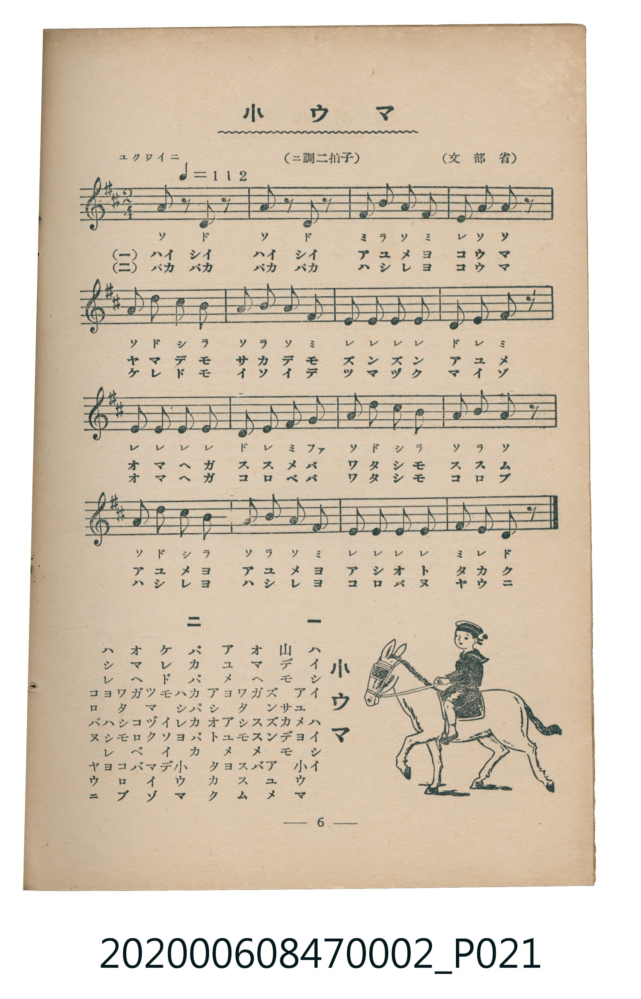

# 小ウマ

> Re:Shōka 使用 AI 協助辨識與重建樂譜，可能會有錯誤。歡迎回報。

- **NEUTRINO 歌聲合成版**：<br><audio controls src="kouma_neutrino.mp3"></audio>
- **鋼琴伴奏版**：<br><audio controls src="kouma.mp3"></audio>


- 文部省
- 臺灣教育會公認《新定兒童唱歌》尋常科第二學年用（2020.006.0847.0002）

## 說明

原書資訊與歌詞全文（對應 P021.jpg，書頁 p. 6，第一學期第 4 首）：
調性與拍號：ニ調二拍子（D 大調 2/4 拍），「ユクワイニ（♩＝112）」


## 跨冊／重複收錄參照

> 同曲（《新定兒童唱歌》、《新編 小學校・公學校 唱歌教材集》共同收錄教材）

- **[同曲]** 《新編小公學校唱歌教材集》第一、二學年（大正12年／1923，國臺圖 0725-41）：[**〈小馬〉**](../../../shoka_kyozai_shu_1923/grade_1_2/50_kouma/index.md)（`D` / `2/4` — [原始 TMD](../../../shoka_kyozai_shu_1923/grade_1_2/50_kouma/kouma.tmd)）
- 總表：[跨冊重複與同名歌曲總索引](../../../duplicate_songs.md)

## 歌詞

```text
一
ハイシイ　ハイシイ　アユメヨ　小ウマ
山デモ　サカデモ　ズンズンアユメ
オマヘガ　ススメバ　ワタシモススム
アユメヨ　アユメヨ　アシオトタカク

二
パカパカ　パカパカ　ハシレヨ　小ウマ
ケレドモ　イシコロ　ツマヅクマイゾ
オマヘガ　コロベバ　ワタシモコロブ
ハシレヨ　ハシレヨ　コロバヌヤウニ
```

## ABC

```abc
X:1
T:小ウマ
M:2/4
L:1/16
Q:1/4=112
K:D
V:V1 name="Piano" snm="Pia"
[V:V1]
A2 z2 D2 z2 | A2 z2 D2 z2 | F2 B2 A2 F2 | E2 A2 A2 z2 |
w: 1.~ハイ シイ | ハイ シイ | ア ユ メ ヨ | コ ウ マ
w: 2.~パカ パカ | パカ パカ | ハ シ レ ヨ | コ ウ マ
A2 d2 c2 B2 | A2 B2 A2 F2 | E2 E2 E2 E2 | D2 E2 F2 z2 |
w: 1.~ヤ マ デ モ | サ カ デ モ | ズ ン ズ ン | ア ユ メ
w: 2.~ケ レ ド モ | イ シ コ ロ | ツ マ ヅ ク | マ イ ゾ
E2 E2 E2 E2 | D2 E2 F2 G2 | A2 d2 c2 B2 | A2 B2 A2 z2 |
w: 1.~オ マ ヘ ガ | ス ス メ バ | ワ タ シ モ | ス ス ム
w: 2.~オ マ ヘ ガ | コ ロ ベ バ | ワ タ シ モ | コ ロ ブ
A2 d2 c2 B2 | A2 B2 A2 F2 | E2 E2 E2 E2 | F2 E2 D2 z2 |
w: 1.~ア ユ メ ヨ | ア ユ メ ヨ | ア シ オ ト | タ カ ク
w: 2.~ハ シ レ ヨ | ハ シ レ ヨ | コ ロ バ ヌ | ヤ ウ ニ
```

## TMD 檔案連結

- [主旋律 TMD 檔案](kouma.tmd) [[在 TMD Studio 編輯](https://tmdlang.github.io/Tmd-TS/#tmd=s7IKdvYPcrWy4qpTUCpJTLdSSM7PyUlNLsnMz7MqzsjMK0nNjM_KTMmPL87Iz05Ugisry88pzU21Si9KTEmNN4o3MjAyiDcwMIs3sDAxBzIMjBBKi_NLi5JTrYqTM_Lzc-JLUitKkvLzsxHyBUX5Zal5iXlANQVFIBtTwIoQClLLMlNSQdKpKZkl-UWZiTlI7kgtKga7FWxJfElRYl5xclFmAcgDCFUlGalAxybmZeaC9GppKTzd0P-4adnj5nkKWlpcirYKhoZGXPa2Ci5cNkb6JnYgfc-mtb9sXvF8TiPYlBftu543Ln42deaLpk3P5jQ_bV3zYlXv44auZ9M2PF0362nrpOerlz6dsvHZ2p7HDd1PN3Q_3bHj-fKJz9esebKr5-naHU93bnk-ZcX7PR2gcNIDhpMeKJyADAOj93s6lbi49LUUbKkFuBQUFJ72zX82e8eLze0vVnS96GgHuuvFynlPW1cAfQV0xdMNvc_aOxUCDIwM9bIK0t_v6QEqfrmgUaFAT8EMyAO5e0cD0N3P5swHshVMFF4umwZ06Ps9s0CGv1i1_1nDcpCx3b0vZs4Hij5u7gYKAv0KFHm6dgLQCheFp0uWA8UUgOGpABQF6wYGTs_j5mWPm9Y_bl7_uGkJUBtQ6aOZK9_vmQuMAaCaxw29XCArgNaDqMfNwGha8rhpO4hsaEDnNi0Cmda88HHzCiAXHqfgANi48XFz--PmRWB1Wx83rUbi7nrcvBlGQo0A29a0Cqj7cfOMx01rwOp2ghDI-Algy4FO3g-yHGgKVGoBRBuKM7BwQQ4GGt0B1r8a6H2IH3f1QPw4Eew6MAmyBo0L9BTQyjVY_Pi4CehHoEQnzF-QoNn8uHktWGcL2Det4OCeB5bdh9WbYA3NM7F5EyI1DR4XCJegc6FKJzxuBkYx0CqgI7tB2ihPz1CgoKXPxeWdX5qbaBWQmZiX71BjUFMNskHBxtBMyw7MwpaNFCCp-cXCHgUNE1DGf76-QQee9jWxaABaBDXs5ay-pxN6rYBBthckAg6FTiirBpdo83ywyEpwUINUQERAMmsQYnC9CNs0gM7UBFoGTuUQc8FJHW4wDvGmRWBLloHJhWByBVRmM1gxRGYeFgt39YAtBCU2qEfgTJCFuMT7IW4AS4D9RIyFNQqmCroKBkBsCKWxiRgDSTMgBsmA2DUKRlAeTG0N2DQfQ3iI6CrEAzE0TCAcAnLAEAMKAkMMRC4EkyugMpvByiEy82A6IDYawYMEaioyh5BcP8QZYKk1RNiIPz3v6qFCeoakWlg8gtIrLE3jSb0YJEgGbA5UDKQaPZlB0zUoxUKSBbAwBpOglAuydCvYOlACQ5fZBeZBkhWCjS3Vo1sKSdtNG5HcBnEnzGiwcyC-h6Tb5rVQ_7QgObQVLL8eKgMWg-rch2opJDUbxgEJc2gihghhJmdkXANO_CAWSB49gYMSLSRZgAIGRIKSLiTIQMkGlMTQZXaBeZBkhWBjS_ZoiRsYVojk2YliJtgdkOQLSbDAsIIk7BYkF7aC5ddDZcBiUJ37iEzYOzopS9gkJNLHzVMfNy1ESvPE5Ab0RAZJ2U2rkBLMDLBiqK1NO8E8MAktmydA3QNKUsCqFslSWMJE1rMAi6XQlI3bUkRqBtbrRFqKrGcaqqWEEq0JPKnjSf1oKRvoekS6mQFOI6B0B_E-iAcmoYXzBGiKAqUskOsRRSksfSLrWYAlZeO2DZGaQWFFnG3IeqYRl7Kfzp49qIpsSA5AFIvoaQyasHE3LQjIQMtVSBrtgMpA0h24mAeXqOiWQpsjOJsXhBoe0OQLSuzAdihUD6Swhji0G9VSsotskDiIBW-3ICVs3G0LAjLQ4hWSVDugMpDkBy7mwQUrensEZ7uCUIsDmnxBiR0UVhA9kMIa4sJuuG21XFy6dgrgtrcCkKHMBQA)]
- [鋼琴伴奏 TMD 檔案](kouma_piano.tmd) [[在 TMD Studio 編輯](https://tmdlang.github.io/Tmd-TS/#tmd=s7IKdvYPcrWy4tLSUni6of9x07LHzfPe7-l42b3n-YQtT_Zsebq0_3lnx_s9nQpaWlyKtgqGhkZc9rYKLlw2Rvomdlx1CkrPprW_bF7xfE6jEoj3on3X88bFz6bOfNG06dmc5qeta16s6n3c0PVs2oan62Y9bZ30fPXSp1M2Plvb87ih--mG7qc7djxfPvH5mjVPdvU8Xbvj6c4tz6esADrAyMDIQM_AwEzPwMLEHMgwMAK6QYmLyzu_NDfRKiAzMS8_yMOhxqCmmksBCGwMzbTswCx9LQVbdKAAMn9Hw4uFPQoaJiB_Pl_foKMQYGBkqJdVkK6JRYOWPtiwGgVTBV0FAyA2hNLYRIyBpBkQg2RA7BoFIygPprYGbJqPYY3C42ZgIC8BCsUD8eOm7QgOAbmmRSDB5mVgciGYXAGV2QxWDpGZB9MBsdEIZOrEx02rYaYicwjJ9UOcAZZaQ4SN-MN_Vw-54W8YByTMoYEMEcIMbmRcA44cEAskjx4BoECFOPtxczuYBAUtyFtbwd4CBQG6zC4wD-JtBBtbtKAFftNGpODrRDET7A5I8EICtHktNOBbkFzYCpZfD5UBi0F17iMy4Hd0khPw-MPUBB4TeCIHLeCbViF5awbYC6BgAcnsBPPAJDRtT4B6GOTxx037EUEFDz5kPQuwBDxu2xCB_bh5JpG2IeuZRlzAP509m44pHiQOYsGLJaSAx110EJCBpk5IUHZAZSDBA84l4HSJXtzgLDYIFSjQ4AVFxuPmHqgeSFqHuLAbblstSk3gg1wTmCAqghd7pj7dv_rlsjUvdrYAIwBYlz3dvuxZZzekXkMEuWG8QrRhLFaGaXw8MDgh3sMlH20aDxVDqEQVxzSdNDOB3tW1UwD7ONoHqAbBMQJzlLkA)]

## 分析

```text
================================================================================
📊 TMD Song Profile: [ 小ウマ ]
================================================================================
⏱  Duration:       0:17 (17.1s), 16 measures total
🎼 Key & Tempo:    首調基準 D, != 112.0 BPM, <2/4>
   - 分析範圍：      由實際發聲的音符與和弦推測調性；播放脈絡另行呈現
🎤 人聲音域:    D4 (MIDI 62) – D5 (MIDI 74) [跨度: 12 個半音 / 1.0 個八度, 難度: easy]
   - 最低音:  D4 in [Kouma #1 @ m.1, 0:00]
   - 最高音: D5 in [Kouma #1 @ m.5, 0:04]
   - 適合: soprano, mezzo-soprano, contralto, tenor, baritone, bass
🏛  結構:      Kouma (17.1s)
⚡ 編曲密度:        Peak 1 軌道同時演奏
🗝  調性診斷：       A 大調（純淨自然大調，未偵測到可信轉調）
   - 風格氣質:    純淨自然大調（陽光明朗、易唱易記，無明顯調外色彩）
   - 轉調歷程:    全曲維持單一推測調性（未偵測到可信轉調）
   - 核心骨幹音:  E, A, D, F#, B
   - 調性數值:    A 大調 [相關度: 0.90, 穩定度: High, 自然音純度: 98.2%]
   - 候選調性 (K-S): A 大調 (0.90), E 大調 (0.67), D 大調 (0.64)
   - 五度圈歷程:   +3
   - 各段落調性細節:
     • [Kouma #1]: A 大調 (r: 0.90, 自然音純度: 98.2%, 調外音: G)

  [ 五度圈游移軌跡 ]
               C  
         F            G  
      Bb               D  
      Eb              [A ]*
         Ab           E  
            Db       B  
               F# 
     (* = active key center)

  [ 十二半音累積音高分佈 ]
     C  :                            0.0%
     C# : █████                      5.4%
     D  : ████████████              14.3%
     D# :                            0.0%
     E  : ████████████████████████  28.6%
     F  :                            0.0%
     F# : ███████████               12.5%
     G  : ██                         1.8%
     G# :                            0.0%
     A  : █████████████████████     25.0%
     A# :                            0.0%
     B  : ███████████               12.5%
--------------------------------------------------------------------------------
Assignment 軌道音域：
  - Piano         : D4 – D5 (12 個半音 / 1.0 個八度, 56 個音符)
================================================================================
```


## 原書掃描頁




