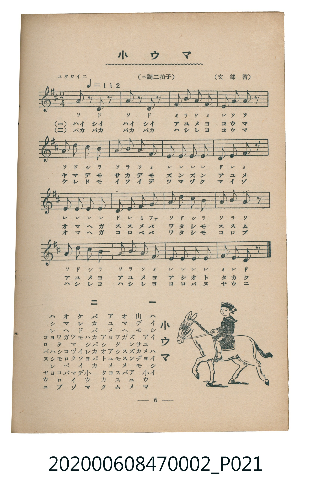

# 小ウマ

> Re:Shōka 使用 AI 協助辨識與重建樂譜，可能會有錯誤。歡迎[回報](https://github.com/TMDLang/reshoka/issues)。

- **鋼琴伴奏版**：<br><audio controls src="kouma.mp3"></audio>
- **NEUTRINO 歌聲合成版**：<br><audio controls src="kouma_neutrino.mp3"></audio>

- 文部省
- 臺灣教育會公認《新定兒童唱歌》尋常科第二學年用（2020.006.0847.0002）

## 說明

原書資訊與歌詞全文（對應 P021.jpg，書頁 p. 6，第一學期第 4 首）：
調性與拍號：ニ調二拍子（D 大調 2/4 拍），「ユクワイニ（♩＝112）」


## 歌詞

```text
一
ハイシイ　ハイシイ　アユメヨ　小ウマ
山デモ　サカデモ　ズンズンアユメ
オマヘガ　ススメバ　ワタシモススム
アユメヨ　アユメヨ　アシオトタカク

二
パカパカ　パカパカ　ハシレヨ　小ウマ
ケレドモ　イシコロ　ツマヅクマイゾ
オマヘガ　コロベバ　ワタシモコロブ
ハシレヨ　ハシレヨ　コロバヌヤウニ
```

## ABC

<div class="abc-score" data-abc-src="kouma.abc" aria-label="五線譜載入中"></div>

[下載 ABC 原始檔](kouma.abc)

## TMD 檔案連結

- [主旋律 TMD 檔案](kouma.tmd) [[在 TMD Studio 編輯](https://tmdlang.github.io/Tmd-TS/#tmd=s7IKdvYPcrWy4qpTUCpJTLdSSM7PyUlNLsnMz7MqzsjMK0nNjM_KTMmPL87Iz05Ugisry88pzU21Si9KTEmNN4o3MjAyiDcwMIs3sDAxBzIMjBBKi_NLi5JTrYqTM_Lzc-JLUitKkvLzsxHyBUX5Zal5iXlANQVFIBtTwIoQClLLMlNSQdKpKZkl-UWZiTlI7kgtKga7FWxJfElRYl5xclFmAcgDCFUlGalAxybmZeYi6wUalZ6ZZ5Wbn5dUCvQeskRJRj7QawUZlVYZmcUgO5MTc-KzE_OQQgBqY0FieqpVgIGRoRKXlpbC0w39j5uWPW6ep6ClxaVoq2BoaMRlb6vgwmVjpG9iB9L7bFr7y-YVz-c0gk160b7reePiZ1Nnvmja9GxO89PWNS9W9T5u6Ho2bcPTdbOetk56vnrp0ykbn63tedzQ_XRD99MdO54vn_h8zZonu3qert3xdOeW51NWvN_TAQp_PWD464HCH8gwMHq_p1OJi0tfS8GWWoBLQUHhad_8Z7N3vNjc_mJF14uOdqC7Xqyc97R1BdBXQFc83dD7rL1TARQaelkF6e_39AAVv1zQqFCgp2AG5IHcvaMB6O5nc-YD2QomCi-XTQM69P2eWSDDX6za_6xhOcjY7t4XM-cDRR83dwMFgX4FijxdOwFohYvC0yXLgWIKwPBUAIqCdQMDp-dx87LHTesfN69_3LQEqA2o9NHMle_3zAXGAFDN44ZeLpAVQOtB1ONmYDQtedy0HUQ2NKBzmxaBTGte-Lh5BZALj1NwAGzc-Li5_XHzIrC6rY-bViNxdz1u3gwjoUaAbWtaBdT9uHnG46Y1YHU7QQhk_ASw5UAn7wdZDjQFKrUAog3FGVi4IAcDje4A618N9D7Ej7t6IH6cCHYdmARZg8YFegpo5RosfnzcBPQjUKIT5i9I0Gx-3LwWrLMF7JtWcHDPA8vuw-pNsIbmmdi8CZGaBo8LhEvQuVClEx43A6MYaBXQkd0gbZSnZyhQ0NLn4vLOL81NtArITMzLd6gxqKkG2aBgY6FlB2Zgy0UKkMT8YmGPgoYJKN8_X9-gA0_6mlg0AO2BGvZyVt_TCb1WwBDbCxIBB0InlFWDS7R5PlhkJTikQSogIiCZNQgxuF6EbRpAZ2oCLQMncoi54JQONxiHeNMisCXLwORCMLkCKrMZrBgiMw-Lhbt6wBaC0hrUI3AmyEJc4v0QN4AlwH4ixsIaBVMFAwVDIEZmGSuYAXnGQJYRkAaJ14BV-xjCfRwP8288IhRQxYAhAPI_yPcgp0AcAnIGyBFAFRATjeBeAuqGMXCJ9YM9CPIedhPxp7ddPVRIb5BUBQtnUHqCpTk8qQuDBMmAzYGKgVSjJwNougOlKEi0ActKMAlKWSBLt4KtAyUAdJldYB4k2hFsbKkS3VJI2mvaiOQ2iDthRoOdA_E9JF01r4X6pwXJoa1g-fVQGbAYVOc-VEtBqc4wTsEcmOBATESyg8AaYII0AoqgJsAlYDNBnga5CxIUoIBAFtkF9jSMRk2OKIkP6FdIguqE6wWaD0pmoMQF9B3EbxAbW8G-gvgJom4fEQlvRydlCY-ERPS4eerjpoVIaZKY1IqeCCApr2kVUoTOACuG2tq0E8wDk9CybQLUPaAoB9ZUSJbCEg6yngVYLIWmPNyWIlIbsFok0lJkPdNQLcVMZCbYUiNKygO6DpIOZoDdBfEWGIMLuQlQ14DcAimoIOkJpmYBWsrDNA2S4kD-w20aTM00winv6ezZg6rIg6RQRLGCngagCQ931UlABlouQdJQB1QGki7AxSS4REK3FFrd4qw-CVWs0OQFSozAZhZUD6Swgzi0G9VSgkWeMZAE18NICQ-zLsUqAi62QMmqA-p1cLEI9DZqfYtRj2KvWcHJbALYV9BiF1zXdoNNq-Xi0rVTADf9FIAMZS4A)]
- [鋼琴伴奏 TMD 檔案](kouma_piano.tmd) [[在 TMD Studio 編輯](https://tmdlang.github.io/Tmd-TS/#tmd=s7IKdvYPcrWy4qpTUCpJTLdSyC8qychPL0osyKi0ysgsLskvykxOzInPTsxLVIIrKs4vLUpOjS9ITE-1CjAwMlTi0tJSeLqh_3HTssfN897v6XjZvef5hC1P9mx5urT_eWfH-z2dClpaXIq2CoaGRlz2tgouXDZG-iZ2IAOfTWt_2bzi-ZxGsPEv2nc9b1z8bOrMF02bns1pftq65sWq3scNXc-mbXi6btbT1knPVy99OmXjs7U9jxu6n27ofrpjx_PlE5-vWfNkV8_TtTue7tzyfMoKoAOMDIwM9AwMzPQMLEzMgQwDI6AblLi4vPNLcxOtAjIT8_KDPBxqDGqquRSAwMZCyw7M0NdSsEUHCiDjdzS8WNijoGEC8ubz9Q06CiB_62UVpGti0aClDzasRsFUwUDBEIiRWcYKZkCeMZBlBKRB4jVg1T6GNQqPm4FhuEQhXuFx03YIA4dY0yKg-DIgXgjEK8Aim4EYJDIPpAJiohFI98THTatBumEMXGL9IAuA9BocJuIPn1095IWPYZyCOTBAQExEsEBgDTDAjIAiqAG0BOygx83tQLwI7MytQLwaRWQXkAVyPIRGDS6UwGnaCPVwJ1wv0HxQMIA837wWHDAtEBtBpjWtB4uAeCB1-4gImB2d5AQMehiYYAsslIBpWgUNmBlA9hqwV3ZCMDiNTAA7fD1QZD80niHehalZgBYwmKZBAuRx80w8psHUTCMcME9nz6ZBijEGkuBshhQwmFkFqwg41kHe7gCLgDwGTFXAGEfNThjZBHvGAQfDBCDuAasBpRaQjd1g02pRCiIf5ILIBFEQvdgz9en-1S-XrXmxswUYQMCi9On2Zc86uyHFKiJIDOMVog1jsTJM4-PhgYFLPto0HiqGUIkqjmk6aWYCvatrpwD2cbQPUA2CYwTmKHMBAA)]

## 分析

```text
================================================================================
📊 TMD Song Profile: [ 小ウマ ]
================================================================================
⏱  Duration:       0:17 (17.1s), 16 measures total
🎼 Key & Tempo:    首調基準 D, != 112.0 BPM, <2/4>
   - 分析範圍：      由實際發聲的音符與和弦推測調性；播放脈絡另行呈現
🎤 人聲音域:    D4 (MIDI 62) – D5 (MIDI 74) [跨度: 12 個半音 / 1.0 個八度, 難度: easy]
   - 最低音:  D4 in [Kouma #1 @ m.1, 0:00]
   - 最高音: D5 in [Kouma #1 @ m.5, 0:04]
   - 適合: soprano, mezzo-soprano, contralto, tenor, baritone, bass
🏛  結構:      Kouma (17.1s)
⚡ 編曲密度:        Peak 1 軌道同時演奏
🗝  調性診斷：       A 大調（純淨自然大調，未偵測到可信轉調）
   - 風格氣質:    純淨自然大調（陽光明朗、易唱易記，無明顯調外色彩）
   - 轉調歷程:    全曲維持單一推測調性（未偵測到可信轉調）
   - 核心骨幹音:  E, A, D, F#, B
   - 調性數值:    A 大調 [相關度: 0.90, 穩定度: High, 自然音純度: 98.2%]
   - 候選調性 (K-S): A 大調 (0.90), E 大調 (0.67), D 大調 (0.64)
   - 五度圈歷程:   +3
   - 各段落調性細節:
     • [Kouma #1]: A 大調 (r: 0.90, 自然音純度: 98.2%, 調外音: G)

  [ 五度圈游移軌跡 ]
               C  
         F            G  
      Bb               D  
      Eb              [A ]*
         Ab           E  
            Db       B  
               F# 
     (* = active key center)

  [ 十二半音累積音高分佈 ]
     C  :                            0.0%
     C# : █████                      5.4%
     D  : ████████████              14.3%
     D# :                            0.0%
     E  : ████████████████████████  28.6%
     F  :                            0.0%
     F# : ███████████               12.5%
     G  : ██                         1.8%
     G# :                            0.0%
     A  : █████████████████████     25.0%
     A# :                            0.0%
     B  : ███████████               12.5%
--------------------------------------------------------------------------------
Assignment 軌道音域：
  - Piano         : D4 – D5 (12 個半音 / 1.0 個八度, 56 個音符)
================================================================================
```


## 原書掃描頁




