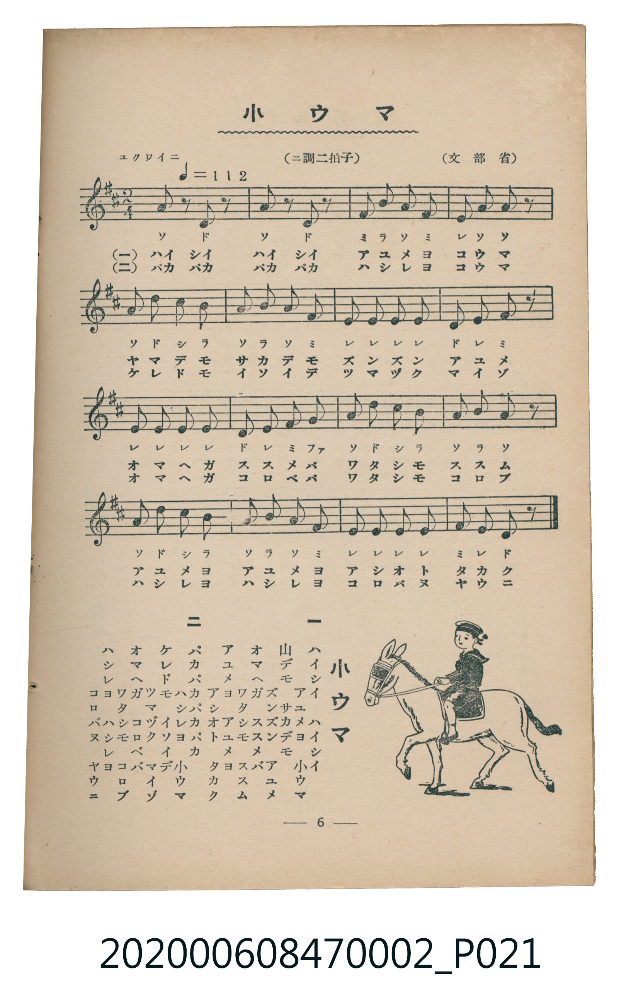

# 小ウマ

<audio controls src="kouma.mp3"></audio>

- 文部省
- 臺灣教育會公認《新定兒童唱歌》尋常科第二學年用（2020.006.0847.0002）

## 說明

原書資訊與歌詞全文（對應 P021.jpg，書頁 p. 6，第一學期第 4 首）：
調性與拍號：ニ調二拍子（D 大調 2/4 拍），「ユクワイニ（♩＝112）」

## 歌詞

```text
一
ハイシイ　ハイシイ　アユメヨ　小ウマ
山デモ　サカデモ　ズンズンアユメ
オマヘガ　ススメバ　ワタシモススム
アユメヨ　アユメヨ　アシオトタカク

二
パカパカ　パカパカ　ハシレヨ　小ウマ
ケレドモ　イシコロ　ツマヅクマイゾ
オマヘガ　コロベバ　ワタシモコロブ
ハシレヨ　ハシレヨ　コロバヌヤウニ
```

## 原書掃描頁



## 分析

```text
================================================================================
📊 TMD Song Profile: [ 小ウマ ]
================================================================================
⏱  Duration:       0:17 (17.1s), 16 measures total
🎼 Key & Tempo:    首調基準 D, != 112.0 BPM, <2/4>
   - 分析範圍：      由實際發聲的音符與和弦推測調性；播放脈絡另行呈現
🎤 人聲音域:    D4 (MIDI 62) – D5 (MIDI 74) [跨度: 12 個半音 / 1.0 個八度, 難度: easy]
   - 最低音:  D4 in [Kouma #1 @ m.1, 0:00]
   - 最高音: D5 in [Kouma #1 @ m.5, 0:04]
   - 適合: soprano, mezzo-soprano, contralto, tenor, baritone, bass
🏛  結構:      Kouma (17.1s)
⚡ 編曲密度:        Peak 1 軌道同時演奏
🗝  調性診斷：       A 大調（純淨自然大調，未偵測到可信轉調）
   - 風格氣質:    純淨自然大調（陽光明朗、易唱易記，無明顯調外色彩）
   - 轉調歷程:    全曲維持單一推測調性（未偵測到可信轉調）
   - 核心骨幹音:  E, A, D, F#, B
   - 調性數值:    A 大調 [相關度: 0.90, 穩定度: High, 自然音純度: 98.2%]
   - 候選調性 (K-S): A 大調 (0.90), E 大調 (0.67), D 大調 (0.64)
   - 五度圈歷程:   +3
   - 各段落調性細節:
     • [Kouma #1]: A 大調 (r: 0.90, 自然音純度: 98.2%, 調外音: G)

  [ 五度圈游移軌跡 ]
               C  
         F            G  
      Bb               D  
      Eb              [A ]*
         Ab           E  
            Db       B  
               F# 
     (* = active key center)

  [ 十二半音累積音高分佈 ]
     C  :                            0.0%
     C# : █████                      5.4%
     D  : ████████████              14.3%
     D# :                            0.0%
     E  : ████████████████████████  28.6%
     F  :                            0.0%
     F# : ███████████               12.5%
     G  : ██                         1.8%
     G# :                            0.0%
     A  : █████████████████████     25.0%
     A# :                            0.0%
     B  : ███████████               12.5%
--------------------------------------------------------------------------------
Assignment 軌道音域：
  - Piano         : D4 – D5 (12 個半音 / 1.0 個八度, 56 個音符)
================================================================================
```

## ABC

```abc
X:1
T:小ウマ
C:TMD (Chen, Chih-Han / aguai)
M:2/4
L:1/16
Q:1/4=112
K:D

V:V1 name="Piano" snm="Pia"

[V:V1]
a2 z2 d2 z2 | a2 z2 d2 z2 | f2 b2 a2 f2 | e2 a2 a2 z2 |
a2 d2 c2 b2 | a2 b2 a2 f2 | e2 e2 e2 e2 | d2 e2 f2 z2 |
e2 e2 e2 e2 | d2 e2 f2 g2 | a2 d2 c2 b2 | a2 b2 a2 z2 |
a2 d2 c2 b2 | a2 b2 a2 f2 | e2 e2 e2 e2 | f2 e2 d2 z2 |
```

- [主旋律 TMD 檔案](kouma.tmd)
- [鋼琴伴奏 TMD 檔案](kouma_piano.tmd)
